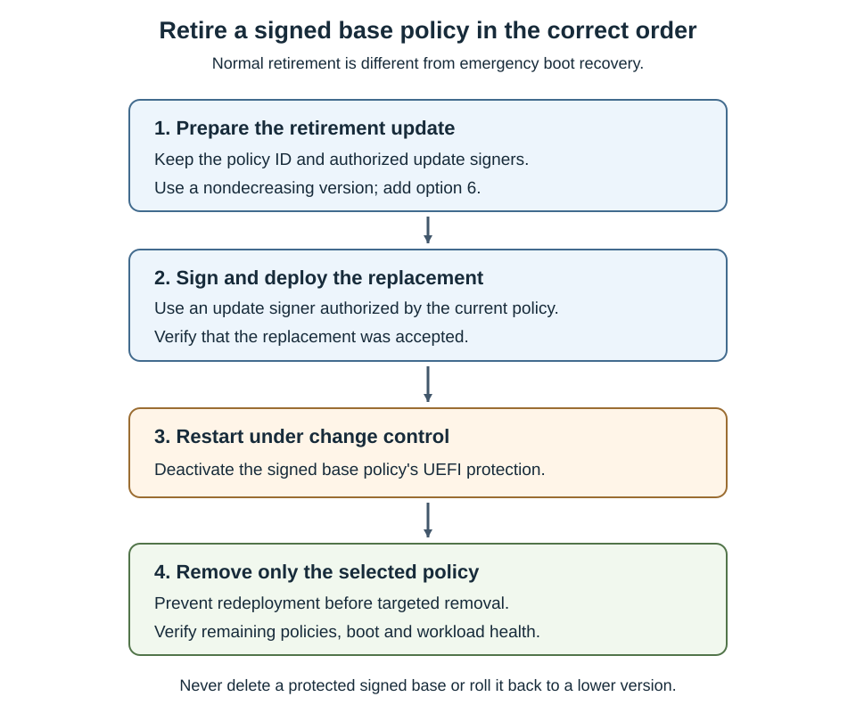

Troubleshooting should identify the responsible decision before changing trust. Adding a broad allowance can hide the symptom while leaving a broken management process or unrelated restriction unresolved.

## Follow a diagnostic sequence

Use the following sequence for a new workload failure:

1. Identify the failing operation, its execution host, and when it last worked.
1. Inventory all active policies and their management owners.
1. Confirm the intended policy IDs, versions, options, and supplemental relationships.
1. Correlate the relevant CI or script events with the actual failure.
1. Verify the affected file, dependencies, signer identity, and rule match.
1. Apply the smallest approved correction and repeat the failed workload test.
1. Stop rollout until the result and recovery path are understood.

An event near the failure isn't automatically its cause. A native-image fallback can be benign, while a COM mismatch might fail without a useful CI event.

This table maps common symptoms to more specific investigations.

| Symptom | Likely investigation | Avoid |
| --- | --- | --- |
| Agent executable starts but one operation fails | Newly loaded DLL, child process, script, or update helper | Allowing the entire installation directory immediately. |
| Supplemental rule appears correct but the file is blocked | Wrong base ID, unauthorized signer, explicit deny, or another enforced base | Adding duplicate allow rules. |
| Policy file exists but behavior hasn't changed | Activation failure, restart requirement, or wrong release artifact | Reporting success from file copy alone. |
| Removed policy returns | OSConfig, GPO, or another deployment owner still declares it | Repeated deletion or competing management loops. |
| PowerShell script starts but methods fail | CLM, module exports, dependencies, or a different runtime | Disabling script enforcement globally. |
| ConfigCI fails after moving a script to PowerShell 7 | Actual worker runtime, module location, and typed objects crossing a remoting boundary | Treating a forced import or successful parse as proof of native compatibility. |
| Remote deployment rejects the runtime | Registered endpoint and approved target PowerShell version | Falling back silently to the default Windows PowerShell endpoint. |
| Server Core has no MSI/script evidence | Documented telemetry limitation and available host/runtime evidence | Treating missing events as proof of no policy effect. |
| Signature rule doesn't match | Unsupported ECC, changed certificate chain, version bounds, or a different signature/catalog | Assuming "signed" means "authorized." |
| New policy causes startup failure | Boot-critical driver denial or signed-policy validity/protection issue | Uncontrolled deletion of every policy file. |

## Choose the correct recovery action

Recovery, rollback, and retirement are different operations. Recovery restores service after a failure. Rollback restores intended rules through an accepted release. Retirement removes a policy no longer required.

For a signed policy, rollback normally means reintroducing known-good rules in a new signed artifact with the **same ID and a nondecreasing version**. Copying an older signed binary back onto the server can cause boot failure.

Use this distinction when selecting a removal procedure.

| Policy state | Normal treatment |
| --- | --- |
| Unsigned, custom-managed policy | Stop its deployment source and use targeted removal; follow any restart requirement. |
| OSConfig-managed policy | Remove or change the corresponding OSConfig desired configuration. |
| Signed supplemental policy | Can be removed without the signed-base retirement sequence; account for the allowances that will be lost. |
| Protected signed base | Deploy an authorized retirement update and restart before removing it. |
| Policy causing boot failure | Use the approved emergency recovery procedure, not an improvised normal removal attempt. |

Removing a supplement can immediately remove needed allowances from its base family. Don't classify supplemental removal as operationally harmless merely because it lacks the base's retirement sequence.

## Remove OSConfig-managed declarations

Use the exact scenario that owns the configuration. For an approved retirement of the default enforced pair, these commands change desired state on the selected test server.

```powershell
$ErrorActionPreference = 'Stop'
$version = Read-Host 'Enter the approved Microsoft.OSConfig version'
$winPS51 = New-PSSession -UseWindowsPowerShell
try {
    Invoke-Command -Session $winPS51 -ArgumentList $version -ScriptBlock {
        param([string]$ModuleVersion)
        $ErrorActionPreference = 'Stop'
        Import-Module Microsoft.OSConfig -RequiredVersion $ModuleVersion
        Remove-OSConfigDesiredConfiguration `
            -Scenario 'AppControl\WS2025\DefaultPolicy\Enforce'
        Remove-OSConfigDesiredConfiguration `
            -Scenario 'AppControl\WS2025\AppBlockList\Enforce'
    }
} finally {
    Remove-PSSession -Session $winPS51
}
```

This removes protection supplied by those declarations. Confirm replacement controls and approval first. For audit declarations, use the corresponding `Audit` scenario names instead.

Requery both OSConfig and CiTool. Removing the base declarations doesn't justify assuming every custom supplemental declaration or another manager's policy has also been removed.

## Retire a protected signed base

The currently enforced policy determines which signer can authorize retirement. Adding a new signer only to the replacement XML doesn't make that signer trusted by the current policy.

The following diagram shows the required order.



Prepare the retirement XML in the trusted authoring environment. This example changes an offline artifact, not the running server.

```powershell
$ErrorActionPreference = 'Stop'
$next = Read-Host 'Enter the approved retirement policy version'
$winPS51 = New-PSSession -UseWindowsPowerShell
try {
    Invoke-Command -Session $winPS51 -ArgumentList $next -ScriptBlock {
        param([version]$NextVersion)
        $ErrorActionPreference = 'Stop'
        Import-Module ConfigCI
        $source = 'C:\AppControl\Source\Base-Enforced.xml'
        $retirement = 'C:\AppControl\Source\Base-Retirement.xml'
        [xml]$current = Get-Content -LiteralPath $source -Raw
        if ($NextVersion.ToString().Split('.').Count -ne 4 -or
            $NextVersion -le [version]$current.SiPolicy.VersionEx) {
            throw 'Provide a higher four-part retirement version.'
        }
        if (Test-Path -LiteralPath $retirement) {
            throw 'Choose a new retirement-artifact path.'
        }
        Copy-Item -LiteralPath $source -Destination $retirement
        Set-RuleOption -FilePath $retirement -Option 6
        Set-CIPolicyVersion -FilePath $retirement -Version $NextVersion.ToString()
    }
} finally {
    Remove-PSSession -Session $winPS51
}
```

Confirm that this source represents the actual active policy lineage, including its authorized update signers. Compare with the deployed release record; a locally older source version isn't an adequate reference.

Compile and sign the retirement artifact with a signer authorized by the current policy. Deploy it, verify acceptance, and restart under the workload's maintenance procedure. Verify the restart occurred before proceeding.

After the retirement prerequisites and deployment-source changes are complete, remove only the selected policy ID. This command is also suitable for an approved unsigned-policy removal; it's not a shortcut around signed-base protection.

```powershell
$ErrorActionPreference = 'Stop'
$policyId = ([guid](Read-Host 'Enter the policy GUID approved for removal')).ToString('B')
& "$env:windir\System32\CiTool.exe" --remove-policy $policyId
if ($LASTEXITCODE -ne 0) {
    throw "Targeted policy removal failed: $LASTEXITCODE"
}
$json = & "$env:windir\System32\CiTool.exe" --list-policies -json
if ($LASTEXITCODE -ne 0) {
    throw "Post-removal inventory failed: $LASTEXITCODE"
}
($json | ConvertFrom-Json).Policies | Format-List *
```

Inspect remaining state and follow any required restart. Don't promise that every policy removal is rebootless. Verify that the retired source won't redeploy the policy.

## Recover a server that can't boot

Boot recovery is an exceptional, authorized operation. A driver-denial failure and a signed-policy tampering failure can require different actions.

Option 10 (`Enabled:Boot Audit on Failure`) is an App Control base-policy setting, not a Windows recovery-menu option. If enabled in the deployed policy before a failure, it instructs Windows to switch that policy from enforcement to audit mode when the policy blocks a boot-critical kernel-mode driver during startup. This fallback can help Windows start, but it doesn't repair invalid or tampered-with signed policies. Other enforced policies still apply. Arrange independent recovery access before deployment.

Use this emergency sequence within the approved incident procedure:

1. Preserve workload availability elsewhere where possible, and stop further policy rollout.
1. Identify the affected policy and obtain console access, recovery credentials, media, and BitLocker material.
1. If a signed policy requires it, use the OEM firmware procedure to temporarily disable Secure Boot.
1. Use the documented **Disable Driver Signature Enforcement** startup option for a single recovery boot when required.
1. Sign in through the approved recovery path, stop redeployment, and remove only the identified failing policy artifacts using Microsoft's recovery procedure.
1. Restore the required Secure Boot and BitLocker state, following the documented BitLocker suspension/resumption sequence where applicable.
1. Restart, verify the remaining protections, and deploy a corrected authorized policy through change control.

That startup option suspends Code Integrity checks, including App Control, for the single boot session. Keep recovery limited, supervised, and isolated as required by the incident process. Secure Boot disablement isn't a routine rollback method.

Multiple-policy files can exist under the OS CI store and the EFI store. Inventory both when the documented recovery procedure requires file-level cleanup.

These are the relevant locations, not a deletion list.

| Store | Location |
| --- | --- |
| OS multiple-policy store | `%windir%\System32\CodeIntegrity\CiPolicies\Active\{PolicyID}.cip` |
| Mounted EFI system partition | `EFI\Microsoft\Boot\CiPolicies\Active\{PolicyID}.cip` beneath its mount point |
| Legacy OS artifact | `%windir%\System32\CodeIntegrity\SiPolicy.p7b` |
| Legacy EFI artifact | `EFI\Microsoft\Boot\SiPolicy.p7b` beneath its mount point |

Never delete every `.cip` file or remove an unrelated Microsoft platform policy to simplify troubleshooting.

## Restore the workload, not just the boot

A successful boot is only one recovery gate. Compare the actual policy state with the intended protection and rerun the affected operations.

Use these workload-specific decision points.

| Failure | Decision path | Evidence required before closing recovery |
| --- | --- | --- |
| Hyper-V host can't manage or migrate VMs | If validated alternate capacity and a working migration path exist, preserve workloads there. Otherwise, use console access and the approved outage plan; don't blindly restart the host. | VM operations, both migration directions, storage/network health, agents, and backup. |
| Domain controller can't replicate or authenticate clients | If healthy alternative domain controller/DNS services exist, repair the pilot while they serve clients. Otherwise, prioritize the identity incident procedure. Confirm whether policy correction or directory recovery is required. | Replication, SYSVOL, DNS, authentication, administration, and backup/recovery access. |
| Server can't boot | If normal startup is possible, use the applicable authorized update/removal path. If startup is impossible, follow emergency boot recovery and distinguish driver denial from invalid signed-policy state. | Accepted policy state, restored firmware/disk protections, successful restart, and workload tests. |

DSRM doesn't bypass Code Integrity. If a domain controller needs directory recovery as well as policy recovery, follow the supported AD DS recovery process after establishing a viable operating-system and policy state.
