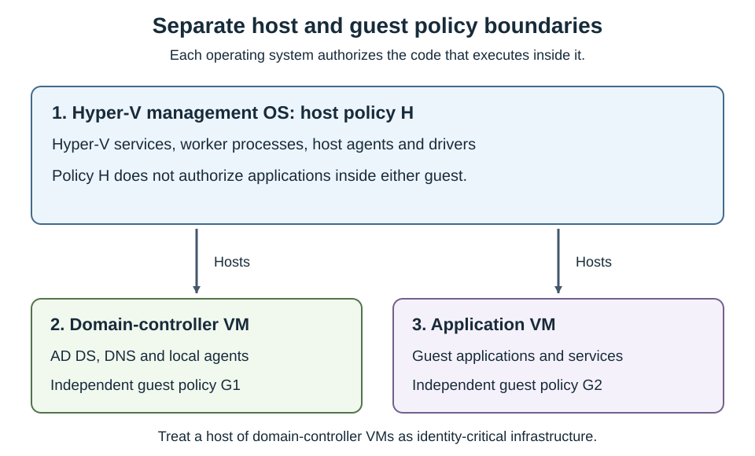

App Control for Business changes the execution decision from "run unless another control blocks it" to "run only when the applicable policy permits it." Older documentation and tools use the names Windows Defender Application Control (WDAC) and Device Guard. These names explain legacy paths and commands; they don't describe separate policy engines to deploy.

## Protect kernel-mode and user-mode code

Kernel-mode Code Integrity evaluates drivers and other kernel code. User-mode Code Integrity (UMCI) extends policy validation to user-mode executables and related code. Without UMCI, a policy can constrain drivers while leaving important server applications outside its intended coverage.

Policy option `0 Enabled:UMCI` enables user-mode coverage. Script enforcement also involves cooperation with the script host; it's not identical to loading a native executable.

The following execution surfaces require different validation evidence.

| Surface | Examples | What to test |
| --- | --- | --- |
| Kernel code | Storage, network, filter, and security drivers | Boot, device operation, updates, and restart behavior. |
| User-mode binaries | Services, executables, DLLs, and plug-ins | Real service workflows and dependent DLL loads. |
| Installer content | MSI packages and their helper executables | Installation, repair, upgrade, and removal. |
| Supported scripts | PowerShell, Windows Script Host, and related components | The host's actual allow, block, or constrained behavior. |
| Dynamic code | .NET-generated or dynamically loaded code | Application behavior, not just a successful process start. |

Policies are device-wide. Administrators, local services, domain service accounts, and scheduled tasks don't receive an automatic exemption. App Control doesn't provide AppLocker-style per-user or per-group allow rules.

## Keep complementary controls distinct

Several Windows controls affect the same process for different reasons. Passing one doesn't bypass the others.

This table distinguishes the controls most likely to appear in a server investigation.

| Control | Primary decision | Relationship to App Control |
| --- | --- | --- |
| AppLocker | Application execution, with user/group targeting and its own rule collections | Useful in selected designs; not equivalent to device-wide kernel and user-mode CI policy. |
| Antivirus and EDR | Malicious behavior, content, detection, and response | Still required. Allowed code can be vulnerable or malicious. |
| Attack surface reduction | Selected risky behaviors | Complements execution control; an attack surface reduction exception isn't an App Control allowance. |
| PowerShell execution policy | Conditions for loading scripts | Not a security boundary and not an App Control override. |
| NTFS permissions | Who can read or change files | Protect policy artifacts and influence FilePath-rule safety. |
| Memory integrity/HVCI | Protect Code Integrity using virtualization-based isolation | Strengthens protection; it's not the application allowlist itself. |
| Secure Boot | Boot-chain integrity | Required for the anti-tampering protection of signed App Control policies. |

App Control doesn't require installation of the Hyper-V server role. Memory integrity uses virtualization-based security, but running Hyper-V workloads and enabling HVCI are distinct configuration decisions.

An App Control allow rule can't make an otherwise invalid driver acceptable to Windows. Kernel signing requirements, HVCI compatibility, and other protections still apply.

## Separate host and guest enforcement

A Hyper-V host evaluates code running in its management OS. It doesn't inspect every executable inside a virtual machine guest and apply the host's allowlist to that VM guest.

The diagram separates these execution boundaries.

- The management OS hosts the VMs, but its policy doesn't flow through the hosting arrows. 
- Each guest authorizes its own operating-system and application code. 
- A virtual domain controller requires both appropriate Hyper-V host protection and a separately designed domain controller CI policy.

> [!NOTE]
> VM disks, configuration files, and backups need access controls. They're not executable allowlists. Adding a broad CI path rule for VM storage doesn't implement guest application control.

## Distinguish three kinds of signing

App Control supports three types of signing, each with a different purpose:

- File signing identifies a publisher and protects a file's signed content. 
- Catalog signing associates a trusted signer with the hashes of multiple files. 
- Policy signing protects policy updates and supports anti-tampering.

These signatures solve different problems. Authorizing a vendor's application doesn't authorize that vendor to replace your enterprise policy. Authorizing a policy signer doesn't automatically authorize every application signed by that certificate.

A valid signature isn't proof of safety. A signed utility might be unnecessary, vulnerable, or capable of running other code. Narrow trust to the files and capabilities the workload needs.
