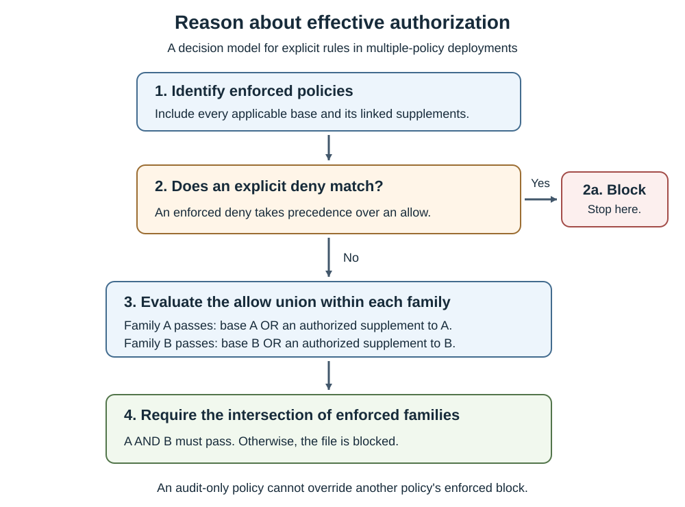

Decide which software families, publishers, drivers, and administrative tools a server needs. Then choose identities that express those decisions without allowing unrelated code.

## Understand policy identity

New Windows Server 2025 designs should normally use multiple-policy format. In this model, each policy has an identity and a defined relationship to a base policy.

These fields determine how a policy is tracked and composed.

| Field or artifact | Meaning |
| --- | --- |
| `PolicyID` | Unique identity of the policy. Preserve it for an in-place update. |
| `BasePolicyID` | Identity of the base policy. A supplement references the base it expands. |
| Policy type | Base policy or supplemental policy. |
| Friendly name | Human-readable label; not an authorization boundary or substitute for the GUID. |
| `VersionEx` | Policy version used for release tracking and signed-update constraints. |
| XML | Maintained, reviewable policy source. |
| `{PolicyID}.cip` | Compiled policy artifact in multiple-policy format. The braces belong in this filename convention. |
| `SiPolicy.p7b` | Legacy single-policy artifact that might exist on an upgraded or previously managed server. |

Inventory all active policies before deployment, including Microsoft platform policies. The absence of a locally recognizable file doesn't prove that no policy is active. To do this, run `CiTool.exe --list-policies` from an elevated PowerShell session on the target server. This read-only command lists both active and inactive policies, including Microsoft platform policies. `Is Currently Enforced: true` identifies an active policy, but doesn't distinguish audit mode from enforcement mode. Check the policy options and policy-load events to determine the mode.

## Combine bases and supplements correctly

Each enforced base policy is a constraint. When two enforced bases apply, a file must pass both. Their effective authorization is an **intersection**, not a combined list of everything either policy allows.

A supplement expands one base. Within that base family, code allowed by the base **or** an authorized linked supplement is allowed, unless an applicable enforced deny blocks it. This is a **union of allowances**.

A supplement can't narrow a broad base. It can't override an explicit enforced deny. It also can't satisfy an unrelated restrictive base merely because both policies are installed.

The diagram presents a reasoning model for explicit rules.

> [!NOTE]
> A matching enforced deny exits to the blocked result. Otherwise, calculate each base family's allow union, then require every enforced family to pass. Audit-only policies report findings; they don't cancel enforced decisions.

The following example can assist you to predict effective results. Assume base A allows Windows and accepts supplement A1, while base B is a separate enforced restriction.

| File or condition | Base A family | Base B | Result |
| --- | --- | --- | --- |
| Required Windows binary | Allowed by A | Allowed | Runs, subject to other Windows protections. |
| Approved host agent | Allowed only by A1 | Allowed | Runs because A1 supplements A. |
| Approved host agent | Allowed only by A1 | Not allowed | Blocked by B. |
| File explicitly denied by B | Allowed by A1 | Explicit deny | Blocked; another allow doesn't override the deny. |
| Supplement references the wrong base ID | Not authorized by A | Allowed | Blocked if A doesn't otherwise allow the file. |
| Proposed policy is audit-only | Generates an audit finding | Enforced policy allows it | Audit doesn't add a new enforced block, although script/runtime side effects still require testing. |

A common design uses a common OS base, narrowly scoped workload supplements, and a separate deny policy. Don't install a Hyper-V-only base and a domain controller-only base together expecting an additive result.

## Select file-rule identities

Choose the narrowest sustainable identity. Excessively broad rules reduce protection; excessively brittle rules create unnecessary servicing failures.

The following rule levels make different maintenance and trust tradeoffs.

| Rule level | Identity and behavior | Appropriate caution |
| --- | --- | --- |
| Hash | Identifies a particular file's CI hash values | Update the rule when the relevant file content changes. |
| FilePublisher | Publisher identity plus a signed file attribute and version constraints | Usually a strong starting point for specific signed application files. |
| Publisher | Signing PCA identity plus the leaf certificate's common name | Can authorize many products from the same publisher. |
| SignedVersion | Publisher identity plus version | Broader than a specific filename-bound rule. |
| LeafCertificate | A particular signing certificate | Certificate rollover requires planned policy maintenance. |
| PcaCertificate | The highest available certificate identified in the examined chain, typically below the root | Potentially broad trust across certificates issued beneath that authority. |
| FileName | A resource attribute such as OriginalFileName | Metadata alone is weaker than a signer-bound identity. |
| FilePath | A path to user-mode code, subject to runtime checks | Permissions can change; it can't authorize kernel drivers. |
| WHQL | Microsoft hardware-certification signing | Doesn't establish that every signed driver is necessary or invulnerable. |
| WHQLPublisher / WHQLFilePublisher | Adds publisher or file/version specificity to WHQL trust | Useful when narrowing driver families. |

`RootCertificate` isn't a supported rule level to prescribe. Signer-based rules require supported RSA signatures, with a maximum key length of 4096 bits. ECC/ECDSA signatures aren't supported for those rules. A blocked ECC-signed file can produce verification error 23 in event 3089.

Examine all signatures before choosing another rule. A file might also have a supported RSA signature or catalog signature. Use an approved hash rule when a suitable supported signer identity is unavailable.

## Bound file versions deliberately

FilePublisher normally uses the signed file's `OriginalFileName` and a minimum version. `-SpecificFileNameLevel` can select another resource attribute, such as `ProductName`. That can reduce rule count, but also widen the set of matching files.

For example, authorizing a vendor's `HostAgent.exe` from version 5.2 onward is narrower than authorizing every executable signed by that vendor. A vendor renewal that changes the relevant certificate chain can still require a rule update.

Cross-signing can provide different certification paths for a signer. Inspect the chain and signature actually evaluated, including any catalog signature, rather than assuming that an unchanged publisher display name guarantees the same policy match.

Version-bound behavior differs between allow and deny rules. Interpret the fields before approving the XML.

| Bounds present | Allow rule | Deny rule |
| --- | --- | --- |
| Minimum and maximum | Allows the inclusive range | Denies the inclusive range |
| Minimum only | Allows that version and later | Denies that version and earlier |
| Maximum only | Allows that version and earlier | Denies that version and later |

To block a vulnerable interval without blocking a repaired release, verify the actual file version and the resulting bounds. Don't infer policy matching solely from a product's marketing version.

Certificate expiry, timestamping, and revocation are different conditions. App Control doesn't automatically reject every executable because its signing certificate has expired. The Lifetime Signing EKU changes expiry handling. Option 20 can treat certain revoked or expired signatures as unsigned, but another appropriate rule must then authorize the file.

## Understand hashes and paths

App Control commonly uses Authenticode/PE image hashes. These exclude some fields, including signature-related information. `Get-FileHash` computes a flat-file hash and is useful for verifying a deployment artifact, but its output isn't a general replacement for a generated App Control hash rule.

Use ConfigCI or supported policy tooling to create file rules. Don't paste a flat SHA-256 value into policy XML and assume that every PE validation scenario will match it.

FilePath rules apply only to user-mode files. Their default runtime protection checks whether the path is writable only by recognized administrative identities. A custom privileged group can still cause a path to be treated as user-writable.

Option `18 Disabled:Runtime FilePath Rule Protection` removes that check. Disabling it to make a rule work changes the security model; it's not a harmless compatibility switch.

Paths can use supported wildcards and macros such as `%OSDRIVE%`, `%WINDIR%`, and `%SYSTEM32%`. Windows Server 2025 supports `*` and `?`; validate complex patterns on the target build rather than importing older server restrictions or assuming a client example is portable. FilePath exclusions aren't supported.

Avoid broad allowances for writable application directories, temporary folders, SYSVOL, or VM storage. An antivirus exclusion limits antivirus scanning; it doesn't justify permission to execute every file in that location.

## Choose templates and blocklists

Windows-supplied templates provide a safer foundation than an arbitrary scan of a partially exercised server. They still require inspection.

The relevant templates and policy sources have different trust scopes.

| Starting point | Trust scope | Design implication |
| --- | --- | --- |
| `DefaultWindows_Audit.xml` | Windows, eligible third-party kernel drivers, and Windows Store apps | It's not an OS-binaries-only allowlist. |
| `AllowMicrosoft.xml` | Extends DefaultWindows trust to additional Microsoft-signed applications | Convenient, but broader than a fixed-workload minimum. |
| `AllowAll.xml` | Allows code unless a deny rule blocks it | Useful for a separate deny policy, not a restrictive allowlist. |
| OSConfig defaults | Microsoft-provided Windows Server 2025 policies | Opt-in, unsigned, and extendable; not automatically workload-minimal. |
| Recommended application block rules | Selected otherwise trusted applications that can be abused | Review actual administrative and application dependencies. |
| Recommended driver block rules | Known vulnerable or malicious drivers | Test hardware compatibility and preserve a boot-recovery path. |

Keep an allow-all-plus-deny blocklist separate when using multiple policies. Merging its allow-all rules into a restrictive allowlist authorizes code that the restrictive policy was intended to exclude.

The attack surface reduction rule for blocking abuse of vulnerable signed drivers can prevent an application from writing a vulnerable driver. It doesn't replace a policy that prevents an already-present driver from loading. Conversely, a driver blocklist isn't guaranteed to contain every vulnerable driver.

## Evaluate other trust sources

A signed catalog authorizes approved file hashes through a trusted catalog signer. It can support legacy applications that are difficult to sign individually.

Catalog capture must be controlled. Package Inspector can collect files written during installation and use, including unrelated files written while capture is active. Review the catalog contents, sign the catalog, distribute it to targets, and authorize its signer. Regenerate it when the application files change.

Managed installer uses AppLocker managed-installer rules and tracking services to identify files written by an approved installer process. App Control can trust the resulting origin claims. This requires deliberate AppLocker/Application Identity configuration; enabling option 13 alone doesn't establish trustworthy installer tracking.

Managed-installer trust is heuristic, isn't a kernel-driver authorization mechanism, and doesn't automatically cover later self-updates. Installer processes that launch other code can widen the trust they create. Prefer explicit rules for critical host and domain controller components.

Intelligent Security Graph (ISG) authorization uses reputation and cached origin information. Connectivity, reputation changes, and performance affect that decision. Don't make boot, identity services, or critical virtualization code depend on a fresh reputation response.

## Select policy options

Policy options control behavior beyond individual file rules. The word `Disabled` in an option name matters: enabling that option disables the named protection.

The following options deserve explicit review for these workloads.

| Option | Effect | Supplemental policy? |
| --- | --- | --- |
| `0 Enabled:UMCI` | Evaluates user-mode code | No |
| `2 Required:WHQL` | Requires WHQL driver signing and removes legacy-driver allowance | No |
| `3 Enabled:Audit Mode` | Audits instead of enforcing the base's normal block decisions | No |
| `6 Enabled:Unsigned System Integrity Policy` | Permits unsigned policy operation | Yes |
| `9 Enabled:Advanced Boot Options Menu` | Makes the advanced boot menu available for physical recovery | No |
| `10 Enabled:Boot Audit on Failure` | Can switch enforcement to audit after a boot-critical driver failure | No |
| `11 Disabled:Script Enforcement` | Disables supported script-enforcement behavior | No |
| `13 Enabled:Managed Installer` | Enables managed-installer authorization | Yes |
| `14 Enabled:Intelligent Security Graph Authorization` | Enables reputation-based authorization | Yes |
| `15 Enabled:Invalidate EAs on Reboot` | Supports revalidation of cached ISG authorization | No |
| `16 Enabled:Update Policy No Reboot` | Permits supported policy updates without a reboot | No |
| `17 Enabled:Allow Supplemental Policies` | Allows supplements to expand the base | No |
| `18 Disabled:Runtime FilePath Rule Protection` | Removes the administrative-writeability check | Yes |
| `19 Enabled:Dynamic Code Security` | Applies .NET dynamic-code hardening; supports audit on Server 2025 | No |
| `20 Enabled:Revoked Expired As Unsigned` | Changes treatment of specified revoked/expired signatures | No |

Don't copy every base option into a supplement. A supplement isn't an independently configurable audit or enforcement policy. Its relationship to the base determines how its allowances participate.

Options 9 and 10 can improve pilot recoverability, but they reduce hardening or apply only to particular failures. They don't guarantee recovery from an invalid signed-policy update.
