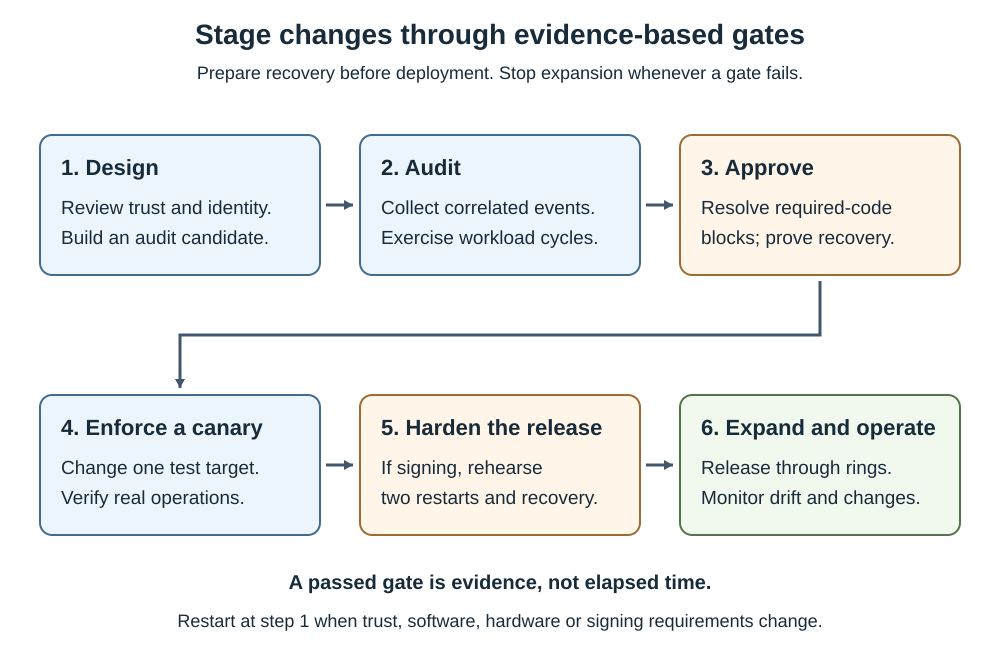

Audit data describes observed policy decisions. It doesn't prove that an application is approved or that every code path has been exercised.

Approve software through your normal security and workload process. Use audit findings to identify missing dependencies and unnecessarily broad or incorrect rules.

## Collect the right events

Executables, DLLs, drivers, and policy activation use `Microsoft-Windows-CodeIntegrity/Operational`. Supported script and MSI decisions use `Microsoft-Windows-AppLocker/MSI and Script`.

Microsoft documents that the AppLocker MSI and Script events aren't included on Server Core. Account for that difference in the collection design. Even if a log name can be queried, that doesn't prove the required events are available.

PowerShell 7.4 and later also record would-be language restrictions in `PowerShellCore/Analytic`, event 16387. This separate, opt-in analytic log isn't the AppLocker script channel. Verify that the PowerShell event provider is registered for the installed package; a missing channel isn't an empty audit result.

These events support most investigations in this module.

| Event | Meaning | Interpretation |
| --- | --- | --- |
| 3076 | Audit would-block decision | Review whether the file should be allowed. |
| 3077 | Enforced binary/driver block | Correlate the blocked file and responsible policy. |
| 3089 | Signature details | Examine all signatures and verification errors; correlate by ActivityID. |
| 3099 | Policy loaded | Confirm the intended identity and options. |
| 3095 | Refresh requires a restart | Schedule the restart; don't claim activation is complete. |
| 3097 / 3100 | Refresh or activation failed | Investigate rather than proceeding to the next rollout ring. |
| 8028 / 8029 | Script/MSI audit or enforced decision | The script host determines the final behavior. |
| 8038 | Script signature details | Correlate with the script decision. |
| 16387 | PowerShell 7 App Control audit restriction in `PowerShellCore/Analytic` | Shows a restriction that would apply in enforcement; collect using the bounded capture in the Control application runtimes unit. |
| 3114 | .NET Dynamic Code Security decision | Correlate closely timed attempts and actual application behavior. |
| 3004 / 3033 | Other integrity/signature failures | They can occur for reasons beyond the enterprise policy. |

Query a bounded time window on the test server. This example is read-only.

```powershell
$filter = @{
    LogName = 'Microsoft-Windows-CodeIntegrity/Operational'
    Id = 3076, 3077, 3089, 3099, 3114
    StartTime = (Get-Date).AddDays(-1)
}
Get-WinEvent -FilterHashtable $filter -ErrorAction Stop |
    Select-Object TimeCreated, Id, ActivityId, Message
```

A "no matching events" result means the query found no matching records. It doesn't prove successful enforcement. Investigate a missing channel, denied access, or collection failure separately.

For Desktop Experience systems that provide the script channel, use the same technique with that channel and IDs 8028, 8029, and 8038. On Server Core, supplement available CI data with PowerShell/runtime evidence and explicit functional tests.

## Correlate rather than guess

One blocked file can produce several signature events. The first visible signature isn't necessarily the one that should authorize it.

Use the decision event's ActivityID to retrieve related signature records.

```powershell
$ErrorActionPreference = 'Stop'
$log = 'Microsoft-Windows-CodeIntegrity/Operational'
$blocked = Get-WinEvent -FilterHashtable @{
    LogName = $log
    Id = 3076, 3077
    StartTime = (Get-Date).AddDays(-1)
} -MaxEvents 1
if (-not $blocked.ActivityId) {
    throw 'The selected event has no correlation ActivityID.'
}
Get-WinEvent -FilterHashtable @{
    LogName = $log
    Id = 3089
    StartTime = $blocked.TimeCreated.AddSeconds(-30)
    EndTime = $blocked.TimeCreated.AddSeconds(30)
} | Where-Object { $_.ActivityId -eq $blocked.ActivityId } |
    ForEach-Object { $_.ToXml() }
```

Retain full XML when you need policy IDs, signer information, hashes, or verification codes. Don't rely on localized message text or positional event-data indexes as a durable automation interface.

## Preserve evidence

Export EVTX rather than screenshots when an investigator needs the original event fields. This example writes an evidence file but doesn't change policy.

```powershell
$ErrorActionPreference = 'Stop'
$destination = 'C:\AppControl\Evidence\CodeIntegrity.evtx'
if (Test-Path -LiteralPath $destination) {
    throw 'Choose a new evidence filename rather than overwriting the capture.'
}
& wevtutil.exe epl 'Microsoft-Windows-CodeIntegrity/Operational' $destination
if ($LASTEXITCODE -ne 0) {
    throw "EVTX export failed: $LASTEXITCODE"
}
```

For fleet operation, use Windows Event Forwarding or an existing supported collector. Monitor collection health, time synchronization, retention, and loss of events. Protect the collected file paths and operational details.

App Control doesn't normally log an allow event for every permitted binary. A quiet allowlist audit log isn't a complete software inventory. Combine inventory, execution tests, and decision events.

## Generate candidate rules from audit data

`New-CIPolicy -Audit` reads audit evidence. It doesn't switch an existing policy into audit mode. On a representative machine, the cmdlet also needs the relevant files still available to generate their rules.

This example creates candidate XML and captures warnings. It doesn't deploy the candidate.

```powershell
$ErrorActionPreference = 'Stop'
$winPS51 = New-PSSession -UseWindowsPowerShell
try {
    Invoke-Command -Session $winPS51 -ScriptBlock {
        $ErrorActionPreference = 'Stop'
        Import-Module ConfigCI
        $candidate = 'C:\AppControl\Source\Audit-Candidates.xml'
        $warnings = 'C:\AppControl\Evidence\Audit-Candidate-Warnings.txt'
        if ((Test-Path -LiteralPath $candidate) -or
            (Test-Path -LiteralPath $warnings)) {
            throw 'Choose new candidate and evidence paths for this capture.'
        }
        New-CIPolicy -FilePath $candidate -Audit -Level FilePublisher `
            -Fallback Hash -UserPEs -MultiplePolicyFormat 3> $warnings
        Get-Content -LiteralPath $warnings
    }
} finally {
    Remove-PSSession -Session $winPS51
}
```

Review both outputs. Temporary installer files might already have disappeared. A warning mustn't silently become a missing dependency in the final policy. Retained events and the App Control Wizard can help interpret evidence when local files are unavailable.

Remove unapproved candidates before merging. After review, either link the candidate as a supplement to the intended base or merge its approved rules into the maintained policy. Preserve the correct identity and increment the release version.

## Define an enforcement gate

An audit period must cover meaningful operations, not just elapsed time. Backup, restore rehearsals, patching, hardware management, certificate rollover, and infrequent scheduled tasks can expose dependencies that normal daily use misses.

Capture before-and-after boot, application-startup, and critical-workflow timings on the pilot. Investigate sustained resource-use or latency regressions. Audit mode still evaluates code and isn't a zero-overhead configuration.

The lifecycle diagram shows where evidence controls progression.



- Audit produces evidence for approval. 
- Canary enforcement tests behavior that audit might not reveal. 
- Signed-policy hardening follows unsigned validation. 
- Expansion stops when any gate fails, and material trust changes restart the cycle.

Require all of the following before enforcement:

- Every required workload test passes against the candidate design.
- No unexplained policy block of required code remains.
- A benign unapproved executable or other suitable negative test produces the expected decision.
- Telemetry and policy-activation evidence are complete.
- Recovery has been rehearsed with the required access and artifacts.
- Security and workload owners approve the release.

An expected block isn't a defect. Document why the code is unnecessary or denied. Conversely, dismissing every 3076 event as harmless defeats the purpose of audit.
