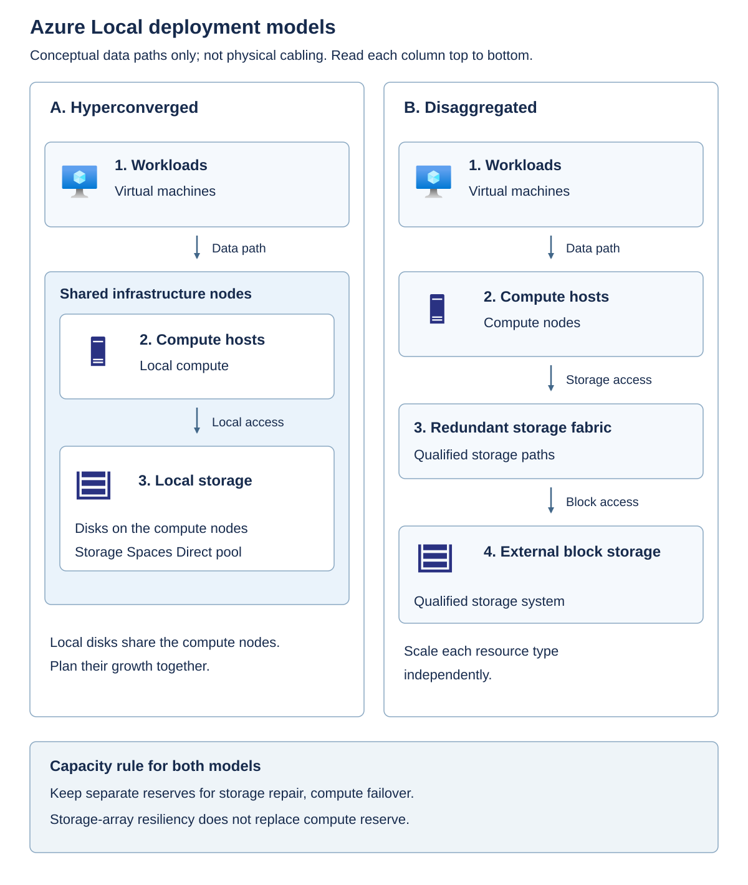
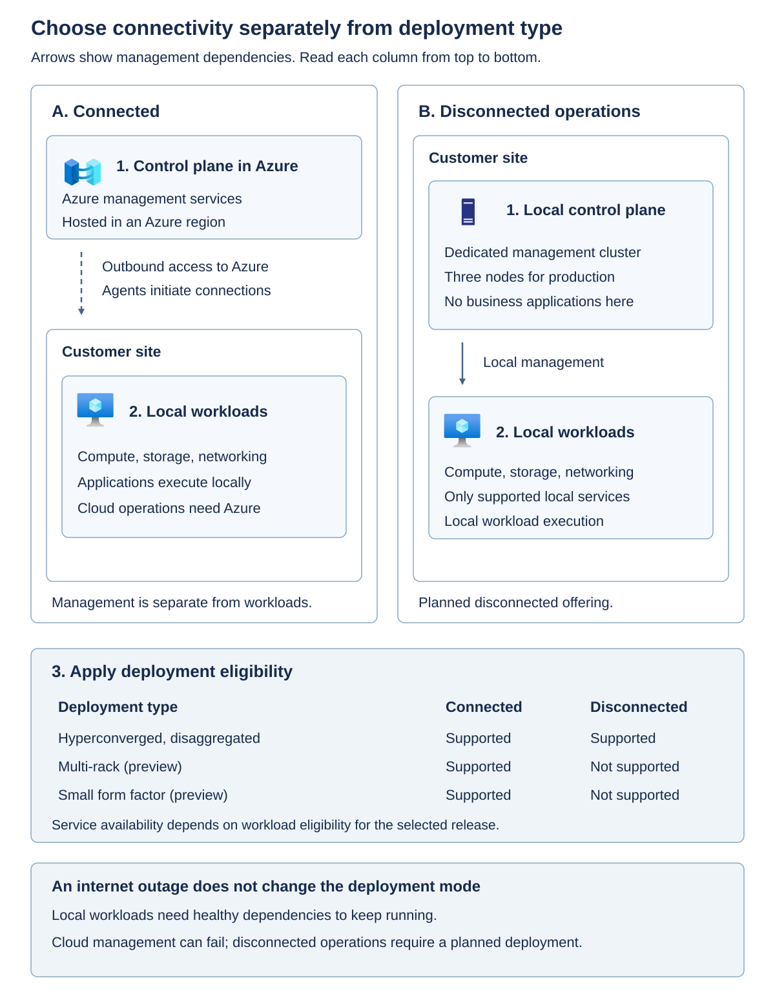

Choosing the right platform requires answering two questions in order:

1. Which product and deployment can support the required workload and operating model? 
1. Which supported configuration provides the needed capacity and resilience? 

A larger unsupported configuration isn't an alternative to a smaller supported one.

## Distinguish the platform from its management services

Azure Local provides locally executed infrastructure with Azure integration. Windows Server provides a general-purpose server operating system and its own virtualization and clustering choices. An Arc-connected Windows Server cluster is substantively different to Azure Local. Azure Arc supplies management capabilities across resources. It isn't a replacement hypervisor or a promise that every Arc-enabled resource supports Azure Local lifecycle operations.

Azure Stack Hub is a different integrated platform with its own service portfolio, deployment model, and support lifecycle. Public Azure places infrastructure responsibility in Microsoft-operated regions and offers services unavailable locally. Choose between these platforms by workload capability, operating responsibility, connectivity, and locality, rather than by similar product names.

Use the following comparison to distinguish each platform or management service from capabilities it doesn't automatically provide.

| Option | What the architect is selecting | What mustn't be inferred |
| --- | --- | --- |
| Azure Local | A supported local infrastructure solution with a defined hardware, software, and management lifecycle | That every Azure service or Windows Server role is available locally |
| Windows Server with Hyper-V | A general-purpose server and virtualization platform with its own supported configurations | That adding Azure Arc confers Azure Local deployment or update support |
| Azure Arc | Azure management integration for supported resources outside Azure | That Arc moves application execution to Azure or supplies local compute |
| Azure Stack Hub | An integrated Azure-consistent platform with a separate service and operations model | That its hardware, disconnected capabilities, or APIs are interchangeable with Azure Local |
| Public Azure | Infrastructure or services hosted in Microsoft-operated regions | That local execution, latency, or isolation requirements automatically disappear |

> [!NOTE]
> **Azure Local and Azure Stack Hub are separate products, not different sizes of the same platform.** Azure Local provides supported local compute, storage, and networking for VMs, containers, and selected services. Connected deployments integrate with Azure management through Azure Arc; supported disconnected operations add a separately planned local control plane.
>
> Azure Stack Hub is an integrated private-cloud platform with its own local Azure Resource Manager instances and administrator and user portals. An operator offers supported services, such as VMs, virtual networks, and storage accounts, to users through plans, offers, quotas, and subscriptions. This provides an Azure-consistent self-service cloud experience, but not the full public Azure service catalog.
>
> Both products run workloads locally and support connected and disconnected deployment options under their respective requirements. The distinction is therefore their service capabilities and operating models, not simply whether internet access is available. Their hardware qualification, APIs, identity requirements, licensing, and update processes aren't interchangeable. Compare the required services against the [Azure Local deployment matrix](/azure/azure-local/plan/find-your-deployment-type?view=azloc-2610&preserve-view=true) and [Azure Stack Hub overview](/azure-stack/operator/azure-stack-overview?view=azs-2604&preserve-view=true).

Don't install business applications directly into the Azure Local infrastructure host. The *host* is the physical machine and its platform operating system, which provide infrastructure capabilities such as virtualization, storage, networking, and management. Applications belong in a supported workload environment above that infrastructure.

A *guest environment* is the Windows or Linux operating system inside a workload VM. For example, install SQL Server in a supported Windows Server or Linux VM, or install a web application and its dependencies inside an appropriate guest VM. The application uses the VM's assigned resources without requiring its software to be installed in the physical host's operating system.

A *service environment* is a supported application platform deployed on Azure Local, such as an Azure Kubernetes Service (AKS) workload cluster. For example, deploy a containerized application through Kubernetes to that cluster's worker nodes, which run application containers, rather than installing a container runtime and the application directly on the Azure Local host. The service environment can itself use VMs; the distinction is that you deploy and manage the application through the service's supported mechanisms. Platform management appliances, such as Azure Arc resource bridge, aren't environments for business applications.

In either case, verify that the deployment type, guest operating system or service version, and application configuration are supported. Follow the documented responsibilities for application updates, security, and backup. Add software to infrastructure hosts only when the Azure Local and hardware-partner guidance supports it for the selected configuration. Keeping host configuration within that boundary reduces update conflicts and makes incidents easier to diagnose.

## Understand hyperconverged and disaggregated designs

In a *hyperconverged* design, the same machines supply compute and local storage. Hyper-V runs VMs, clustering coordinates hosts, and Storage Spaces Direct combines eligible local drives into software-defined storage. Storage resiliency distributes data across fault domains so that a supported drive or machine failure needn't make the data unavailable. The usable storage is smaller than the installed drive capacity because resilience and repair need space.

This design couples some expansion decisions. Adding a machine can add both processor and memory capacity and storage resources. That's useful when the demands grow together, but less attractive when an application needs much more storage and little additional compute. Individual expansion options still depend on the qualified configuration; don't assume you can add any drive or mix any server generation.

In a *disaggregated* design, compute and qualified external block storage are separate. Block storage presents addressable storage to hosts rather than supplying an application-level file or object API. Compute hosts access the storage over a supported fabric, which is the collection of adapters, links, switches, paths, and protocols connecting them to the array.

Independent scaling can match an existing storage operating model, but it also adds an array and fabric support boundary. An array with redundant controllers still needs a supported host configuration, resilient paths, usable free space, and a failure-state performance budget. A familiar storage protocol or an array already used by another hypervisor isn't proof of Azure Local qualification.

The [external-storage guidance](/azure/azure-local/concepts/external-storage-support?view=azloc-2610&preserve-view=true) includes qualified Fibre Channel and iSCSI storage area network (SAN) configurations and a supported software-initiator configuration. A SAN is a network that supplies block-storage access to hosts. Individual solutions can have narrower host limits than the deployment-wide maximum. A supported hyperconverged system can also add external storage; that doesn't turn its Storage Spaces Direct cluster into a 64-node hyperconverged cluster, and it changes the commercial assessment.

Fibre Channel uses a dedicated storage-networking technology; iSCSI carries block-storage commands over IP networks. An *initiator* is the host-side component that requests storage operations from a storage *target*. Supported multipath configurations provide more than one access path, but the paths must avoid the common failure that the design is intended to tolerate. Two paths through one failed switch aren't independent protection against that switch failure.

The following diagram contrasts the resource arrangement. It's a conceptual comparison, not a physical cabling plan.

> [!NOTE]
> In the hyperconverged column, local disks contribute to a Storage Spaces Direct pool. In the disaggregated column, compute reaches an external array through a storage fabric. Both designs need compute failover headroom; they obtain storage resilience through different supported implementations.

## Apply deployment and workload eligibility together

The following decision matrix separates scale from workload eligibility for the 2610 baseline.

| Deployment | Architectural fit | Workload boundary | Decision consequence |
| --- | --- | --- | --- |
| Hyperconverged | Compute and Storage Spaces Direct on 1-16 machines | Azure Local virtual machines, Azure Kubernetes Service, SQL Server, Azure Virtual Desktop, and other listed workloads | Validate storage copies, node count, and lifecycle headroom together |
| Disaggregated | Independent compute and qualified external block storage; up to 64 machines | Broad workload set similar to hyperconverged, subject to individual service requirements | Include array qualification, fabric operations, and a different billing tier |
| Multi-rack (preview) | Prescriptive integrated racks supporting hundreds of machines | Azure Local virtual machines and Azure Kubernetes Service are listed; SQL Server and Azure Virtual Desktop aren't listed as supported | Confirm preview eligibility; don't transfer the general cluster workload matrix |
| Small form factor (preview) | Compact appliance for constrained edge locations | Azure Kubernetes Service is listed; Azure Local virtual machines aren't; listed artificial-intelligence capabilities include preview cases | The deployment itself is preview, not a miniature Hyper-V cluster |

Preview status applies to these deployment architectures, not only to individual workload features. Confirm enrollment, hardware eligibility, available support, and preview terms before proposing either for a production requirement. A capability listed in the workload matrix doesn't remove that preview boundary.

Microsoft 365 Local, GitHub Enterprise Local, and Azure IoT Operations for Internet of Things workloads also have deployment-specific availability. A "Yes" in the platform matrix is an entry condition, not evidence that an application's version, backup product, identity model, or disconnected scenario is supported. Recheck workload guidance when approving a design.

Use the [deployment selection and workload matrix](/azure/azure-local/plan/find-your-deployment-type?view=azloc-2610&preserve-view=true) as a starting point, then verify the selected service's own prerequisites. For example, a service might have a particular host version, guest image, network, or identity requirement even though the deployment row lists it.

Azure Kubernetes Service (AKS) orchestrates containerized workloads; it doesn't make an existing VM application a container application without redesign. The SQL Server workload entry describes supported database deployment in VMs, not installation of Azure SQL Server on an Azure Local infrastructure host.

Azure Virtual Desktop (AVD) illustrates why local execution doesn't remove every cloud dependency. Its session hosts can run locally, but connection brokering and connecting users require the Azure-hosted AVD service. AVD therefore isn't evidence for an air-gapped desktop design. See the [AVD on Azure Local limitations](/azure/virtual-desktop/azure-local-overview#limitations).

An upper node limit is a support boundary, not a sizing recommendation. One node can be a supported footprint without providing host failover. Conversely, a workload that fits in a large memory total can still fail placement, latency, or fault-domain requirements.

## Distinguish rack-aware placement from multi-rack infrastructure

Spreading hosts across racks isn't by itself a supported rack-failure design. A *rack-aware cluster* uses a documented two-zone arrangement and its associated storage, quorum, network, and placement rules. It's distinct from the integrated multi-rack deployment in the matrix.

For hyperconverged rack-aware configurations, the documented layouts use equal node counts across two zones, from one node per zone through four per zone. They require their own all-flash storage, network, and nested-mirroring design. The [hyperconverged rack-aware requirements](/azure/azure-local/concepts/rack-aware-cluster-requirements?view=azloc-2610&preserve-view=true) specify a round-trip latency limit of 1 millisecond between zones. Don't apply the general three-copy capacity example later in this module to that rack-aware storage layout.

Azure Local 2610 also introduces [rack-aware clusters with SAN storage](/azure/azure-local/deploy/deploy-rack-aware-cluster-storage-area-network?view=azloc-2610&preserve-view=true). That separate pattern supports one through eight nodes per zone, with specific synchronous SAN replication, Fibre Channel fabric, disk-witness, and latency requirements. It isn't permission to stretch any existing cluster across sites. Its 5-millisecond round-trip limit mustn't be substituted for the hyperconverged pattern's 1-millisecond limit.

The architectural lesson is to name the failure domain and select the reference pattern that supports it. "Multi-rack," "rack-aware," and "site disaster recovery" describe different designs and aren't interchangeable labels.

## Choose connectivity separately

Connectivity is a separate axis. Connected deployments use a control plane in an Azure region. Disconnected operations use a dedicated local control-plane appliance and a subset of services. At this baseline, hyperconverged and disaggregated deployments support either mode; multi-rack and small form factor are connected-only. An internet outage doesn't convert a connected system into a supported disconnected deployment.

A connected system uses local resources to execute workloads while relying on Azure for designated management functions. A supported disconnected offering deliberately supplies its own local management architecture, service subset, and operational processes. It must be designed and obtained as that offering; blocking internet access on a connected system isn't a conversion procedure.

The [disconnected control-plane requirements](/azure/azure-local/manage/disconnected-operations-control-plane-appliance?view=azloc-2610&preserve-view=true) call for a dedicated three-node management cluster for production, with no unrelated workloads on it. This is a separate infrastructure and capacity commitment, not a small extra management VM on the workload cluster. Eligibility also includes the applicable agreement, support, operational capability, and supported hardware requirements. The connected example's 96 GiB infrastructure allowance later in this module doesn't size that appliance.

For the manufacturer, temporary WAN independence for an application doesn't automatically justify a disconnected control plane. The architect must first show that the application, its identity dependencies, and its data remain usable locally. If the actual requirement is permanent isolation of management as well as workloads, the connected design must be revisited.

> [!IMPORTANT]
> Deployment support, service support, hardware qualification, connectivity mode, and licensing are separate gates. Passing one doesn't grant an exception to another. Record the exact configuration and documentation version used for the decision.

## Apply the selection sequence

Follow these steps to narrow the platform options before sizing a supported design.

1. Identify the required execution environment: existing VMs, containers, desktop sessions, or another listed workload.
1. Eliminate deployment types that don't list the required workload or can't meet an accepted preview policy.
1. Select connected or supported disconnected operations from the management and residency requirements.
1. Identify a qualified hardware and storage configuration for that combination.
1. Size the remaining candidates for the failure cases and operating lifecycle.

For the running scenario, connected hyperconverged infrastructure is a candidate, not yet a conclusion. It fits the VM requirement and available storage model. The next units determine whether the application dependencies and failure-state capacity support the business requirement.
