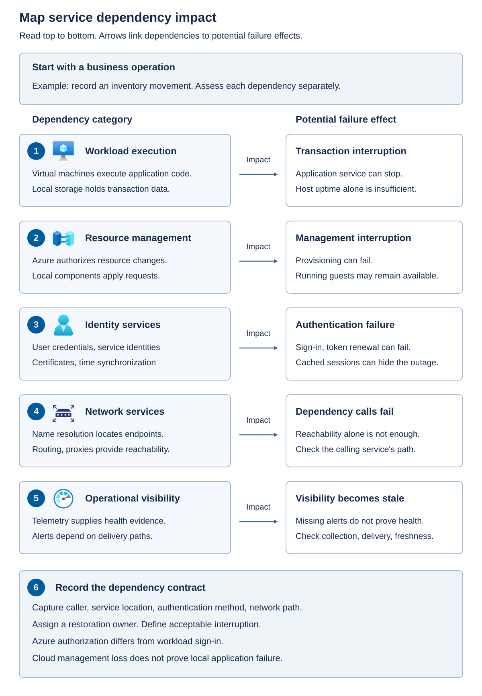
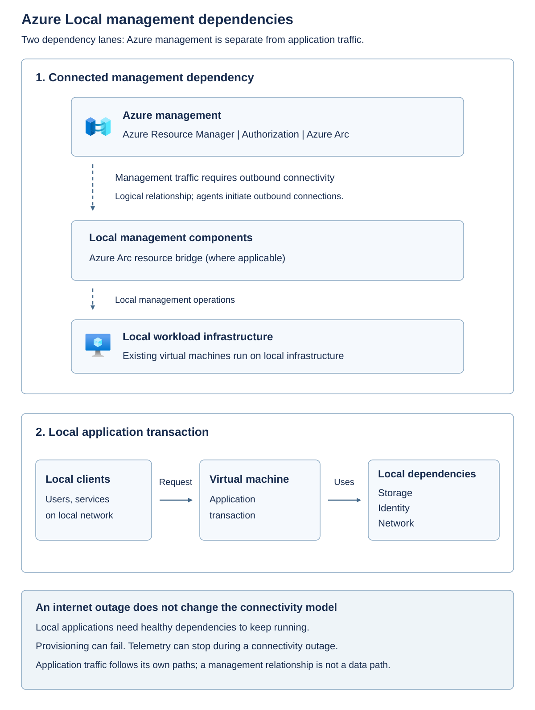
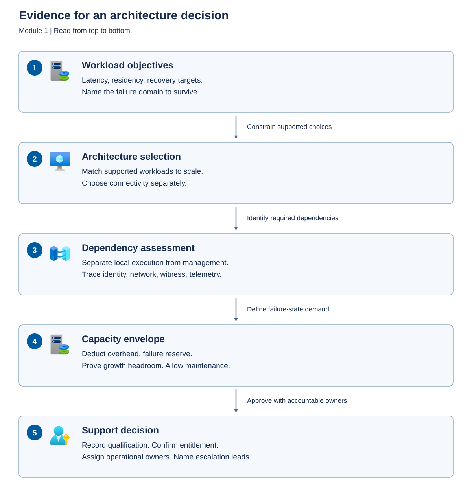

A deployment diagram is incomplete if it shows only hosts, disks, and Azure. You also need to know which component calls which service, how it authenticates, and what stops when the call fails.

The *data plane* performs the useful work: a guest executes instructions, a database commits a transaction, or a client accesses an application. The *control plane* manages resources: it authorizes changes, requests provisioning, reports inventory, and coordinates supported operations. These planes interact, but a failure in one doesn't imply an identical failure in the other.

## Trace a management request without confusing it with workload traffic

In a connected Azure Local VM scenario, Azure Resource Manager provides the Azure resource-management interface, Azure authorization determines whether the requester can perform an operation, and the supported local management components carry out the operation against local infrastructure. Azure Arc resource bridge is part of the local management integration for supported VM management scenarios; it isn't the VM's processor or its application data path.

The resource bridge is a local appliance VM hosting management Kubernetes components. Its management cluster isn't the tenant AKS cluster that runs business containers, and the bridge isn't the complete disconnected Azure control plane. A *custom location* identifies the Azure deployment target, while the VM-management extension processes the relevant Azure Resource Manager requests locally. See [Azure Local VM management components](/azure/azure-local/manage/azure-arc-vm-management-overview?view=azloc-2610&preserve-view=true#components-of-azure-local-vm-management).

An Arc-enabled server or guest management agent has a different role from the resource bridge. Enabling management inside a guest doesn't by itself give that guest a particular Azure Local provisioning lifecycle. Distinguish management of the physical platform, Azure management of VM resources, and management inside each guest.

The following diagram separates a logical management relationship from an application transaction.

The management path connects Azure services to local management components through required outbound connectivity. The application path connects local clients to a workload and its required data, identity, and network services. These are logical dependencies, not instructions to open inbound internet access. If the management path fails, assess the application path independently.

## Include identity, network services, and data movement

Data residency includes more than application disks. Record where identity information, diagnostic logs, inventory, backups, billing records, and support bundles travel. A local database doesn't establish that every associated management record remains on site. Likewise, low storage latency doesn't compensate for an application that synchronously calls an unavailable remote identity service.

Azure management identity and guest application identity aren't necessarily the same system. Microsoft Entra ID can authorize Azure management operations while a guest application depends on Active Directory Domain Services, certificates, or another supported identity service. Document the selected deployment's identity requirements; don't replace them with a generic assumption that all identity can be local or all identity can be cloud-hosted.

Name resolution and time synchronization are critical dependencies. A server can have a working IP route and still fail because its Domain Name System (DNS) response is wrong, its certificate can't be validated, or its clock causes authentication to fail. A proxy that permits one administrator's browser doesn't prove that platform agents, service accounts, and update downloads can reach their required endpoints.

For each dependency, record its location, caller, authentication method, network path, outage behavior, restoration owner, and evidence. Include both normal operation and recovery. A backup stored locally is of limited use after site loss if its catalog, keys, or recovery credentials were lost at the same site.

The diagram shows the evidence dependency between business objectives and an approved operating design.

Workload objectives constrain architecture selection. The selected architecture determines which local execution and cloud management dependencies must be assessed. That dependency assessment identifies failure scenarios for sizing. Capacity evidence and ownership agreements then support the final decision; a failed gate sends the design back for revision.

The following dependency map distinguishes an infrastructure failure from a management interruption.

| Plane or dependency | Typical responsibility | Consequence when unavailable |
| --- | --- | --- |
| Local data plane | Hosts, storage, workload networks | Guest execution or application access can stop |
| Cloud control plane | Azure authorization, Arc services, resource management | Provisioning, policy delivery, and cloud-managed operations can fail |
| Local identity | Directory or supported local identity, certificates, time | Administration or service authentication can fail even while machines run |
| Network services | Routing, name resolution, proxy, certificate validation | Different callers can fail differently despite shared physical connectivity |
| Telemetry | Collection, retention, alert delivery | Visibility becomes stale; absence of alerts isn't evidence of health |
| Licensing dependencies | Registration, reporting, activation, entitlement | Compliance and supported operation need separate assessment from current guest uptime |

## Evaluate a bounded WAN outage

Consider a connected site whose outbound proxy fails while local switching, storage, directory services, and application dependencies remain healthy. Existing local virtual machines can continue executing. Azure-originated creation or configuration operations can't be assumed to work, monitoring can become stale, and downloads or reporting can be delayed. A cloud witness might also lose reachability, increasing the risk of a subsequent partition. Connected billing guidance requires Azure contact at least every 30 days; that minimum isn't an availability target for cloud-managed operations.

The [connected-operation FAQ](/azure/azure-local/faq?view=azloc-2610&preserve-view=true) describes successful synchronization at least once per 30 consecutive days and an out-of-policy state when that condition isn't met. Its description allows existing infrastructure and VMs to continue but blocks new VM creation until synchronization succeeds. Don't interpret continued execution as compliant operation or as a guarantee that a cloud-dependent task works during those 30 days.

The following table separates conclusions supported by outage observations from assumptions that still require evidence.

| Observation during the interruption | Valid conclusion | Invalid conclusion |
| --- | --- | --- |
| A local client can still commit a database transaction | That tested transaction and its current dependencies are functioning | All applications and all future authentication attempts will work |
| A VM continues running | Existing local execution hasn't stopped | Azure VM creation, changes, extensions, or update operations remain available |
| A dashboard shows the last healthy state | Previously received telemetry showed health | The system is currently healthy |
| Azure management is unreachable | Cloud-dependent operations can be interrupted | The system is now a supported disconnected deployment |
| The witness is unreachable but the cluster continues | The current quorum state permits operation | Another failure or partition is safe |

Use a bounded outage review to establish the actual blast radius.

1. Select one business transaction and identify every local and remote dependency it invokes.
1. Mark which management and witness flows cross the failed proxy.
1. Separate continuing local execution from unavailable provisioning, telemetry, and authorization operations.
1. Compare the interruption with documented connectivity requirements and the application's recovery objectives.
1. Assign restoration ownership and identify the additional failure that would exhaust remaining resilience.

For the manufacturer, include a new user login and an application restart in the outage exercise, not just an already-authenticated session. Cached credentials or established connections can hide a dependency until the next login, certificate renewal, or service restart. Record which functions are deliberately unavailable and how operators recognize that state.

Don't disable production connectivity to complete this module. Treat the outage review as a tabletop exercise. Any later failure injection requires an approved test environment, change control, and a recovery plan.
