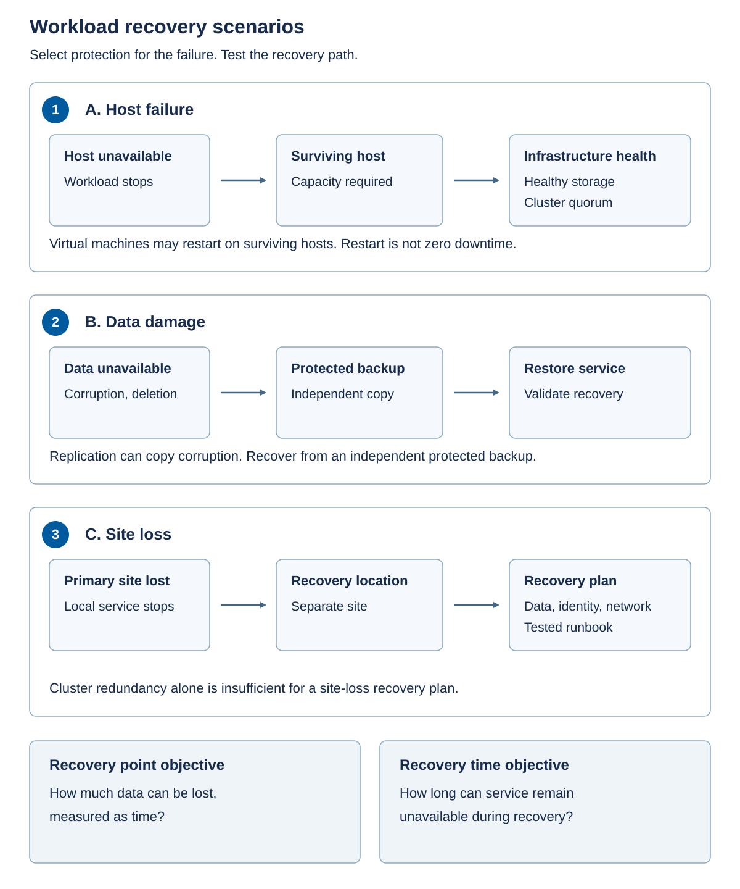

Availability design connects the business target to a named failure. It must account for the application, not only the health of the cluster.

## Define the target and the failure domain

Use the following terms to describe your application's availability requirements and recovery targets:

- A *failure domain* is a set of components that can become unavailable together because they share a dependency. A drive, a node, a switch, a power circuit, a rack, and a site can each be a failure domain. Two hosts in the same rack aren't independent of a failed rack power feed.
- A *recovery point objective* (RPO) specifies the maximum tolerable data loss, usually expressed as time. An RPO of 15 minutes means the recovery design must be able to restore a sufficiently recent usable data state; a backup scheduled every 15 minutes isn't proof that every backup finishes or can be restored.
- A *recovery time objective* (RTO) specifies how long restoration of service may take. Include detection, escalation, recovery decisions, data restoration, dependency startup, validation, and any network cutover. A five-minute VM boot time doesn't establish a five-minute application RTO.
- A *service-level objective* (SLO) is a measurable operating target, such as transaction availability over a stated interval. A *service-level agreement* (SLA) is a contractual commitment with defined scope, terms, and remedies. Neither a vendor response-time commitment nor a platform SLA automatically becomes an end-to-end application SLA.

Microsoft doesn't provide an availability SLA for an Azure Local instance or its workloads. The [Azure Local Well-Architected guidance](/azure/well-architected/service-guides/azure-local#reliability) makes this boundary explicit. An SLA for a cloud service used by the design doesn't become an Azure Local workload SLA.

> [!NOTE]
> For perspective, a fictional 99.9 percent monthly availability SLO permits 43.2 minutes of unavailability in a 30-day month if measured continuously without exclusions. That calculation describes the example SLO, not a Microsoft availability promise.

## Separate quorum, storage resilience, and workload capacity

Quorum, storage resilience, and workload capacity solve different problems.

*Quorum* determines which set of cluster members is permitted to continue operating. It helps prevent a partition from creating conflicting owners of clustered resources. A witness supplies an additional quorum mechanism under the supported configuration; it doesn't store a recoverable copy of application data or contribute CPU and memory.

Storage Spaces Direct also has *pool quorum*, which protects the consistency of the storage pool's metadata. Cluster quorum and pool quorum must both be considered. For example, three data copies on three nodes don't guarantee uninterrupted access after two nodes become unavailable: the storage pool can lose quorum even if a copy remains. See [cluster and pool quorum](/windows-server/storage/storage-spaces/quorum).

Witness choice is deployment-specific. Storage Spaces Direct doesn't support a disk witness, whereas the rack-aware SAN preview has its own disk-witness requirement. Connected two-machine and rack-aware hyperconverged designs have documented cloud-witness requirements. Don't move a witness rule from one storage architecture to another or assume that a lost witness immediately means the cluster has stopped.

*Storage resilience* determines whether enough valid data and metadata remain accessible after the particular failure. A mirror keeps multiple copies of data in supported fault domains. Losing a host can remove storage copies as well as compute capacity in a hyperconverged design.

*Workload capacity* determines whether the surviving infrastructure can actually run the required services within their performance targets. A cluster can have quorum and readable storage yet lack the memory to restart all affected VMs.

All three must hold, along with the application's own dependencies. Don't conclude that a cluster can lose a certain number of machines merely from its node count. The result depends on quorum configuration, failure sequence, data placement, storage resiliency, and available capacity.

For a single-node footprint, there's no second host on which to restart a VM after that host fails. A two-node design has different storage and quorum considerations from a larger design. The supported resiliency options and their prerequisites must come from the selected Azure Local documentation.

## Distinguish failover, live migration, backup, and disaster recovery

The following mechanisms address different needs, including planned maintenance, host failures, data loss, and site outages:

- *Live migration* moves a running VM between healthy hosts as part of a supported operation. It's useful during maintenance. It can't preserve a running memory state from a host that's already failed.
- *Failover* transfers or restarts a supported workload on surviving infrastructure after failure. Restarting a VM can interrupt the application, and the guest may need database recovery or dependency startup before it serves requests. Application-level redundancy can reduce interruption when designed and tested for that workload.
- *Backup* retains recoverable data states so that you can undo corruption, deletion, or other damage. Storage mirroring isn't backup: a valid write that deletes data is normally reflected in the live copies. A second copy under the same administrative compromise might not provide meaningful protection.
- *Disaster recovery* restores service after a failure beyond the local availability design, such as loss of a site. It needs a supported recovery destination, recoverable data, identity and network services, credentials or keys, and an executable runbook. A runbook is the ordered operational procedure for carrying out and validating recovery.

The following diagram matches three failure types to different recovery mechanisms.

Local failover needs surviving capacity and healthy quorum and storage. Corruption or deletion needs an appropriate independent recovery point. Site loss requires a separate recovery location and its dependencies. RPO and RTO apply to the recovered service, not simply to the movement of a VM.

## Write the failure contract

Before sizing, agree which concurrent events the design must tolerate.

| Failure case | Required evidence | What it doesn't establish |
| --- | --- | --- |
| One host unavailable | Surviving compute, storage access, quorum, and workload placement | Tolerance of another failure during maintenance |
| One network path or switch unavailable | Supported redundancy and enough remaining throughput | Resilience to a shared upstream or power dependency |
| One node in maintenance plus another failed | Capacity and supported resiliency with two unavailable nodes | Automatic support for every two-node failure combination |
| Application data damaged | Protected recovery points and tested application-consistent restoration | Site recovery if all recovery assets are local |
| Entire site unavailable | Separate recovery environment and tested end-to-end runbook | An RTO met merely by having replication enabled |

The running scenario initially allows **one unavailable node in total**, whether it's down for maintenance or has failed. If the business requires maintenance and another failure at the same time, that's a different requirement. You'll calculate both cases in the next unit.
