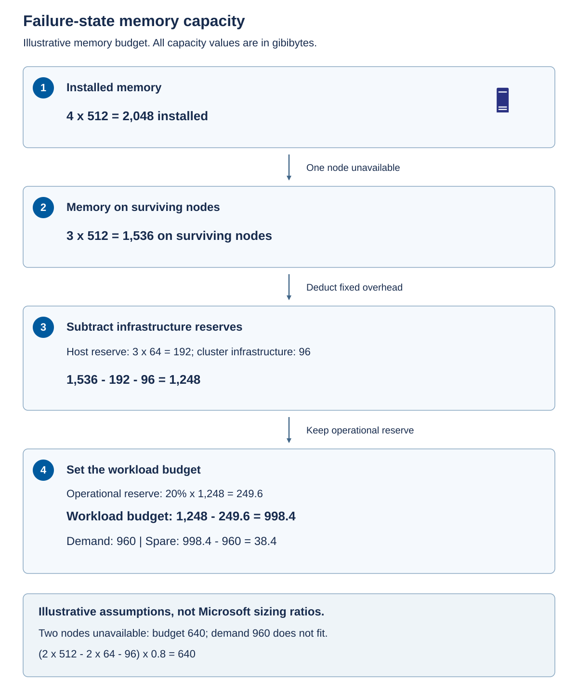

A *capacity envelope* is the combination of compute, memory, storage, network, and placement limits within which the required workload can run. Passing one dimension doesn't compensate for failing another. Plan from measured workload demand and failure-state behavior, not from a total printed on a hardware quotation.

Installed capacity isn't allocatable capacity. Subtract host overhead, platform infrastructure, failure reserve, maintenance reserve, and growth before advertising a workload budget. Avoid counting the same reserve twice, but don't assume that scheduled maintenance and an unplanned failure can never overlap.

## Establish measured demand and consistent units

Gather demand over representative business cycles, including production peaks, batch jobs, backups, and recovery activity. A daily average can hide a short period that determines whether transactions meet their latency target. Record both utilization and the resulting application behavior.

Use the following table to identify the evidence needed for each capacity dimension and the sizing mistakes it helps prevent.

| Dimension | Evidence to collect | Common sizing mistake |
| --- | --- | --- |
| CPU | Concurrent demand, processor model, latency targets, and host overhead | Treating a configured virtual CPU as a dedicated physical core |
| Memory | Peak working requirements, VM startup requirements, platform demand, and growth | Counting memory that guests might release but aren't guaranteed to release |
| Storage | Used space, growth, read/write mix, IOPS, throughput, latency, and protection overhead | Sizing only from virtual disk sizes or drive capacity |
| Network | Traffic paths, peak throughput, latency, migration, backup, and repair demand | Adding link speeds without understanding traffic distribution |
| Placement | Largest VM, host eligibility, failure domains, and separation requirements | Assuming total free capacity is usable by every workload |

*IOPS* means input/output operations per second. Throughput measures data transferred per second; latency measures how long an operation takes. A system can have acceptable aggregate throughput while latency-sensitive transactions perform poorly. Compare measurements that use a relevant request size, read/write mix, and concurrency.

Use binary units consistently for the worked examples: 1 GiB is 1,073,741,824 bytes, and 1 tebibyte (TiB) is 1,099,511,627,776 bytes. A drive advertised in decimal terabytes (TB) uses 1,000,000,000,000 bytes per TB. Mixing TB and TiB creates apparent capacity that doesn't exist.

## Inventory physical cores and installed memory

Run this read-only inventory on an authorized representative Windows server, not an architect's workstation. It uses the built-in CimCmdlets module in Windows PowerShell 5.1 or later and requires local Common Information Model access, normally through an approved administrative session. There are no placeholders or configuration changes.

```powershell
$ErrorActionPreference = 'Stop'
$processors = Get-CimInstance -ClassName Win32_Processor
$system = Get-CimInstance -ClassName Win32_ComputerSystem
[pscustomobject]@{
    PhysicalCores = ($processors |
        Measure-Object NumberOfCores -Sum).Sum
    LogicalProcessors = ($processors |
        Measure-Object NumberOfLogicalProcessors -Sum).Sum
    MemoryGiB = [math]::Round($system.TotalPhysicalMemory / 1GB, 1)
}
```

Physical cores inform hardware capacity and core-based charging. Logical processors include hardware threads and aren't additional licensed physical cores. MemoryGiB reports installed bytes divided by 1,073,741,824. None of these fields measures current demand, sustained processor performance, or eligibility for a catalog configuration.

Run physical-capacity inventory on a physical host: a VM can report a virtualized processor and memory allocation instead. If you can't query an authorized representative system, use an approved hardware inventory; this module doesn't require access to production. If the command fails, resolve the permissions or management-provider issue rather than treating an empty result as zero capacity.

## Calculate memory after a failure

Suppose four equal nodes each provide 512 gibibytes (GiB) of memory, with 64 GiB reserved per surviving host. Assume one failed node, 96 GiB of cluster-wide infrastructure demand, and a further 20 percent operational reserve after these deductions. Measured peak workload demand plus planned growth is 960 GiB. These are example assumptions.

The 64 GiB is a per-host allowance, so it's deducted only for the hosts still running. The 96 GiB is the assumed total demand of separate platform infrastructure that must remain available; it isn't another per-host allowance. The example's 20 percent reserve is additional operational headroom, not an extra growth allowance for growth already included in the 960 GiB.

Use this formula:

```text
Workload budget =
  ((total nodes - unavailable nodes) x (memory per node - host reserve)
    - cluster infrastructure demand) x (1 - operational reserve fraction)
```

The assumptions must be mutually consistent. If measurements already include infrastructure demand in the host allowance, don't deduct it again. If workloads aren't permitted on particular surviving nodes, aggregate arithmetic needs to be supplemented by a placement calculation.

This arithmetic-only example runs in any PowerShell 5.1 or later session with ordinary user permissions and no modules. Replace its numeric inputs with approved measurements; it neither queries nor changes infrastructure.

```powershell
$nodes = 4
$failedNodes = 1
$memoryPerNodeGiB = 512
$hostReserveGiB = 64
$infrastructureGiB = 96
$operationalReserveFraction = 0.20
$plannedWorkloadGiB = 960
if ($nodes -le $failedNodes -or $failedNodes -lt 0 -or
    $hostReserveGiB -lt 0 -or $memoryPerNodeGiB -le $hostReserveGiB -or
    $infrastructureGiB -lt 0 -or $plannedWorkloadGiB -lt 0 -or
    $operationalReserveFraction -lt 0 -or
    $operationalReserveFraction -ge 1) {
    throw 'Invalid capacity assumptions. Review node counts and reserves.'
}
$remainingGiB = ($nodes - $failedNodes) *
    ($memoryPerNodeGiB - $hostReserveGiB) - $infrastructureGiB
if ($remainingGiB -lt 0) {
    throw 'Surviving capacity cannot accommodate platform infrastructure.'
}
$workloadBudgetGiB = $remainingGiB * (1 - $operationalReserveFraction)
[pscustomobject]@{
    WorkloadBudgetGiB = [math]::Round($workloadBudgetGiB, 1)
    PlannedWorkloadGiB = $plannedWorkloadGiB
    SpareGiB = [math]::Round($workloadBudgetGiB - $plannedWorkloadGiB, 1)
    FitsMemory = $plannedWorkloadGiB -le $workloadBudgetGiB
}
```

The result is a 998.4 GiB budget and 38.4 GiB spare, with `FitsMemory` equal to `True`. The 38.4 GiB is what remains after the operational reserve has already been withheld; it isn't the entire resilience allowance.

The following diagram shows the deductions in order.



Start with 2,048 GiB installed. One unavailable node leaves 1,536 GiB. Deduct 192 GiB for the three surviving hosts and 96 GiB for infrastructure to obtain 1,248 GiB. Withhold 249.6 GiB, or 20 percent, leaving 998.4 GiB for planned workloads.

Compare the candidate designs using the same assumptions.

| Installed nodes | Unavailable nodes | Capacity after host and infrastructure deductions | Workload budget after 20 percent reserve | Does 960 GiB fit? |
| --- | --- | --- | --- | --- |
| 3 | 1 | 800 GiB | 640 GiB | No; short by 320 GiB |
| 4 | 1 | 1,248 GiB | 998.4 GiB | Yes; 38.4 GiB remains |
| 4 | 2 | 800 GiB | 640 GiB | No; short by 320 GiB |
| 5 | 2 | 1,248 GiB | 998.4 GiB | Yes, for memory only |

Three identical nodes leave only 640 GiB under the same one-node failure assumption, so that alternative fails. Four nodes also fail when one node is being maintained and another fails. Five identical nodes pass that two-unavailable-node **memory** calculation, but this doesn't prove that the proposed storage, quorum, networking, or workload placement supports the same failure.

Passing this calculation establishes only aggregate memory feasibility. Processor scheduling, storage latency, network throughput, and placement can independently reject the design. A large VM that can't fit on any eligible surviving host can't use fragmented free memory spread across several hosts.

## Test processor demand and placement

Processor oversubscription must come from measured concurrency and latency tolerance, not a universal virtual-to-physical ratio. Memory oversubscription mustn't depend on every guest shrinking during failover. Hardware asymmetry can make the loss of the largest node the governing scenario, even when the average node appears adequately sized; support symmetry rules apply independently.

*Oversubscription* means allocating more virtual resources than the equivalent physical resources available at one time. For CPU, that can be appropriate when workloads don't need all configured virtual processors concurrently. It can become unacceptable when the same workloads peak together after failover.

Check whether application replicas need placement on different hosts, whether some VMs require a specific device, and whether host or guest licensing constrains migration. A resilience design can't rely on restarting a workload on an ineligible target. Prefer supported placement controls and documented operational procedures to assumptions about where a VM will happen to run.

## Calculate usable storage and repair headroom

For a simplified mirrored pool, calculate physical capacity first, then convert to logical capacity using the resilience overhead, then deduct logical allocations.

```text
Logical workload capacity =
  (physical capacity - physical repair reserve - physical overhead)
    / copy count
  - logical infrastructure allocation
```

For an illustrative 100 TiB physical capacity tier, subtract 10 TiB of repair reserve and 2 TiB of physical overhead, leaving 88 TiB. Three-copy mirroring yields about 29.3 TiB before logical infrastructure allocation. Reserving another 2 TiB for infrastructure leaves approximately 27.3 TiB for workloads, before workload growth.

The following table tracks each deduction from physical storage to the remaining logical workload capacity.

| Deduction or conversion | Result | Meaning |
| --- | --- | --- |
| Start with physical capacity | 100 TiB | Eligible capacity-tier space, not a total that also counts cache or boot devices |
| Deduct physical repair reserve | 90 TiB | Space retained for the assumed repair scenario |
| Deduct physical overhead | 88 TiB | Simplified allowance for physical consumption not used by workload data |
| Divide by three copies | About 29.3 TiB | Illustrative logical capacity before infrastructure allocations |
| Deduct logical infrastructure | About 27.3 TiB | Workload space before a separate growth requirement |

The reserve and overhead amounts in this calculation are deliberately illustrative. They aren't a recommended percentage or an exact prediction of a real pool's formatted capacity. Apply the actual storage layout, supported resiliency, repair requirements, and sizing guidance for the selected system. Don't count cache drives as capacity devices or divide a capacity figure again if a sizing tool has already reported it after resiliency.

For Storage Spaces Direct, the [volume-planning guidance](/windows-server/storage/storage-spaces/plan-volumes#reserve-capacity) recommends reserving the equivalent of one capacity drive per server, up to four drives. This is unallocated physical pool capacity, not necessarily dedicated hot-spare drives. The correct reserve must be assessed against the actual drive layout and recovery design; the example's 10 TiB isn't a replacement for that assessment.

Two-copy mirroring has a theoretical 50 percent data efficiency and three-copy mirroring about 33 percent before other deductions. Those percentages alone don't tell you whether the layout is supported for a given node count or which failures it survives. Nested resiliency and parity-based layouts use different calculations and prerequisites; don't substitute their efficiency without checking the selected deployment.

Ordinary cross-node two-way mirroring needs at least two server fault domains, and three-way mirroring needs at least three. Two-server nested mirroring has a different, approximately 25 percent efficiency because it maintains additional copies within the servers. The [fault-tolerance guidance](/windows-server/storage/storage-spaces/fault-tolerance) and [nested-resiliency guidance](/windows-server/storage/storage-spaces/nested-resiliency) define the corresponding supported conditions. More copies can preserve data through a failure without preserving enough quorum or compute to serve it.

*Thin provisioning* allows logical allocation to exceed physical space currently consumed, subject to supported platform behavior. It doesn't create storage. A design must monitor physical consumption and retain room for growth and repair. Similarly, a compression or deduplication saving observed for one data set isn't a guaranteed saving for another.

Storage performance must also survive the degraded state. Rebuilding lost data consumes throughput and can increase latency while workloads continue running. An external array has its own spare-space, protection, and rebuild model; don't apply a Storage Spaces Direct three-copy formula to the array's already-protected usable capacity.

## Budget the surviving network path

For networking, two 25-gigabit paths aren't a guaranteed 50-gigabit application pipe. Check protocol behavior and the load on the surviving path. Rebuild traffic, live migration, backup, and normal writes compete precisely when redundancy is reduced. Include switch uplink oversubscription and failure of an entire switch, not only a cable.

Separate management, storage, workload, migration, and backup traffic in the design even when the supported physical pattern converges some of them on shared adapters. Where the selected pattern uses [Network ATC](/azure/azure-local/concepts/network-atc-overview?view=azloc-2610&preserve-view=true), network *intents* express the purposes of host adapters and apply the supported host configuration. Network ATC doesn't make an unqualified switch topology supported or configure the physical switches for you. Don't apply a hyperconverged intent model indiscriminately to disaggregated cluster and storage ports; follow the selected architecture's network pattern.

Where the selected design uses remote direct memory access (RDMA), the adapters and network must satisfy that design's requirements. RDMA can reduce host CPU overhead for supported transfers, but its presence isn't proof of adequate bandwidth or correct fabric configuration. Protocol-specific settings and their responsibilities belong in the network design, not in an assumption that all Ethernet behaves identically.

Suppose the required storage and workload traffic can reach 18 gigabits per second (Gbps), and a concurrent repair adds 10 Gbps across the same surviving 25 Gbps bottleneck. The 28 Gbps demand exceeds the nominal link rate even before overhead. Another idle adapter doesn't solve the bottleneck unless the supported traffic pattern can use it. Change the supported design or the approved concurrency and performance requirement; don't hide the overload in an average.

## Make lifecycle capacity a design constraint

Platform updates, firmware work, hardware replacement, backup restoration, and storage repair all need resources. A system that has room only when every node is healthy might be impossible to maintain within its availability commitment.

Record a capacity trigger and an owner. For example, the manufacturer can require a design review before planned demand exceeds the calculated failure-state budget, with earlier procurement triggers based on lead time. An alert at the exact exhaustion point is too late if expansion takes months.

Keep the capacity evidence with its date, workload measurement interval, growth assumptions, chosen failure case, and excluded resources. This makes later change review reproducible and reveals when a new requirement invalidates the original decision.
