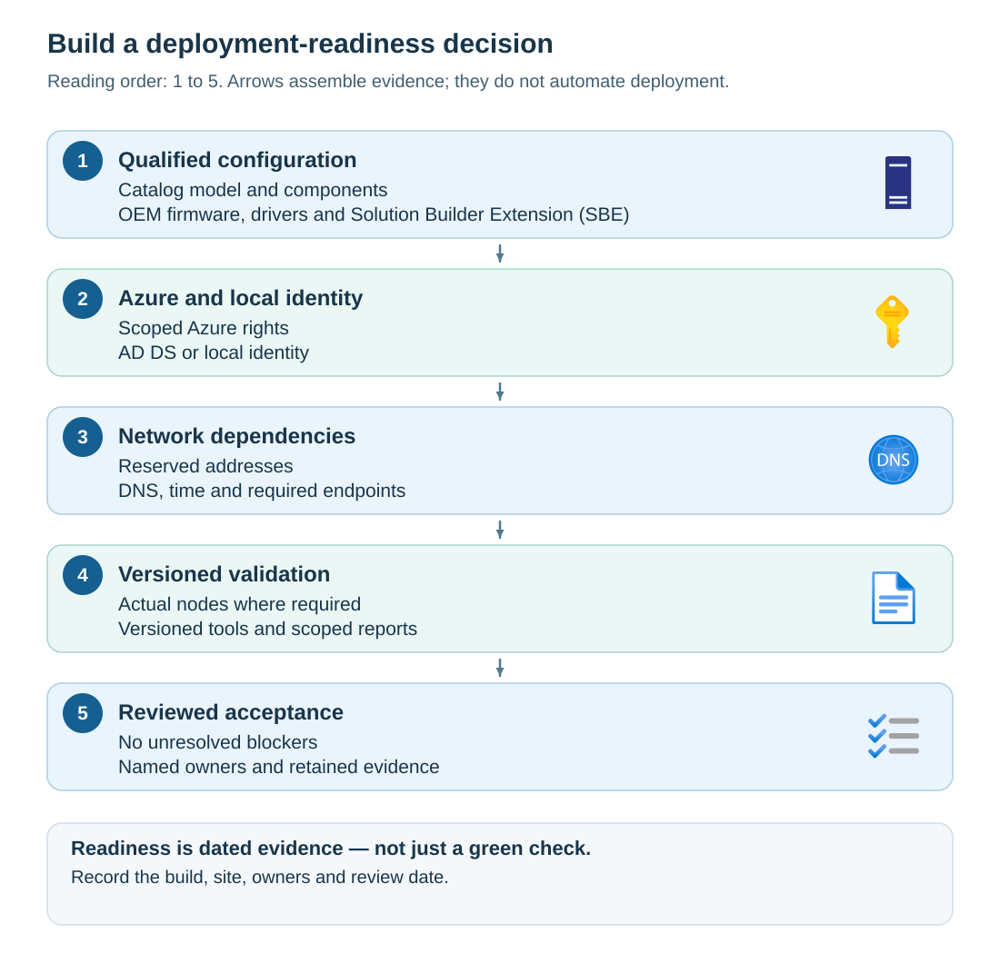

Deployment failures often expose boundaries between teams. A manufacturer-qualified server can fail validation because someone changed its firmware settings. An Azure user can read a resource group but lack permission to create a vault. Correct credentials can fail when name resolution or time synchronization is wrong.

Your task as someone interested in a successful deployment of Azure Local administrator is to make all relevant dependencies explicit before deployment to maximize your chances of a successful outcome.

## Contoso's Azure Local deployment scenario

Contoso is preparing two connected Azure Local sites. At its main site, an established Active Directory Domain Services (AD DS) environment can support the platform. At a branch site, there's no suitable domain dependency, so the team is considering local identity with Azure Key Vault.

Both sites need Azure resource management, supported hardware, reliable networking, and an operating model. The branch site isn't disconnected just because it has no domain. It still needs the Azure connectivity required by its deployment type.

You're the deployment engineer. Hardware, identity, Azure, and network administrators provide inputs, but you own the readiness handoff. You must distinguish a verified input from an assumption and assign unresolved findings to an owner.

## Determine configuration baseline

A *configuration baseline* is the recorded set of choices against which you evaluate readiness. It includes the deployment type, solution build, manufacturer configuration, node inventory, identity model, Azure location and scope, and network design.

Evidence is meaningful only in relation to that baseline. A report from a different build, a staging machine on a different network, or a principal with different permissions might not describe the environment you intend to deploy.

Use the following sequence to assemble readiness evidence:

1. Start with eligible hardware.
1. Establish Azure and local identity prerequisites.
1. Prove network dependencies from the relevant callers.
1. Run versioned checks.
1. Have the responsible owners review the evidence and close findings.

The arrows in the following diagram show how the acceptance case is assembled; they don't represent automated deployment steps.

The following table identifies the evidence, responsible owners, and stop conditions for each readiness boundary.

| Readiness boundary | Evidence to retain | Typical owner | Stop condition |
| --- | --- | --- | --- |
| Catalog configuration | Exact model, component inventory, supported software combination | Manufacturer and platform engineer | Unqualified hardware or unsupported combination |
| Firmware security | Secure Boot, hardware TPM, virtualization settings | Hardware administrator | Required control absent, disabled, or not established |
| Azure resources | Region, providers, scoped authorization, policy, applicable limits | Subscription and resource owners | Denied resource creation or unavailable service |
| Local authentication | Prepared directory or supported local identity; recovery design | Identity administrator | Missing delegation, incompatible tools, or incomplete recovery preparation |
| Network prerequisites | Approved addresses, name resolution, time, required endpoint access | Network administrator | Overlap, unresolved names, or blocked required flows |
| Validation and acceptance | Reproducible reports, finding dispositions, owner approval | Deployment engineer | Unresolved blocker or evidence for the wrong configuration |

Record **not tested** separately from **passed**. A team that hasn't supplied evidence hasn't supplied a pass. Likewise, a tool warning doesn't cancel a documented support requirement.
