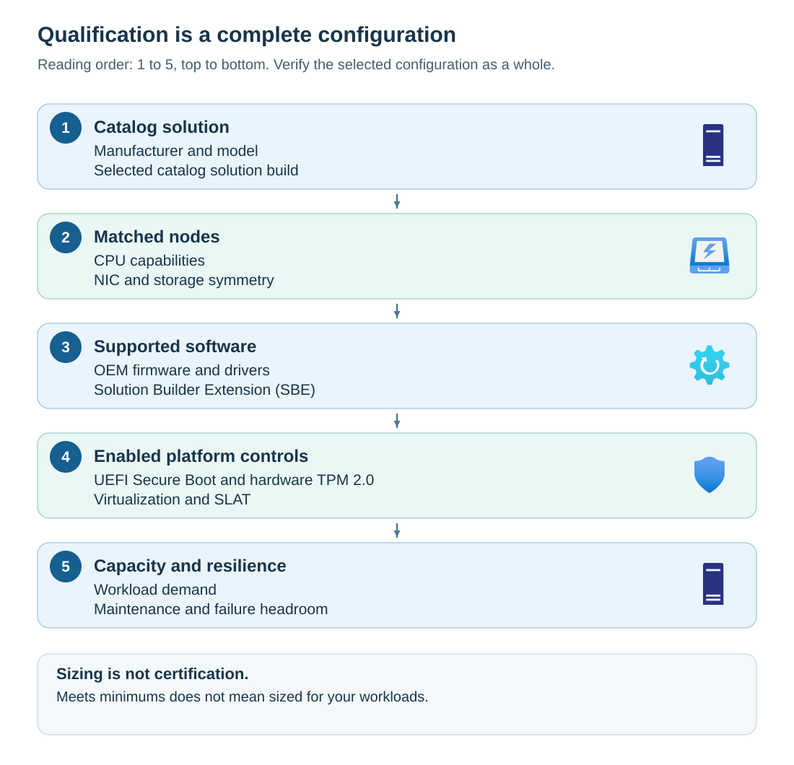

Hardware qualification establishes that the physical platform and its software combination are supported. Sizing establishes that this qualified platform can run the intended workloads under normal conditions, maintenance, and the chosen failure scenario. You need both to achieve a state of readiness.

## Qualify the configuration

Azure Local isn't built at the local computer shop using off the shelf components. An *original equipment manufacturer* (OEM) supplies and supports the server platform. An Azure Local catalog entry identifies a qualified solution or configuration, not permission to assemble arbitrary components from the same manufacturer.

Compare the delivered machines with the selected catalog solution. Record the server model, processor characteristics, network adapter models, drive population, firmware, drivers, and solution compatibility. Capture any manufacturer-specific preparation requirements as part of the baseline.

The *Solution Builder Extension* (SBE) is the manufacturer's integration package for solution-specific lifecycle content, such as applicable driver and firmware updates. Its compatibility with the Azure Local solution version matters. Don't assume that the newest driver downloaded independently from a component vendor is the right driver for the qualified solution.

Hardware qualification covers the following considerations:

- Catalog eligibility identifies the supported starting point.
- Node consistency and manufacturer software preserve that configuration.
- Enabled controls establish platform capabilities.
- Capacity and resilience planning determine whether it meets the business requirement.



## Node symmetry

*Symmetry* means that the nodes have the matching characteristics required by the platform. It's more than matching the number of physical cores. Initial deployment requirements cover manufacturer and model, processor types and capabilities, network adapters, and the number and type of storage drives.

Two processors with the same core count can differ in instruction support, clock characteristics, enabled cores, or logical processor configuration. Two network interface cards (NICs) sold at the same nominal speed can use different silicon, firmware, or capabilities. These differences can prevent validation or create uneven behavior after failover.

For the initial deployment, compare every node with the same approved inventory, rather than comparing only the first two machines. Reconcile mismatches with the manufacturer's supported configuration before proceeding.

Add-node and repair workflows have their own compatibility rules. A documented allowance for a replacement node doesn't justify an asymmetric initial purchase.

## Distinguish capability, protection, and capacity

The following concepts explain what common hardware prerequisites protect.

| Concept | What it does | Readiness implication |
| --- | --- | --- |
| Hardware virtualization | Allows a hypervisor to run isolated virtual machines efficiently | Enable supported Intel VT or AMD-V capabilities in firmware |
| Second-level address translation (SLAT) | Assists translation between guest and host memory addresses | A compatible processor must provide the capability; core count alone is insufficient |
| Error-correcting code (ECC) memory | Detects and corrects supported memory error patterns | Use qualified ECC memory; minimum RAM isn't a workload memory budget |
| Unified Extensible Firmware Interface (UEFI) Secure Boot | Checks the boot trust chain before loading trusted boot components | The capability must be present and enabled |
| Hardware Trusted Platform Module (TPM) 2.0 | Provides protected cryptographic operations and supports platform trust | Verify hardware TPM 2.0 eligibility and enabled state |
| Boot storage | Holds the operating system and space needed for servicing and diagnostics | Preserve room for updates and support data, not only the initial image |

Current system guidance specifies at least **32 GB of ECC memory per machine** and a boot drive of at least **200 GB**. For machines with more than **768 GB of physical memory**, at least **400 GB of boot storage** is recommended for diagnosability. These are prerequisite values, not a recommended production configuration for every workload.

Secure Boot and TPM address different parts of platform protection. Secure Boot helps prevent untrusted boot components from loading. A TPM can protect key operations used by security features. Neither replaces the other, and neither proves that all firmware and driver combinations are supported.

> [!CAUTION]
> Don't clear a TPM, reset firmware, or disable Secure Boot to make a check pass. These changes can affect BitLocker-protected keys, boot access, security, and supportability. Obtain the manufacturer's approved remediation and establish protected recovery access before making firmware changes.

## Separate boot storage from pooled data storage

*Storage Spaces Direct* pools eligible drives attached to the Azure Local machines and uses software-defined storage to provide volumes and resilience. For this module's hyperconverged design, the data drives must be presented through supported direct attachment rather than hidden behind an unsupported hardware RAID virtual disk.

> [!NOTE]
> *Hyperconverged* means that the same physical machines provide compute and local storage to the system. This module doesn't establish prerequisites for disaggregated storage, disconnected operations, or every workload service. Those choices require their own support and prerequisite review.

An eligible host bus adapter presents individual drives through the documented pass-through configuration. A boot-device design is a separate question: a restriction on pooled data disks isn't a blanket prohibition on every OEM-supported boot arrangement.

The system requirements include at least two data disks per machine, each at least 500 GB, with the required matching characteristics at deployment. Refer to the manufacturer's documentation for your selected Azure Local hardware configuration to confirm supported drive types, drive counts and placement, firmware versions, power-loss protection requirements, and permitted combinations of storage media. More raw capacity doesn't automatically provide more usable resilient capacity.

Plan compute and storage headroom for maintenance and failure. For example, if workloads already consume nearly all the usable memory across a two-node system, losing one node leaves no realistic failover margin. Adding the nodes' advertised capacity isn't a resilience calculation.

## Collect a bounded hardware inspection

Run the following read-only example in elevated **Windows PowerShell 5.1 on each target machine**. It uses the built-in TrustedPlatformModule, SecureBoot, and CimCmdlets modules. It has no user placeholders and doesn't alter firmware, install drivers, or enable features.

> [!NOTE]
> This example uses Windows PowerShell 5.1 (`powershell.exe`). PowerShell 7 (`pwsh.exe`) installs separately and doesn't replace Windows PowerShell 5.1. For other Azure Local tasks, use the PowerShell version specified by the relevant procedure, because compatibility depends on the modules and workflow.

```powershell
$ErrorActionPreference = 'Stop'

Get-CimInstance -ClassName Win32_ComputerSystem |
    Select-Object Name, Manufacturer, Model, TotalPhysicalMemory

Get-CimInstance -ClassName Win32_Processor |
    Select-Object DeviceID, Caption, Family, Manufacturer, MaxClockSpeed,
        NumberOfEnabledCore, NumberOfLogicalProcessors, ThreadCount

Get-CimInstance -ClassName Win32_BIOS |
    Select-Object Manufacturer, SMBIOSBIOSVersion, ReleaseDate

Get-Tpm |
    Select-Object TpmPresent, TpmReady, TpmEnabled, TpmActivated, ManufacturerIdTxt

Get-CimInstance -Namespace 'root\CIMV2\Security\MicrosoftTpm' `
    -ClassName Win32_Tpm |
    Select-Object SpecVersion, ManufacturerVersion

Confirm-SecureBootUEFI
```

Compare the results between nodes and against the approved configuration. `TotalPhysicalMemory` is reported in bytes. Keep each processor instance in a multisocket machine; don't reduce the evidence to one processor row.

`Get-Tpm` reports state, while the TPM CIM information helps establish the reported specification version. `Confirm-SecureBootUEFI` returning `True` establishes the queried Secure Boot state. These outputs don't certify the solution or prove the authenticity of every component.

If a command fails because a module, firmware interface, permission, or CIM class is unavailable, the state **isn't established**. Preserve the error and investigate its cause. Don't convert an exception or missing result into a pass. NIC, drive, and SBE inventories still require separate evidence.

**Scenario decision:** A delivery matches the catalog server model, but one node has a different NIC and firmware release. Contoso must reconcile the delivered configuration with the OEM-supported combination before acceptance. A successful Windows boot doesn't settle that question.
