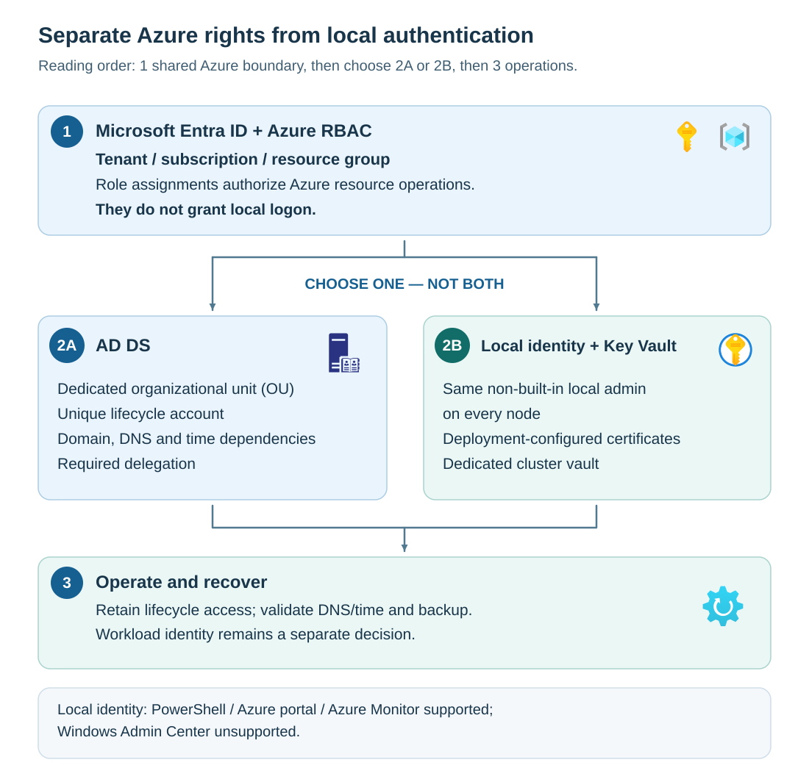

Identity selection determines how the platform authenticates and maintains local administrative and cluster operations. It doesn't remove the need for Azure identities or determine how every workload authenticates.

## Separate the three identity questions

*Authentication* establishes who a caller is. *Authorization* determines what the authenticated caller can do. A valid password can establish identity without granting permission for a particular operation.

Ask three separate questions when designing Azure Local:

- Which Microsoft Entra principals can manage the Azure resources?
- Which supported identity model will the local platform use?
- Which identities will guest operating systems, applications, and workload services use?

AD DS supplies domain authentication, directory objects, and policy. Local identity with Key Vault uses local administrative credentials and deployment-configured certificate-based integration without requiring the Azure Local nodes to join AD DS.

Local identity isn't Microsoft Entra domain join for the physical machines. Key Vault isn't a replacement domain controller. The vault stores and protects supported secrets and certificates; the deployment and management mechanisms use them for their documented purposes.

The shared Azure boundary applies to both choices. Choose either the AD DS preparation path or the local-identity path for the instance. Both converge on lifecycle administration and recovery. There's no permission inheritance from Azure subscription ownership into local administrator access.

## Compare operational consequences

The following table compares the preparation, ongoing dependencies, and operational responsibilities of AD DS and local identity with Key Vault.

| Question | AD DS | Local identity with Key Vault |
| --- | --- | --- |
| What must be prepared? | Dedicated OU, unique lifecycle account, delegated rights, applicable policy, domain DNS and time | Same approved non-built-in local administrator credentials across nodes, supported DNS design, deployment certificate integration, dedicated cluster vault |
| What remains a dependency? | Domain services, account health, DNS, time, and retained delegation | Local account maintenance, certificate health, DNS, time, vault access, and verified recovery material |
| What must operations support? | Domain-aware administration and platform lifecycle requirements | Supported PowerShell, Azure portal, and Azure Monitor operations |
| What can't be assumed? | Domain administrators are required for every operation | Windows Admin Center works, or Key Vault automatically rotates the customer-managed administrator |
| What happens to workload identity? | Designed for each workload | Still designed for each workload; avoiding a platform domain doesn't eliminate application identity needs |

Windows Admin Center is unsupported for the local-identity model. Microsoft Management Console tool compatibility varies, and System Center Virtual Machine Manager has limited or no support depending on the use case. Validate the actual management workflow rather than assuming compatibility from another Windows-based environment.

Select local identity because its supported operating model fits the site, not merely because directory preparation appears inconvenient. Likewise, select AD DS only when directory services and ownership can meet the lifecycle requirements.

**Scenario decision:** The branch can use local identity, but its proposal is incomplete if Windows Admin Center is the only approved administration tool. Establish a supported management and recovery workflow before approving the identity choice.
