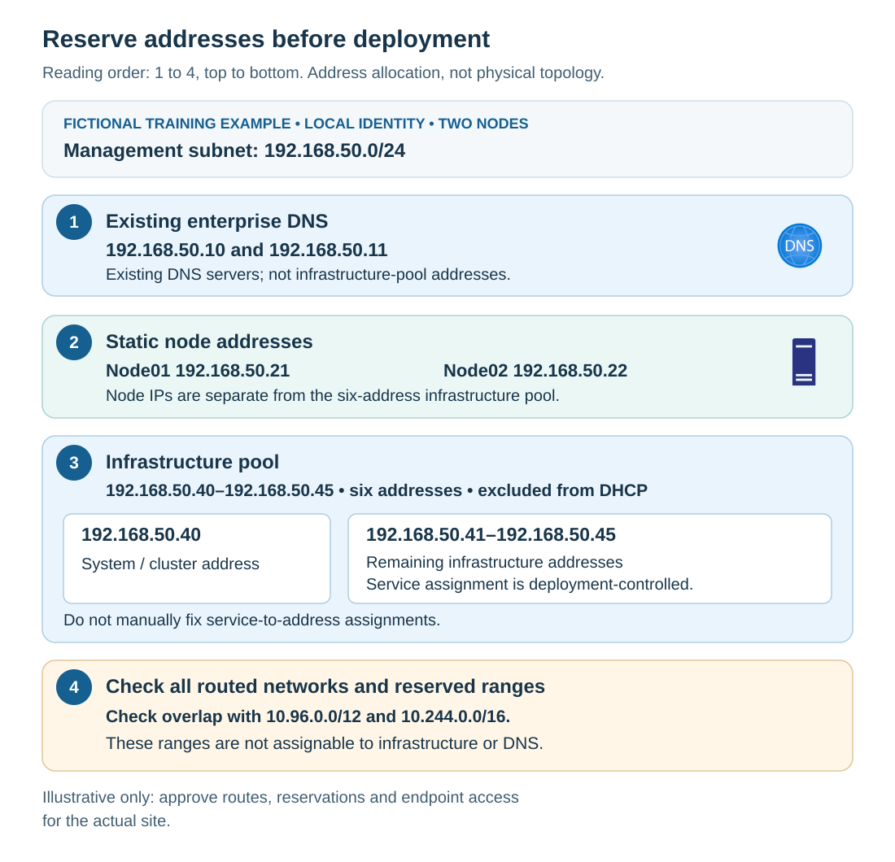

Network readiness means that each Azure Local node, infrastructure appliance, and service can reach the systems and services it depends on, using the approved addressing, DNS, time, and security configuration. A successful browser session from an administrator's laptop doesn't establish this for physical nodes or infrastructure appliances.

## Build a complete address budget

Distinguish node management addresses from the infrastructure pool. The connected hyperconverged prerequisites require at least **six available contiguous IPv4 infrastructure addresses** on the management subnet. The first is used for failover clustering. Node addresses are additional; six isn't the complete site address budget.

*Contiguous* means consecutive addresses, such as `.40` through `.45`. Reserve the pool and exclude it from dynamic allocation. Don't assign those addresses manually to nodes, DNS servers, or unrelated devices. Let deployment assign infrastructure services through the supported workflow.

An IPv4 address written as `192.168.50.0/24` uses classless interdomain routing (CIDR) notation. The `/24` prefix identifies the network portion; for this example, usable conventional host addresses run from `192.168.50.1` through `192.168.50.254`. The prefix is part of the address plan, not merely a notation to omit when checking overlap.

Contoso's fictional branch allocation illustrates the separation.

| Purpose | Example allocation | Interpretation |
| --- | --- | --- |
| Management subnet | `192.168.50.0/24` | Approved subnet for this teaching example |
| Existing enterprise DNS | `192.168.50.10` and `192.168.50.11` | Resolvers with the required internal records and forwarding |
| Node01 and Node02 | `192.168.50.21` and `192.168.50.22` | Static node addresses, outside the infrastructure pool |
| Infrastructure pool | `192.168.50.40` through `192.168.50.45` | Six reserved addresses, excluded from DHCP and other allocations |
| System/cluster address | `192.168.50.40` | First address within the infrastructure pool, not an additional seventh address |

> [!WARNING]
> These private addresses are examples, not universally safe allocations. Use approved site values after checking routes and existing networks.



The diagram is an allocation view, not a physical network topology. DNS and node addresses are outside the six-address pool. The first pool address is the cluster address; remaining infrastructure assignments are deployment-controlled.

## Check overlap beyond the local switch

Compare proposed networks with management, workload, storage, VPN, routed branch, container pod, and service networks. A *pod network* supplies addresses to Kubernetes pods. A *service network* supplies virtual addresses for Kubernetes services. These ranges can affect infrastructure even before you deploy your own application containers.

Azure Local prerequisites reserve `10.96.0.0/12` and `10.244.0.0/16`. The `/12` range covers `10.96.0.0` through `10.111.255.255`; the `/16` covers `10.244.0.0` through `10.244.255.255`. Don't place infrastructure allocations or DNS servers inside those ranges.

A DNS server at `10.100.1.10` conflicts with the first range even though the address doesn't begin with `10.96`. A proposed subnet can also be unused at the site but overlap a network reachable through a VPN. Use the authoritative IP address management and routing information, not only a ping test.

Where generic Arc resource bridge guidance and Azure Local guidance use different ranges, apply the requirements for the selected Azure Local integration. Don't narrow an Azure Local reservation by borrowing a smaller prefix from another product's example.

## Establish DNS and time as infrastructure dependencies

The Domain Name System (DNS) translates names into addresses and publishes records that help callers locate services. It provides more than Internet name resolution. AD DS uses DNS to locate domain services; cluster and node names locate infrastructure; Azure endpoints require the correct external resolution path. Verify the configured resolvers, authoritative records, and forwarding from every relevant caller.

Time synchronization supports authentication and certificate validation. Kerberos, the ticket-based authentication used by AD DS, relies on acceptable time agreement. Certificate checks rely on validity dates. Local identity therefore still needs consistent time even though the domain is absent.

*Network Time Protocol* (NTP) commonly uses UDP port 123. Establish the supported time source and permit the required flow. A domain controller or an approved NTP appliance can supply time, depending on the design. Don't assume that matching clock displays prove a healthy synchronization source.

The following read-only checks run in elevated Windows PowerShell 5.1 on each proposed node. DnsClient provides the DNS inspection; `w32tm` is the Windows Time command-line utility.

```powershell
$ErrorActionPreference = 'Stop'

Get-DnsClientServerAddress -AddressFamily IPv4 |
    Select-Object InterfaceAlias, ServerAddresses

w32tm /query /source
if ($LASTEXITCODE -ne 0) {
    throw 'Windows Time source query failed.'
}

w32tm /query /status
if ($LASTEXITCODE -ne 0) {
    throw 'Windows Time status query failed.'
}
```

Interpret the results against the intended interface and time design. Record the source, synchronization status, and errors. Don't accept an unintended free-running clock as proof of synchronization merely because the displayed time is close.

Current deployment prerequisites restrict changing the DNS servers used by deployed nodes and Arc resource bridge. Settle the resolver design before deployment. Correcting an authoritative record is different from replacing the infrastructure's configured DNS servers.

## Map network dependencies to nodes, appliances, and services

The network owner needs an endpoint and flow plan, not a statement that "Azure is allowed." Include the destination name, port, protocol, source component, proxy route, and owner for every applicable dependency.

Use the following table to identify dependency categories for the plan and the evidence needed to establish their readiness.

| Dependency | Why it's needed | Evidence that's useful |
| --- | --- | --- |
| Azure Local and Arc services | Registration, management, configuration, and lifecycle operations | Required service names and connections work from nodes and applicable infrastructure |
| Resource bridge and platform infrastructure | Appliance deployment and Azure management integration | Their documented endpoint set is reachable, not only Arc for Servers endpoints |
| Domain services, if selected | Domain authentication and object lifecycle | Domain DNS and documented domain-service flows work from the nodes |
| Time source | Authentication and certificate validity | Approved source is reachable and synchronization is healthy |
| Certificate validation | Certificate chain, revocation, and trust-list checks | Required validation endpoints work over their documented protocols |
| Quorum witness | Provides a vote used by cluster quorum | Every relevant node can reach the selected witness |
| OEM and enabled workload services | Qualified updates and workload-specific functions | Additional endpoint requirements are approved and tested |

*Quorum* is the cluster voting mechanism that helps prevent competing subsets of nodes from operating independently. A *witness* contributes a vote; it isn't a workload-data backup. A two-node system requires a witness. A cloud witness uses Azure Storage and needs HTTPS connectivity from every node.

For this example, plan a dedicated witness storage account to keep ownership clear. Don't present that design choice as a universal service limitation: the general prerequisite checklist and detailed witness procedures differ in their account-reuse guidance. Resolve the selected deployment's requirements before implementation.

Certificate validation can require **HTTP port 80** for named certificate revocation list (CRL), online certificate status protocol (OCSP), or trust-list endpoints. A rule allowing only HTTPS port 443 isn't automatically sufficient. Use the documented endpoint list rather than opening unrestricted outbound HTTP.

## Validate proxy settings and HTTPS inspection exclusions

A proxy is part of the source component's effective connection path. Configure the supported proxy settings and bypasses for local node, cluster, and infrastructure traffic. A successful test with a command-specific proxy parameter doesn't prove that the deployment services use the same proxy configuration.

Azure Local doesn't support HTTPS inspection. Don't resolve a connectivity failure by introducing TLS interception or by disabling certificate validation. Current Azure Local firewall guidance also excludes Arc Private Link Scopes for this integration; don't assume another Arc service's private-connectivity example applies.

The 2610 release includes a preview coordinated proxy-update workflow. That doesn't make independent postdeployment edits on nodes or resource bridge a supported procedure, and existing workload services can have separate update requirements. This module establishes the initial design; later changes require the documented lifecycle workflow.

**Scenario decision:** A staging machine reaches Arc successfully, but Node02 uses a different resolver and the witness endpoint is blocked. Contoso remains blocked. The staging result covers neither Node02's resolution path nor quorum witness access.
