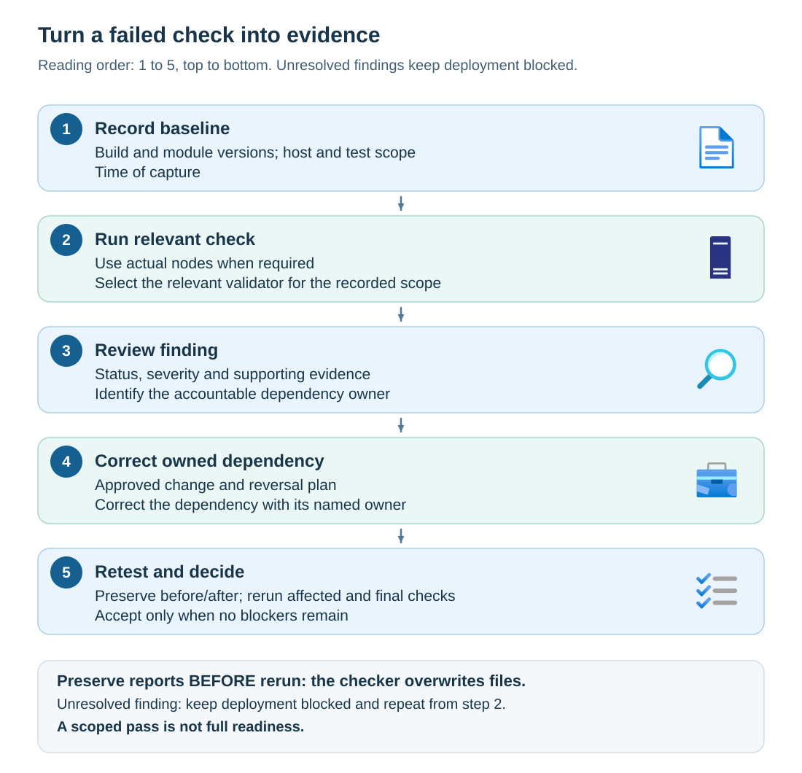

The **Azure Local Environment Checker** is a Microsoft tool for assessing whether an environment meets selected Azure Local deployment prerequisites. It runs automated checks for areas such as hardware, network connectivity, AD DS preparation, and Azure Arc integration, and produces diagnostic reports with findings and available remediation guidance. Use these results to identify and resolve deployment blockers and document readiness. A successful result applies only to the checks and systems assessed; it doesn't replace documented requirements, manufacturer qualification, or engineering review.

## Install the Azure Local Environment Checker

The standalone **AzStackHci.EnvironmentChecker** module is available from the [PowerShell Gallery](https://www.powershellgallery.com/packages/AzStackHci.EnvironmentChecker). Use an approved Windows workstation or staging server connected to the deployment network, with permitted access to the gallery and its package downloads. Installation changes the host and can update shared PowerShell modules, so obtain the required change approval before proceeding.

Complete the following steps to install the standalone tool:

1. Open **Windows PowerShell 5.1 as administrator** on the approved host and update PowerShellGet:

    ```powershell
    Install-Module -Name PowerShellGet -Repository PSGallery `
        -Scope AllUsers -AllowClobber -Force
    ```

1. Close the PowerShell window and open a new Windows PowerShell 5.1 session as administrator so that the updated PowerShellGet module is available.

1. Install Environment Checker from the gallery. The following command installs the latest published version. If your organization requires a specific approved version, add `-RequiredVersion` with that version before running the command:

    ```powershell
    Install-Module -Name AzStackHci.EnvironmentChecker `
        -Repository PSGallery -Scope AllUsers
    ```

1. List the installed versions and record the approved version for use in subsequent readiness checks:

    ```powershell
    Get-Module -Name AzStackHci.EnvironmentChecker -ListAvailable |
        Select-Object Name, Version
    ```

    If the intended version isn't listed, resolve the installation issue before continuing. Don't substitute another version without approval.

Review package-provider and repository prompts according to your organization's policy. You can approve an individual installation without permanently changing the PowerShell Gallery repository's installation policy to trusted.

> [!IMPORTANT]
> If you install the standalone checker on an Azure Local node, uninstall it before starting deployment to avoid conflicts with the integrated checks. This requirement applies to the separately installed module, not the checks built into the deployment workflow. For the complete installation requirements, see [Install Environment Checker](/azure/azure-local/manage/use-environment-checker?view=azloc-2610&preserve-view=true#install-environment-checker).

## Plan readiness checks for your environment

Environment Checker has integrated deployment checks and a separately installable standalone module. These are related capabilities, but their installations and timing aren't interchangeable.

The following table summarizes what each validator area helps establish and the scope or timing limitations to consider before running checks.

| Validator area | What it helps establish | Scope or timing limitation |
| --- | --- | --- |
| Connectivity | Required endpoint access for selected services | Results apply to the execution host or targeted sessions and effective connection path |
| Hardware | Physical configuration and platform capabilities | Must inspect the actual target machines |
| Software | OS consistency, time configuration, and related software prerequisites | Documented checks require sessions to the relevant target nodes |
| AD DS | Required directory objects, permissions, and policy conditions | Requires the directory design and documented tools; can attempt to install missing AD or GroupPolicy modules |
| Network | Final intended network configuration | Follow the documented final predeployment wizard stage and final-hardware requirements |
| Arc integration | Registration, location, and relevant Azure integration constraints | Distinct from whether an Arc endpoint is reachable |

A staging host on the intended network is useful for early connectivity investigation. It can't prove a different node's firmware, account rights, DNS client configuration, or proxy settings.

Not every validator is side-effect-free. For example, the AD DS validator can attempt to install missing supporting modules. Obtain the necessary approval and prerequisites before running a validator. Don't label the entire tool read-only because a connectivity example doesn't repair settings.

## Run a scoped connectivity check

This example uses elevated **Windows PowerShell 5.1** on an approved staging host or target node. It requires a preinstalled, approved version of **AzStackHci.EnvironmentChecker** and permission to make outbound probes and write diagnostic reports.

At the prompt, supply the exact installed version approved for the selected environment. Don't infer a checker-to-solution compatibility mapping from similar version numbers. Installation, repository trust changes, and prerequisite upgrades belong in the tool-preparation process, not in this inspection.

```powershell
$ErrorActionPreference = 'Stop'
$approvedVersion = Read-Host 'Approved installed checker version'

Import-Module AzStackHci.EnvironmentChecker `
    -RequiredVersion $approvedVersion

Get-Module AzStackHci.EnvironmentChecker |
    Select-Object Name, Version

Invoke-AzStackHciConnectivityValidation `
    -Service 'Arc For Servers' `
    -PassThru
```

The documented `Service` value scopes the test to Arc for Servers; `PassThru` returns a PowerShell object. Preserve the test result and the tool's reports. Use the installed module's help if parameter availability differs, and resolve the approved version rather than silently substituting another package.

This invocation doesn't register providers, assign permissions, repair settings, or prove witness, hardware, directory, and all infrastructure readiness. A service-scoped pass isn't a full readiness certificate.

## Preserve evidence before the next run

Environment Checker reports can contain personally identifiable information, machine names, addresses, and directory information. Restrict access to original reports and create sanitized copies for teaching or broad review. Never attach vault secrets, passwords, recovery keys, or access tokens to the evidence package.

The tool overwrites report files on subsequent runs. Preserve the first report in approved protected storage **before rerunning** the check. A screenshot of a green summary is less useful than a report that identifies the baseline, caller, checks, and evidence.

Use the following fields to document each validation run, its findings, and the resulting readiness decision.

| Evidence field | What to record |
| --- | --- |
| Configuration | Deployment type, solution build, OEM configuration, and selected identity model |
| Execution context | Execution host, target nodes, PowerShell and module versions, relevant connection path |
| Time and scope | Timestamp with time zone, command or workflow, parameters excluding secrets |
| Finding | Check name, status, severity, actual evidence, affected caller, and failed dependency |
| Remediation | Owner, approved change reference, previous value or reversal plan, expected result |
| Retest | Preserved before-and-after report locations, affected checks rerun, remaining findings |
| Decision | Accepted or blocked, supporting requirements, owner approval, and conditions requiring revalidation |

## Interpret status and severity separately

*Status* describes the outcome of a check, such as `Succeeded`, `Failed`, or `In Progress`. *Severity* describes the reported importance of the finding. A result that's still in progress isn't a pass.

The following teaching report is fictional and simplified; it isn't copied from a live system.

| Check | Status | Severity | Evidence and response |
| --- | --- | --- | --- |
| Arc endpoint resolution | Failed | Critical | Required name is unresolved on Node02; inspect that node's resolver and forwarding path |
| Secure Boot | Failed | Critical | Firmware reports disabled; obtain OEM-approved remediation |
| Processor consistency | Failed | Warning | Nodes report different processor characteristics; compare with initial-deployment requirements |
| Infrastructure allocation | Failed | Critical | Proposed range conflicts with a reserved network; revise the address plan |

A critical blocker stops progression. A warning still needs a disposition: correct the condition, document why the check isn't applicable with evidence, or escalate it to the responsible support owner. A warning on a mandatory processor requirement can't be accepted merely because the tool didn't mark it critical.

An exception record documents a supported decision; it doesn't create a new support policy. Never edit the report, suppress the test, or weaken a mandatory control to produce an apparent pass.

## Remediate the dependency, then retest the affected scope

Use a controlled investigation sequence rather than making unrelated changes until deployment proceeds. Record the baseline and run the relevant check. Review the evidence to identify the failing dependency. Have its owner make an approved, reversible correction. Preserve the previous report, rerun the affected checks, and then complete the required final validation. If a blocker remains, keep the decision blocked.



Suppose Node02 resolves a required Arc service hostname through a stale resolver override. The following read-only investigation uses **DnsClient on Node02 in Windows PowerShell 5.1**. At the prompts, supply the actual documented service hostname and the approved resolver address. Don't use a bare wildcard from an endpoint allow list as a query.

```powershell
$ErrorActionPreference = 'Stop'
$name = Read-Host 'Approved Arc service fully qualified hostname'
$resolver = Read-Host 'Approved resolver address'

Resolve-DnsName -Name $name -Server $resolver -Type A -DnsOnly |
    Select-Object Name, Type, IPAddress

Resolve-DnsName -Name $name -Type A -DnsOnly |
    Select-Object Name, Type, IPAddress
```

The explicit-resolver query investigates the approved resolver's response. The second query investigates the node's normal DNS path. A difference is a clue, not automatic proof of a stale record: caching, aliases, and legitimately variable service addresses can affect the output. Correlate the results with resolver configuration and record ownership.

DNS success doesn't prove TCP reachability, certificate trust, authentication, or authorization. Diagnose the next boundary only after you've established the current one.

Complete the correction through this bounded procedure:

1. Preserve the failing report and record the queried name, resolver choice, response, affected callers, and record owner.
1. Have the DNS owner verify and correct the stale override or forwarding configuration under change approval, retaining the prior configuration for reversal.
1. Repeat the queries after the relevant cache lifetime or approved cache-remediation procedure, checking every affected node against the intended resolution design.
1. Rerun the failed service-scoped connectivity check and any other checks affected by the change; preserve the new reports separately.
1. Review the expected and actual outcomes. Revert an unsuccessful change through its approved reversal plan and leave deployment blocked if the requirement remains unmet.

Don't hard-code a currently observed public service IP address as a permanent fix for DNS. Required cloud endpoints can change addresses. Correcting DNS resolution and maintaining the documented endpoint policy is different from replacing the infrastructure resolver design.

## Close standalone tooling and hand off

Before deployment, remove separately installed standalone Environment Checker copies from target nodes through the documented uninstall process. Unloading a module from the current PowerShell session isn't the same as uninstalling it. Don't remove deployment-managed validator components or recursively delete module directories.

Use the dedicated AD DS preparation article for current preparation commands. Some Environment Checker examples describe older preparation mechanisms; a validator's remediation text isn't a reason to replace the current supported workflow with an obsolete one.

Run the deployment workflow's required final validation at the documented point, against the approved final configuration. Any material change afterward, such as firmware replacement, an identity-policy change, or a new network allocation, requires review of which evidence is now stale.
