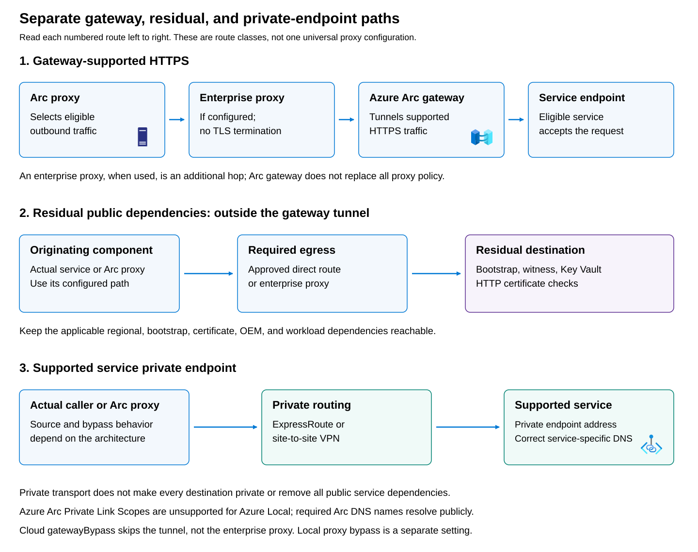
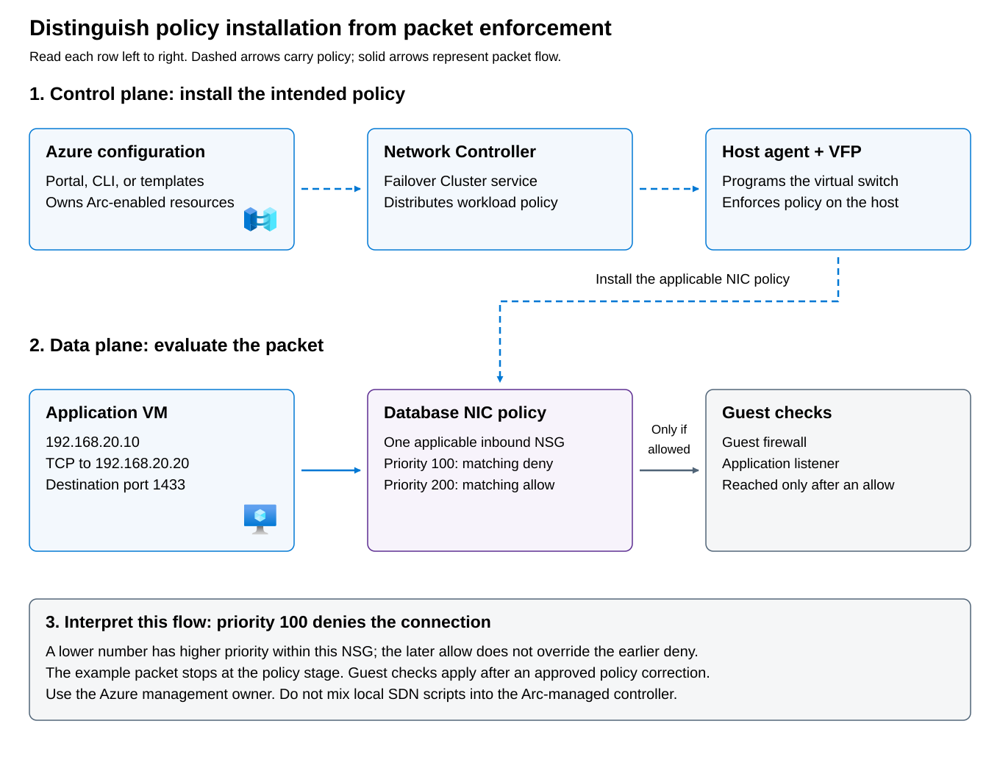

**Direct egress** reaches required services without an explicit proxy or Arc gateway hop. It still requires approved DNS, routing, firewall rules, and endpoint permissions. “Direct” doesn't mean unrestricted internet access.

An **enterprise forward proxy** is a customer-controlled outbound intermediary. It doesn't replace destination allowlisting or service authentication. Current Azure Local guidance excludes authenticated proxies, proxy auto-configuration (PAC) files, and proxy endpoints using a `.local` domain.

**Azure Arc gateway** is an Azure resource used with the **Azure Arc Proxy** service on the originating resource or host. It consolidates eligible HTTPS traffic through a common entry point. It isn't a workload VPN, an SDN gateway, or a tunnel for every external dependency.

HTTPS carries Hypertext Transfer Protocol (HTTP) inside TLS. A plaintext HTTP certificate-revocation request is therefore a different transport case from an HTTPS service request, even when both support the same management operation.

A **service private endpoint** exposes a supported service-specific destination through private addressing. It requires correct DNS and private routing, potentially over Azure ExpressRoute or a site-to-site VPN. Private transport and private service addressing are separate properties.

The **Azure Local private-path architecture** connects the on-premises environment to an Azure virtual network through ExpressRoute or a site-to-site VPN and uses Azure Firewall as an explicit forward proxy. For gateway-supported HTTPS destinations, the host's Arc proxy establishes an Arc gateway tunnel, which the explicit proxy forwards. This provides a controlled outbound path through Azure rather than requiring hosts to connect directly to public service endpoints. It doesn't make every destination private: Arc gateway and required services still use Azure public endpoints, and the enterprise firewall, Azure Firewall, DNS, and routing must permit the appropriate connections.

Traffic outside the gateway tunnel needs its own path. Non-bypassed HTTP traffic uses Azure Firewall explicit proxy without passing through Arc proxy or Arc gateway. Required public HTTPS destinations outside gateway coverage, including OEM services, also use the explicit proxy and require appropriate application rules. Internal traffic can bypass the proxies. For supported service private endpoints, the destination name must resolve to the private IP and a permitted private route must exist. A private endpoint outside Arc gateway coverage can be reached directly by Arc proxy without the explicit proxy or gateway; a bypass entry isn't automatically required for every private endpoint.

> [!NOTE]
> Azure Arc gateway integration for Azure Local infrastructure and Azure Local VMs is generally available. Integration for AKS on Azure Local remains in preview for this module's 2610 baseline. Enabling Arc gateway on an existing Azure Local instance after deployment is also in preview. The AKS traffic path described here is subject to the AKS integration's preview status; it is separate from the preview status of post-deployment proxy updates and cloud gateway bypass.

The originating component also matters. Arc resource bridge and AKS node VMs send non-bypassed HTTPS through the cluster IP proxy to the host Arc proxy, reusing the host's gateway tunnel for eligible destinations. AKS node traffic uses TCP port 40343 for that first hop. Application pods and Azure Local guest VMs require their own applicable proxy and outbound configuration; they don't automatically inherit every host traffic path.

Preserve end-to-end TLS on the required management connections. TLS inspection is unsupported, and Azure Firewall explicit proxy isn't configured with a certificate to terminate these TLS sessions. Use the complete supported combination of components and routing rules: an ExpressRoute circuit or VPN alone isn't the Azure Local private-path architecture, and blocking all public service dependencies doesn't turn a connected deployment into a disconnected one.



## Preserve residual dependencies and release boundaries

Azure Arc gateway consolidates only supported HTTPS traffic; it doesn't eliminate the connections needed to establish and maintain the deployment. Bootstrap downloads, Azure Arc registration, and Microsoft Entra authentication still require access to their own endpoints, such as `aka.ms`, `management.azure.com`, and `login.microsoftonline.com`. The gateway's own public hostname must also be reachable. The deployment's Azure Key Vault and cloud witness storage account retain separate connectivity requirements outside the gateway tunnel.

Certificate-status and revocation checks that use HTTP need an approved direct or proxy path because Arc gateway doesn't carry HTTP traffic. Required HTTPS destinations outside gateway coverage, including OEM update services and other third-party endpoints, also need their own firewall or proxy permissions; Arc proxy routes them through the applicable alternative path rather than making them gateway-supported. Plan these exceptions for the component that actually originates each connection, and include the additional dependencies introduced by installed services and extensions. The endpoint examples above aren't a complete allow list, and enabling Arc gateway isn't a reason to block every other outbound destination.

Build a deployment-specific firewall plan rather than treating one endpoint list as universally complete. Azure Local requires outbound HTTPS connectivity on TCP port 443 and HTTP connectivity on TCP port 80 for dependencies such as updates and certificate checks. Scope rules to the required destinations and the actual originating nodes, infrastructure VMs, or proxy servers, and account for any component-specific ports separately. Permit the traffic through every firewall on the selected path; an allow rule on the host doesn't override a block at the enterprise firewall or proxy. These outbound requirements aren't a reason to expose host administration ports to the public internet.

The destination set must cover Azure Local itself, the Azure Arc-enabled server agents, Azure Arc resource bridge, and the AKS infrastructure used by the deployment. Add the endpoints required by the hardware vendor and enabled services such as Azure Monitor, Microsoft Defender, Azure Site Recovery, or Azure Virtual Desktop. Endpoint names vary by Azure cloud, region, and resource, so don't construct regional names merely by inserting the full region name into a hostname template. Maintain the approved endpoint inventory for the deployed version and enabled features, and review it when those change. If firewall rules use published Azure service-tag IP ranges, refresh imported ranges as Microsoft updates them rather than treating a downloaded list as permanent.

Preserve the required DNS and TLS behavior. Azure Arc Private Link Scopes are unsupported for Azure Local: names under `*.his.arc.azure.com`, `*.guestconfiguration.azure.com`, and `*.dp.kubernetesconfiguration.azure.com` must resolve to public addresses from the nodes, resource bridge, and any proxy. Supported private endpoints for other services require their own private DNS resolution and routing. Disable HTTPS inspection on the required Azure Local management paths, including TLS-intercepting tenant-restriction mechanisms. Plan internal DNS, Active Directory, time synchronization, cluster, storage, and management connectivity separately; opening outbound web ports alone doesn't provide those internal paths.

## Distinguish local bypass from cloud gateway bypass

**Cloud gateway bypass** is a routing exception configured through the `gatewayBypass` property on the Azure Arc gateway resource. Use it when a destination normally supported by Arc gateway must be reached without traversing the gateway tunnel. It changes the gateway-routing decision for associated Arc-enabled resources without rewriting their local proxy settings. A configured enterprise proxy remains in the path, and the change affects every resource using that gateway, not just one Azure Local instance. Entries must be exact destination hostnames, without a URL scheme, path, or wildcard. This post-deployment capability is in preview and requires Azure Local 2610 or later.

**Local proxy bypass** serves a different purpose: matching traffic skips the local Arc proxy and enterprise proxy on the updated components and follows the source subnet's routing. Use the coordinated `Update-AzureLocalProxy` operation to update the targeted instance's host proxy settings and Azure Arc resource bridge configuration, rather than modifying the appliance directly. This operation can also add, change, or remove an enterprise proxy. It requires healthy connected machines, a running resource bridge, administrator access, and a planned maintenance window; the post-deployment workflow is also in preview for Azure Local 2610 or later.

Before changing either option, record the current configuration and ensure the alternative path has working DNS, routes, and firewall or proxy permissions. Both bypass lists are complete replacements: preserve every existing entry that must remain. When updating the gateway resource, also preserve its existing location, tags, and allowed features. Keep the current network path available until the change is applied and service connectivity is confirmed from the actual source. The following table summarizes the differences:

| Property | Local proxy bypass | Cloud `gatewayBypass` |
| --- | --- | --- |
| Owner | Target Azure Local instance | Azure Arc gateway resource |
| Scope | Updated hosts and resource bridge | Associated Arc-enabled resources using that gateway |
| Traffic effect | Skips local Arc proxy and enterprise proxy for matching traffic | Skips the gateway tunnel only |
| Enterprise proxy | Bypassed | Remains applicable |
| Eligible destinations | Can include destinations outside gateway coverage | Only currently gateway-supported endpoints |
| Matching | Component-specific syntax | Exact fully qualified domain names; no wildcards |
| Update semantics | Complete replacement list | Complete replacement array |

A **fully qualified domain name (FQDN)** identifies the complete DNS name. Adding an unsupported destination to `gatewayBypass` isn't a remedy: unsupported destinations already require their applicable fallback route.

Don't assume all private endpoints require local bypass. The documented private-path architecture includes a case where Arc proxy connects directly to a private IP for a private endpoint outside gateway coverage, without an enterprise-proxy hop or local bypass entry. Verify the architecture and logs before generalizing.

Existing AKS clusters don't automatically inherit every infrastructure proxy update, and pod settings require separate consideration. Cloud gateway bypass also doesn't remove an AKS cluster-IP proxy first hop or redesign its subnet egress.

## Follow control and packet paths separately



- The upper, dashed policy path carries Azure configuration to Network Controller and then to host enforcement. The host agent programs the **Virtual Filtering Platform (VFP)**-enabled virtual switch. Application packets don't travel through Azure or Network Controller for each decision.
- The lower packet path shows an application packet approaching one confirmed applicable database-NIC NSG before guest firewall and listener checks. In the supplied example, a matching deny at priority 100 takes precedence over a matching allow at 200. This is a single-NSG exercise; it makes no claim about evaluation order across multiple attachments.

Enabling Arc-enabled SDN is a planned platform change, not simply attaching a security rule. An administrator runs the Azure Local Lifecycle Manager action plan to deploy Network Controller as a Failover Cluster service, bring existing logical networks and VM network interfaces into its management scope, and enable Virtual Filtering Platform policy enforcement on the host virtual switches. This requires a supported instance running Azure Local 2506 or later with OS build 26100 or later, the required administrator permissions, and a prepared controller naming prefix and DNS configuration. Don't enable it on an instance that already has an on-premises-managed Network Controller.

Existing VMs can remain deployed during enablement, but their network connectivity experiences a short interruption as the filtering policies are applied. Schedule an approved maintenance window, confirm that the action plan completes successfully, and check management and workload connectivity afterward. Once Arc-enabled SDN is enabled, there is no supported disablement or rollback procedure. For an incident investigation, inspect the existing controller, policy attachments, and host enforcement state instead of enabling SDN as a troubleshooting experiment.

## Interpret rules within the confirmed scope

**Network Security Group (NSG)** rules match direction, addresses, protocol, and ports. Priorities range from **100 to 4096**, with lower numbers evaluated before higher numbers within the relevant rule collection. An empty attached NSG denies inbound traffic; it isn't equivalent to having no NSG.

For an Azure-managed database VM, inspect the attachment and rule details through Azure. A documented read operation is:

```powershell
az stack-hci-vm network nsg show `
    --resource-group "<approved-resource-group>" `
    --name "<approved-nsg-name>"
```

This requires an authenticated Azure CLI session, the applicable Azure Local VM extension, and permission to read the resource. The placeholders must identify an approved existing resource; the command doesn't create or modify one. Use the returned group and portal resource details together to establish attachment and policy evidence.

Azure Local NSGs are `Microsoft.AzureStackHCI/networkSecurityGroups` resources associated with the instance's custom location, rather than public-Azure virtual network NSGs. Manage them through the Azure Local resource's **Resources** > **Network security groups** page or the `az stack-hci-vm network nsg` command group. Creating an NSG doesn't automatically apply it to a workload: associate it with the intended logical network to apply a common policy to connected VMs, or with a supported VM network interface for interface-specific protection. Inspect both the logical network and NIC associations before deciding which policies affect a connection.

Read the individual rules as well as the group resource. In the portal, inspect **Inbound security rules** and **Outbound security rules**; in Azure CLI, use `az stack-hci-vm network nsg rule list` with the resource group and NSG name, or `rule show` for a named rule. Check the source and destination addresses, source and destination ports, protocol, direction, action, and unique priority within the rule collection. Explicit inbound and outbound policies use separate directional rules. A matching lower-numbered deny isn't overridden by a later allow simply because that allow describes the application more specifically.

The VM creation experience also offers a **Basic** default network access policy that blocks inbound connections except selected permitted ports and allows outbound access. This default-policy option is available only for the VM's first network interface; **Advanced** selects an NSG instead. An empty attached NSG still denies inbound traffic, so deleting its last rule isn't equivalent to removing the association. Conversely, dissociating an NSG removes that group's protection at that attachment, although other applicable controls can remain.

Check provisioning status and resource associations after every approved change. A successful operation confirms that the configuration request completed, not that the intended traffic is allowed or denied end to end. Don't assume that public-Azure effective-rule tools or evaluation ordering across multiple attachments apply unchanged to Azure Local. Confirm every applicable policy and test the actual source-to-destination flow, including the guest firewall and listening application.

If a narrow change is justified, the policy owner should approve it through the owning interface, preserve the original configuration, repeat the identical positive test, and run a negative test for unauthorized access. Disabling all filtering is neither diagnosis nor acceptance testing.
