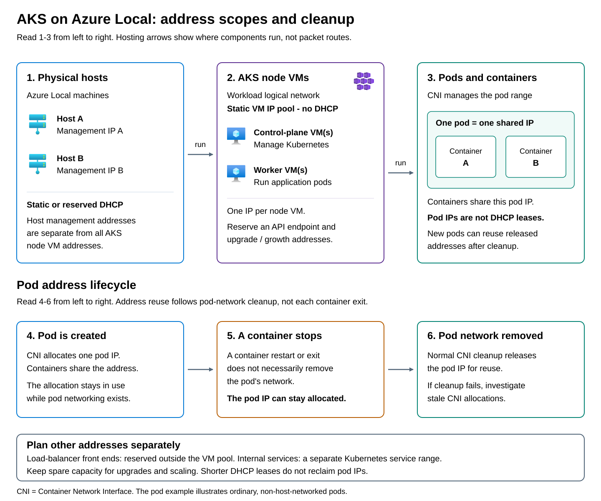

For Azure-managed VMs, an Azure Local **logical network** represents a network available through a host virtual switch. It records settings such as the virtual local area network (VLAN), subnet, IP allocation method, address pool, default gateway, and Domain Name System (DNS) servers. A VM's network interface connects to that logical network.

You create a workload logical network as an Azure resource associated with your Azure Local instance and an existing external virtual switch. Before starting, the instance must be deployed with Azure Local VM management configured, and you need permission to create logical network resources. Obtain the approved VLAN and IP settings from your network team. You can identify the host's external virtual switch with the read-only PowerShell command `Get-VMSwitch -SwitchType External`.

To create the logical network in the Azure portal:

1. Open the Azure Local instance that will host the workloads.
1. Under **Resources**, select **Logical networks**, and then select **Create logical network**.
1. On **Basics**, select the subscription and resource group, enter a logical network name, and enter the existing virtual switch name. Confirm that the populated custom location identifies the intended Azure Local instance.
1. On **Network configuration**, choose **Static** or **DHCP**. For **Static**, provide the reserved IPv4 address space, any IP pool, default gateway, DNS servers, and VLAN ID. For **DHCP**, provide the VLAN ID if required; the existing DHCP service supplies the VM's IP configuration.
1. Select **Review + Create** and review the settings against the approved network plan.
1. Select **Create** to deploy the logical network.
1. After deployment succeeds, open the logical network resource and confirm that its switch association, VLAN, and addressing match the intended configuration.

The logical network is then available for selection when you create a VM network interface. Creating it does not attach existing VMs automatically. For automated provisioning, the Azure CLI `stack-hci-vm` extension provides the `az stack-hci-vm network lnet create` command, which accepts the same instance, switch, and network configuration information.

Creating the logical network does not create the corresponding physical switch VLAN or upstream route. It also does not create an Azure virtual network or move application traffic through Azure. The resource defines how workloads connect to the local network.

VM logical networks support static IP configuration and allocation through the **Dynamic Host Configuration Protocol (DHCP)**. A DHCP-based logical network relies on an existing reachable DHCP service; creating the logical network does not deploy a DHCP server. Use the allocation method supported by the workload, and reserve static ranges with the network team. 

> [!NOTE]
> For resilience, use a DHCP service that remains available independently of the Azure Local instance, especially when its physical hosts obtain management addresses through DHCP. Avoid making those hosts depend solely on a DHCP VM running on the same instance, because that VM is unavailable during a full shutdown or recovery. A dedicated physical DHCP server is not required; an independently hosted service can meet this need. Configure DHCP reservations for host management addresses, and for DHCP-based workload VMs that need stable addresses; not every workload VM requires a reservation. Protect statically allocated infrastructure pools, workload pools, and load-balancer addresses with DHCP scope exclusions rather than reservations. AKS node VMs require static allocation, not DHCP allocation with reservations.

For a static logical network, specify an IPv4 subnet and its gateway and DNS settings. An optional **IP pool** defines a range within that subnet from which VM interface addresses can be allocated. Reserve that range for its intended use and exclude it from any overlapping DHCP scope or other allocation process. For a DHCP-based logical network, the existing DHCP service supplies addresses and associated network settings. The allocation method determines how a VM obtains its configuration, not which connections it is allowed to make.

The logical network settings describe different parts of the connection:

| Setting | Purpose |
| --- | --- |
| Virtual switch | Identifies the host virtual switch that connects VM interfaces to the physical network. Its uplinks must provide the required connectivity on every host that can run the VM. |
| VLAN ID | Identifies the Layer 2 network used by the VM interface. The physical switches must carry that VLAN. A value of 0 means untagged traffic, which must match the physical switch's native or access VLAN configuration. |
| IPv4 address prefix | Defines the subnet, such as `192.168.20.0/24`. It describes the address space, not a single VM's address. |
| IP pool | Reserves a subset of the subnet for address allocation. It must not overlap addresses assigned to other devices or pools on the same network. |
| Default gateway | Identifies the router used to reach destinations outside the subnet. Supplying its address does not create the router or configure its routes. |
| DNS servers | Identify the services that resolve names for the workload. Supplying their addresses does not deploy DNS servers or guarantee that the required names can be resolved. |

For example, Adatum could define an application logical network on VLAN 120 with subnet `192.168.20.0/24` and reserve a pool within that subnet for application VMs. The gateway and DNS server addresses would refer to services reachable from that network. Multiple VM interfaces could use this logical network without needing a separate physical adapter or virtual switch for each VM.

Plan these settings before creating the logical network. Its address space, IP pools, default gateway, VLAN ID, and virtual switch association cannot be changed once in place. Changing those properties requires a new logical network and a planned transition for impacted workloads.

## Azure Local application network requirements

For each application, establish the following requirements before provisioning its network:

- **Addressing and name resolution:** Which subnet, addresses, gateway, and DNS servers will the workload use? Allow room for growth and maintenance without overlapping other allocations.
- **Communication paths:** Which clients, application tiers, identity services, and external services must it reach? Identify the required routes, protocols, and ports.
- **Access controls:** Which connections should be permitted or denied, and which network policy or guest firewall will enforce that decision?
- **Availability and capacity:** Can the workload reach the same network from every host on which it might run? Account for migration, backup traffic, and the capacity available after a link failure.

> [!NOTE]
> Azure Local does not require a separate logical network, VLAN, or subnet for every application. Applications with compatible security and connectivity requirements can share a workload network, with appropriate access controls. Consider separate networks for different tenants, compliance requirements, or application tiers, and explicitly control communication between them. Separate logical network resources alone do not establish isolation; the underlying VLANs, routing, and security policies must enforce the intended boundaries. Separate workload networks can still share physical adapters and switches.

## Azure Kubernetes Services requirements

Azure Kubernetes Service (AKS) on Azure Local adds further requirements. Plan addresses for cluster VMs, control-plane access, and load-balancer front ends, and account for the supported pod and service address ranges. Include capacity for upgrades and scaling; a host management pool alone is not a Kubernetes address plan. 

> [!NOTE]
> AKS on Azure Local requires static IP allocation for its node VMs; DHCP is not supported for those addresses. Pod addresses are managed separately by the cluster's Container Network Interface (CNI) networking and IP address management, not by the enterprise DHCP server. Containers in a pod share its network address. Normal pod-network cleanup releases that address for reuse when the pod's networking is removed; stopping or restarting an individual container does not necessarily release it. For short-lived workloads, ensure Kubernetes workload cleanup completes and investigate CNI cleanup failures if unused address allocations persist. Shortening DHCP leases does not reclaim pod addresses.

An AKS cluster runs its control-plane and worker nodes as VMs on Azure Local. Control-plane nodes manage the Kubernetes cluster; worker nodes run application pods. These VMs need their own IP addresses on a workload logical network, separate from the addresses of the physical Azure Local hosts.



## Cluster address considerations

Distinguish the following address requirements when planning the cluster:

| Address purpose | Allocation source | Planning consideration |
| --- | --- | --- |
| Control-plane and worker VMs | Static IP pool in the workload logical network | Allow one address for every node VM, including nodes in all worker node pools. |
| Kubernetes API endpoint | Workload logical network IP pool | Reserve a separate address for each cluster's control-plane endpoint, through which clients manage Kubernetes. |
| Upgrade and growth capacity | Unused addresses in the workload logical network IP pool | Rolling upgrades can create replacement VMs before removing old ones. Reserve at least one additional address per cluster for upgrades, plus capacity for planned scaling. |
| Application load-balancer front ends | For a same-subnet design, reserved addresses in the AKS VM subnet outside its VM IP pool; an external load-balancing design can use a different network | Size the reservation for the services exposed, prevent conflicts with VM and DHCP allocations, and provide the routing and advertisement required by the chosen supported load-balancer implementation. |
| Pods | Kubernetes pod address range | A pod is a scheduling unit containing one or more containers. Its address comes from the pod network, not the VM IP pool. With overlay networking, traffic between pods on different nodes is encapsulated across the underlying VM network. |
| Internal Kubernetes services | Kubernetes service address range | A service provides a stable virtual address for a set of application endpoints, even as pods change. This internal address is distinct from an externally reachable load-balancer address. |

Pod and internal service addresses are not automatically reachable from the branch network. Clients normally reach an application through an explicitly exposed endpoint, such as a load-balancer front end. Plan the route, DNS name, and access rules for that endpoint as well as connectivity between the cluster nodes.

AKS and other Azure Local VMs can share a workload logical network or use separate logical networks. Sharing simplifies connectivity but combines address consumption and network exposure. Separate networks can support different address plans and security boundaries when the corresponding VLANs, routing, and access controls are configured. Merely creating another logical network resource does not establish isolation.

Before deployment, check the internal Azure Local platform reservations `10.96.0.0/12` for Kubernetes services and `10.244.0.0/16` for pod networking. Keep node management addresses, the cluster IP, the infrastructure pool and Arc resource bridge addresses, DNS and proxy servers, the default gateway, and workload logical networks outside these ranges. Also check the services and private endpoints that Azure Local or its AKS workloads must reach. If a destination overlaps an internal range, traffic can follow the cluster's internal path instead of reaching that destination.

These are platform and connectivity constraints, not a ban on using the address space in unrelated networks. They do not require globally unique internal CIDRs across otherwise isolated Kubernetes clusters. Any workload pod-range option, where supported, does not change the platform's own reservations.

## Options for segmenting traffic

Segmentation can separate physical traffic paths, logical networks, or access permissions. A VLAN separates a Layer 2 network into its own broadcast domain, while an IP subnet defines its addressing. Access policies determine which connections are allowed. An Azure Local design can combine the following mechanisms:

| Mechanism | What it provides | Important distinction |
| --- | --- | --- |
| Dedicated adapters and separate intents | Separate physical interfaces for traffic such as storage and management/compute. | Separate ports can reduce contention, but do not by themselves define which applications may communicate. |
| VLANs and VLAN-backed logical networks | Separate Layer 2 networks over shared physical infrastructure. Workload interfaces connect to the selected VLAN and subnet. | Switch ports must carry the required VLANs. Communication between subnets needs routing and appropriate access controls. |
| Network security groups (NSGs) with Arc-enabled software-defined networking (SDN) | Traffic rules on supported logical networks and Azure Local VM interfaces, allowing finer-grained control than VLAN membership alone. | Rules apply to the resources to which they are attached. A VLAN is not a replacement for these rules or a guest firewall. |
| Virtual networks in on-premises-managed SDN | Overlay networks that separate tenant address spaces from the underlying physical network. | This is a different deployment and management model, not an additional feature of an Arc-managed logical network. |

Choose the SDN management model before designing its policies. Azure Local supports two distinct models, with different VM scopes, controller deployments, and management interfaces. In both models, **Network Controller** distributes network policy to the hosts, where virtual networking components enforce it. Workload packets do not travel through Azure or Network Controller for each policy decision.

The following table compares the two models:

| Aspect | Arc-enabled SDN | On-premises-managed SDN |
| --- | --- | --- |
| VM scope | Azure Local VMs provisioned through Azure interfaces, such as the Azure portal, Azure CLI, or Azure Resource Manager templates. | Eligible VMs provisioned through local tools, such as Hyper-V Manager, Windows Admin Center, or System Center Virtual Machine Manager. |
| Network Controller | Runs as a Failover Cluster service integrated with the Azure Local lifecycle. | Runs in dedicated controller VMs deployed and managed through the supported local procedures. |
| Network resources | Logical networks, VM network interfaces, and NSGs. | Logical networks, VM network interfaces, NSGs, overlay virtual networks, software load balancers, and SDN gateways. |
| Configuration ownership | Manage network resources through the Azure portal, Azure CLI, or Azure Resource Manager templates. | Use the supported local management tools for each operation, such as Windows Admin Center, SDN Express, and PowerShell. |

Arc-enabled SDN is the model for applying Azure-managed network security policies to Azure-provisioned VMs. It does not provide the overlay virtual networks, software load balancers, or VPN, Layer 3, and GRE gateways available in the on-premises-managed model. Those additional services require their own supported deployment; selecting local management does not automatically configure them.

The models are not interchangeable management interfaces for the same deployment. Do not manage an Arc-enabled controller or its NSGs through local SDN tools, or enable the Arc-managed model over an existing locally managed controller deployment. Installing an Azure Arc agent inside a locally provisioned VM does not convert it into an Azure Local VM resource provisioned through Azure.

AKS can run on an Azure Local instance with Arc-enabled SDN, but Arc-enabled NSGs cannot be attached to the logical network used for AKS workload deployment or to AKS workload VM interfaces. Account for that restriction when choosing shared networks and workload security controls.

**Quality of service (QoS)** addresses a different need: managing bandwidth contention on shared links. It can help protect traffic classes in a converged design, but it does not isolate tenants or authorize application connections.

## Deploy Network Controller

Choose the SDN management model during network design, before committing to the VM provisioning method, host network intents, and required security or routing services. Deploy or enable its Network Controller after the Azure Local instance is deployed, preferably before introducing production workloads. This is an instance-level deployment decision, not a setting selected separately for each logical network. Basic VLAN-backed workload connectivity does not require SDN enablement merely to create a logical network.

The following paths are **alternatives**. Use **Path A** for Arc-enabled SDN or **Path B** for on-premises-managed SDN; do not perform both on the same instance.

### Initial steps

Prepare the following prerequisites for the selected path:

- A healthy, deployed Azure Local instance with the physical switches, management connectivity, and host virtual switches configured for the chosen supported network pattern.
- An approved address and DNS plan, including the controller's management endpoint, and access to the DNS administrator when records or update permissions must change.
- Administrative access to the instance, an approved maintenance window, and a record of working management and workload connections to repeat after deployment. Keep credentials out of configuration files and command history.
- For **Path A**, Azure Local 2506 or later with OS build 26100 or later, a host networking pattern supported by Arc-enabled SDN, and the Azure Stack HCI administrator access required on the node and in Azure.
- For **Path B**, Active Directory domain-joined Hyper-V hosts, sufficient resources for dedicated controller VMs, and an SDN VHDX image whose OS version matches the hosts. Apply the required updates to the SDN infrastructure VMs; their maintenance is separate from changing the Azure Local hosts' managed update process.

Check whether Network Controller is already deployed and which model owns it. If the selected model is already operational, manage that deployment rather than installing another controller. If the other model is present, stop: these instructions do not provide an in-place conversion procedure.

### Path A: Enable Arc-managed Network Controller

This path installs Network Controller as a Failover Cluster service through Azure Local's Lifecycle Manager. It does not create dedicated controller VMs.

> [!IMPORTANT]
> Enabling Arc-managed SDN causes a short workload-network interruption, including on an instance with existing VMs. Perform the change only in an approved maintenance window. Once enabled, it cannot be disabled or rolled back through a supported procedure. Do not run the action plan over an on-premises-managed Network Controller.

1. Choose an SDN prefix for the controller name. It must be nonempty and no more than eight characters, using letters, numbers, and hyphens, with no consecutive hyphens or trailing hyphen. The endpoint name is formed as `<prefix>-NC.<domain>`.
1. Prepare DNS for that endpoint. With Active Directory-integrated dynamic DNS and secure updates enabled, the action plan creates the A record. With static DNS, have the DNS administrator precreate the `<prefix>-NC` A record pointing to the fifth IP address in the infrastructure management IP range supplied during Azure Local deployment. Confirm that the name is not already assigned to another resource and that the address is reserved for this controller.
1. During the maintenance window, open an elevated Windows PowerShell session on an Azure Local node using the required administrator access. Run the action plan with the approved prefix:

   ```powershell
   $sdnPrefix = Read-Host 'Approved SDN prefix (maximum 8 characters)'
   Add-EceFeature -Name NC -SDNPrefix $sdnPrefix
   ```

1. Respond to the action plan's maintenance-window and DNS acknowledgments only after those preparations are complete. Keep the interactive safeguards rather than automatically suppressing them.
1. Wait for the action plan to finish and inspect its outcome. Successful execution reports completed actions and the Network Controller URL. If an action fails, review the reported transcript and progress logs before proceeding; starting the command is not evidence that deployment succeeded.
1. Confirm that the reported controller name resolves as expected and that existing management and workload connections have recovered. Existing logical networks and VM network interfaces are brought into Network Controller's management scope by the action plan. Check their state through Azure before creating and attaching NSGs.

After enablement, manage the supported network resources through the Azure portal, Azure CLI, or Azure Resource Manager templates. Do not use the local-controller installation tools in Path B to alter this deployment.

### Path B: Deploy a locally managed Network Controller

This path creates dedicated controller VMs. The procedure below uses Windows Admin Center; SDN Express is an automation alternative, not a subsequent installation step.

1. Connect Windows Admin Center to the existing Azure Local cluster and check **Settings** > **Extensions** for the **SDN Infrastructure** extension. Install the extension if it is missing.
1. Open **SDN Infrastructure** under **Tools** and select **Get Started** for Network Controller.
1. Under **Cluster settings**, supply the controller's management DNS name, the path to the matching SDN VHDX image, and the number of controller VMs. Use three controller VMs for the recommended production configuration and plan their placement across available hosts.
1. Under **Network**, specify the management VLAN and choose **Static** or **DHCP** for the controller VM addresses. For static addressing, enter each VM's reserved address, subnet prefix, gateway, and DNS servers. For DHCP, use an available service and stable reservations consistent with the approved management-network plan. These are controller VMs, not AKS node VMs.
1. Under **Credentials**, supply the domain-join account in `domain\username` format and the controller VMs' local administrator password through the wizard's credential fields.
1. Under **Advanced**, specify the VM storage location and the workload MAC address pool. Use an appropriate cluster storage path such as `C:\ClusterStorage\...`, not a UNC path. Ensure the MAC pool does not conflict with existing allocations.
1. Select **Next: Deploy** and remain on the deployment page until all tasks complete, then select **Finish**.
1. Complete DNS registration for the controller's management name. Where the deployment uses dynamic DNS, coordinate secure updates and the necessary controller-account permissions with the DNS administrator. Verify the name resolves to this deployment's controller endpoint. Do not apply Path A's fifth-address reservation rule to this separate VM-based deployment.
1. Confirm that the controller VMs are running, domain joined, and reachable on the management network, and that Windows Admin Center can read the SDN infrastructure state.

If you use **SDN Express instead of the wizard**, install the `SDNExpress` PowerShell module on a Windows Server 2016-or-later deployment computer with administrative access to the hosts and access to the VHDX image. Work from the module's supplied configuration samples: `Traditional VLAN networks.psd1` for controller-managed VLAN networks or `Virtualized networks.psd1` for overlays.

Populate the host list, switch name, VHDX and VM paths, domain settings, management subnet, DNS, controller endpoint name and address, and each controller VM's name, host, IP, and MAC address. Keep the controller VM MAC addresses outside the workload MAC pool. For a controller-only deployment, leave the `Muxes` and `Gateways` sections empty. Run `SDNExpress.ps1` with the reviewed configuration data file and credential objects obtained through secure prompts, then complete the same DNS and health checks as for the wizard.

Deploy software load balancers and gateways only if the design requires them, after Network Controller is healthy. Their address pools, routing dependencies, and deployment sequence require separate planning.

### Validate before applying workload policies

For either path, confirm that the controller endpoint resolves correctly, the selected management interface can read the expected network resources, and the controller can communicate with all intended hosts. Repeat the recorded management and application connectivity checks. After applying a narrowly scoped test policy through the owning interface, test both a permitted connection and a connection that should be denied. Controller deployment and policy enforcement are separate outcomes; do not treat successful provisioning alone as proof that workload access is correct.

## Integration with an existing network

Azure Local can connect to existing switching, routing, DNS, identity, and security services when they meet the selected deployment's requirements. It does not replace the organization's network infrastructure. Existing switch ports might need changes to VLAN membership, tagged or untagged traffic handling, maximum frame size, or storage traffic policies.

Workloads can join an appropriate existing VLAN and subnet or use a new dedicated network, depending on addressing, capacity, and security requirements. Coordinate address reservations through the organization's IP address management system or approved register. Work with the network team to provide gateways and return routes for management and workload networks, and to apply the required firewall rules. Do not assume that host-to-host storage networks should be routed into the wider enterprise network; follow their supported storage design.

Connected deployments also need approved outbound connectivity to Azure services. That might use direct egress, an enterprise proxy, or Azure Arc gateway for eligible management traffic. These choices do not automatically provide workload internet access or a VPN to Azure. Plan application connectivity separately from platform management connectivity.

For example, the fictional organization Adatum could connect a two-node, fully converged system to compatible redundant branch switches. Management could use VLAN 110, application VMs VLAN 120, and the two storage paths their validated storage VLANs. Adatum would create a workload logical network for VLAN 120, use its existing DNS service, and configure its existing router or firewall for approved client and application connections. The VMs would communicate over that local infrastructure, while Azure interfaces would manage their resources. These VLAN numbers illustrate the design; they are not universal requirements.

The resulting design should identify physical connections, host intents, workload logical networks, address allocations, routes, and policy owners. These decisions depend on one another: the deployment architecture and node count constrain the storage topology, the topology constrains adapter use, and adapter use determines which traffic shares bandwidth. A supported plan must describe the complete combination rather than assemble individually plausible settings.

Use the following planning areas to connect Azure Local requirements to the existing environment:

| Planning area | Decisions to include |
| --- | --- |
| Deployment scope and growth | Establish the architecture, node count, physical placement, and expected expansion. This module assumes connected hyperconverged deployment; external-storage and disconnected deployments require their own supported designs. |
| Physical and storage connectivity | Choose switched or switchless storage and shared or dedicated host ports. Match the adapters, switches, link speeds, redundancy, frame sizes, and storage traffic policies to that design. Spare ports alone do not establish a supported expansion path. |
| Host traffic and capacity | Map management, compute, and storage traffic to supported Network ATC intents. Include live migration and backup traffic in the capacity plan, and account for the bandwidth remaining after a path fails. VLAN separation does not create additional bandwidth. |
| Addressing and infrastructure services | Reserve node addresses, infrastructure pools, and workload ranges without conflicting allocations. Account for Kubernetes pod and service ranges and platform reservations. Identify reachable DNS and time services, required gateways, and the routes back to each subnet. |
| Azure and application connectivity | Identify which components originate connections and which destinations they need. Plan approved outbound routes, endpoint access, and any proxy or Arc gateway configuration. A private circuit or gateway does not automatically cover every service dependency or provide workload connectivity. |
| Security and management ownership | Decide which workloads can share networks, where access policies apply, and whether SDN is needed. Match the SDN model to VM provisioning and required network services, and assign responsibility for host, switch, router, DNS, and firewall changes. |

Cloud deployment does not prepare all of this infrastructure automatically. Before registering the machines with Azure Arc, establish their management connectivity and the required DNS, routing, VLAN, and outbound access. During deployment, supply the infrastructure address pool and supported host traffic configuration through the Azure portal or deployment template. The deployment orchestrator and Network ATC apply the host-side configuration; the network team remains responsible for the corresponding physical and upstream network settings.

After deployment, create workload logical networks and, when required, deploy the selected SDN model and its access policies. Confirm that the resulting configuration matches the approved plan and supports the intended application connections. Assess both normal operation and the required failure scenarios: a design that works only while every link is available does not satisfy a requirement to continue service after a link failure.
