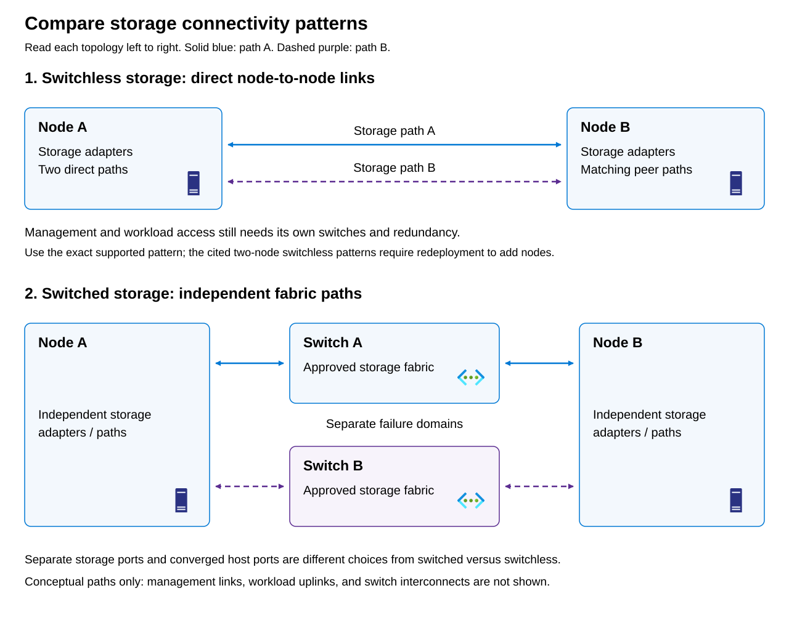

Azure Local can use switched or switchless storage:

- Switched storage traverses an appropriate Ethernet fabric. 
- Switchless storage uses direct host-to-host connections in a specifically supported small-cluster topology. Switchless storage doesn't mean that management and workload access require no switches.

Physical port sharing on the host can be converged or separated. A fully converged design shares approved host ports among management, compute, and storage. A separated-storage design dedicates ports to storage while management and compute can still share other ports. Consequently, a published “nonconverged” pattern can still converge management and compute.

> [!NOTE]
> Switch count doesn't establish the storage path, and port count doesn't establish traffic sharing.

The diagram compares storage failure domains. In the upper topology, storage path A connects the two nodes directly, as does storage path B. In the lower topology, each path traverses its corresponding fabric.

## Evaluate supported patterns, not generic Ethernet possibilities

The following table compares Azure Local deployment and network designs, highlighting the advantages and limitations that affect resilience, expansion, and ongoing management:

| Pattern | Useful property | Constraint to state explicitly |
| --- | --- | --- |
| Single node | Small footprint without inter-node storage links | No host-failure continuity or destination for live migration |
| Two-node switchless storage, one access switch | Fewer storage-switch dependencies | Access switch remains a northbound single point of failure |
| Two-node switchless storage, redundant access | Direct storage and redundant access can be independent | Detailed switchless guidance doesn't support scale-out; adding a node requires redeployment |
| Switched separated storage | Dedicated storage interfaces and separate traffic budgets | Additional ports and fabric configuration must be maintained |
| Switched fully converged | Fewer shared host ports with managed traffic classes | Degraded-state contention becomes a central design constraint |

Choose a supported design that matches the required node count, storage connectivity, availability, and expansion plans. Treat its cabling, adapter roles, Network ATC intents, VLANs, and subnets as a coordinated configuration rather than independent choices. For example, the two-node switchless design with two access switches uses two dedicated RDMA-capable storage ports per host for redundant direct connections between the nodes, plus two SET-teamed management and compute ports, with one uplink to each switch. The switch pair uses multichassis link aggregation (MLAG), but the host-facing SET connections remain switch-independent rather than using LACP. Management and compute share one Network ATC intent, while a separate storage intent provides two storage networks on different IP subnets. This separates the direct storage paths from the switched paths used to reach workloads and management services.

Don't turn broad node-count guidance into a four-node cable mesh. The detailed two-node switchless reference states that scale-out is unsupported and adding a node requires redeployment. Adatum treats switchless growth as a redeployment decision, not a cable-addition task.

## Manage failure domains

A **failure domain** is a component or group of components that can become unavailable together because they share a dependency. For example, all network connections through one switch share that switch as a failure domain; if it fails, those connections are lost together. Failure domains can also be broader: switches with separate cables might still depend on the same power supply or upstream router. To tolerate a particular failure, redundant paths must not both depend on the component that could fail.

List the failures your implementation promises to tolerate: cable, port, adapter, switch, switch power feed, or host. Then map every redundant path to the components it traverses.

Two links on one adapter retain adapter failure as a shared dependency. Two switches can share power or uplink dependencies. Network redundancy also doesn't establish cluster quorum behavior or application recovery.

Also distinguish **availability** from **capacity**. The surviving link might preserve reachability while leaving insufficient bandwidth for the intended workload. A successful failover ping doesn't validate the degraded performance objective.

## Host teaming requirements

Switch Embedded Teaming (SET) integrates teaming with the Hyper-V virtual switch. It uses a switch-independent model; it is **not host-facing Link Aggregation Control Protocol (LACP)**. Don't configure a host-facing LACP bundle for a SET team, and don't substitute legacy Load Balancing and Failover teaming. Switch-to-switch multichassis aggregation doesn't change SET's host-facing requirements.

Match adapter make, model, speed, and relevant settings across corresponding nodes, and maintain consistent adapter and intent names. OEM-supported firmware and driver compatibility is a separate validation obligation: passing an intent check isn't proof that every firmware combination is supported.

For hyperconverged Azure Local, use network adapters qualified for their assigned management, compute, or storage roles, with OEM-supported drivers rather than the operating system's inbox drivers. Storage adapters must support RDMA, and communicating peers must use the same RDMA protocol, either iWARP or RoCE. Storage links require at least 10 Gbps, with 25 Gbps or faster recommended. In switched designs, separate storage subnets and VLANs help keep traffic on the intended switch paths rather than creating unnecessary traffic across switch interconnections. Adapter qualifications, link speeds, and bandwidth reservations don't by themselves establish sufficient capacity. For Adatum's two 25-Gbps ports, assess the combined storage, migration, management, and workload demand against the single surviving 25-Gbps link after a failure, allowing for protocol overhead and operating headroom.

In the two-node, single-rack switched separated-storage design, each host uses two SET-teamed ports for management and compute, plus two standalone RDMA ports for storage under a separate Network ATC intent. Both port groups connect to the same MLAG-configured top-of-rack (ToR) switch pair; a separate storage-only switch pair isn't supported for this pattern. This gives storage dedicated host interfaces and bandwidth, but requires more adapters, cables, and switch ports; the shared switches can still be common points of failure or congestion. A fully converged design carries management, compute, and storage through two shared host ports under one combined intent, with host virtual interfaces providing storage connectivity. It reduces port and cabling requirements, but depends more heavily on traffic prioritization and sufficient shared bandwidth, particularly after a link fails. Both designs use redundant switches and can support expansion within their validated topology and capacity limits. Choose between them based on workload demand, failure tolerance, growth plans, and the team's ability to manage the configuration, rather than cable count alone.
