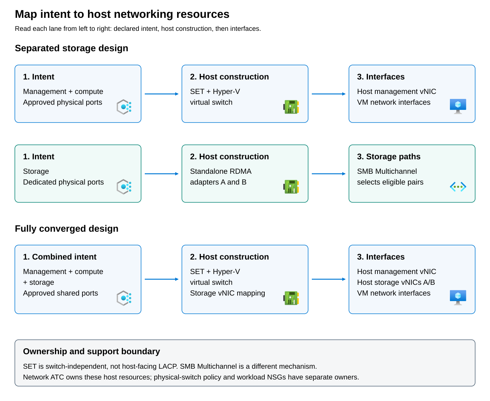

An **intent** is a named declaration of how Azure Local should use a set of physical network adapters for management, compute, storage, or a supported combination of these purposes. You define the adapter assignments and traffic combinations in the networking settings during Azure Local deployment, either through the Azure portal or an Azure Resource Manager template. The deployment process creates the corresponding Network ATC intents for the cluster. For example, a separated-storage design can use one intent for management and compute adapters and another for dedicated storage adapters.

Network ATC uses those intents on the Azure Local hosts to build and maintain the required host networking configuration consistently across the cluster. The intent is not configured inside each workload VM, and it does not configure the physical switches. On a deployed instance, you can inspect the intent definitions with `Get-NetIntent` in Windows PowerShell. Changes must follow the supported Azure Local procedure and applicable Network ATC configuration or override interfaces, rather than editing the generated virtual switches or adapter settings independently.

**Reconciliation** is the process that brings the actual host configuration into agreement with an intent and maintains that agreement over time. Network ATC applies the required settings, monitors the managed configuration, and can correct configuration drift. Saving an intent does not mean reconciliation has succeeded: a node with a missing or incorrectly named adapter might be unable to apply it. Use `Get-NetIntentStatus` to examine the result on each affected node. In short, the intent defines what the configuration should be, while reconciliation performs and tracks the work needed to make it so. A successful result establishes host configuration state, not end-to-end connectivity or application performance.

An individual physical adapter belongs to one intent. Generic Network ATC capabilities are not identical to the choices exposed by Azure Local cloud deployment; the documented deployment supports up to three intents with supported traffic combinations. Do not derive a deployment design solely from a Windows Server example.

Depending on the pattern, Network ATC manages virtual switches, SET, host virtual network interfaces, storage configuration, QoS, and live-migration choices. It does not configure the entire physical fabric or own an application's network security group. 

A physical **network interface card (NIC)** provides hardware connectivity. A host **virtual NIC (vNIC)** is a networking endpoint in the host's management operating system, connected to a virtual switch. It is distinct from a virtual adapter inside a guest VM. This distinction matters when identifying the interface carrying storage traffic in a converged design.

In the separated-storage pattern, management and compute share the appropriate SET-backed virtual switch, while dedicated storage adapters provide storage connectivity through SMB Multichannel. Storage is not implicitly another teamed workload uplink.

In the fully converged pattern, the shared physical ports support the SET-backed virtual switch, management and VM networking, and host storage virtual NICs. Those host storage interfaces remain distinct evidence points. SET is not LACP, and SMB Multichannel's selection of storage interface pairs is a different mechanism from teaming.

An intent-managed setting should be changed through its supported configuration or override interface. A manual adjustment can be reverted during reconciliation, creating intermittent behavior that appears to be a hardware fault.

Capture the existing intent, explicit overrides, operational settings, and error state before a proposed change. Maintain names consistently across nodes and preserve unrelated settings. Removing an intent is not a general cleanup or rollback method: it does not automatically undo every configuration item the intent created.
