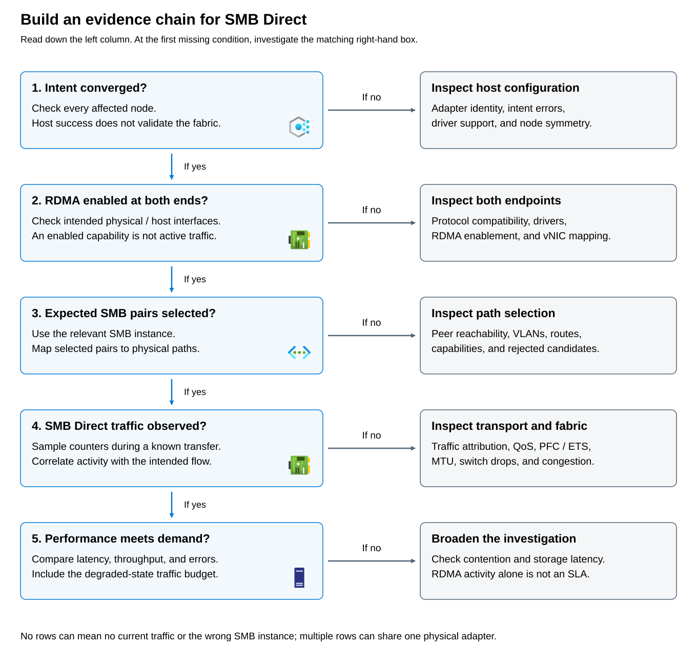

**Remote direct memory access (RDMA)** allows efficient data movement with reduced processor involvement. **Server Message Block (SMB) Direct** uses RDMA-capable connections. **SMB Multichannel** discovers and selects suitable interface pairs, allowing SMB to use multiple connections where appropriate.

These mechanisms answer different questions. RDMA enablement is local configuration. SMB Multichannel selection identifies eligible active connection paths. SMB Direct activity demonstrates use of the RDMA transport. None alone establishes acceptable storage latency.

Azure Local supports Ethernet-based host storage RDMA through **RDMA over Converged Ethernet version 2 (RoCEv2)** and **Internet Wide Area RDMA Protocol (iWARP)**. Use adapters qualified for the storage role, with the appropriate Storage Standard or Storage Premium qualification, supported firmware, and OEM drivers rather than the operating system's inbox drivers. Both ends of an RDMA connection must implement the same protocol: an iWARP adapter can't establish an RDMA connection to a peer using RoCE merely because both advertise RDMA capability. Network ATC applies the host-side storage configuration, while the physical network must meet the chosen protocol's requirements. Keep storage interfaces, subnets, and VLANs aligned with the supported design, and confirm actual SMB Direct activity rather than assuming that RDMA-capable hardware guarantees RDMA use.

> [!NOTE]
> **InfiniBand and guest RDMA are not supported for the Azure Local hyperconverged deployment covered here.** Guest RDMA means that applications inside a VM can use an RDMA-capable interface directly; it's different from the host using SMB Direct to provide storage for that VM. These capabilities are available in other explicitly supported environments. For example, Azure HBv3 high-performance computing VMs expose an InfiniBand adapter to the guest through single-root I/O virtualization (SR-IOV). Using it requires a supported guest operating system, the appropriate InfiniBand/RDMA drivers, and a supported VM placement and networking configuration. RDMA uses that InfiniBand interface, not the VM's ordinary Azure Ethernet interface. This Azure cloud capability doesn't make InfiniBand or guest RDMA supported on Azure Local, and simply connecting a VM to an RDMA-capable host adapter doesn't provide guest RDMA.

RoCEv2 requires the supported Ethernet congestion and loss-management configuration. iWARP uses TCP and has different transport loss-handling behavior; this doesn't exempt an Azure Local iWARP design from the product's physical switch and QoS requirements.

## Understand PFC and ETS without treating them as capacity

**Data Center Bridging (DCB)** comprises Ethernet mechanisms relevant to the supported storage fabric. **Priority flow control (PFC)** pauses selected priorities to mitigate loss. It isn't a recommendation to pause every traffic class: indiscriminate pause behavior can spread congestion.

**Enhanced transmission selection (ETS)** allocates bandwidth among traffic classes under contention. An ETS reservation is neither a hard throughput ceiling nor an end-to-end performance guarantee. A class can borrow unused allocation, while bottlenecks elsewhere can prevent it reaching the nominal reservation.

A common Network ATC storage policy assigns SMB traffic to priority 3 with a 50-percent ETS bandwidth allocation. Cluster heartbeat traffic uses priority 7, with a recommended allocation of 2 percent on 10-Gbps links or 1 percent on links of 25 Gbps or faster. Other traffic uses the default priority 0. These are IEEE 802.1p traffic priorities, not bandwidth values or application-level access rules. In a RoCE design, PFC protects the RDMA storage priority; it shouldn't be enabled indiscriminately for heartbeat or default traffic.

ETS assigns a minimum share of available link bandwidth to each configured traffic class when classes compete for transmission. It operates on the link between directly connected peers, not across the entire application path. A class can borrow bandwidth that other classes aren't using, so a 50-percent allocation isn't a hard throughput limit. On a nominal 25-Gbps link, 50 percent represents 12.5 Gbps before overhead, but doesn't guarantee that an application will achieve that rate through every switch and endpoint. Priority classification, ETS bandwidth allocation, and PFC pause behavior are separate settings that must work together.

Keep the Network ATC defaults unless the workload and supported network design justify an approved change. Apply changes through an intent QoS override, created with `New-NetIntentQosPolicyOverrides` and submitted with `Set-NetIntent`, rather than editing the generated traffic classes independently. Coordinate the corresponding switch configuration, wait for intent reconciliation to complete, and inspect the operational traffic classes on every affected node. Treat the configured percentages as traffic-management policy, not as evidence that the surviving links can carry the workload after a failure.

You can read operational host QoS using the solution-shipped `NetAdapter` and **`DcbQos`** modules. `Get-NetQosTrafficClass` belongs to `DcbQos`, not `NetQos`.

```powershell
Get-NetAdapterQos
Get-NetQosTrafficClass |
    Select-Object Name, Priority, Bandwidth
```

Compare these results with the intended policy and the relevant switch configuration. An advertised DCB capability or neighbor record isn't proof that both ends enforce matching operational settings.

## Choosing storage protocol options

When making decisions about storage configuration: 

1. Establish converged intent. 
1. Confirm enabled capability on the relevant interfaces. 
1. Identify the selected SMB interface pairs. 
1. During an authorized existing transfer, observe actual SMB Direct activity. 
1. Correlate throughput, errors, and storage latency with the service objective.



Failure at a stage directs investigation toward nearby dependencies; it doesn't automatically identify a root cause. For example, missing selected pairs might reflect no current session, the wrong SMB instance, addressing, or a peer problem—not necessarily a failed NIC.

The following read-only query uses `SmbShare`:

```powershell
Get-SmbMultichannelConnection -IncludeNotSelected |
    Select-Object ServerName, ClientIPAddress, ServerIPAddress,
        Selected, ClientRdmaCapable, ServerRdmaCapable, Failed
```

SMB instances matter. Depending on the flow being investigated, inspect the appropriate `-SmbInstance` value: `Default`, `CSV` (Cluster Shared Volumes), `SBL` (Storage Bus Layer), or `SR` (Storage Replica). These values identify different SMB consumers, not interchangeable views of every session. No rows in one instance doesn't establish that no storage connections exist.

| Supplied observation | Supported conclusion | What remains to establish |
| --- | --- | --- |
| Intent completed successfully | Reconciliation succeeded | Fabric and actual traffic health |
| RDMA enabled on both local interfaces | Local capability is enabled | Peer capability and selected paths |
| Selected pair has both RDMA capability flags true and `Failed=False` | An eligible pair is selected | Actual RDMA use and physical independence |
| Selected pair has a false RDMA capability flag | That pair doesn't demonstrate end-to-end RDMA eligibility | Why that interface or transport was selected |
| Two selected connections exist | Multiple connections were selected | Whether they share one physical adapter or failure domain |
| No rows during an idle period | No rows were observed in that query | Correct instance and evidence during relevant traffic |

For actual use, inspect existing performance telemetry or authorized counter samples during an existing transfer. Relevant SMB Direct Connection counters include **Bytes RDMA Read/sec** and **Bytes RDMA Written/sec**. These are rates: nonzero samples demonstrate activity in the interval; they aren't cumulative byte totals. A zero sample while idle isn't a failure.

Counter names can be localized. Discover available sets with the read-only command `Get-Counter -ListSet '*'` before selecting counters, and don't treat absent English names as absent transport support. In Performance Monitor, add the SMB Direct Connection counters for the relevant connection instances and observe their read and write byte rates during the same transfer interval. Match those instances to the SMB connections under investigation rather than assuming that activity on any RDMA connection proves the workload is using it.

SMB Multichannel detects RDMA-capable interfaces and establishes the RDMA connections used by SMB Direct. Disabling SMB Multichannel also disables SMB Direct, even if the adapters remain RDMA-enabled. SMB initially negotiates over TCP and retains that connection for fallback after establishing RDMA connections, so observing a TCP connection doesn't by itself prove that RDMA is unused. Multiple RDMA connections can also use the same physical interface. Correlate the counter activity with the selected interface pairs, independent network paths, throughput, and latency rather than relying on connection counts or capability flags alone.
