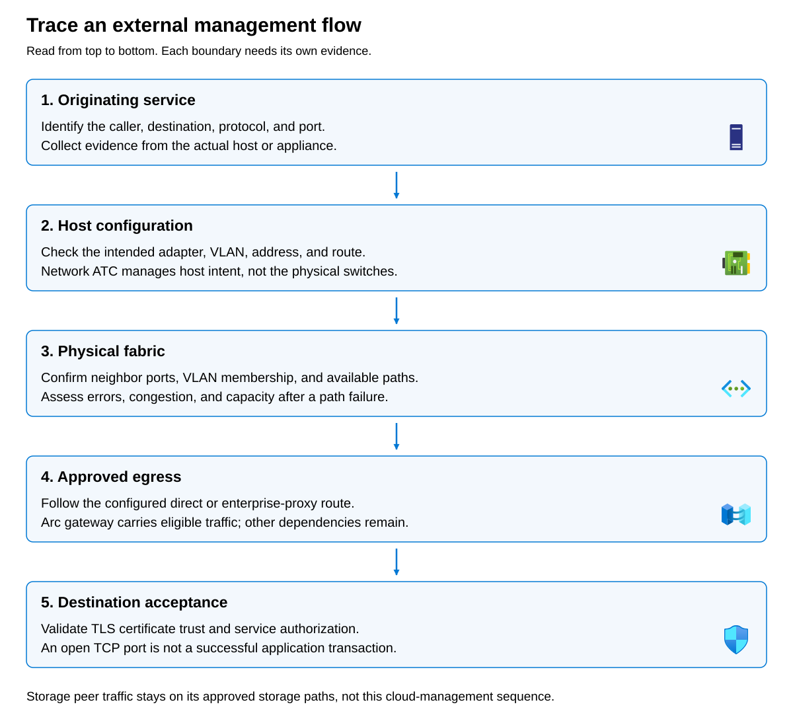

When investigating network functionality anomalies, record network traffic flow information that includes: 

- Originating component
- Source address
- Destination name and address
- Protocol and destination port
- Direction
- Expected route
- Policy owner
- Timestamp
- Reported symptom

When a connection uses a proxy, record that intermediary separately from the service destination.

The following diagram provides an ordered model for an external management request:

- Stage 1 identifies the originating service. 
- Stage 2 selects its host interface, address, and network. 
- Stage 3 carries traffic through the physical fabric. 
- Stage 4 provides approved direct, proxy, or gateway-assisted egress. 
- Stage 5 establishes Transport Layer Security (TLS) and application acceptance, including certificate validation and authorization.

A successful check at one stage does not confirm that the entire connection works. Correct host configuration cannot compensate for a blocked switch VLAN. A functioning proxy cannot make an expired credential valid. The separate storage path emphasizes that peer storage traffic does not take this Azure-management journey.

## Assign ownership before remediation

Use the following table to identify who manages each part of the network path and what evidence to request before proposing a configuration change:

| Boundary | Primary owner | Evidence to request |
| --- | --- | --- |
| Adapter identity and supported firmware | Platform and OEM teams | Inventory, validated compatibility, physical port mapping |
| Intent-managed host networking | Azure Local platform team | Intent definition, reconciliation state, operational adapter settings |
| Physical switching and uplinks | Network team | Port configuration, VLANs, neighbors, counters, failure domains |
| Azure egress and proxies | Connectivity and security teams | Destination classification, route, proxy configuration, service logs |
| Workload network security | Owner of the selected SDN management model | Resource attachment, matching rules, policy provisioning |
| Guest firewall and listener | Workload owner | Firewall evidence, listening service, application logs |

Investigations can examine layers in parallel, but conclusions should identify observations and uncertainty. “The network is fine” is too broad. “The source resolved the expected public address and opened a direct TCP connection at 09:14” is bounded evidence.

For Adatum, this discipline prevents three common mistakes: adjusting Network ATC for a proxy failure, editing a switch for a guest-firewall denial, and changing an Azure-managed security group through local controller scripts.
