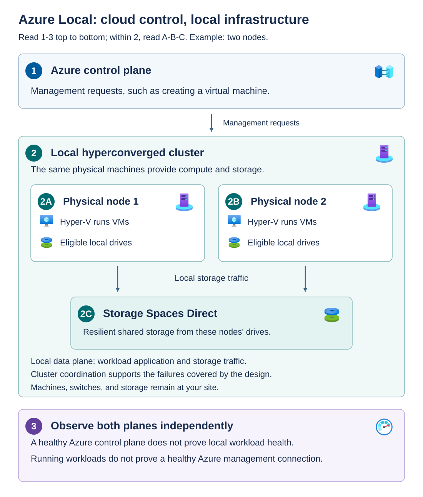
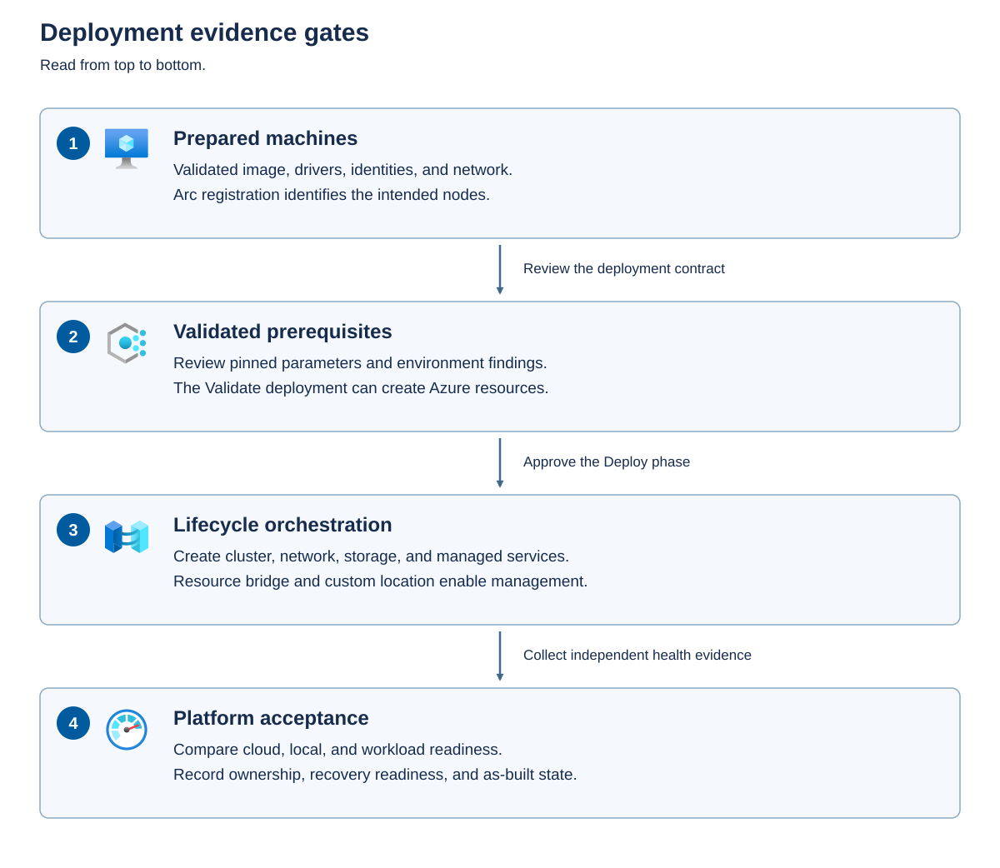

Azure Local brings Azure management to infrastructure that runs at your location. In a *hyperconverged* deployment, the same physical hosts, called *Azure Local nodes*, provide compute and software-defined storage. Hyper-V runs virtual machines (VMs), and Storage Spaces Direct combines eligible local drives into resilient shared storage. A *cluster* coordinates these nodes so that infrastructure and workloads can tolerate the failures covered by the design.

Azure supplies a management control plane, but the Azure Local nodes, switches, and storage devices remain local to your server room or datacenter. The *control plane* handles management requests such as creating a virtual machine. The *data plane* carries a workload's application and storage traffic. A functioning control plane doesn't prove that the local data plane is healthy, and a running application doesn't prove that its Azure management connection is healthy.

## Azure Local deployment scenario

In this module we'll use an Azure Local deployment at Contoso as an illustrative example. Contoso is commissioning a two-node Azure Local system at a distribution site. Its applications need local processing, while the central platform team wants consistent Azure-based management. The approved design uses Active Directory Domain Services (AD DS), a dedicated cloud witness storage account, and infrastructure-only storage provisioning. Workload volumes will be created during a later, approved commissioning step.

The hardware team has delivered the physical hosts that'll become Azure Local nodes. The network team has configured the switches. An Azure administrator has created the deployment resource group. You've been given responsibility for overseeing this Azure Local deployment. You'll have to decide whether these preparations agree with each other, whether to authorize the supported workflow, and ensure you gather enough evidence to hand the system to operations.

You also support a second site that's considering Local Identity with Azure Key Vault instead of AD DS. Throughout the module, you'll learn to distinguish shared requirements from identity-specific requirements, rather than assuming that every site should use the same deployment inputs.

## Use three engineering gates

An *engineering gate* is a planned decision point where the responsible owner reviews evidence against agreed criteria and decides whether work can proceed to the next stage. Define the criteria, required evidence, and approval responsibility before reaching the gate. If a required criterion is unmet or its evidence is missing, hold progression until the finding is resolved. A completed task or successful status alone isn't sufficient.

- *Readiness* means that the proposed inputs and environment satisfy the deployment requirements. 
- *Orchestration* is the coordinated execution of the steps that create and configure the platform.
- *Acceptance*, also called commissioning here, is the engineering decision that the observed result meets the agreed requirements.

The diagram has four numbered stages. Prepared Azure Local nodes and identities provide the starting evidence. Parameter review and environment checks establish readiness. The lifecycle orchestrator then configures the cluster and managed services. Finally, acceptance compares cloud, local infrastructure, and workload-management evidence before handover. The arrows show evidence dependencies, not a promise that every underlying task runs serially.

These gates prevent two common mistakes:

- Registering a host intended to become an Azure Local node with Azure Arc doesn't make it a deployed cluster member.
- A successful Azure resource operation isn't necessarily a workload-ready system.
