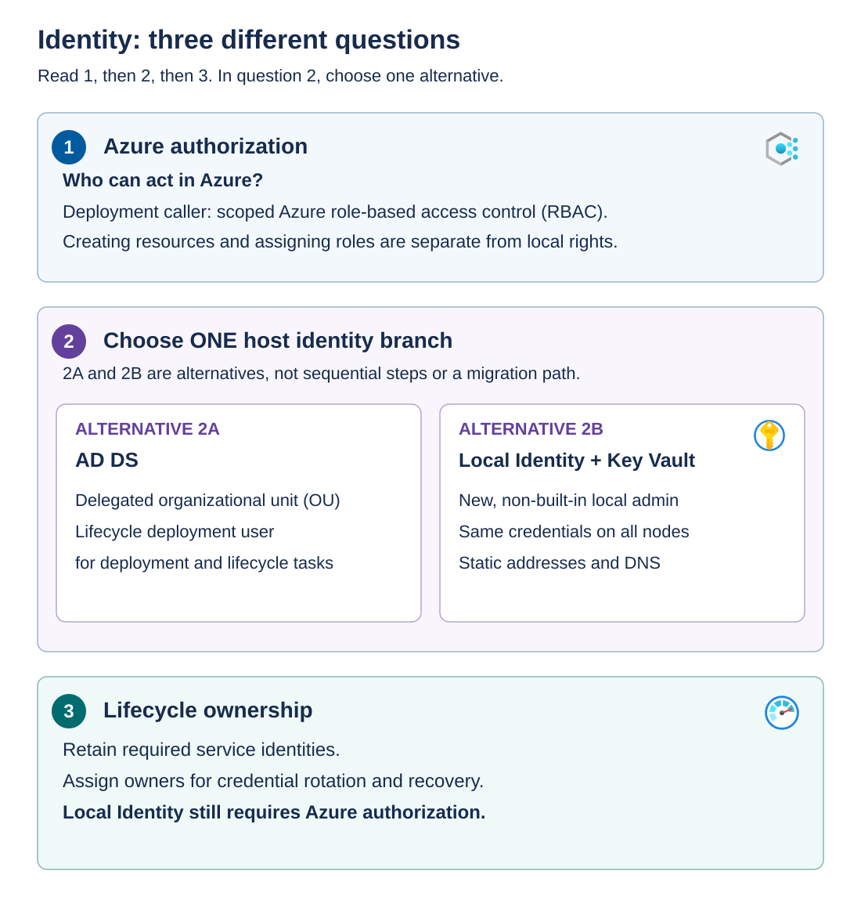

Before assembling a deployment template or opening the deployment wizard, explicitly define what you're deploying, which Azure Local nodes you'll use, and which teams own the prerequisites. A *deployment boundary* is the agreed set of resources and dependencies that the change is authorized to create or modify.

## Align the hardware and software baseline

Use the validated operating system image for the intended Azure Local release and original equipment manufacturer (OEM) solution. Keep a record of the approved firmware, drivers, network adapter settings, and manufacturer integration package for every Azure Local node.

The *Solution Builder Extension* is the OEM integration package used with the Azure Local lifecycle experience. It connects manufacturer-specific components and operations to the platform's supported lifecycle workflow. It isn't interchangeable with an arbitrary Windows driver package.

A driver that installs successfully proves only that the operating system accepted it. It doesn't prove that the combination of adapter, firmware, driver, switch configuration, and Azure Local release is supported. Differences between nodes can also produce failures that appear only during clustering or storage traffic.

Capture an Azure Local node inventory before orchestration. Include serial numbers, node names, adapter names and physical ports, management addresses, disk roles, and Azure Arc resource identifiers. This inventory lets you distinguish a mistaken deployment target from a genuine configuration failure.

For example, suppose Contoso assigns the operating-system adapter name `StorageA` to a network adapter on each Azure Local node to identify its role in carrying storage traffic. The node inventory must map that name to the corresponding physical network port and connected switch port. Verify that the deployment parameters and actual cabling match this mapping. Identical adapter names on both nodes don't prove that they're connected to the correct storage network.

## Identify deployment prerequisite owners

An *owner* is the person or team accountable for a specific deployment prerequisite, such as network connectivity or identity preparation. The owner ensures that the prerequisite meets the approved design, supplies readiness evidence, coordinates corrective work, and obtains required change approvals. Tasks can be delegated, but the owner remains accountable for the outcome and for escalating unresolved issues. If a team owns a prerequisite, record a named contact so that questions and failures have a clear destination. Here, ownership describes operational responsibility, not the Azure **Owner** RBAC role. This responsibility doesn't automatically grant administrative permissions.

An owner must be able to supply evidence and authorize remediation. "The infrastructure team checked it" isn't an actionable handoff.

Use the following table to assign owners, identify required readiness evidence, and understand which deployment activities depend on each prerequisite.

| Dependency | Accountable owner | Evidence before deployment | What depends on it |
| --- | --- | --- | --- |
| Hardware and image | Hardware/OEM team | Supported bill of materials, image, firmware, drivers, and extension package | Cluster creation and lifecycle operations |
| Physical and host networking | Network and platform teams | Port mappings, virtual LANs, routing, adapter configuration, and tested connectivity | Network intents, storage traffic, and management services |
| Addressing and DNS | Network/DNS team | Reserved address pools, correct records, resolvers, and forwarders | Node discovery and infrastructure service connectivity |
| Identity preparation | Directory or local-identity owner | Prepared accounts, delegated permissions, and credential custody | Authentication during deployment and servicing |
| Azure permissions and policy | Azure governance team | Approved role assignments, resource-provider registration, and permitted resource types | Registration, prerequisite resources, and deployment operations |
| Storage and capacity | Storage/platform team | Eligible disks, expected usable capacity, and maintenance reserve | Infrastructure storage and workload admission |
| Secrets and recovery | Security/operations team | Approved vault access, rotation responsibilities, and recovery-material custody | Credential retrieval and recoverability |

*Maintenance reserve* is capacity intentionally left available so that supported maintenance or failure recovery doesn't exhaust the remaining system. Raw drive capacity and total installed memory aren't the same as capacity available for adding Azure Local workloads.

## Separate Azure authorization from host identity

Azure role-based access control (RBAC) authorizes operations on Azure resources. A role assignment combines an identity, a role definition, and a scope. A Microsoft Entra tenant supplies the directory in which those identities are represented. A subscription is a broad management and billing boundary. A resource group groups related Azure resources. An individual resource is a narrower scope.

Those permissions don't automatically grant administrative rights on Azure Local nodes or permissions in AD DS. Similarly, membership in an Azure Local node's local Administrators group doesn't grant permission to create Azure resources.

Read the numbered identity diagram from Azure authorization to host identity and then lifecycle ownership. The AD DS and Local Identity panels are alternatives, not successive steps. Both require Azure authorization. Each branch has its own host credentials and preparation, and both require ongoing ownership of credentials and service identities after installation.

For an **AD DS deployment**, prepare the designated organizational unit (OU), name resolution, and the lifecycle deployment user's delegated permissions. An OU is an Active Directory container used to organize objects and apply administrative controls. Group Policy objects can affect Azure Local nodes in that OU, so review inherited policy for conflicts with the supported deployment configuration.

The Lifecycle Manager (LCM) deployment account is an Active Directory user account, distinct from the node's local administrator account. Prepare it with these requirements:

- **Account name:** Use a username unique to each Azure Local instance. It must be 1 to 20 characters long, contain only letters, numbers, hyphens, and underscores, and not start with a hyphen or number. It can't be `admin` or match the local administrator's username.
- **Credential input:** If you use the optional `New-HciAdObjectsPreCreation` cmdlet to prepare the account and OU, supply only the username in the credentials, not a domain-qualified name such as `contoso\username`.
- **Password:** Use at least 14 characters, including a lowercase letter, an uppercase letter, a number, and a special character. A unique password for each instance is recommended to limit the impact of a compromised account.
- **Logon rights:** Allow interactive logon and grant the **Log on as a batch job** user right. Ensure that domain policy doesn't deny the required rights.

Azure Local adds the LCM account to the physical nodes' local Administrators group during deployment. Retain and manage it afterward: it's used for servicing, such as applying updates through PowerShell, and for domain-join operations when adding or repairing nodes. Its delegated permissions must allow it to add computer accounts to the deployment's target OU. Don't treat it as a disposable installation account.

The optional `New-HciAdObjectsPreCreation` cmdlet in the `AsHciADArtifactsPreCreationTool` module creates the dedicated OU and deployment account with the required permissions. Run it in an elevated PowerShell session on a domain-joined computer, using an identity authorized to create OUs. Supply the new account's credentials through `-AzureStackLCMUserCredential` and the OU's distinguished name through `-AsHciOUName`. For example, `OU=AzureLocalSite01,DC=contoso,DC=com` identifies an OU within the Contoso domain. The preparation blocks GPO inheritance on the OU, but enforced GPOs can still apply. The directory owner must separately exclude the Azure Local computer accounts from those policies. Moving the computer objects to another OU after deployment isn't supported. Don't delete the existing OU during a node repair, because doing so can remove the BitLocker recovery keys stored there.

For **Local Identity with Azure Key Vault**, omit AD-specific prerequisites and use the documented certificate-based identity model. Azure Key Vault provides controlled storage and access for secrets, keys, and certificates. Create a non-built-in local account in the Administrators group, with identical credentials across the Azure Local nodes. Don't use the built-in Administrator account for this branch. Assign an owner to maintain password expiration, rotation, and secure custody.

Local Identity requires static node addresses and appropriate DNS configuration. Removing the AD dependency doesn't remove the need for name resolution. With external DNS, prepare the documented host records for the nodes and system, and verify that the intended names resolve to the intended addresses.

The optional **internal DNS capability** provides cluster and infrastructure name resolution. It isn't a DNS service for application records, virtual machines, or Kubernetes workloads. Keep the workload DNS design separate. Also check tool compatibility: Windows Admin Center isn't supported for this identity configuration in the referenced compatibility guidance. Use the supported Azure portal and PowerShell paths.

For the Active Directory branch, Azure Local version 2604 and later supports joining nodes to the domain before deployment. Configure each node to use the domain's DNS servers and a valid time source, then use **Domain/workgroup**, option 1 in SConfig, to join the domain. Add the LCM deployment user to the local Administrators group on every prejoined node before deployment. If you don't prejoin the nodes, the AD DS-based Azure portal deployment joins them automatically. This choice doesn't apply to the Local Identity branch, which doesn't require domain membership.

## Review each authorization task

Subscription preparation, Arc onboarding, resource deployment, role assignment, directory lookup, and secret access are separate tasks. Build a role matrix around those tasks, not around the job title of the person running the deployment.

For Arc onboarding, assign the **Azure Connected Machine Onboarding** and **Azure Connected Machine Resource Administrator** roles to the registration identity at the resource group where the nodes will be registered. Keep subscription preparation separate: an authorized subscription Contributor or Owner registers the required resource providers before the resource-group-scoped operators begin. Include **Microsoft.Insights** registration, because missing it causes diagnostic-account and Key Vault audit-logging failures during validation. Confirm that Azure Policy permits the required extensions, resource types, and deployment locations.

**Contributor alone doesn't grant role-assignment authority.** If the template creates role assignments, arrange the required authorization through your Azure governance team. Don't solve an unexplained access error by granting subscription Owner.

Key Vault has another important distinction: permission to manage the vault resource doesn't automatically mean permission to read secret values. Directory lookup permission also doesn't grant either of those capabilities. For the Azure portal deployment workflow, assign the following roles to the deployment user at the resource group used to register the nodes:

| Deployment task | Required roles |
| --- | --- |
| Manage the Azure Local deployment and inspect its resources | Azure Stack HCI Administrator and Reader |
| Create and manage the deployment vault resource | Key Vault Contributor |
| Manage the vault's supported data-plane role assignments | Key Vault Data Access Administrator |
| Read and write deployment secrets | Key Vault Secrets Officer |
| Create and manage the deployment storage account | Storage Account Contributor |

> [!NOTE]
> The product is now named **Azure Local**, but some existing roles, resource providers, and commands retain **Azure Stack HCI** naming. For example, the **Azure Stack HCI Administrator** role applies to Azure Local. Use the existing names exactly when assigning roles, specifying resource providers, or running commands.

In the Azure portal, review the assignments under the resource group's **Access control (IAM) > Role assignments**. For an ARM template, also authorize the role assignments that the template creates at their intended scopes. The roles in this table aren't a blanket grant to assign any Azure role. Keep permission to look up tenant service principals separate from resource-group RBAC, and record the actual deployment and service identities rather than assuming that they all use the operator's account.

For new deployments in this baseline, Azure Local uses a system-assigned managed identity for cluster authentication to Azure. A *managed identity* lets a service authenticate without an operator maintaining an application password for that identity. Don't copy older application/client-secret preparation steps into a current deployment without checking their applicability.

## Register the prepared Azure Local nodes

Azure Arc registration creates an Azure representation of each prepared Azure Local node and establishes its management connection. The *Azure Connected Machine agent* supplies that node-level connection, and extensions add specific management capabilities.

Use the supported registration workflow for your chosen connectivity model. Confirm the tenant, subscription, resource group, node names, expected extensions, and connection status for every Azure Local node. A similarly named resource in another resource group isn't the intended deployment target.

Registration is an input to cluster deployment. It doesn't create the cluster, verify storage resiliency, or certify the future workload-management path.

**Readiness decision:** Proceed to parameter review only when every required dependency has an owner and evidence, and the inventory identifies exactly the Azure Local nodes and Azure scope authorized for the change.
