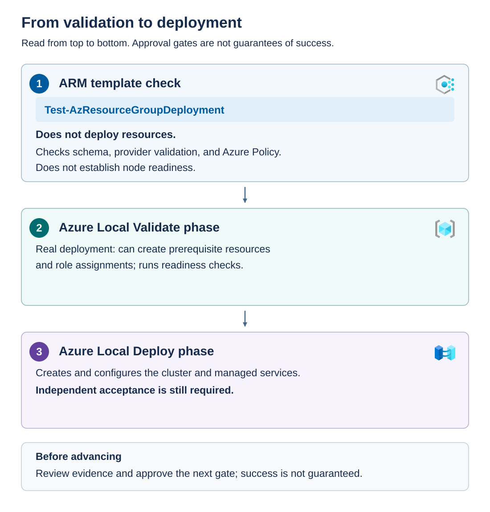

"Validation passed" is incomplete unless you identify the validator, its scope, and the time it ran. Azure resource validation, target-environment checks, and successful deployment answer different questions.

## Compare the validation layers

The diagram orders three activities. 

1. An ARM template check evaluates the proposed Azure deployment without creating its resources. 
1. The Azure Local `Validate` phase is submitted as a real deployment: it can create prerequisite resources and assignments while checking readiness. 
1. `Deploy` orchestrates platform creation. Independent acceptance remains necessary after the third activity.



The following table compares the scope and limitations of template review, ARM/provider validation, Environment Checker, and deployment completion.

| Check or operation | What it establishes | What it doesn't establish |
| --- | --- | --- |
| JSON/schema and template review | Inputs are structurally valid and match the reviewed template | That addresses, hardware, and credentials are correct |
| ARM/provider validation | Azure can evaluate the request and detect supported schema, policy, or permission findings | That every local dependency is healthy |
| Environment Checker | Supported checks can assess target connectivity, hardware, identity preparation, networking, and Arc integration | That no dependency will change or fail later |
| Deployment completion | The relevant workflow or resource operation reached its reported completion state | That independent commissioning criteria passed |

*Environment Checker* is a set of Azure Local readiness checks. It can run independently during preparation and as part of deployment. Use the documented version and execution location. If you installed a standalone copy on a node, follow Microsoft's instruction to remove that standalone copy before deployment to avoid conflicts with the deployment's checker.

A result is also time-bound. A successful DNS check before a firewall change isn't proof of connectivity afterward. Record when checks ran and rerun the applicable checks after material prerequisite changes using the supported workflow.

## Perform a non-deploying template check

A *management workstation* is the administrator's computer used to run Azure PowerShell commands against Azure. These examples run from that workstation, not from an Azure Local node. Ensure that approved, compatible versions of `Az.Accounts` and `Az.Resources` PowerShell modules are installed and that the workstation can reach Azure's sign-in and management endpoints.

Here, *authenticated* means that the PowerShell session is signed in to Azure. Signing in to Windows or the Azure portal doesn't authenticate that session. Use `Connect-AzAccount` to sign in, `Set-AzContext` to select the intended tenant and subscription, and `Get-AzContext` to confirm the active account, tenant, and subscription before running commands.

Authentication doesn't grant authorization. The signed-in identity needs the Azure RBAC permissions required by each command at the appropriate scope. For the following validation example, the caller must be authorized to validate the deployment and resolve its referenced resources.

Replace the resource-group name and both file paths with reviewed values. This command contacts Azure but doesn't submit the Azure Local deployment workflow.

```powershell
$ErrorActionPreference = 'Stop'

$validationParameters = @{
    ResourceGroupName      = 'rg-azure-local'
    TemplateFile           = '.\approved-template.json'
    TemplateParameterFile  = '.\approved-validate.parameters.json'
    Mode                   = 'Incremental'
}

$issues = Test-AzResourceGroupDeployment @validationParameters

if ($issues) {
    $issues | Select-Object Code, Message
    throw 'Template validation returned findings.'
}

'No template validation findings returned.'
```

No findings means only that this call returned no validation findings. It doesn't mean Environment Checker passed or that the cluster exists. An authorization or transport exception is a failed check, not an empty successful result.

Resource Manager what-if can provide additional change-preview information where supported. It isn't a substitute for environment validation and can't predict every locally orchestrated action. Protect validation and error output because it can contain private resource identifiers.

## Submit the readiness phase under change control

The Azure Local `Validate` phase is a resource-changing operation. The template creates or configures prerequisite resources and permissions as needed and initiates readiness checks. Those changes can have cost and governance implications even if full cluster deployment hasn't started.

Before authorizing it, confirm the approved parameter file, identities, scope, endpoint access, resource policies, and readiness owners. Verify that no conflicting deployment is already running.

The following is a reference invocation. It requires a complete parameter file containing `deploymentMode` set to `Validate`, approved permissions, and change authorization.

```powershell
$ErrorActionPreference = 'Stop'

New-AzResourceGroupDeployment `
    -ResourceGroupName 'rg-azure-local' `
    -Name 'azure-local-approved-validation' `
    -TemplateFile '.\approved-template.json' `
    -TemplateParameterFile '.\approved-validate.parameters.json' `
    -Mode Incremental
```

> [!NOTE]
> When performing this step in your own deployments, inspect the environment-check results, not just the command's return. For each finding, record the affected target, required correction, owner, and evidence needed to close it. Resolve warnings according to their documented meaning. A warning isn't automatically harmless.

## Authorize deployment only after readiness passes

Authorize `Deploy` only when current readiness evidence confirms that the approved configuration meets the required prerequisites. Deployment changes Azure resources and local cluster infrastructure, consumes capacity, and can restart nodes. Unresolved networking, identity, storage, or permission issues can stop the workflow after it's already made changes, leaving a partially configured system that needs controlled recovery. Resolving these issues before deployment reduces avoidable failures, disruption, and recovery work. A readiness pass supports the decision to proceed, but it doesn't guarantee deployment success or replace the acceptance checks performed afterward.

For an initial deployment, follow this review sequence:

1. Match the design and chosen identity branch to the pinned template and complete parameter file.
1. Run the non-deploying template check and resolve applicable policy and permission findings.
1. Submit the documented `Validate` phase under change approval and retain the readiness results.
1. Resolve failed prerequisites, complete the documented validation workflow, and approve the transition to `Deploy`.

Use the documented redeployment point with `deploymentMode` changed to `Deploy`. Review the parameter difference: changing the phase shouldn't silently change node selection, addressing, identity, or storage policy.

The next reference invocation changes Azure and local infrastructure. It requires successful readiness gates, approved deployment and role-assignment permissions, a maintenance window, associated service cost approval, and a complete parameter file containing `Deploy`. Deployment consumes capacity and can restart Azure Local nodes.

```powershell
$ErrorActionPreference = 'Stop'

New-AzResourceGroupDeployment `
    -ResourceGroupName 'rg-azure-local' `
    -Name 'azure-local-approved-deployment' `
    -TemplateFile '.\approved-template.json' `
    -TemplateParameterFile '.\approved-deploy.parameters.json' `
    -Mode Incremental
```

`Incremental` leaves existing resources that aren't declared in the template in place. By contrast, Resource Manager's `Complete` mode can delete resources that are absent from the template, so don't substitute it for the documented deployment mode. Incremental mode isn't a transaction or rollback guarantee, and it doesn't make deployment non-disruptive. Existing resources described in a template can still be changed.

> [!NOTE]
> **Validation decision:** Authorize orchestration only when the required readiness evidence is complete, current, and associated with the exact deployment contract.
