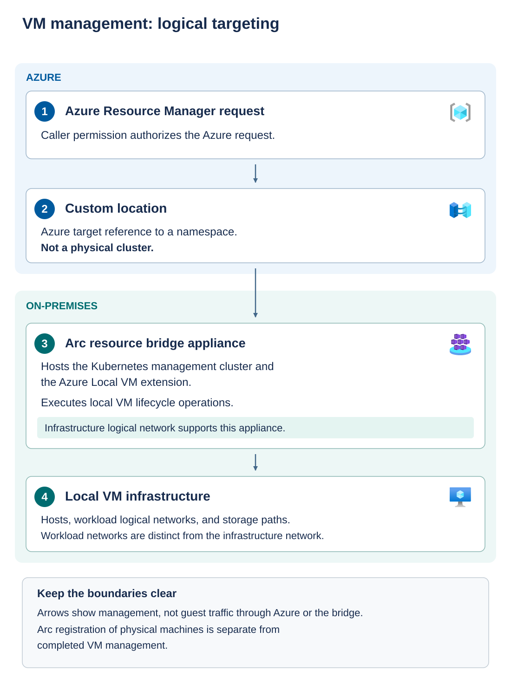

The lifecycle orchestrator coordinates work that spans Azure resources and Azure Local nodes. It applies the supported sequence for cluster formation, networking, storage, security, and infrastructure services. These steps aren't independent scripts that you can safely rerun in any order.

## Understand the managed components

Cluster formation establishes membership and high-availability coordination. Network intents apply the reviewed host configuration. Storage operations establish the infrastructure and any requested workload storage. Security configuration applies the platform baseline. Managed services then connect the local platform to the Azure workload-management experience.

Several resources in that last group have similar names but different responsibilities:

| Component | Responsibility |
| --- | --- |
| Arc machine resource | Represents an Azure Local node and its node-management connection to Azure |
| Azure Local instance resource | Represents the deployed Azure Local system in Azure |
| Azure Arc resource bridge | Appliance virtual machine hosting an Arc-enabled Kubernetes management cluster |
| Azure Local VM Kubernetes extension | Processes Azure management requests and carries out local VM lifecycle operations through the bridge's management environment |
| Custom location | Azure deployment-target abstraction associated with a namespace in the bridge's management cluster |
| Infrastructure logical network | Network resource used by the resource bridge and created as part of the infrastructure |
| Workload logical networks and storage paths | Network and storage resources used when provisioning workload VMs |

A custom location isn't a second physical cluster or a geographical Azure region. It tells Azure where supported local resources should be deployed. A Kubernetes *namespace* is a logical grouping within a Kubernetes cluster. Here, it identifies the management target, not a workload VM's network. The bridge's Kubernetes management cluster serves platform management and isn't an application Kubernetes cluster. A resource bridge isn't the application network gateway for every VM.

The numbered path represents logical management relationships. An authorized Azure Resource Manager request uses a custom location to identify its local target. The on-premises resource bridge hosts the management cluster and VM extension that carry out local lifecycle operations. Workload VMs use the appropriate host, workload network, and storage resources. The bridge's infrastructure network is separate from the workload network design. Guest application traffic doesn't follow this management diagram.

This distinction helps explain a partial failure: an Azure Local node can remain Arc-connected while the VM management extension is unhealthy. The node's connection and the workload-management path need separate observations.

## Monitor deployment without making changes

Record the deployment name, start time, resource group, template revision, and correlation identifier. A *correlation identifier* links related operations for troubleshooting. A local action identifier links work inside the local orchestrator. Retaining both helps connect a cloud error to the local stage that produced it.

Use the Azure Local deployment view and Resource Manager deployment operations to identify the current stage. Some work appears in nested deployments. A parent deployment's state summarizes its children, but it isn't necessarily the most useful diagnostic message.

Don't create a second deployment simply because a command or browser session stopped waiting. A client timeout can occur while service-side or local work continues. Confirm the actual workflow state before taking recovery action.

Resources created by orchestration have lifecycle ownership. Recreating an appliance or custom location manually can produce the expected name but incorrect identities, certificates, or persisted state. In 2610, automatically managed Provisioned Machine resources also belong to the system's lifecycle inventory. Don't delete them as cosmetic cleanup.

> [!NOTE]
> **Orchestration decision:** Move to commissioning only when the documented platform workflow has completed and its expected resources and service states can be inspected. Resource presence alone isn't service readiness.
