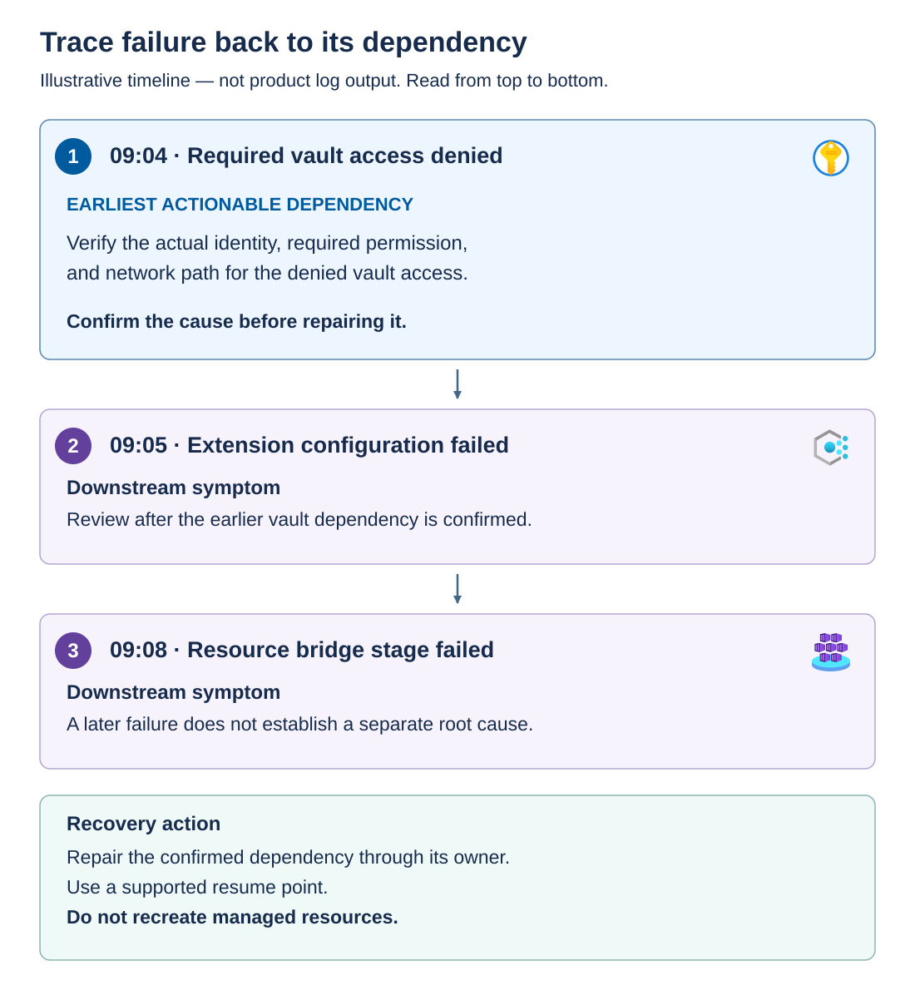

Troubleshooting starts by identifying the failed dependency, not by repeating the final command. A storage error, denied secret request, and invalid Azure parameter require different owners and recovery paths.

## Find the earliest actionable dependency

Consider this illustrative sequence of observations: The timeline shows three ordered observations. Required vault access is denied at 09:04. Extension configuration fails at 09:05, and the resource bridge stage fails at 09:08. The later failures can be consequences of the earlier dependency. Investigate the secret request's actual identity, access method, authorized scope, and connectivity before treating the appliance as the cause.



"Earliest" means the first relevant causal failure, not simply the first warning in a log. Correlate timestamps, targets, and identifiers. An unrelated warning from another node doesn't explain the failed secret request.

## Examine the Azure operation evidence

Run the following inspection in an authenticated Azure PowerShell session on the management workstation, using the approved `Az.Resources` version. Confirm the active tenant and subscription and ensure that the signed-in identity has deployment read permission. Replace the example resource group and deployment name with an existing deployment. These commands don't retry or resume anything.

```powershell
$ErrorActionPreference = 'Stop'
$resourceGroup = 'rg-azure-local'
$deploymentName = 'azure-local-approved-deployment'

Get-AzResourceGroupDeployment `
    -ResourceGroupName $resourceGroup `
    -Name $deploymentName |
    Select-Object DeploymentName, ProvisioningState, Timestamp, CorrelationId

Get-AzResourceGroupDeploymentOperation `
    -ResourceGroupName $resourceGroup `
    -DeploymentName $deploymentName |
    Where-Object { $_.ProvisioningState -eq 'Failed' } |
    Select-Object OperationId, TargetResource, ProvisioningState
```

The failed-operation list is an entry point. In a restricted troubleshooting session, inspect the operation's full status message and relevant nested deployment details. If the parent only reports a nested deployment failure, follow that nested deployment rather than concluding that its resource name is the cause.

Retain local action identifiers, exact error messages, timestamps with time zones, and node/resource targets. Check whether timestamps use the same clock basis before ordering events. Store complete diagnostics securely and redact secrets and private identifiers before broader distribution.

## Route the deployment finding to the correct owner

The following table links common deployment findings to the first checks to perform and the team or supported action needed to address them.

| Finding | Investigate first | Appropriate remediation boundary |
| --- | --- | --- |
| Template parameter rejected | Template version, allowed values, and complete input schema | Correct and approve the parameter contract |
| Azure authorization denied | Actual caller/service identity, requested action, scope, and policy | Azure governance owner corrects the documented permission |
| Secret retrieval denied | Secret consumer, access path, vault authorization, and secret version | Identity/vault owner restores the intended access relationship |
| Name resolution or endpoint access fails | Resolver response, routing, firewall, proxy, and the affected node/service | Network/DNS owner repairs the prerequisite |
| Network intent fails | Adapter-to-port mapping and supported host/switch settings | Network/platform owners correct the approved configuration |
| Storage configuration fails | Eligible disks, health, capacity, and the supported storage workflow | The storage/platform owner or support investigates. Don't clear disks speculatively |
| Client timeout with active local work | Actual orchestrator state and recent progress | Observe or escalate. Don't start a competing workflow |

Recheck the failed dependency after repair. For example, a role assignment to the wrong service principal doesn't help even if the role name is correct. A *service principal* is the tenant-local representation of an application or service identity. An application ID identifies an application. A service principal object ID identifies that principal's directory object in a particular tenant. Don't substitute one for the other in a role assignment or principal lookup.

## Resume at a supported point

Recovery depends on both **where** the failure occurred and **what state** the system is in now.

A template/preflight failure before orchestration can require correcting the contract and repeating the documented validation path. Arc registration has its own bootstrap-status and retry procedure. A system whose validation completed and whose deployment later failed requires its documented failed-stage recovery path.

For the supported portal recovery flow, correct the underlying issue and use **Deployments > Resume deployment** as described in the deployment guidance. Don't select **Try again** while validation tasks are still running. Confirm the applicable procedure for the identity model and deployment interface you used.

> [!CAUTION]
> Don't initiate another ARM deployment with `deploymentMode` set to `Validate` after validation completed while the system is in **Deployment failed** state. Resubmitting validation in this state resets system properties and can cause license synchronization problems. It isn't a harmless diagnostic retry. Correct the failed dependency and continue through the supported failed-stage recovery flow instead. The initial validation sequence isn't a universal recovery sequence.

Deleting a resource group isn't a universal undo. It can remove management relationships and resources without safely reversing local configuration. Reimaging, decommissioning, cleaning disks, or replacing managed appliances requires a specific supported procedure and explicit change approval.

If the stage is ambiguous or partially complete, stop additional submissions, preserve evidence, and open an Azure Local deployment support request in the Azure portal. Include the release, hardware/OEM details, identity model, connectivity model, failed stage, exact error message, correlation identifiers, and changes already attempted.

File the support request before starting standalone log collection. If registration or deployment failed before observability was set up, follow Microsoft Support's instructions to copy the requested diagnostics from the affected node to a system with Azure connectivity, then use `Send-AzStackHciDiagnosticData` to send that package to Microsoft. If observability is already configured, use its on-demand log collection instead. Handle diagnostic packages as restricted data and send them only through the approved support channel.

Remote support is a separate access decision, not an automatic consequence of opening a ticket. For predeployment or preregistration assistance, an authorized administrator can use `Enable-AzStackHciRemoteSupport` with the support-provided shared access signature, an approved access level of `Diagnostics` or `DiagnosticsRepair`, and an expiration in minutes. Enabling it configures Just Enough Administration and restarts Windows Remote Management, which can interrupt the PowerShell session. A dropped session during that setup isn't, by itself, evidence that cluster deployment failed.

> [!NOTE]
> **Recovery decision:** Resume only after the responsible owner repairs the confirmed dependency and the supported procedure identifies a safe continuation point.
