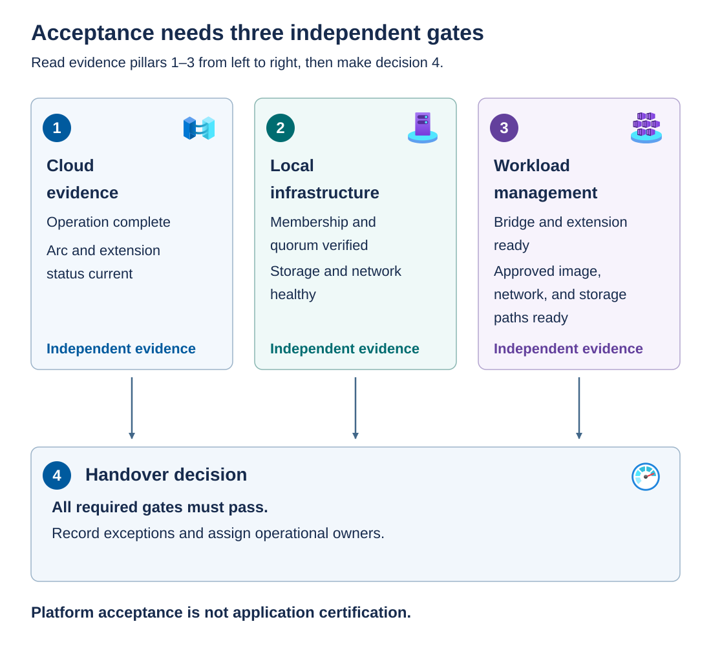

*Commissioning the Azure Local deployment* is the process of checking that the deployed Azure Local system meets agreed requirements and formally deciding whether it's ready for operational handover. Deployment creates and configures the system. Commissioning establishes, through current evidence, that its components work together, its health and resiliency are acceptable, and the operations team has the access, documentation, and recovery arrangements needed to support it. Resolve blocking issues before acceptance, and record any approved limits on how the system can be used. Accepting the platform doesn't automatically certify the applications that'll run on it.

Commissioning is an evidence-based decision, not a transcription of a green status icon. Define the acceptance criteria before deployment so that the same team isn't inventing a lower standard while trying to close a change.

## Gather three independent evidence sets

Cloud evidence, local infrastructure evidence, and workload-management evidence are three separate inputs. All feed a fourth handover decision. No input substitutes for another: a successful Azure operation doesn't cancel a storage-health finding, and a locally running VM doesn't prove that the Azure VM management extension is ready. Platform acceptance still doesn't certify the application.



The following table expands these evidence sets into the observations to collect and explains how each observation supports the handover decision.

| Evidence area | Expected observations | Why the observation matters |
| --- | --- | --- |
| Azure operation and inventory | Completed workflow, expected resources, and retained deployment identifiers | Establishes what was created and how to trace it |
| Cluster and quorum | Expected membership, available nodes, and intended witness configuration | Establishes that the cluster matches the resiliency design |
| Storage | Healthy pools, virtual disks, and expected volumes, plus understood repair activity and capacity | Establishes usable storage rather than only disk presence |
| Networking | Healthy intents and correct addresses, with working DNS and access to required endpoints | Establishes infrastructure and management connectivity |
| Security and recovery | Required baseline applied, recovery material escrowed, and access owners assigned | Establishes recoverability, not just enabled protection |
| Arc and extensions | Current connection evidence and healthy required extensions | Distinguishes live management from stale resource inventory |
| Workload management | Healthy bridge and extension, a usable custom location, and approved workload resources | Establishes the platform path for provisioning and managing workloads |

> [!NOTE]
> *Escrowed* means placing recovery material in an approved protected location with a defined retrieval process and authorized custodians. Encryption without recoverable keys can make a protected system unrecoverable. Don't include recovery secrets in the general handover document. Reference the controlled recovery process.

## Inspect local health in the right context

To inspect Azure Local health, run local cluster commands in an authorized elevated Windows PowerShell session on an Azure Local node, or in an approved remote session to that node. They aren't commands for an ordinary Azure Cloud Shell session. Use the platform-provided modules rather than installing arbitrary management components on a node.

The following read-only observations cover cluster membership, witness configuration, and storage health:

```powershell
$ErrorActionPreference = 'Stop'

Get-ClusterNode
Get-ClusterQuorum

Get-StoragePool -IsPrimordial $false |
    Select-Object FriendlyName, HealthStatus, OperationalStatus, IsReadOnly

Get-VirtualDisk |
    Select-Object FriendlyName, HealthStatus, OperationalStatus, DetachedReason

Get-StorageJob
```

Compare membership with the expected inventory. A cluster with fewer available nodes than designed hasn't demonstrated the intended capacity or failure tolerance. Compare the observed witness with the chosen deployment type, rather than expecting the same witness on every Azure Local architecture.

For storage, inspect both health and operational status. Repair activity can represent ongoing restoration of resiliency. Don't admit production workloads merely because a volume is accessible while that work is unresolved. Investigate findings and apply the agreed acceptance criteria.

Inspect network intents and the Azure Local node's Arc connection:

```powershell
$ErrorActionPreference = 'Stop'

Get-NetIntent
Get-NetIntentStatus
azcmagent show

if ($LASTEXITCODE -ne 0) {
    throw 'The Azure Connected Machine agent status command failed.'
}
```

`Get-NetIntent` describes the intended host configuration. `Get-NetIntentStatus` reports its status. Check coverage across the expected nodes and intents. `azcmagent show` reports this Azure Local node's connection and agent information. It doesn't prove bridge or cluster health. Repeat node-level observations across the required nodes rather than extrapolating from one.

On the supported baseline, `Get-SolutionHealthSummary` can also help review the most recent solution health-check results. Treat its output as a stored observation: review the check timestamps and sources rather than assuming that reading the summary runs a new comprehensive check.

Local commands complement Azure deployment and service evidence. They don't replace the portal's bridge, extension, custom-location, and Arc status observations or the approved security inspection procedure.

## Distinguish platform readiness from workload readiness

For VM management, confirm the approved image is available, a workload logical network is configured, storage paths exist, and workload administrators have the intended access. An *image* supplies the guest operating system used to create a VM. It isn't the installed host operating system image.

If commissioning includes a test VM, use an approved nonproduction image, network, storage path, and access scope. Test the agreed create/manage/delete lifecycle, record the result, and remove the test workload through the supported management workflow. This test consumes resources and requires authorization, but it isn't required for the desk-based exercise.

For the example Contoso `InfraOnly` deployment, infrastructure creation can complete before workload storage is ready. In that example, you'd record that distinction explicitly and not label the system "ready for workloads" while planned storage-path creation remains outstanding.

Application owners must validate guest configuration, application health, performance, data protection, and service-specific requirements. Container platforms have their own readiness criteria. A platform deployment doesn't certify an application or every workload service that might later run on it.

## Make and record the handover decision

Compare evidence collected within a suitable acceptance window. A fresh deployment result combined with yesterday's healthy storage screenshot isn't a coherent acceptance package.

Use **accepted**, **deferred**, or **accepted within an explicitly limited scope** according to your change process. Limited acceptance must name the restriction, accountable owner, and exit criterion. Don't use limited acceptance to waive unsupported configurations or relabel an unready platform as production-ready.

The handover package should include:

- As-built topology, node/adapter inventory, address allocations, and Azure resource identifiers.
- Operating system, firmware, driver, OEM package, template, and parameter versions.
- Redacted readiness, deployment, and acceptance evidence with timestamps.
- Operational access owners, required lifecycle identities, and credential-rotation responsibilities.
- Monitoring and alert routes, update ownership, backup responsibilities, and recovery procedures.
- Known exceptions with scope, risk owner, remediation date, and support/escalation contacts.

Remove temporary deployment privileges through the approved access process. Retain the identities and permissions required for ongoing lifecycle management. A successful handover includes a supportable access model, not simply fewer accounts.

> [!NOTE]
> **Acceptance decision:** Sign off only for the scope demonstrated by current cloud, local infrastructure, workload-management, and operational-readiness evidence.
