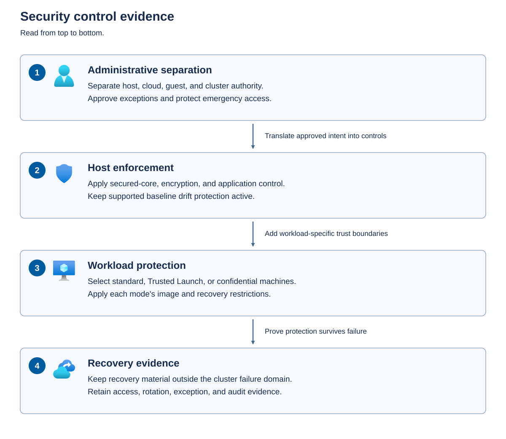

A *trust boundary* separates components or identities with different authority. Crossing that boundary requires an explicit authorization or assurance decision. Identifying the boundary prevents you from applying a control at the wrong layer.

For Azure Local, distinguish the physical hardware, the host operating system and virtualization platform, the Azure management resources, the guest operating systems, and the applications that process data. Protecting one layer doesn't automatically authorize or secure another.

Azure Arc extends Azure management to infrastructure outside Azure. A resource's representation in Azure provides a management and governance surface, but doesn't replace the security controls that operate on its local host or inside its guest.

The following diagram orders the governance questions from authority through recovery. Its arrows represent dependencies between decisions, not a network route.



You need all four layers for a defensible decision:

- Identities determine who can request or perform a change. 
- Host controls enforce the platform configuration. 
- Workload controls address guest boot, memory, and application risks. 
- Independent recovery material and retained evidence establish whether protection can survive a failure. 

## Understand the hardware and host foundation

*Secured-core* is a server-security design developed by Microsoft and hardware manufacturers that combines hardware, firmware, driver, and operating-system protections. It has three goals: establish a hardware-backed root of trust, defend against firmware-level attacks, and protect the operating system from unverified code. A *root of trust* is a protected foundation on which other security checks depend. These protections matter because compromised firmware or operating-system kernel code can undermine higher-level controls. Secured-core therefore protects both startup and the running system rather than relying only on security software that starts after the operating system loads.

In Azure Local, secured-core capabilities protect the physical nodes that provide compute, storage, and virtualization for hosted workloads. Compatible processors and security hardware supply the foundation, firmware enables the required features, and the host operating system uses them to enforce protection. Azure Local's security baseline manages supported host security settings, but it can't supply missing hardware capabilities or replace correct firmware configuration. Strengthening this foundation helps protect the shared infrastructure beneath Contoso's clinical applications, where a host compromise could affect multiple workloads.

The following technologies contribute different protections:

- **Secure Boot** checks digital signatures on boot components against trusted signing identities before allowing them to run. It helps block unauthorized boot software, but doesn't evaluate an application's business logic.
- **Trusted Platform Module (TPM) 2.0** provides hardware-backed protection for key material and stores measurements of components loaded during startup. These measurements can support attestation, and protected key operations can support features such as BitLocker. A measurement is evidence about what loaded, not an automatic declaration that everything is safe.
- **Direct Memory Access (DMA) protection** uses an input/output memory management unit (IOMMU) to restrict how hardware devices access system memory. On supported systems, this helps prevent unauthorized device access to memory during startup and runtime.
- **System Guard Secure Launch and Dynamic Root of Trust for Measurement (DRTM)** use compatible processor capabilities to establish a measured environment as the operating system starts. This reduces reliance on earlier firmware execution when establishing trust.
- **Virtualization-based security (VBS)** uses the Windows hypervisor to create a security-isolated memory region separate from the normal operating-system environment. Selected security functions run within that boundary, making them harder to compromise from the ordinary host environment.
- **Hypervisor-protected code integrity (HVCI)** uses VBS to protect kernel-mode code-integrity checks and help prevent untrusted code from executing or modifying protected kernel code. Compatible drivers are required so that this protection doesn't prevent necessary devices from operating.
- **Credential Guard** uses VBS to help isolate selected Windows credentials from credential-theft attacks.

These features work together, but they aren't interchangeable. Host VBS doesn't turn every guest into a confidential VM. Secure Boot doesn't encrypt a disk. A TPM doesn't replace a recovery-key backup.

Prior to deployment, select validated Azure Local hardware with the required secured-core capabilities, and keep its firmware and drivers compatible with the deployed release. A catalog entry indicates a supported configuration, not proof that a particular node is currently running every intended protection. Include hardware and firmware evidence alongside operating-system evidence for each node. These host protections don't replace guest security, application authorization, or patient-data handling controls.

## Govern network boundaries and permitted traffic

*Network segmentation* separates communication paths and applies controls to traffic crossing between them. It limits which systems can reach an administrative interface or workload, rather than relying only on authentication after a connection arrives. Encryption protects traffic in transit, but doesn't decide whether a source should be allowed to connect.

Define separate trust zones even when the supported physical design shares adapters or switches. A virtual local area network (VLAN) can separate traffic, but doesn't by itself enforce authorization between routed networks. Use the supported combination of network access controls, firewalls, and workload controls to permit required flows and deny unnecessary ones. Don't assume that an Azure network security group automatically filters an on-premises VM's traffic. Enforcement must exist on that VM's actual network path. Treat a server's baseboard management controller (BMC), which supplies hardware management and remote-console functions, as a separate administrative endpoint.

The following boundaries help Contoso separate clinical workload access from infrastructure administration.

| Traffic boundary | Intended access | Governance evidence |
| --- | --- | --- |
| Hardware management | BMC and remote-console access from approved administration systems only | Management-network rules, named operators, and console-access records |
| Host management | Authorized management systems reach the required host administration services | Source restrictions, authentication controls, and successful authorized access tests |
| Cluster, storage, and migration | Required communication between the intended infrastructure endpoints | Approved network intents, required flow inventory, and cluster and storage health |
| Workload networks | Application clients and services communicate only with required workload endpoints | Application flow rules and tests that unrelated workloads can't reach management interfaces |
| Azure and external services | Nodes and platform components reach required management, identity, update, and monitoring services | Approved destination list, proxy configuration, and service-specific connectivity evidence |

For each permitted flow, record its source, destination, protocol, port, direction, purpose, owner, and review trigger. Include DNS and time services, identity dependencies, the cluster witness, backup destinations, and monitoring collectors. Restrict BMC access separately from Windows host access. Network ATC manages host networking through declared configuration intents. Use it for the settings it manages rather than introducing conflicting adapter or switch changes.

Azure Local's cloud-connected management path requires outbound connectivity, including ports 80 and 443, to the applicable service endpoints. An open port alone isn't an approved destination list. Include the required Azure Local, Azure Arc-enabled server, Azure resource bridge, platform Kubernetes infrastructure, and original equipment manufacturer (OEM) endpoints for the selected region and configuration. Optional services can add dependencies. Control additions to that list through change approval, and verify each dependent function instead of granting unrestricted outbound access when one connection fails.

Azure Local doesn't support HTTPS inspection on its management communication path. Configure a narrowly scoped inspection bypass for the required traffic rather than disabling certificate validation on the clients. Azure Arc Private Link Scopes aren't supported for Azure Local, and the required Arc endpoints must resolve to public IP addresses from the nodes, resource bridge, and any proxy. This limitation doesn't establish that every other Azure service must use a public endpoint. Evaluate private connectivity separately for each supported integration, including routing and name resolution.

Before approving a network change, demonstrate both that required operations still work and that representative unauthorized paths are denied. For example, an approved administration workstation should reach the intended management endpoint, while a clinical application VM shouldn't gain host-management access merely because it shares a facility network. Use controlled connection tests, not disruptive scanning of production hosts. Retain the results with the flow inventory and revisit them after network, workload, or platform changes.

## Separate administrative authority

*Authentication* establishes who an identity is. *Authorization* determines what that identity may do. Azure role-based access control (RBAC), local Windows permissions, and application permissions make authorization decisions at different boundaries.

An *access review* is a structured assessment of which people and workload identities, such as service accounts, can access a resource, what actions they can perform, and whether they still need those permissions. An authorized reviewer compares effective access with current responsibilities and the principle of least privilege: granting only the access needed for the task. The review produces a recorded decision to retain, reduce, or revoke access, followed by confirmation that approved changes were applied.

Access reviews help identify permissions left behind when staff change roles, contractors finish work, or applications are retired. They also reveal excessive privileges that could increase the impact of a compromised account. For Contoso, reviewing access helps limit unnecessary exposure of patient information, separate administrative duties, and provide evidence for applicable regulatory obligations. Review access periodically and after significant personnel or system changes. A review assesses what an identity is allowed to do, not just what its sign-in history shows.

The following table shows why a single administrator designation isn't enough for an access review. Permissions must be assessed at each boundary rather than assuming that a role in one system describes access everywhere.

| Boundary | What the authority controls | What you must review separately |
| --- | --- | --- |
| Azure management | Permitted operations on Azure resources at assigned scopes | Local host sign-in, guest accounts, and application data access |
| Host and virtualization platform | Local operating system, platform configuration, and supported VM operations | Azure role assignments and workload-specific authorization |
| Guest operating system | Accounts, services, files, and processes inside a VM | Host administration and Azure resource management |
| Kubernetes, when used | Cluster resources through Kubernetes authorization | Host access, cloud identity permissions, and application authorization |
| Key and secret repository | Access to protected material under its configured permission model | Permission to manage the consuming VM or application |

Scope is the resource boundary over which an assignment applies. An Azure role assigned to a subscription can affect many resources through inheritance. A resource-group assignment is narrower, but you still need to consider inherited assignments, group membership, and deny assignments.

Don't assume the boundaries are completely independent. An Azure role might permit an operation that affects a guest through a management agent. A host administrator can affect a conventional VM's availability and infrastructure. Review the actual permitted operations, not just the role's name.

Use dedicated administrative accounts and the narrowest supported role and scope. Where supported, make elevation time-bounded and require approval. Separate permission to operate infrastructure from permission to approve an exception or retrieve recovery material.

## Protect privileged Azure and Arc administration

Least privilege includes how an administrator signs in, where they work, and how long their authority remains active. *Multifactor authentication (MFA)* requires more than one authentication factor. For privileged cloud access, prefer phishing-resistant methods, such as appropriately configured FIDO2 security keys or certificate-based authentication, over password-only access. Authentication proves identity, but doesn't make a broad role assignment appropriate.

Microsoft Entra Conditional Access evaluates signals such as the user, target resource, device state, and sign-in conditions. It can require an approved authentication strength or managed device for Azure management access. Define which identities and management resources the policy protects, confirm the required licensing, and evaluate a staged or report-only deployment before enforcement. Keep a tested emergency cloud-administration path and monitor its use so that a policy mistake doesn't lock out all administrators.

*Privileged Identity Management (PIM)* can make an Azure resource role eligible for activation rather than permanently active. Confirm that the organization has the required PIM licensing and configuration. An eligible operator activates the role for a limited duration, with justification, MFA, and approval where those requirements are configured. Select the narrowest role and scope that supports the approved operation, record the activation, and review the actions afterward. Eligibility isn't active permission, but an activated role has the authority defined by that role. A short activation window doesn't make an excessively broad role safe.

These controls apply at their configured Microsoft Entra and Azure boundaries. Requiring MFA for the Azure portal doesn't add MFA to a node-local console account, a BMC account, or an application account. Expiry of a cloud role activation doesn't undo changes already made or guarantee termination of a separately established local session. Protect those access paths independently. Service principals and managed identities also need separate permission and credential reviews rather than an assumption that interactive user MFA covers them.

Treat permission to manage Azure Arc agents and extensions as security-sensitive. The Arc extension manager runs with high local privileges, including Local System on Windows, so an allowed extension operation can have consequences beyond the Azure resource record. Review inherited permissions to install or change extensions, modify policy assignments, and grant roles, not just interactive sign-in rights. For Azure Local hosts, preserve platform-required agents and extensions. Don't copy generic Arc hardening examples that disable extension management or machine configuration without confirming Azure Local support and lifecycle dependencies.

Use a protected administration workstation or dedicated management environment for privileged work. Keep it patched and monitored, restrict the tools it can run, and separate it from routine email and browsing. Control its network access to the hosts and BMCs. Don't use unrestricted credential delegation to make administration easier.

For Contoso, an access approval should identify the operator, permitted task, target resource, role and scope, activation duration, approval authority, and evidence source. A controlled exercise should demonstrate that the operator can perform the authorized task, can't perform a representative task outside the approved scope, and no longer has the temporary authorization after deactivation has taken effect. Review cloud and local access separately before closing the record.

## Account for the deployment identity model

In a domain-joined Azure Local deployment, Active Directory Domain Services contributes to identity and administration. In an Azure Local deployment using Local Identity with Azure Key Vault, the cluster doesn't require Active Directory, but local administration, certificates, and vault access still require governance.

For the Local Identity model, create a customer-managed local account in the local Administrators group rather than using the built-in Administrator account. The deployment requirements specify a password of at least 14 characters containing uppercase and lowercase letters, a numeral, and a special character. Use the same credentials for this account across the cluster nodes because operations such as adding or repairing a node need to authenticate across the cluster. The customer owns the account's security, expiry, and rotation. Restrict credential distribution and coordinate changes across all nodes.

For ongoing administration, Azure Local provides the `AzureLocal.LocalIdentity.AdminSetup` PowerShell module. It supports cluster-wide local administrator account management, certificate provisioning, and remoting configuration. Certificate-based authentication lets an administrator prove possession of a certificate's private key rather than repeatedly sharing a local password. The module can retrieve certificate material from Azure Key Vault and keep it in memory instead of writing it to disk. Protect private-key access and manage certificate expiry and revocation as carefully as passwords. This administration model reduces reliance on shared passwords without removing the documented local-account requirement for cluster lifecycle operations.

Most routine infrastructure operations can be managed through the Azure portal. Tasks that require direct node access use authorized local credentials and supported PowerShell or command-line tools. A dedicated administration workstation or management server can provide a graphical management experience, but requires additional configuration. Regardless of the interface, use only operations supported for the resource being managed.

Removing an Active Directory dependency doesn't remove dependencies on DNS, time synchronization, certificates, or Azure services. Local Identity nodes require static IP addresses and a resolvable DNS namespace for the nodes and cluster. The optional Internal DNS capability is preview and serves cluster infrastructure, not VM, Kubernetes, or application name resolution. Workloads still need an appropriate enterprise DNS service or forwarding arrangement. Certificate authentication also depends on valid certificates, trusted issuers, and accurate time, so it can fail even when the network is reachable.

Use a separate Azure Key Vault for each Local Identity cluster. Review human access and the identities used by the platform integration separately. A *managed identity* lets an Azure resource authenticate to supported services without an administrator maintaining an application password or secret. The documented node-identity integration requires the Azure Arc-enabled server managed identities to have the **Key Vault Secrets Officer** and **Key Vault Certificates Officer** roles on the vault. These service permissions don't justify granting the same rights to every infrastructure administrator.

After deployment, verify that the expected BitLocker recovery information and the dedicated `RecoveryAdmin` account's password are backed up to the vault. The recovery account provides a local recovery path, but its usefulness depends on an authorized operator being able to retrieve the current credential independently of the affected cluster. Record backup status and access approvals without copying secret values into evidence. Don't assume that this check proves every workload secret or Trusted Launch key is recoverable.

Monitor the Key Vault integration for missing-vault and access-failure alerts. Network access, vault permissions, and extension health all affect secret backup and retrieval. Recovering a deleted vault doesn't automatically restore its previous role assignments. Reestablish the required identity access, confirm that the extension succeeds, and verify that backups resume before treating the dependency as healthy.

An *access review* checks which people and service identities can administer the deployment, what permissions they have, and whether that access is still justified by their current responsibilities. The identity model determines which access paths you must examine. For a domain-joined deployment, review relevant domain groups and host permissions. For Local Identity, review local administrator membership on every node, who can obtain administrative credentials or use authentication certificates' private keys, and the relevant Azure Key Vault permissions. Reviewing Azure role assignments alone doesn't establish who can administer the hosts locally.

Perform these reviews periodically and when staff, contractors, or services change. They help uncover unused accounts, excessive privileges, and access that remains after a support engagement ends. For Contoso, removing unnecessary administrative access reduces opportunities to compromise systems that support patient care. Record the justification and owner for retained access, approve any reduction or removal, and confirm the outcome through supported identity-management workflows. Coordinate credential or certificate changes across their documented consumers so that removing a person's access doesn't interrupt required platform services.

## Implement emergency access to Azure Local

Emergency access is an alternate, controlled way to administer a system when the normal identity path is unavailable. It isn't a permanently unrestricted account used for routine work.

Keep the emergency procedure and credentials outside the cluster's failure domain. A *failure domain* is a set of components that can become unavailable together. A credentials vault hosted only in a VM on the same failed cluster doesn't provide independent recovery access.

Define who approves emergency use, how the operator obtains credentials, which actions are permitted, and how access is reviewed afterward. Test the authorization path without publishing credentials in tickets or screenshots.

The built-in administrator account isn't exempt from Azure Local's account-lockout policy. Repeated attempts can lock it out like another local account. Don't make "keep trying the built-in account" your emergency procedure.

Use the following procedure to configure emergency access to individual Azure Local nodes. It establishes a local administration path for an identity-service or cloud-management outage. It doesn't grant Azure permissions, unlock BitLocker-protected disks, or replace a workload recovery plan.

> [!CAUTION]
> This procedure creates privileged local accounts. Unlike the inspection examples later in this module, the account-creation commands change the node. Obtain change approval, use an authorized existing administrator, and retain a working alternate sign-in path throughout setup. Don't disable drift control, weaken account-lockout settings, or change platform-managed recovery accounts.

1. **Define the failure scenario and authorization.** Record whether access must survive loss of Active Directory, Azure connectivity, or the normal management network. Name the emergency-access owner, approver, credential custodians, and incident contact. Define the actions an emergency operator can perform and require a record of every use.

1. **Prepare an independent console connection.** Arrange physical console access or configure the server manufacturer's baseboard management controller (BMC) for remote console access. A BMC is a management component that can provide a server console independently of the host operating system. Configure its approved management address, restrict network access, and protect its administrative credentials separately from the host credentials. Confirm that the console path and its authentication don't depend entirely on the identity service or cluster you're planning to recover. Azure Arc connectivity alone isn't a suitable path for an Azure-connectivity outage.

1. **Choose the account and credential-custody model.** Use a dedicated, customer-managed local account for emergency console access, separate from ordinary user accounts and the deployment or lifecycle account. For this node-only procedure, generate a different strong password for each node and store each password in an approved repository outside the cluster's failure domain. Its authentication and network access must remain usable in the failure scenario defined in step 1. Use at least 14 characters with uppercase and lowercase letters, a numeral, and a special character, and satisfy any stricter applicable policy. Record the node-to-account association without placing passwords in tickets, scripts, or the runbook. The Local Identity account used for cluster lifecycle operations still has its documented same-credentials-across-nodes requirement. Don't replace it with these node-specific emergency accounts.

1. **Account for cloud-dependent recovery credentials.** On Local Identity deployments, the platform's `RecoveryAdmin` credential in Azure Key Vault provides another recovery path. Don't manually reset, rename, or repurpose that platform-managed account. Confirm that authorized custodians can reach the vault and retrieve the current credential when local identity services are unavailable. If the scenario also includes loss of Azure access, retain the independently accessible customer-managed account from this procedure rather than relying solely on Key Vault or on a cached copy of a rotating recovery password.

1. **Create the emergency account on the first node.** Connect through the approved console using an existing authorized administrator. At the administrative command prompt, open 64-bit Windows PowerShell with `powershell.exe -NoProfile`. If using a desktop interface, select **Run as administrator** when opening Windows PowerShell. Replace `EmergencyAdmin` if your approved naming standard requires another name, then run the following commands. Enter the node-specific password from your protected repository only at the secure prompt.

   ```powershell
   $ErrorActionPreference = 'Stop'
   Import-Module Microsoft.PowerShell.LocalAccounts

   $name = 'EmergencyAdmin'
   $password = Read-Host 'Enter the approved node emergency password' -AsSecureString
   $user = New-LocalUser -Name $name -Password $password `
       -Description 'Approved node emergency access'
   Remove-Variable password

   Add-LocalGroupMember -SID 'S-1-5-32-544' -Member $user
   ```

   The security identifier `S-1-5-32-544` identifies the built-in Administrators group regardless of its display language. Passing the newly created local user object avoids selecting a similarly named domain account. These commands affect only the connected node. If the account already exists or any command fails, stop and inspect the result from the existing administrative session. Account creation and group membership are separate operations, so a partially created account isn't proof that emergency access is ready.

1. **Verify membership and lifecycle settings.** In the same session, inspect the account and its local Administrators membership:

   ```powershell
   Get-LocalUser -Name $name |
       Select-Object Name, Enabled, SID, AccountExpires, PasswordExpires

   Get-LocalGroupMember -SID 'S-1-5-32-544' |
       Where-Object { $_.SID -eq $user.SID } |
       Select-Object Name, SID, PrincipalSource
   ```

   Confirm that the intended local account is enabled and appears in the group. Record the account and password-expiry status, and schedule credential maintenance before access can expire. Don't turn off password expiry or account-lockout protection merely to avoid maintenance. If the setup must be abandoned, use the existing administrator to remove only the newly created customer-managed account and retire its escrow record. Don't remove deployment, built-in, or platform recovery identities.

1. **Repeat provisioning for every intended node.** Repeat account creation and verification through each node's approved console, using its own emergency password and repository entry. Record each node's account name, security identifier, owner, and maintenance schedule. A successful setup on one node doesn't create the account on the other nodes.

1. **Perform a controlled sign-in test.** Keep another authorized administrative route available. Through the independent console, sign in with `.\EmergencyAdmin`, or the approved replacement name, to select the node's local account rather than a domain account. Confirm that `whoami` identifies the expected node and account, and that you can open an elevated PowerShell session for an approved read-only inspection. Have a credential custodian exercise the retrieval and approval process as part of the test. Use an isolated lab to demonstrate that the path still works without the normal identity or cloud dependency. Don't disconnect production identity services, restart cluster nodes, or repeatedly enter incorrect passwords to simulate an outage. If the test fails, preserve the working access path and investigate account status, sign-in restrictions, and credential custody.

1. **Alert on emergency use.** Configure the approved monitoring system to identify sign-ins by these accounts and changes to their group membership or account state. Route alerts to the named incident contact. Confirm that the test sign-in is collected and attributed to the correct node. Don't assume the default syslog severity configuration includes every event you need. Retain the local audit trail and arrange later collection when an outage interrupts central forwarding.

1. **Publish and maintain the runbook.** Store console addresses, node-to-account mappings, credential-retrieval instructions, approval contacts, permitted actions, and recovery dependencies outside the cluster. Keep secret values only in their protected repository. Record the successful test and schedule repeat tests after relevant network, identity, node, or credential changes. After emergency use, review the actions taken, rotate the customer-managed emergency credential through the approved process, update its repository entry, and repeat the sign-in test. Keep rotation of platform-managed credentials within their supported lifecycle workflows.

Emergency access is ready only when an authorized operator can obtain approval, retrieve the correct credential, reach the intended node, and establish an audited administrative session through the independent path. For Contoso, this prepares the platform team to recover infrastructure supporting clinical services without distributing unrestricted host credentials to workload owners.

**Apply the concept:** Giving Contoso's workload owner access to manage an Azure VM resource doesn't, by itself, justify host administration or access to every recovery secret. Approve each authority against the task it enables.
