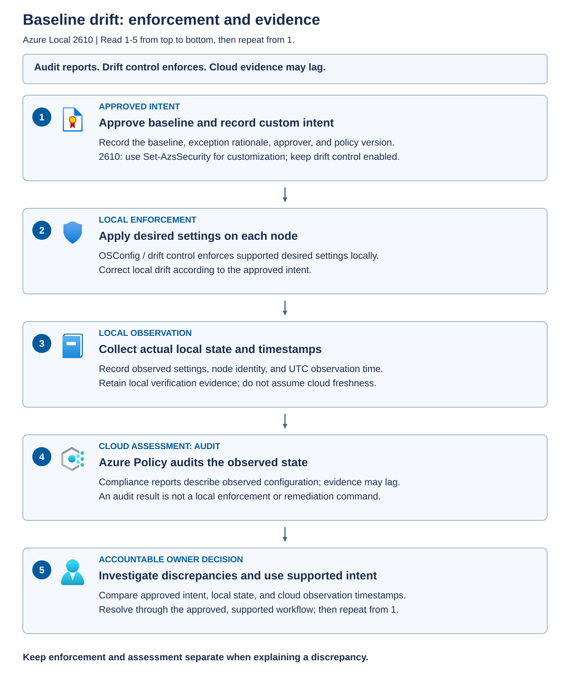

Azure Policy connects governance decisions to repeatable technical checks. Governance determines which rules resources must follow, where those rules apply, who owns remediation, and how exceptions are approved. Azure Policy evaluates supported Azure and Azure Arc-enabled resources against assigned rules and reports whether they meet the specified conditions. Depending on the policy effect and resource support, it can also prevent certain noncompliant resource changes or support remediation. This helps an organization apply consistent standards across many resources instead of relying only on individual administrators to configure them correctly.

*Compliance* in Azure Policy describes conformity with the applicable assigned policy conditions, not compliance with every organizational or legal obligation. Governance teams use the results to identify gaps, assign corrective work, review exceptions, and retain evidence of progress. For Contoso, a policy assessment can contribute evidence about technical controls protecting patient information, but a compliant result doesn't certify a clinical application or healthcare facility as legally compliant. Legal, privacy, and compliance owners must still map the applicable regulations to technical and organizational controls, assess areas the policies don't cover, and confirm that required corrective actions are completed.

Azure Local has both local enforcement and cloud assessment. Understanding their timing and scope helps you distinguish actual drift from stale evidence, incorrect applicability, or incomplete onboarding.

An Azure Policy *definition* describes an evaluation rule and effect. An *assignment* applies a definition or an initiative at a scope. An *initiative* groups policy definitions. The Microsoft Cloud Security Benchmark (MCSB) initiative organizes security recommendations and assessments across resources.

An `audit` effect reports a condition. It doesn't rewrite a host setting. Other Azure Policy effects can have different behaviors, but a policy's name or a noncompliant result doesn't tell you that remediation has occurred.

## Keep the two control loops separate

Locally, Azure Local applies the security baseline during deployment and updates. With drift control enabled, it restores the baseline value or a supported customized value when an out-of-band change occurs.

In the cloud, assigned policies and assessment services evaluate reported or collected resource state. The latest result can lag behind a host correction. Conversely, an older compliant result doesn't prove that a node hasn't changed since the observation.

The diagram distinguishes the enforcement path from the assessment path. Approved baseline values and recorded intent drive local enforcement. Operators collect actual state and timestamps. Cloud assessment reports the state it evaluated. If the observations disagree, an accountable owner investigates the scope, timing, and intended value before changing anything. An audit result isn't a command channel to the host.



## Select the correct baseline

The **Microsoft-provided Azure Local 2610 host security baseline** defines the security settings and desired values applied to the physical cluster nodes. These settings include account and authentication policies, auditing, user rights, and network protections.

Azure Local applies the baseline during deployment and reapplies it during solution updates. With drift control enabled, the platform maintains the intended values and corrects unsupported changes. In version 2610, supported customizations become part of the desired configuration that drift control protects.

For version 2610, Microsoft documents 429 evaluated settings for domain-joined deployments and 403 for deployments that aren't domain-joined. These counts describe the applicable host baseline, not a universal count of Azure Policy assessments or application controls. The baseline isn't an Azure Policy initiative, and matching it doesn't establish that a clinical application or healthcare facility meets all regulatory obligations.

Microsoft publishes the exact baseline settings in version-specific CSV files through its security-defaults documentation, with separate files for domain-joined and non-domain-joined deployments. Select the file that matches the solution version and identity model, and record both with the assessment evidence. Comparing totals from different baselines can produce an apparent regression even when both systems match their applicable profiles.

Also distinguish the product baseline from an organizational requirement. The product might provide a valid default logon notice, while Contoso requires a different notice approved by its legal and privacy teams for access to systems handling patient information. That's a customization decision, not evidence that the default mechanism has failed. A logon notice alone doesn't satisfy the facility's access-control or privacy obligations.

## Inspect cloud assessment from a workstation

To view the policy assessment, on a management workstation, open an approved PowerShell session with the Az modules installed. Use a reader account that has the necessary resource, policy-state, and assignment read permissions at the selected scope. You don't need to grant Owner simply to collect these results.

Replace the placeholders, including the angle brackets, with the approved tenant, subscription, and resource group. Authentication and context selection affect this PowerShell session. The subsequent queries don't change Azure resources.

```powershell
$ErrorActionPreference = 'Stop'
Import-Module Az.Accounts, Az.Resources, Az.PolicyInsights

$tenantId = '<tenant-id>'
$subscriptionId = '<subscription-id>'
$resourceGroup = '<resource-group-name>'

Connect-AzAccount -Tenant $tenantId -Subscription $subscriptionId
$context = Get-AzContext

if ($null -eq $context -or
    $context.Tenant.Id -ne $tenantId -or
    $context.Subscription.Id -ne $subscriptionId) {
    throw 'The Azure context does not match the approved assessment scope.'
}

$scope = "/subscriptions/$subscriptionId/resourceGroups/$resourceGroup"

Get-AzPolicyAssignment -Scope $scope -IncludeDescendent |
    Select-Object Name, Scope, PolicyDefinitionId

Get-AzPolicyState -ResourceGroupName $resourceGroup |
    Select-Object ResourceId, ComplianceState, PolicyAssignmentId,
        PolicySetDefinitionId, PolicyDefinitionId,
        PolicyDefinitionReferenceId, Timestamp

Get-AzRoleAssignment -Scope $scope |
    Select-Object ObjectId, ObjectType, RoleDefinitionName, Scope
```

The assignment query includes assignments at the selected scope, inherited from ancestors, and assigned below it. The policy-state query returns the latest states generated within its default last-day window. These results identify the evaluated resource, definition, assignment, and timestamp. Use those identifiers to investigate a specific finding rather than treating every result in the resource group as an Azure Local host control.

For an initiative assignment, `PolicySetDefinitionId` identifies the initiative and `PolicyDefinitionReferenceId` identifies the policy member within it. Keep those values with the assignment ID, policy definition ID, resource ID, and timestamp. The member reference isn't interchangeable with the policy definition's resource ID. A standalone policy assignment doesn't have an initiative-member reference to record.

The role projection helps identify assignments, but isn't a complete effective-access review. Examine inherited scopes, group membership, privileged-role activation, deny assignments, and the operations in the relevant role definitions. Azure permissions also don't describe all local or application permissions.

If no policy states are returned, don't report "100 percent compliant." Confirm the scope, assignment, resource onboarding, assessment prerequisites, and query time window. Use the documented `-From` and `-To` parameters when an investigation needs a different period, and continue to distinguish older observations from current state. A missing assessment is missing evidence.

`Get-AzPolicyAssignment -Scope` normally returns assignments at the specified scope and inherited from its ancestors. Adding `-IncludeDescendent`, as in the example, also includes assignments below that scope. This matters when an individual node resource has an assignment that isn't made at the resource-group level. To inspect one assignment, use its full identifier with `-Id`, or its name with the appropriate `-Scope`. Assignment results describe which rules are configured, not whether the affected resources currently satisfy them.

`Get-AzPolicyState` returns evaluated compliance records. Without an explicit time range, it returns the latest records generated within the last day. `-ResourceGroupName` limits the query to that group in the selected subscription, while `-ResourceId` targets a particular resource. Use `-From` and `-To` with explicit UTC timestamps to compare a defined period with a change record. Adding `-All` returns historical records as well as the latest records within that period. It doesn't expand the resource scope or trigger a new assessment. Multiple historical records for one resource aren't evidence that multiple nodes were assessed.

The Azure Local security views need assessment configuration in addition to the local security baseline. The Defender for Cloud integration for Azure Local is documented as preview and applies to instances that are deployed, registered, and connected to Azure. Foundational cloud security posture management (CSPM) provides basic posture recommendations at no extra cost. Defender for Servers is a separate paid plan for additional protection capabilities. It isn't necessary merely to read existing policy-state results.

If assessment hasn't been configured, treat onboarding as an approved administrative change, not part of the read-only inspection. The documented Azure Local onboarding workflow requires subscription Owner or Contributor permissions to enable Foundational CSPM, and the operator must also have the permissions needed to manage the required policy assignments. Keep the assessment reader's permissions separate from those administrative permissions.

An authorized administrator can configure the Defender for Cloud assessment path as follows:

1. Confirm the target subscription and inventory the Azure Local instance's Azure Arc-enabled server resources. Review existing policy assignments so that you don't create duplicate assignments or overlook inherited coverage.
1. Sign in to the Azure portal, search for **Microsoft Defender for Cloud**, and open it. On first use, this initializes the basic Defender for Cloud capabilities, including Foundational CSPM. Don't select **Enable all**, which enables additional paid plans rather than only the basic assessment capabilities.
1. In Defender for Cloud, select **Environment settings**, select the intended subscription, and open **Security policies**. Confirm that **Microsoft cloud security benchmark** has **Status** set to **On**, enabling it under the approved change if necessary.
1. Allow at least one hour for the initiative to evaluate the included resources, then confirm that fresh results cover every expected node. To view recommendations, open the Azure Local instance, select **Security (preview)** > **Microsoft Defender for Cloud**, and inspect **Recommendations**. Evaluation is asynchronous, so elapsed time alone isn't proof that onboarding succeeded.

The related built-in host assessment is named **Windows machines should meet requirements of the Azure compute security baseline**. An approved Azure Policy-based design can assign this assessment to the cluster servers directly instead of using the Defender for Cloud onboarding path. In either case, verify the assignment scope and actual per-node assessment results rather than assuming that the parent Azure Local resource proves coverage of its hosts. The Azure Local portal page for viewing platform security settings is **Security defaults**. Neither its status nor a cloud policy result replaces the local evidence collected earlier.

## Work through a recurring logon-notice finding

A *logon notice* is a message displayed during interactive Windows sign-in. It typically appears as a dialog with a short title, a block of explanatory text, and an **OK** button that the user selects to acknowledge the message and continue. In this example, the notice appears when an administrator signs in to the Windows operating system on an **Azure Local physical node**, such as through its console or a Remote Desktop session. It isn't an Azure portal notification, and configuring it on a host doesn't automatically add the same notice to guest VMs or clinical applications.

For example, Contoso's notice might have the title **Authorized Contoso access** and the message "Access is restricted to authorized personnel. This system supports healthcare services and may contain patient information. Activity is logged and reviewed according to Contoso policy." This wording is illustrative. Contoso's legal and privacy teams must approve the actual notice.

Suppose Contoso requires that notice on its Azure Local nodes. An administrator edits the logon-notice registry values directly on one node, and the desired title and message appear during a subsequent interactive sign-in. Later, drift control restores the values defined by the host security baseline because the direct registry edit didn't update the supported desired configuration.

The important question isn't "How do I stop the baseline?" It's "Which supported intent should define this setting?" For 2610, customizable individual settings are managed through `Set-AzsSecurity` while drift control stays enabled.

Use this investigation sequence:

1. Identify the exact resource, node, policy definition, assignment, and assessment timestamp. Determine whether the finding describes the current condition.
1. Compare the observed host value with the version-specific baseline and the approved organizational value. Review both cluster intent and any node-local change record.
1. Confirm that the proposed value is supported and that the setting is customizable. Identify its exact **Name** from the baseline file and its documented policy type.
1. Obtain change approval that covers the value, scope, affected nodes, validation, connection or restart impact, and rollback.
1. Apply the approved customization through the documented `Set-AzsSecurity` workflow. Preserve drift control and the command's confirmation safeguards.
1. Reinspect the intended nodes and the recorded cluster intent. Compare the next cloud assessment with the local correction time before closing the finding.

`Set-AzsSecurity` uses policy types such as `SecuritySettings`, `SecuredCore`, and `DefenderAntivirus`. The setting name must match the baseline exactly. Choosing a similarly named registry value isn't an equivalent supported operation.

With `-Cluster`, the customization is recorded as cluster intent and applied to every node. Without `-Cluster`, it applies to the connected node. Both forms have documented persistence through solution updates, but cluster intent takes precedence over a conflicting local change.

To remove a customization, the supported workflow uses `-Default` at the matching scope. At cluster scope, that removes recorded customer intent and returns the setting to the product baseline. This is different from restoring a previously approved custom value, which requires reapplying that value. Record which outcome the rollback is intended to produce.

Some settings are blocked from customization because they're critical to platform integrity. `-Force` doesn't override that protection. A rejected request is a reason to revisit the design or engage support, not to edit the registry, apply conflicting Group Policy, or manipulate orchestrator data.

## Govern policy exemptions and accepted risk

An *Azure Policy exemption* records that a specific resource or resource hierarchy is exempt from an assigned policy assessment. It doesn't change the host's configuration, install a missing update, or make an unsupported deployment supported. A supported baseline customization, an App Control supplemental policy, and a cloud policy exemption are three different mechanisms and need separate records.

Azure Policy distinguishes two exemption categories. *Mitigated* means the policy's intent is met through another method, for which evidence is required. *Waiver* means the noncompliant state is accepted temporarily. Exempt resources contribute to Azure Policy's overall compliance reporting, so a high compliance percentage can include approved exemptions rather than only resources that passed the original technical check. Report exemptions and unresolved risk alongside the aggregate result.

Before creating an exemption, confirm the exact policy assignment, the evaluated resource, the finding's applicability, and the current evidence. Product-specific exclusions must be limited to the resource types and conditions for which they're justified. For example, an Azure Local host assessment limitation doesn't justify exempting unrelated Azure VMs from vulnerability assessment.

Require an exception record with the requester, independent approver, accountable owner, rationale, affected resources, assignment identifier, specific initiative definitions if applicable, compensating controls, expiry, and remediation or reassessment plan. Use the narrowest resource and policy scope. A broad assignment exclusion removes coverage from the excluded scope and isn't a substitute for a documented resource-specific exemption. Permission to implement an exemption doesn't, by itself, confer authority to accept the business risk.

When exempting selected members of an initiative, use the matching `policyDefinitionReferenceId` values from that initiative, not the policy definitions' full resource IDs. Verify the current assignment and initiative membership before implementing the approved exemption.

Set an explicit `expiresOn` value for temporary exemptions and schedule review before that time. The service stops honoring the exemption when it expires but retains the exemption object for record-keeping. Expiry doesn't remediate the resource. Confirm subsequent assessment and either complete remediation or obtain a newly justified approval. Reassess earlier if the workload, threat, product support, or compensating control changes.

## Map requirements to controls and evidence

Translate organizational and applicable regulatory requirements into decisions that can be demonstrated. Start with the requirement confirmed by the legal, privacy, or compliance owner, identify the resources and data it concerns, then specify the technical and procedural controls. Record who operates each control, what evidence supports it, and which part of the requirement remains outside that evidence.

The following worked example maps a Contoso-approved administrative-access requirement. It illustrates the mapping method, not the wording of a particular law.

| Mapping element | Contoso example |
| --- | --- |
| Requirement | Only approved administrators may change infrastructure supporting clinical records, and each privileged change must be attributable to an authorized operator. |
| Scope | The Azure Local instance, its node and Azure management resources, management network, and associated recovery vault. |
| Controls | Scoped Azure roles and time-bounded elevation, separately controlled host and BMC accounts, restricted management paths, change approval, and cloud and host auditing. |
| Owners | The identity team operates cloud access safeguards, the platform team controls host access and changes, and security operations retains and reviews the activity evidence. |
| Evidence | Access-review decisions, role activations, approved change records, Azure management events, local sign-in and administrative events, and vault-access records where recovery material was used. |
| Remaining gap | Infrastructure logs don't establish who read a patient record inside the application. The workload owner must supply application authorization and access-audit evidence. |
| Exception and review | Any temporary additional authority has a named approver, defined task, expiry, and compensating monitoring. Review the mapping after identity, workload, logging, or regulatory changes. |

Keep the requirement, control, finding, and exception identifiers connected so that an auditor can trace a conclusion to its supporting evidence. If a control is only partly implemented or evidence is missing, record that gap and its owner. Don't replace a missing application or process control with an unrelated green infrastructure assessment.
