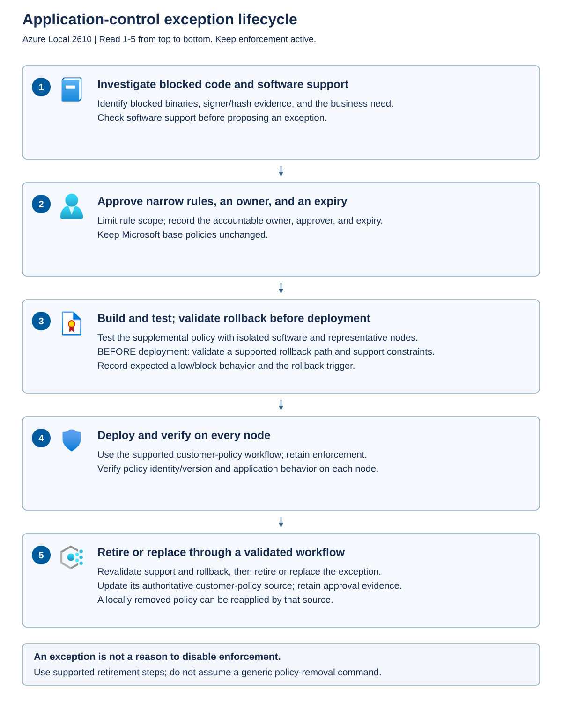

App Control for Business reduces the host attack surface by controlling which drivers and applications may execute. In enforced mode, disallowed code is blocked. In audit mode, code that would be blocked can run while events are recorded.

Audit mode helps administrators identify which software an App Control policy would block, but it records those decisions instead of blocking execution. The change applies to the affected policy and nodes, not just to the diagnostic tool being investigated. For example, switching Contoso's host policies to audit mode so that one vendor utility can run also allows other code that those policies would normally block. Other security controls can still intervene, but the auditing policies no longer provide that execution protection. Use audit mode only for an explicitly approved, time-limited investigation with a defined return to enforced mode. If the utility needs ongoing access, authorize only the required software through a reviewed supplemental policy while retaining enforcement.

## Investigate before expanding trust

Begin with the Code Integrity event for the blocked operation. Identify the node, time, binary, file version, signer, and applicable policy. A failed installer alone doesn't establish that App Control caused the failure.

Azure Local hosts use a Server Core operating system, so don't assume that Event Viewer is available as a local graphical application on the node. Use Event Viewer on an approved Windows management workstation with authorized remote event-log access, or use the local PowerShell alternative below. Both methods inspect existing evidence without changing application-control policies.

To view the events through Event Viewer, follow these steps:

1. **Identify the affected node and time.** Record the physical node on which the application or installer ran and the approximate failure time, including the time zone. If the failure occurred inside a guest VM, investigate that guest's controls and logs separately. Don't switch a host to audit mode or run an unapproved binary merely to generate an event.
1. **Open Event Viewer on the management workstation.** From **Start**, search for and open **Event Viewer** using an account authorized to read the target node's event logs.
1. **Connect to the node.** Select **Event Viewer (Local)**, open the **Action** menu, and select **Connect to Another Computer**. Enter the affected node's name, not just the cluster name, and connect through the approved management path. If access is denied or remote event-log connectivity isn't configured, use the local PowerShell method instead of weakening firewall or authentication settings.
1. **Open the Code Integrity log.** Expand **Applications and Services Logs** > **Microsoft** > **Windows** > **CodeIntegrity**, then select **Operational**.
1. **Filter the relevant events.** Select **Filter Current Log**, choose a time range that includes the failure, and enter `3076,3077,3089` in the event-ID filter. Apply the filter. These IDs provide a starting point for investigating policy decisions and related signing information, not an exhaustive list of Code Integrity events.
1. **Inspect the policy decision.** Open a relevant event and read the **General** and **Details** tabs. Match the event to the affected node, time, file path, and process. In the event details, record the policy name and identifier, file version where present, status, and hash information. Record the hash type as well as its value because different hash fields aren't interchangeable. The blocked file can be a DLL or driver loaded by an installer rather than the installer executable itself.
1. **Find the related signature information.** In the **Details** tab's XML view, locate the `ActivityID` under `System` > `Correlation`. Find event `3089` records with that same activity identifier and inspect their signing information. A file with multiple signatures can have several related `3089` events. Match the activity identifier rather than assuming that the nearest event by time belongs to the same file.
1. **Retain the evidence securely.** Save the relevant events as an `.evtx` file in the approved evidence repository, and record the node, event record IDs, policy identifier, and investigation reference. Don't clear the source log. Event contents can expose account names, file paths, and other sensitive information, so restrict access and avoid copying unnecessary details into ordinary support tickets.

Use the following event meanings when interpreting the filtered results.

| Event ID | Meaning | What you can conclude |
| --- | --- | --- |
| `3076` | An audit-mode policy would have blocked the file if enforced. | That policy recorded a potential block but didn't prevent execution. This event alone doesn't explain an execution failure. |
| `3077` | An enforced policy blocked a file that didn't satisfy its requirements. | Investigate the identified file and policy as evidence of an actual App Control block. |
| `3089` | Signing information associated with a policy or Code Integrity decision. | Correlate it with the decision event to investigate the signature. An unsigned file can produce a record with a signature count of zero. |

If remote Event Viewer access isn't available, connect to the affected node through an existing approved administrative console or PowerShell session. At an administrative command prompt, open Windows PowerShell with `powershell.exe -NoProfile`. Run the following read-only query on the node to retrieve up to 200 matching events from the previous 24 hours:

```powershell
$ErrorActionPreference = 'Stop'
$filter = @{
    LogName = 'Microsoft-Windows-CodeIntegrity/Operational'
    Id = 3076, 3077, 3089
    StartTime = (Get-Date).AddHours(-24)
}

$events = Get-WinEvent -FilterHashtable $filter -MaxEvents 200
$events |
    Sort-Object TimeCreated |
    Select-Object TimeCreated, Id, RecordId, MachineName
```

The query retrieves the newest matching events before sorting them for display. If the incident is older or the log is busy, adjust the time range and result limit rather than assuming this bounded result is the full history. Record the time zone used for displayed timestamps. The event's XML `SystemTime` value provides a UTC timestamp.

To inspect one returned record, enter its `RecordId` from the preceding output. The formatted output shows the readable message, and the XML output exposes the detailed fields and correlation activity identifier:

```powershell
$recordId = [long](Read-Host 'Enter the event RecordId to inspect')
$selectedEvent = $events |
    Where-Object { $_.RecordId -eq $recordId }

if ($null -eq $selectedEvent) {
    throw 'The selected RecordId is not in the retrieved event set.'
}

$selectedEvent |
    Format-List TimeCreated, Id, RecordId, MachineName, Message
$selectedEvent.ToXml()
```

If the query reports no matching events, check the node, time range, permissions, and whether the relevant records have rolled out of the log. Broaden the event-ID filter when the failure requires other Code Integrity events. Don't treat missing events as proof that the application is permitted. Some Windows troubleshooting instructions also use the **AppLocker** > **MSI and Script** log, but those events aren't included on Windows Server Core, so don't depend on that log for an Azure Local host investigation.

Confirm that the vendor supports the software on Azure Local. Ask whether it actually needs to run on a host. A tool that can run from a management workstation often doesn't justify expanding the trusted code on every node.

*Code signing* associates a file with a signing identity and supports integrity checking. A valid signature doesn't guarantee that the code is safe or appropriate. You still need software provenance, supportability, vulnerability review, and a business reason for installation.

## Understand base and supplemental policies

Microsoft supplies the **base code integrity policies for App Control for Business**, formerly called Windows Defender Application Control (WDAC), on Azure Local hosts. These policies define which drivers and applications are trusted to run on the physical nodes. They contain identifying metadata, such as a policy name and version, options that control policy behavior, and rules that allow required platform code or deny unsafe code. They aren't Azure Policy definitions used for cloud governance and assessment, and they aren't the broader host security baseline that configures settings such as account policies and auditing.

A customer *supplemental policy* extends the permitted code associated with the base policy. It isn't a replacement for the Microsoft base policies and isn't a way to make unsupported software supported. Don't assume a supplemental allow rule overrides a platform deny rule.

Choose the rule level according to the required trust boundary and maintenance burden.

| Rule approach | Benefit | Governance consequence |
| --- | --- | --- |
| Publisher or signer-based rule | Can accommodate software updates that match the approved signing criteria | Review how much software the rule actually authorizes, not just the scanned file |
| File hash rule | Identifies a specific file's content | An updated binary has a different hash and needs policy maintenance |
| Leaf-certificate rule | Matches the end-entity signing certificate and can address documented certificate-chain matching problems | Review and redeploy rules when the vendor's signing certificate changes |

The current Azure Local guidance describes a case in which cross-signed certificate chains cause a publisher-level policy to deploy successfully but not match at runtime. In that case, the same root certificate authority has both cross-signed and self-signed certificate representations. Policy generation records one representation, while runtime validation resolves the other, so their certificate hashes don't match. A leaf-certificate rule targets the signing certificate itself and can address that case. Don't respond to an unmatched rule by allowing an entire drive or removing enforcement.

The policy-generation scan directory determines which files are considered when generating rules. It doesn't necessarily limit a publisher rule to that directory at runtime. Inspect the resulting rule semantics before approval.

## Approve the complete lifecycle

An code integrity policy exception should be temporary rather than permanent. The following diagram places investigation, approval, validation, deployment, and retirement in a defined order.



The process begins with evidence of a block and a justified host requirement. Approval defines the narrow trust expansion and its expiry. Testing evaluates both application operation and continued enforcement. Deployment is verified on every intended node. Retirement removes or replaces the customer exception through a supported workflow without modifying platform base policies.

At Contoso's healthcare facilities, a diagnostic utility or its support bundle could expose patient identifiers, clinical information, or privileged configuration. Review the utility's data access and output as well as which code it runs. Limit collection and support access to the approved purpose, and keep sensitive data out of ordinary change tickets.

For Contoso's diagnostic utility, require the following record before deployment.

| Record field | What to capture |
| --- | --- |
| Business justification | Diagnostic task, why a host installation is necessary, software support statement, and permitted data access |
| Software scope | Product, version, approved binaries, signing identity, and generated rule scope |
| Policy identity | Customer policy name, identifier, version, and reviewed artifact location |
| Authority | Requester, technical owner, security approver, and authorized deployment operator |
| Exposure window | Intended nodes, start date, expiry, and review trigger for vendor updates |
| Validation | Positive application test, controlled negative test, and per-node enforcement evidence |
| Recovery and retirement | Supported replacement or removal workflow, rollback artifact, and verification criteria |

An expiry in a ticket is an organizational deadline. It doesn't necessarily cause the policy engine to remove the trust automatically. Assign an owner and a mechanism to act on that deadline.

A *compensating control* is another safeguard that reduces the risk during an approved exception, such as restricting access to the affected management path and increasing monitoring. It doesn't make an unsupported configuration supported or eliminate the need to retire the exception.

## Build, deploy, and validate safely

Start in an isolated Azure Local validation environment that represents the production release and policy configuration. Install or stage only the intended, supported software and its required dependencies in a dedicated directory, such as `C:\AppControlReview\DiagnosticUtility`. Don't scan the entire system drive, a shared tools directory, or unrelated applications.

If preparing the software requires audit mode, treat that as a separate, temporary reduction in protection. Define the affected scope, duration, isolation, monitoring, and return-to-enforcement criteria before starting. Don't leave production in audit mode while waiting for an exception review.

On the validation node, open an elevated Windows PowerShell session with an authorized administrator account and the installed `ConfigCI` module. The following example generates a new candidate XML policy and sets its identifying metadata. It writes a file but doesn't deploy or activate the policy. Replace the sample paths, name, and version with the approved values before running it.

```powershell
$ErrorActionPreference = 'Stop'
Import-Module ConfigCI

$scanPath = 'C:\AppControlReview\DiagnosticUtility'
$policyPath = 'C:\AppControlReview\Contoso-DiagnosticUtility.xml'
$policyName = 'Contoso-DiagnosticUtility'
$policyVersion = '1.0.0.1'
$ruleLevel = 'Publisher'

if (-not (Test-Path -LiteralPath $scanPath -PathType Container)) {
    throw 'Stage the approved software in the dedicated scan directory first.'
}
if (Test-Path -LiteralPath $policyPath) {
    throw 'Preserve the existing policy and choose a new candidate output path.'
}

New-CIPolicy -MultiplePolicyFormat -Level $ruleLevel -UserPEs `
    -Fallback Hash -ScanPath $scanPath -FilePath $policyPath

Set-CIPolicyVersion -FilePath $policyPath -Version $policyVersion
Set-CIPolicyIdInfo -FilePath $policyPath `
    -PolicyId "${policyName}_$policyVersion" -PolicyName $policyName
```

`-MultiplePolicyFormat` creates a policy that can participate in a multiple-policy configuration. `-UserPEs` includes user-mode executable code in the scan, rather than considering only kernel-mode code. `-Level Publisher` generates publisher-based rules, while `-Fallback Hash` allows hash-based rules when the requested rule level can't be used. The scan directory controls which files are examined, but a generated publisher rule can trust additional software that matches its signing criteria.

`Set-CIPolicyVersion` sets the XML policy version, and `Set-CIPolicyIdInfo` assigns its identifying metadata. Open the generated XML in an approved text editor and review the policy options, signers, allow rules, and fallback hashes. Remove unintended trust through the reviewed policy-authoring process before deployment. Preserve the reviewed XML and its approval record. This example creates a new candidate, not an automatic update to an already deployed policy. For revisions, preserve the required policy identity and use the approved replacement workflow rather than assuming a matching file name replaces the old policy.

If a publisher-based policy deploys successfully but the signed application remains blocked, inspect the correlated Code Integrity decision and signature events. One documented cause is a certificate chain containing cross-signed and self-signed representations of the same root authority. Policy generation can record one representation while runtime validation resolves the other, producing a certificate-hash mismatch. A successful deployment doesn't prove that a signer rule matches the intended binary.

For software affected by that chain-matching problem, generate a separate candidate with `$ruleLevel = 'LeafCertificate'` and a new output path. This selects the end-entity certificate that signed the file rather than relying on the ambiguous chain representation. Review and test that candidate before replacing the earlier policy. Revalidate it after software updates, regenerate rules when the signing certificate or required hash-based rules change, and confirm that superseded rules aren't left active unintentionally.

Azure Local's `Add-ASAppControlSupplementalPolicy` workflow converts the candidate XML into a supplemental policy and distributes it across the cluster. Don't install the generated file as a replacement Microsoft base policy or manually copy it into system policy locations.

> [!CAUTION]
> The following deployment command changes the trusted-code configuration across the cluster, not just the connected node. Use it first in the isolated validation environment. Production deployment requires the approved artifact, completed validation, a supported rollback plan, and an authorized change window.

Using local administrator or deployment-user credentials on a node in the intended cluster, open an elevated PowerShell session. Set `$approvedPolicyPath` to the exact reviewed XML file available on that node, then deploy it. If you generated a leaf-certificate candidate, use that candidate's path rather than the earlier publisher-based file:

```powershell
$ErrorActionPreference = 'Stop'
$approvedPolicyPath = 'C:\AppControlReview\Contoso-DiagnosticUtility.xml'

Add-ASAppControlSupplementalPolicy -Path $approvedPolicyPath
Get-ASAppControlPolicyMode
Get-ASLocalAppControlPolicyInfo
```

`Get-ASAppControlPolicyMode` reports the mode per node. Repeat `Get-ASLocalAppControlPolicyInfo` on every intended node and confirm the customer policy's name, deployed identifier, version, scope, and last-applied time. Customer policies should be distinguishable from Microsoft-provided base policies through the `MicrosoftProvided` field. Confirm that enforcement remains active and that the platform base policies are intact. An accepted deployment request or a result from one node isn't sufficient evidence of cluster-wide completion.

Test that the approved utility runs. In the isolated validation environment, also use an approved benign test artifact to establish that software outside the exception remains blocked. Never introduce actual malware to perform the negative test. If the application remains blocked or a node has the wrong policy state, investigate the events and deployment results rather than broadening the allow rules or disabling enforcement. Only then promote the reviewed artifact through the approved production change process.

## Plan rollback and retirement before approval

Retain the previously approved policy and validate the supported replacement procedure. Reverting rule content can require packaging the previous rules into a reviewed policy with a higher version rather than simply copying an older file over the current one.

For removal, confirm the Azure Local build-specific process and the source that distributes the customer policy. Deleting a policy locally doesn't retire it if an active deployment source reapplies it.

Don't delete Microsoft base policies or alter orchestrator state. Generic Windows App Control removal guidance describes Windows mechanisms, not authorization to bypass Azure Local's managed configuration. If the supported removal or replacement path isn't clear, resolve it with product support before deployment.

At expiry, confirm whether the utility is still needed. Remove or replace the customer exception through the approved path, verify the resulting per-node policy inventory, and demonstrate that required operations still work. Close the record only when the effective trust matches the approved final state.
