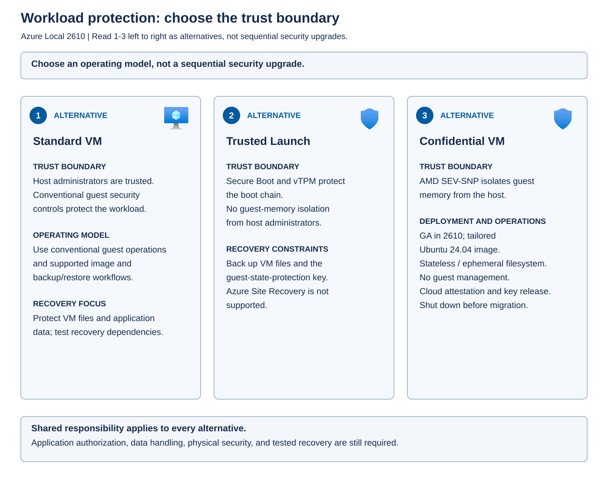

Azure Local can apply different levels of protection to its virtual machine workloads depending on the threats you're attempting to mitigate. A *threat model* describes the assets to protect, the adversaries and failure conditions to consider, and the trust assumptions the design makes. Select a VM security type against that model, not against which name sounds strongest.

A conventional business application might need a supported persistent operating system, authenticated users, disk protection, and tested backup. A sensitive stateless workload might additionally need memory isolation from infrastructure operators. 

The following infographic lists the three alternatives VM host trust models.

- Standard VMs retain conventional trust in the host. 
- Trusted Launch adds guest boot and virtual TPM protections, with specific key-recovery responsibilities. 
- Confidential VMs add hardware-based isolation of guest memory from the host, but require a compatible stateless design and supported hardware, image, attestation, and key-release services. 

## Standard virtual machines

A standard VM relies on the host virtualization platform to isolate it from other workloads. Host administrators remain trusted. The guest still needs appropriate patching, authentication, network controls, endpoint protection, and data handling.

Host-volume encryption like BitLocker doesn't automatically configure guest application encryption or restrict access inside the guest. Apply guest and application controls according to the workload's requirements.

For Azure Local VMs enabled by Azure Arc, use the supported operation matrix to choose the correct management interface for each task. A local Hyper-V operation that's technically possible isn't automatically supported for an Azure-managed VM. Unsupported local changes can create *management-state inconsistencies*: differences between the VM configuration recorded in Azure and the actual configuration on its local Hyper-V host.

For example, adding or removing a data disk or network interface directly through Hyper-V bypasses operations that Azure Local expects you to perform through the Azure portal or Azure CLI. These changes can cause synchronization errors, misleading configuration information, or failed management operations. Unsupported actions such as cloning a VM can also leave it unmanageable through Azure, even if a local VM still exists.

Not every difference between local tools and the portal is an error. Some explicitly supported local operations aren't reflected in the Azure portal. The operation matrix distinguishes changes that must use Azure management from changes that can use local tools, so follow the specified interface rather than assuming either that all local changes are safe or that all local tools are prohibited.

The following matrix summarizes the management routes relevant to Azure Local 2610 VM administration and recovery. These routes apply only when the operation is supported for the VM's security type and guest operating system. They don't override the additional Trusted Launch and confidential VM restrictions described below.

| Management route | Operations and limitations |
| --- | --- |
| Azure portal or Azure CLI | Create and delete VMs, manage their power state, add or remove network interfaces and data disks, and change virtual CPU count or startup memory. Manage extensions and guest management only where supported. Changing dynamic memory minimum and maximum values isn't supported. |
| Azure CLI only | Change the guest computer name, which restarts the VM. Attach or detach a GPU and expand a data disk where those capabilities are supported. Changing a guest computer name isn't the same operation as changing the VM's display name in a local tool. |
| Supported local tools | Perform supported operations such as changing boot order, configuring processor compatibility, expanding an OS disk, and migrating a VM between nodes in the same cluster. Local checkpoints are supported from Azure Local 2504 onward, but permission to create them must remain restricted to Hyper-V administrators. Don't infer checkpoint support for every protected VM type from this general capability. |
| Network ATC PowerShell cmdlets | Configure single-root I/O virtualization (SR-IOV), the number of simultaneous live or storage migrations, and the host networks used for live migration. These settings must use the Network ATC management path rather than arbitrary local networking changes. |
| Unsupported through any interface | Change the VLAN ID of an existing VM network interface, live migrate a VM between clusters, perform VM storage live migration, convert the VM disk type, or clone or copy the VM. Such operations can break Azure management, and copying can also cause corruption or startup failures. |

Network ATC manages host networking through declared configuration intents. The ability to configure a host-level migration limit doesn't make an otherwise unsupported VM migration supported. If a VM needs a different IP address or VLAN configuration, use the supported network-interface replacement workflow rather than directly changing its existing Hyper-V VLAN setting, and plan for the connectivity impact.

## Trusted Launch

Trusted Launch virtual machines strengthen the guest boot chain with Secure Boot and a virtual Trusted Platform Module, or *vTPM*. The vTPM supplies TPM capabilities to the VM and protects guest security state. Azure Local supports transfer of that state during supported migration or failover within the same cluster.

Trusted Launch doesn't provide the same host-excluding memory boundary as a confidential VM. It also doesn't make live-migration traffic inherently encrypted. Use a supported network-layer encryption design, such as appropriately configured IPsec, to protect that traffic. IPsec is a protocol suite that can authenticate and encrypt IP traffic between configured endpoints.

*Attestation* evaluates evidence about a system against a policy to establish whether it meets expected conditions. Trusted Launch boot-integrity attestation is a separate preview capability. A VM booting successfully isn't proof that attestation has been configured or passed.

Supported Azure Local Windows Marketplace images and supported custom Windows images can be used with Trusted Launch. Linux support uses compatible custom images. Custom-image support doesn't mean guest attestation is supported: the documented Trusted Launch workflow disables guest attestation for custom images that haven't been validated.

Guest management can be used where the guest operating system and operation matrix support it. *Guest management* means supported capabilities that operate inside the guest, such as extensions. It's distinct from managing the VM resource itself, such as creating or stopping it. That distinction matters for the confidential VM implementation described next.

Protect the VM files as well as the guest boot process. Trusted Launch VM state files are restricted to host administrators at their default location. If you place them elsewhere, preserve that access restriction at the new location. Trusted Launch also supports guest VBS where the guest operating system supports it, but that isolates selected security functions inside the VM rather than providing confidential-VM isolation from the host.

## Confidential virtual machines

Azure Local confidential VMs use supported AMD Secure Encrypted Virtualization-Secure Nested Paging (SEV-SNP) hardware. The hardware encrypts and isolates guest memory so that the workload's sensitive in-memory data has a stronger boundary against the host operating system and host management code.

A *trusted execution environment (TEE)* is the hardware-backed environment in which protected computation occurs. The *trusted computing base (TCB)* is the set of components that the security claim relies on. Reducing the TCB can reduce exposure, but it doesn't remove the need to trust the guest code and the services that authorize key release.

For Azure Local 2610, the documented confidential VM implementation supports Ubuntu 24.04 with the tailored integrity-protected image preparation workflow. Windows confidential guests aren't supported. The documented validated OEM configurations use AMD fourth-generation EPYC processors with SEV-SNP and include Lenovo ThinkAgile MX455 V3 Edge PR and HPE ProLiant DL145 Gen11 systems. A processor's support for SEV-SNP alone doesn't establish that an arbitrary server, firmware configuration, or guest image is supported.

*Image integrity* checks help detect unauthorized changes to the guest operating system and boot chain. Memory encryption alone isn't equivalent to protection against a tampered guest image. Use the documented image preparation and integrity protections for the intended threat model.

The current implementation has important operational constraints:

- The entire file system is ephemeral, and parts are read-only. Don't rely on local writes as durable application state.
- The image must be prepared specifically for this workload in a controlled, clean environment. Initial guest credentials are defined during image preparation. A normal persistent server image isn't a drop-in replacement.
- Guest management isn't supported. Don't design around ordinary extension-based configuration or management agents.
- Azure connectivity is required for Azure Attestation and Azure Key Vault secure key release.
- Migration of a running confidential VM isn't supported. Shut it down before a supported migration, and validate the destination and procedure.
- Install cluster updates through the Azure portal's supported solution-update workflow, not through Windows Update directly on individual hosts.

*Stateless* means an instance can be recreated without relying on durable state held only inside that instance. For Contoso, an eligible healthcare analytics component can process sensitive data in protected memory, while durable inputs, outputs, and patient records need a separately protected and authorized data service. That service becomes part of the end-to-end security design and must support the applicable access, retention, and recovery requirements.

## Understand attestation and secure key release

The confidential workload obtains hardware-rooted evidence about its execution environment. Microsoft Azure Attestation validates the report and issues an attestation token. Azure Key Vault can use the token and the configured release conditions when deciding whether to release a key.

The token isn't the encryption key. It's evidence used in the release decision. A policy that accepts the wrong measurements, an incorrectly authorized identity, or an exposed image-build credential can undermine the design even when hardware memory protection works.

Plan what happens if attestation fails or Azure connectivity is unavailable. For operations that require post-boot key release, the workload can't simply assume it can retrieve the key offline. This doesn't mean every network interruption necessarily stops an already running workload. Availability depends on when the application needs external services and which material it already holds.

Confidential computing also doesn't prevent every physical attack or denial of service. Infrastructure operators can still affect availability, and sophisticated physical side-channel threats require additional safeguards. Protect facilities, firmware lifecycle, network paths, and the cloud identities and resources used for attestation and key release.

## Compare recovery consequences

Use the following table to test whether a protection choice fits the workload's operating model.

| Security type | Required recovery design | Assumption to reject |
| --- | --- | --- |
| Standard VM | Validated VM and application backup, protected credentials, and supported restore operations | Every Hyper-V operation is supported for an Azure-managed VM |
| Trusted Launch VM | All required VM files plus the corresponding guest-state-protection key and its recovery dependencies | A VM-file backup alone is sufficient, or Azure Site Recovery replication is supported |
| Confidential VM | Reproducible approved image, successful attestation and key release, and protected external application data | A persistent-VM backup or live-migration design automatically applies |

Trusted Launch uses a *guest-state-protection key* to protect saved guest state, including vTPM state. Azure Local stores this key in a local key vault. Without the required key, the restored VM can't start, even if its VM files are present.

Back up all required VM files with a solution that follows supported Hyper-V backup methods, and manually back up the guest-state-protection key as soon as the Trusted Launch VM is created. During recovery, restore the VM files and restore the corresponding key into the destination Azure Local instance's local key vault before attempting to start the VM. A backup of the operating-system disk alone doesn't satisfy these requirements. Automatic system-secret backup is a separate preview capability and doesn't, by itself, prove that all required recovery material is available.

The documented Trusted Launch recovery behavior differs by destination. Restoring to the same Azure Local instance can retain Azure management. A Trusted Launch VM restored to a different Azure Local instance can be managed with local VM tools, but can no longer be managed through the Azure Arc control plane under the documented recovery workflow. Plan the destination's operations and recovery ownership around that limitation rather than assuming that a manual reconnection will restore Azure management. Azure Site Recovery replication isn't supported for Trusted Launch Azure Local VMs. Cloning and copying aren't supported substitutes for recovery.

For confidential VMs, don't infer backup, replication, or migration support from the standard or Trusted Launch paths. Verify image recreation and external-data recovery against the current confidential VM restrictions.

**Apply the concept:** Contoso's persistent Windows clinical-records application doesn't fit the current confidential VM guest and storage model. A stateless Ubuntu healthcare analytics component might fit after its hardware, image, key-release, and external-data dependencies are validated. Neither security type establishes regulatory compliance without the necessary application controls and organizational processes.

Apply the security-type restrictions before selecting a management tool or recovery workflow. For example, the general operation matrix's support for within-cluster live migration doesn't permit migration of a running confidential VM, and its extension-management operations don't make confidential guest management supported. A successful local restore to a different instance doesn't restore Azure Arc control-plane management of that Trusted Launch VM. Record the approved security type, image, hardware configuration, management route, and recovery destination together so that Contoso's operational procedures preserve the intended protection.
