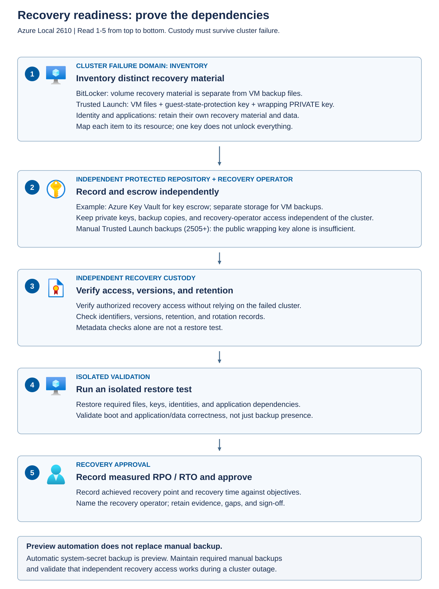

Recovery readiness means more than knowing that backups exist. The required data, keys, identities, tooling, and supported destination must be available together within the business's recovery objectives.

The *recovery point objective (RPO)* is the maximum acceptable amount of data loss, expressed as time. The *recovery time objective (RTO)* is the target time to restore service. An image that can be recreated quickly doesn't meet either objective if its application data or required keys are unavailable.

## Inventory different kinds of recovery material

Don't treat all keys as interchangeable. Each item protects a different object and can have different custody, rotation, and retention requirements.

The following inventory distinguishes common dependencies without recording secret values.

| Material | Purpose | Evidence to retain |
| --- | --- | --- |
| BitLocker recovery material | Unlock a protected volume when normal unlock isn't available | Volume association, protector reference, escrow location, authorized custodian |
| Trusted Launch guest-state-protection key | Restore access to protected VM and vTPM state | VM association, key-backup set, required version, restore procedure |
| Wrapping-key material for manual key backup | Protect and later unwrap exported key backups | Public-key identifier, protected private-key custody, backup-set association |
| Identity certificates and recovery credentials | Reestablish authorized administration or service authentication | Identity and certificate references, expiry, recovery owner, approved procedure |
| Application secrets and data-encryption keys | Restore application access and protected data | Data or service association, version dependencies, retention and rotation record |

An *escrow* arrangement stores recovery material under controlled custody so it can be retrieved when needed. Escrow isn't the same as placing a secret in a shared folder. It requires access control, retrieval approval, retention, monitoring, and a tested recovery process.

## Protect the backup of the keys

The documented manual Trusted Launch workflow for release 2505 and later exports guest-state-protection keys to a backup folder in encrypted form. A wrapping key protects the exported material.

In that workflow, the public portion of the wrapping key is used for backup, and the private portion is required for recovery. Losing the private wrapping key can make an intact encrypted key backup unusable. Protect it independently and document its association with the backup set.

Don't keep the only VM backup, guest-state-protection key backup, and wrapping private key on the cluster they must recover. Also consider identity dependencies: a repository outside the cluster still isn't operationally independent if every authorized recovery sign-in depends on a service hosted only on that cluster.

Protect recovery copies against deliberate deletion as well as hardware failure. Use a supported offline or immutable backup arrangement where required by the recovery design. *Immutable* storage prevents alteration or deletion for its configured retention period. Separate backup deletion authority from routine platform administration, and monitor changes to backup protection and retention. An off-cluster repository that the same compromised administrator can erase doesn't provide a strong ransomware recovery boundary. Test that authorized recovery remains possible under these restrictions, including access to the matching keys.

Azure Local 2610 uses the file-based workflow introduced in release 2505. Earlier releases used a different, instance-to-instance key-vault workflow, so don't mix commands from those procedures. The current workflow exports encrypted key material to a timestamped backup folder and later imports it into the local key vault of the recovery instance.

> [!CAUTION]
> The wrapping private key and the restore operations are security-sensitive. The private PEM file produced by this workflow contains unencrypted private-key material, even though the exported VM-key backup is encrypted. Protect that file with restricted access and encrypted storage. Key imports and the same-instance root-key replacement described below require an approved recovery plan and should first be exercised in an isolated recovery environment.

The reviewed `Import-TvmWrappingKeyFromPem` sample also creates a temporary JSON file containing an unencrypted copy of the wrapping private key. It uses `[System.IO.Path]::GetTempFileName()`, so the file can be outside the PEM staging folder. Before import, identify and protect the effective temporary location used by the operator's process, including its access restrictions and storage encryption. The utility reports the exact temporary path. Retain that path as cleanup metadata without displaying or copying the file's contents. Its normal cleanup deletes the file in a `finally` block, but abrupt process or host termination can prevent that cleanup. File deletion alone isn't proof of secure media erasure.

For a different-instance restore, check that the destination's Trusted Launch key-vault state meets the reviewed sample's empty-vault assumption before importing the temporary wrapping key or the backup. The temporary wrapping key added for this recovery is an expected prerequisite, not a preexisting workload key. Don't create Trusted Launch VMs on that recovery instance before restoring the backed-up keys. If the destination already contains Trusted Launch keys or workloads, or import reports a root-key collision, stop and obtain a product-supported recovery plan for that destination state. An identical key name doesn't prove that the destination contains the required key material. Don't delete a destination root key merely to clear `InvalidVersion`.

Use the following sequence to plan and perform the backup and restore:

1. **Prepare the tools and custody arrangements.** Use a secure administration computer with PowerShell 7 to generate the wrapping key. Obtain an approved copy of Microsoft's `TvmBackupUtils.psm1` sample module, review it, and record the version used for backup and recovery. Its backup and import functions aren't built-in PowerShell commands. Stage the reviewed module on the Azure Local instances where it'll be used, with authorized administrative access. Don't bypass App Control if importing the module is blocked.

1. **Generate and preserve the wrapping-key pair.** The documented workflow uses a 2048-bit RSA key pair. In PowerShell 7, create it with `[System.Security.Cryptography.RSA]::Create(2048)`, export the public key with `ExportRSAPublicKeyPem()`, and export the private key with `ExportPkcs8PrivateKeyPem()`. Save the outputs as `public.pem` and `private.pem` in the protected locations specified by the recovery plan. Don't display the private value in a console or assessment record, and don't overwrite a wrapping key associated with retained backups. Copy only `public.pem` to the source Azure Local instance for the backup operation.

1. **Export the guest-state-protection keys.** On the source instance, import the reviewed `TvmBackupUtils.psm1` module with `Import-Module`. Run `Backup-TVMKeys`, providing the public PEM file through `-WrappingKeyPath` and the backup root folder through `-BackupRootPath`. The function creates a timestamped folder containing the encrypted key backup, including the VM keys and associated root-key material. Preserve the complete folder and its structure without editing the files. Copy it to the approved backup repository outside the cluster's failure domain, and record which wrapping-key pair protects it.

1. **Stage a restore on the approved destination.** Select the backup set that contains the keys required by the VM files being restored. Copy the complete timestamped folder and both matching PEM files into a restricted temporary location on the destination Azure Local instance. Import the reviewed sample module. Before importing the wrapping key, choose a `-KeyName` that's unused in the destination vault and doesn't match any key name in the selected backup set. Check the names without changing the backup files or recording key values. A name collision with a backed-up key can cause the MOC import command to hang. Use `Import-TvmWrappingKeyFromPem` with that checked name, the matching `-PublicKeyPath` and `-PrivateKeyPath`, and `-KeySize 2048`. This imports the wrapping key needed to recover the encrypted backup. Keep its temporary name in the recovery record so that later import and cleanup operations target the correct key.

1. **Handle same-instance recovery explicitly.** When restoring to the original Azure Local instance, the documented procedure removes the existing `AzureStackTvmAKRootKey` before importing the backup. This uses `Remove-MocKey` against the `AzureStackHostAttestation` group and `AzureStackTvmKeyVault` local vault. Treat it as a planned replacement of platform key material, not routine backup cleanup. Proceed only after confirming the destination identity, the approved restore scope, and the availability of the required backup and wrapping-key material. Don't apply this same-instance deletion step to a different-instance restore or delete other keys to suppress import errors.

1. **Import the backup and prove recovery.** Run `Import-TVMKeys` with `-WrappingKeyName` set to the temporary name created earlier and `-BackupPath` set to the selected timestamped folder. An `InvalidVersion` message can indicate that a key with the same name already exists. Confirm that the required key is already available rather than treating every such message as a successful import or deleting existing keys indiscriminately. Investigate other errors before continuing. Restore all required VM files with the approved backup tool, then verify VM startup and application recovery in the isolated environment. Importing keys alone doesn't restore the VM or its application data.

1. **Remove temporary recovery copies, not retained recovery material.** After the import process has finished or has been confirmed stopped, verify that the exact temporary JSON file reported by `Import-TvmWrappingKeyFromPem` was removed, regardless of whether recovery succeeded. If it remains, use the approved secret-material cleanup process for that identified file only. Don't delete a file still needed by an active import, delete unrelated temporary files, or use a blanket wildcard cleanup. After successful recovery or approved abandonment of the attempt, remove the temporary `public.pem` and `private.pem` copies from the destination instance. Once no active import needs it, remove only the temporary wrapping key imported for this restore, using `Remove-MocKey` with that checked key name in the `AzureStackHostAttestation` group and `AzureStackTvmKeyVault` vault. Keep the restored VM keys in place. Retain the protected off-cluster wrapping-key pair and encrypted backup sets for the required restore window. Record completion and cleanup without recording secret values.

For Contoso, the acceptance criterion is a working recovery path for the clinical workload, not merely the presence of a timestamped folder. A custodian must be able to obtain the matching wrapping private key, an authorized operator must be able to recover the required VM keys, and the application owner must confirm that the restored service and patient records are usable under the approved access controls.

## Treat automatic backup as a capability to verify

Automatic system-secret backup to a configured Azure Key Vault is documented as preview. It can cover system-level material such as Trusted Launch VM keys and BitLocker recovery keys. A deployment setting alone doesn't prove that every required item and version has been backed up successfully.

Retain the supported manual backup responsibilities unless the applicable product guidance explicitly replaces them. Check coverage, completion, permissions, retention, and the documented recovery path.

For a cloud vault, verify network reachability, the identity used to retrieve recovery material, and protection against accidental or malicious deletion. Azure Key Vault provides two complementary deletion protections: soft delete and purge protection. These controls preserve an opportunity to recover deleted material, but they don't keep deleted objects available to applications.

*Soft delete* retains a deleted vault, key, secret, or certificate for a recovery period of 7 to 90 days after deletion. The default is 90 days. Configure the period when creating the vault because it can't be changed afterward. Soft delete is enabled by default on new vaults and can't be disabled once enabled. A soft-deleted object can't be retrieved or used normally until an authorized operator recovers it, so dependent backup or recovery operations can still fail while it remains deleted.

*Purge* means permanent deletion. Without purge protection, an identity with the required purge permissions can permanently remove soft-deleted material before the recovery period ends. *Purge protection* prevents that early permanent deletion and uses the same retention period as soft delete. It isn't enabled by default and requires soft delete to be enabled first. Once enabled, it can't be disabled or overridden, including by an administrator or Microsoft. It doesn't prevent an initial deletion, so monitoring and timely recovery remain necessary.

A vault's name remains reserved while the vault is soft-deleted. Recover the existing vault rather than assuming that creating a new vault with the same name will restore its contents. If the deleted vault or object isn't recovered before its retention period expires, Key Vault permanently purges it. Assign an owner to detect deletion and complete recovery within that window, and restrict purge permissions separately from routine administration.

Recovering a vault also doesn't automatically restore its vault-scoped Azure RBAC role assignments or associated Event Grid subscriptions used for event-driven monitoring and automation. Reestablish the required permissions and event subscriptions, then confirm that the Azure Local integration can access the vault and resume successful backup operations. Recovery of the vault resource alone isn't evidence that its dependent services are working.

For Contoso, the vault's deletion-recovery window is distinct from the retention requirements for patient records, security evidence, and VM backups. Keep the key versions needed to restore retained backups under the approved custody policy. Soft delete and purge protection don't establish that the correct key version was backed up, that an independent recovery operator can retrieve it, or that a clinical workload can be restored. Those claims still require inventory, access, and recovery evidence.

## Move from inventory to a recovery test

The diagram shows the progression from identifying dependencies to demonstrating recovery.

First, associate each protected resource with its required backup and key material. Next, place that material and the recovery authorization path outside the relevant failure domain. Verify access, versions, and retention without exposing secret values. Then perform an isolated supported restore and measure application recovery. Only that final exercise establishes more than inventory readiness.

Use a controlled recovery test:

1. Define the failure scenario, target RPO and RTO, supported restore destination, and approved test scope.
1. Select the corresponding VM or image backup, application data, guest-state-protection material, and wrapping-key dependencies.
1. Have an independently authenticated recovery operator retrieve the required material through the approved custody process.
1. Restore or recreate the workload in an isolated environment by following the security-type-specific procedure. Prevent unintended access to production endpoints.
1. Verify boot, required key access, application authentication, data integrity, and the expected management experience at the destination.
1. Record the recovered data point, elapsed recovery time, exceptions, and evidence references. Remove temporary copies and test access using the supported cleanup procedure.

The test isn't complete when the VM powers on. The application owner must confirm that the service works and the recovered data meets the business requirement. The security owner must confirm that recovery didn't leave broader access or exposed key material behind.

A metadata review can establish that a backup entry exists, has a plausible timestamp, and is accessible to an approved custodian. It can't prove successful decryption or application recovery. Record these assurance levels separately.

## Govern rotation and expiry

*Rotation* replaces a credential, key, or certificate with a new one. It reduces the useful lifetime of exposed material and prevents avoidable expiry failures. It can also break dependent services if performed outside their supported lifecycle.

Azure Local creates and rotates internal secrets and certificates through managed workflows. Monitor expiry, rotation failures, time synchronization, and dependent-service health. Don't delete certificates from `Cert:\LocalMachine\My` to force a refresh.

Customer-managed credentials require coordination across their documented consumers. A password changed in the identity provider but not updated through the relevant Azure Local workflow can leave services using the previous value. Local Identity and domain-joined procedures aren't interchangeable.

Keep the recovery material required for the approved restore window. Rotating an active encryption key doesn't make older backups independent of their original keys. Conversely, retaining an old backup key doesn't justify leaving an unnecessary old sign-in credential active.

For Azure Local 2610, use the internal-secret rotation workflow for version 2411.2 and later. Internal secrets include infrastructure certificates, passwords, secure strings, and keys. Manual rotation is required only when you suspect compromise or receive an expiration alert. An authorized operator signs in to one node with deployment-user credentials and runs `Start-SecretRotation` as an approved maintenance or incident-response action. The older procedures that reset the certificate authority password or delete File Copy Agent certificates aren't part of this workflow.

For a domain-joined deployment, use `Set-AzureStackLCMUserPassword` to update the deployment-user credential held by Azure Local. If the password has already changed in Active Directory, supply `-Identity` and `-NewPassword` to synchronize the platform's stored credential. To change the password in Active Directory as part of the operation, also supply `-UpdateAD` and `-OldPassword`. Don't supply `-OldPassword` without `-UpdateAD`. Provide password values as secure strings rather than embedding them in scripts or command history. The current session becomes unresponsive after the change, so sign in again with the updated password. This domain-account procedure isn't a substitute for Local Identity account management.

A cloud witness requires coordinated storage-account key rotation so that the cluster doesn't continue using a revoked key. Sign in to a node with deployment-user credentials and use `Set-ClusterQuorum -CloudWitness` to switch the witness to the secondary storage-account key. Regenerate the primary key, then reconfigure the witness to use that new primary key. Regenerate the secondary key only after the witness has switched back. Finally, update the stored primary key in the platform's secret store by using `Set-ECEServiceSecret` with the `WitnessCredential` container. Confirm witness health during the change and identify other consumers of either key before regenerating it.

For storage used by Azure Local VM images, revoking a *shared access signature (SAS)* depends on how that access token was created. An expired SAS is already invalid. Revoke an unexpired ad hoc SAS signed with a storage-account key by regenerating the signing key. For a user delegation SAS, revoke the user delegation key or remove the relevant permissions from the identity that created it. Cached keys and permissions can delay user delegation SAS revocation. For a SAS associated with a stored access policy, set the policy's expiry to a past time or delete the policy. Key and policy changes can invalidate other tokens that depend on them, so assess affected consumers and confirm that revoked access no longer works.

Azure resource bridge has a separate service-principal secret. Locate its existing service principal in Microsoft Entra ID, whose name follows the `ClusternameXX.arb` pattern, and create a replacement client secret. From a node signed in with deployment-user credentials, update the platform by using `Set-AzureStackRPSpCredential` with the subscription ID, tenant ID, existing application ID, and new secret supplied as a secure string through `-NewPassword`. Creating the secret in Microsoft Entra ID alone doesn't update the platform's stored credential.

The separate deployment-service-principal update procedure applies only to instances upgraded from Azure Local 2306 to version 23H2. For that legacy case, create a new client secret for the existing deployment service principal, sign in to Azure from a node, select the correct subscription, and load the `Microsoft.AS.ArcIntegration` module. Use `Update-ServicePrincipalName` with the existing application ID and the new secret as a secure string. Don't apply this legacy procedure indiscriminately to newer deployments.

Routine assessment should review expiry, rotation status, and dependent-service health, not initiate these changes. Record the secret's purpose, responsible owner, version or expiry metadata, approved maintenance action, and outcome without recording passwords, keys, client secrets, or SAS tokens. After an approved change, confirm that required authentication and platform operations still work before closing the change record.

**Apply the concept:** Contoso can't accept a Trusted Launch backup whose protection key exists only on the protected cluster. It needs independent key custody, any required wrapping-key material, and a demonstrated restore path. The recovery exercise must confirm that authorized staff can access the restored clinical service and required patient records within objectives agreed with facility operations.
