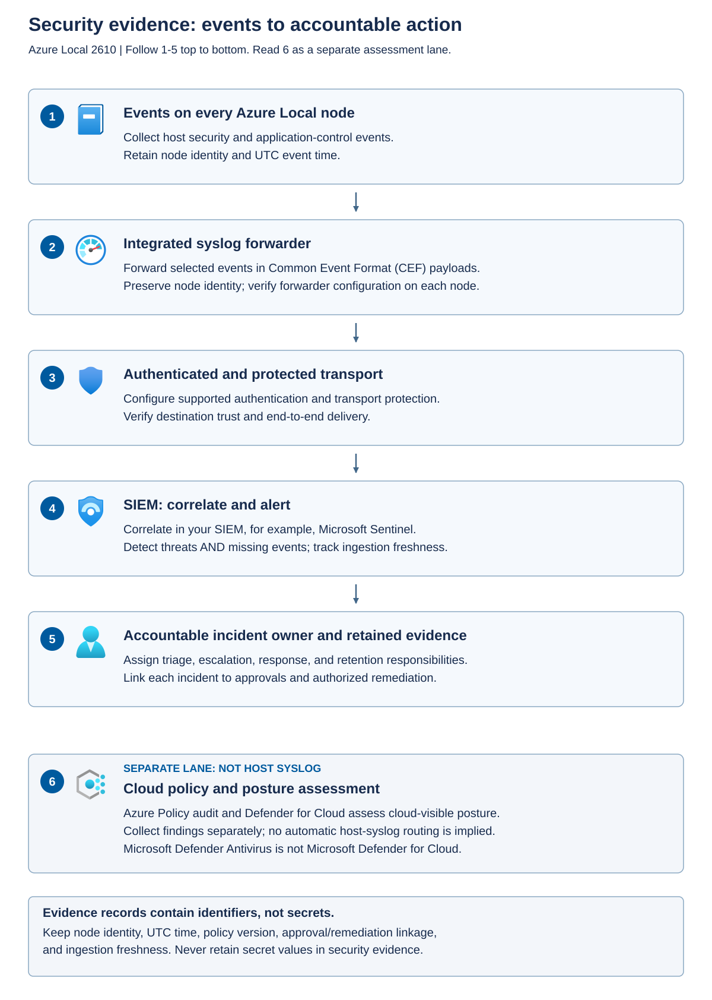

Security evidence connects a control to an observation and an accountable response. Useful evidence explains what happened, where it happened, when it happened, and which approved state should have applied.

Separate three kinds of information. *Configuration evidence* describes intended and observed settings. *Security events* record activity such as policy blocks or authentication failures. *Recovery evidence* records whether protected resources could be restored. One category doesn't replace the others.

## Distinguish the Defender capabilities

Microsoft Defender Antivirus is the host antimalware component. Microsoft Defender for Cloud is a cloud security posture and workload-protection service. Turning on antivirus doesn't automatically configure every Defender for Cloud capability.

The Azure Local Defender for Cloud integration is documented as preview. Foundational cloud security posture management provides posture recommendations. Defender for Servers plans add capabilities under their own coverage, configuration, and licensing requirements.

Don't assume that every feature available for an Azure VM is supported on an Azure Local host. Review the current integration documentation and resource-specific exclusions. For example, host update recommendations must be reconciled with supported Azure Local solution-update workflows rather than applied as ad hoc updates to individual nodes.

## Collect cloud and identity audit evidence

The host event stream doesn't describe every action that can affect Azure Local. A cloud administrator can change a role assignment without signing in to a node, and a recovery custodian can retrieve a secret from Azure Key Vault without generating the corresponding host security event. Cloud posture recommendations also aren't an activity audit trail.

A *security information and event management (SIEM)* system collects and correlates security information to support detection, investigation, and retention.

Use the following source map to collect evidence at the boundary where an action occurs.

| Evidence source | What it can establish | Important limit |
| --- | --- | --- |
| Azure Activity Log | Azure management operations such as role-assignment changes, policy changes, resource deletion, and extension-management requests | It doesn't normally record read operations or Key Vault secret retrieval. An accepted management request isn't proof that an agent completed the requested operation. |
| Microsoft Entra sign-in logs | Authentication attempts, results, and available MFA and Conditional Access details | They don't replace node-local, BMC, guest, or application sign-in records. |
| Microsoft Entra audit logs and PIM history | Relevant directory and access changes, plus privileged-role eligibility, activation, and approval history | Verify the records and export path for the particular role type. Don't assume one log contains every Azure and directory authorization event. |
| Azure Key Vault audit logs | Vault operations and data-plane activity such as secret retrieval, key use, and deletion, with caller and result information | Diagnostic collection must be configured. Successful secret retrieval doesn't prove successful workload recovery. |
| Host, guest, and application logs | Local administrative actions and workload-specific behavior, including patient-record access where the application audits it | The host syslog selection doesn't automatically include guest or application events. |

*Control-plane* operations manage a resource, such as changing its permissions. *Data-plane* operations use its contents, such as retrieving a vault secret. Azure Activity Log records management events automatically and retains them for 90 days. Longer retention and central analysis require an export destination. Azure resource logs, including Key Vault audit events, require diagnostic settings for collection. Directory log availability and retention depend on the log type and licensing. A retention requirement must therefore be configured and demonstrated for each source rather than inferred from the SIEM's retention setting.

Configure collection as a separate approved change:

1. **Define coverage and custody.** Inventory the subscription, tenant, vaults, nodes, and applications that support the workload. Specify required event categories, retention, access restrictions, destination region, and the owner who responds to gaps. Separate permission to read evidence from permission to change collection or delete retained copies.
1. **Prepare destinations.** Use a secured Log Analytics workspace for analysis, a storage account for an approved archive, or an event hub for streaming to a supported SIEM integration. A Log Analytics workspace is an Azure log-analysis resource. Create and authorize the selected destination before configuring each source. An on-premises syslog listener doesn't automatically ingest Azure diagnostic streams.
1. **Route Azure management events.** In the intended subscription's **Activity log**, use **Export Activity Logs** to configure diagnostic settings for the required categories and destination. Include **Administrative** events for management changes. Confirm subscription-wide coverage rather than relying on a filtered view of a single resource.
1. **Route identity events.** In the Microsoft Entra admin center, open **Entra ID** > **Monitoring & health** > **Diagnostic settings**. An authorized Security Administrator can add a general diagnostic setting, select the required audit and sign-in categories, choose the prepared destination, and save it. Include relevant noninteractive, service-principal, or managed-identity sign-in categories where available and required. Separately confirm that the required PIM history is retained through the approved collection process.
1. **Route vault events.** For each required Key Vault, add a diagnostic setting that includes **AuditEvent** and sends it to the approved destination. The operator needs permission to configure diagnostics and the destination, not permission to read production secret values merely to configure logging.
1. **Demonstrate collection.** Coordinate benign test activity with security operations, such as an approved role activation and retrieval of a nonsensitive test secret in an authorized test scope. Confirm that the relevant source records arrive with the expected caller, target, operation, result, and time. Then establish coverage for the actual production resources without disclosing their secrets.

Allow for source-specific ingestion delays, but don't treat a saved diagnostic setting as delivery evidence. Newly enabled collection can't be assumed to reconstruct events that were never retained. Record the collection start time and any earlier gap.

Correlate cloud and local records using UTC timestamps, resource and node identities, caller identifiers, operation names, and correlation or request IDs where available. Different services don't necessarily share one correlation ID. For Contoso, connect the approved role activation to the Azure management request and, where applicable, the resulting host action. Alert on unexpected privilege changes, disabling of diagnostic settings, unusual vault access, and missing expected streams. Protect archives against unauthorized alteration or deletion, and retain application access records separately when they're required to explain use of patient information.

## Build the event path deliberately

Host-event forwarding is one input to the broader evidence pipeline.

Azure Local includes a syslog forwarder on each host. Syslog is the message transport and formatting mechanism used for forwarding. Azure Local's integrated mechanism sends RFC3164 syslog messages with a Common Event Format (CEF) payload, which supported SIEM integrations can parse.

The diagram separates host-event forwarding from cloud posture assessment.



Each host generates relevant security events and forwards them through its configured agent. Protected transport carries those events to the collector and SIEM, where correlation and response rules apply. Cloud policy and posture findings are another evidence source with their own collection and timing. Neither path should silently replace the other.

For production, use supported TCP forwarding with authentication and Transport Layer Security (TLS) encryption. TCP provides a connection-oriented transport. TLS protects the connection's contents and supports authentication of its endpoints. Mutual authentication lets both the client and the server verify identity with certificates. At minimum, the client should validate the server and use encryption.

TCP alone doesn't encrypt messages. Disabling server-certificate validation might make a connection succeed, but it weakens assurance about the destination. Fix trust, certificate naming, expiry, or connectivity problems rather than leaving validation bypassed.

Collector configuration also affects coverage. The documented default output severity includes warning, critical, and error events. A requirement to retain informational events needs explicit review of forwarding settings and supported event coverage. Don't assume "syslog enabled" means "every Windows event forwarded."

## Inspect forwarding without changing it

Return to the authorized node PowerShell session described in the host-inspection unit. The following command reads the local forwarder's configuration:

```powershell
$ErrorActionPreference = 'Stop'
Get-AzSSyslogForwarder -Local
```

Repeat the local inspection on each node, or use the documented cluster-wide inspection with its required permissions and connection method. Compare the collector destination, transport, certificate-validation behavior, enabled state, and severity configuration with the approved design.

Configuration evidence isn't delivery evidence. In the SIEM, confirm that a suitable known event from each node arrives, is parsed with the right source identity and timestamp, and triggers the expected test response. Coordinate the test with security operations so that it doesn't cause an unnecessary production incident.

If events don't arrive, investigate the host source, forwarding configuration, name resolution, route, firewall, TLS trust, collector listener, and parsing rules in that order. Avoid changing multiple layers at once because doing so makes the cause harder to establish.

## Configure forwarding as an approved change

Forwarding configuration changes are separate from the read-only inspection above. The documented domain-joined workflow requires access to a physical Azure Local host with a domain administrator account and an elevated PowerShell session. Commands issued on one host can configure the agents across all hosts, so confirm the intended cluster and obtain approval before making changes. These examples don't establish the permissions or connection method for a Local Identity deployment.

Prepare the collector before changing the agents. Confirm its fully qualified domain name (FQDN), listening port, network reachability from every node, and trusted server certificate. Use a destination name that matches the certificate. TCP with server authentication and TLS encryption is the default configuration and the minimum recommended production protection. TLS 1.2 and TLS 1.3 are supported by default, with the version negotiated between the endpoints.

The following example configures server-authenticated TLS. Replace `<collector-fqdn>` and the illustrative port `6514` with the approved collector values:

```powershell
$ErrorActionPreference = 'Stop'
Set-AzSSyslogForwarder -ServerName '<collector-fqdn>' -ServerPort 6514 -OutputSeverity Default
```

For mutual TLS, the recommended production configuration, the collector also authenticates the forwarding client. Ensure that the referenced client certificate and its private key are available to each forwarding agent and that the collector trusts the certificate. If the certificate chain uses a self-signed root, import the required root certificate as well. Use this alternative configuration command, replacing the thumbprint placeholder with the approved client certificate's thumbprint:

```powershell
Set-AzSSyslogForwarder -ServerName '<collector-fqdn>' -ServerPort 6514 -ClientCertificateThumbprint '<client-certificate-thumbprint>' -OutputSeverity Default
```

Don't add `-NoEncryption`, `-UseUDP`, `-SkipServerCertificateCheck`, or `-SkipServerCNCheck` to work around production connectivity failures. The first two select unencrypted transport. The latter two bypass certificate validation or certificate-name validation. Repair the underlying listener, network, name, or trust problem instead.

Choose output severity as part of the approved collection design. `-OutputSeverity Default` includes warning, critical, and error events. Use `-OutputSeverity Verbose` when the required coverage also includes informational and verbose events, after accounting for ingestion volume, retention cost, and sensitive event content. This setting broadens the severity range of the supported event selection. It doesn't make every Windows event eligible for forwarding.

A successful `Set-AzSSyslogForwarder` request starts an action plan to configure agents across the hosts and returns the action-plan instance ID. Keep that ID with the change record. Receiving an ID isn't proof that every agent has applied the configuration or delivered an event. After the configuration action completes successfully, enable forwarding with:

```powershell
Enable-AzSSyslogForwarder
```

Enabling uses the configuration from the last successful `Set-AzSSyslogForwarder` call and fails if no configuration has been supplied. Inspect both the global configuration and the copies used by individual nodes:

```powershell
Get-AzSSyslogForwarder -Cluster
Get-AzSSyslogForwarder -PerNode
```

`-Cluster` returns the global configuration and is the default when no scope switch is supplied. `-PerNode` returns each host's configuration, which should match the global configuration. The earlier `-Local` query returns only the connected host's configuration. Check every expected node for the approved destination, port, authentication, encryption, severity, and enabled state, then repeat the controlled end-to-end delivery test. A matching configuration doesn't prove that a collector accepted or parsed the messages.

For an approved temporary pause, `Disable-AzSSyslogForwarder` disables forwarding without removing its stored configuration. `Enable-AzSSyslogForwarder` enables it again using that configuration. Either command accepts `-Force` to trigger an action plan even when the target state already matches, which can help correct out-of-band changes. `Set-AzSSyslogForwarder -Remove` instead removes the configuration and stops forwarding. Don't use disable or remove as a routine diagnostic step. Record any collection gap and restore and demonstrate delivery before closing the change.

## Validate event coverage and parsing

Confirm that the collector parses both the RFC3164 header and the CEF payload. The header carries priority, time, and host information. The CEF signature ID identifies a Windows event as `ProviderName:EventID`. Retain source fields such as `MasComputer`, `MasChannel`, `MasEventID`, and `MasEventRecordID` so that analysts can correlate a received record with its host log. Syslog and CEF severity numbers use different scales. For example, a Windows warning maps to syslog severity `4` and CEF severity `5`, while a critical event maps to `2` and `10`, respectively. Verify those mappings before relying on severity-based alerts.

The built-in event queries are fixed rather than customer-customizable. They include selected sign-in and account-management events, process creation, Defender events, Code Integrity decisions, and other infrastructure events. Filters can exclude particular logon types or built-in accounts, and an event must exist in the source log before it can be forwarded. For the application-control investigation in this module, the documented Code Integrity query selects events `3076` and `3077`, not signing-information event `3089`. Preserve the required `3089` records through the earlier event-log inspection and export procedure rather than assuming that switching to verbose forwarding will collect them. At Contoso, demonstrate delivery of each required event type from each node and document any coverage that needs a separate approved collection path.

## Make missing evidence visible

An empty dashboard can mean that no suspicious events occurred. It can also mean that a forwarder stopped, a certificate expired, or the collector rejected the payload.

Maintain a per-node inventory of expected sources and their last observed ingestion time. Account for the expected event rate and configured severity before declaring a source silent. Where ordinary activity is too infrequent to establish health, use an approved periodic delivery test or another supported health signal.

Synchronize time and record timestamps in a consistent form, such as UTC with an explicit offset. Record both event time and ingestion time when available. That distinction helps identify forwarding delays rather than misclassifying them as a change in event order.

## Retain an evidence package

For each material finding or exception, retain enough information to reconstruct the decision without exposing secrets. The following fields connect observations with action.

| Evidence category | Minimum useful context |
| --- | --- |
| Resource identity | Instance, node or VM identifier, solution version, and deployment identity model |
| Intended control | Applicable baseline or policy version, approved customization, and accountable owner |
| Observation | Result, collection method, timestamp, scope, and evidence of missing resources |
| Decision | Risk assessment, approval, exception expiry, and compensating controls |
| Remediation | Supported workflow used, change reference, per-node verification, and fresh assessment |
| Recovery | Backup and key-version references, authorized custody, restore result, and measured RPO/RTO |

Restrict evidence access, protect it against unauthorized alteration, and apply a retention schedule approved for the relevant record type and applicable obligations. Identifiers, configuration details, and event messages can be sensitive even when they aren't secrets. At Contoso, minimize patient identifiers and clinical information in logs, diagnostic bundles, and assessment records. Clinical records and security evidence can have different retention requirements. Redact unnecessary personal data and never include passwords, recovery-key values, private keys, or access tokens.

Infrastructure evidence supports the infrastructure portion of a control framework. It isn't an application compliance certificate or proof that a healthcare facility meets all regulatory obligations. Guest patching, application authorization, patient-data handling, and clinical-service recovery remain the workload owner's responsibility, with legal, privacy, and compliance teams assessing the broader obligations.
