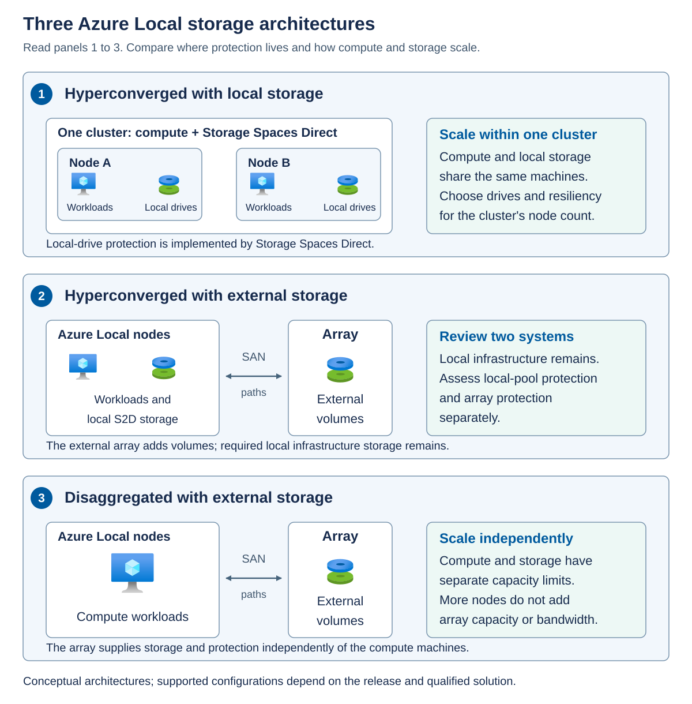

Imagine that you operate an Azure Local environment for a manufacturing organization. The application owner asks for production VMs to recover if an entire rack loses power. The storage proposal lists four copies of each data block. The networking proposal lists redundant links. The operations proposal says that a cloud witness will keep the cluster online.

Each proposal addresses part of the requirement. None, on its own, demonstrates that the application will recover.

If all copies are in the same rack, the rack failure removes them together. If the surviving hosts have no accessible storage path, intact data can't serve requests. If both sides of a network partition believe that they own the same workload, independent writes can create inconsistent state. If ownership and storage survive but the remaining hosts lack memory, a VM might not restart.

## Azure Local storage options

Azure Local stores workload data on infrastructure at your location, while Azure provides management and a resource model for that infrastructure. A virtual machine (VM) typically stores its virtual disks as VHDX files on a clustered volume. Creating an Azure Local storage resource doesn't move those files into an Azure Storage account or create a cloud copy of the data.

Storage is organized into layers. Physical drives provide capacity. A storage system combines and protects that capacity, then exposes a logical disk to the operating system. A filesystem organizes files on the disk, and a *Cluster Shared Volume* (CSV) makes the volume accessible to participating cluster nodes through a shared namespace. An Azure Local *storage path* identifies an eligible location for placing resources such as VM disks. Each layer has its own capacity and health state: free space inside a VM doesn't necessarily mean that its backing storage has space for more writes.

With **local storage**, Storage Spaces Direct combines eligible directly attached drives into a software-defined storage pool. Virtual disks allocate capacity from that pool and apply a resiliency layout. Mirroring maintains multiple complete copies of data, while parity stores reconstruction information that can recover data after covered failures. Copies or fragments are distributed across eligible drives and machines according to the supported layout. The storage network allows machines to coordinate access and protection across the cluster. Protection isn't limited to the drives in the host currently running a VM.

With **external storage**, a qualified array manages the underlying drives and data protection. It presents block devices, commonly called logical units or LUNs, to Azure Local over supported connections such as Fibre Channel or iSCSI. Multipath I/O (MPIO) manages multiple access routes to the same device. These routes protect access, not the data itself: the array must provide its own redundancy. Array LUNs remain separate from the Storage Spaces Direct pool used for local drives.

The main storage architectures differ in where protection is implemented and how compute and storage scale:

| Architecture | How storage is provided | Configuration implications |
| --- | --- | --- |
| Hyperconverged with local storage | The same machines run workloads and contribute directly attached drives to Storage Spaces Direct. | Compute and local storage resources share the cluster. Select a supported drive configuration and resiliency layout for its machine count. |
| Hyperconverged with external storage | Local Storage Spaces Direct and qualified external-array volumes coexist. | Local infrastructure storage requirements still apply. Assess local-pool protection and array protection separately. |
| Disaggregated with external storage | Qualified arrays provide storage independently of the Azure Local compute machines. | Compute and storage can scale separately within the solution's limits. Adding compute machines doesn't automatically add array capacity or bandwidth. |

Within those architectures, choose the configuration to match the workload and the failures it must withstand. An eligible single-node deployment can protect against some drive failures, but it can't keep a VM running after that machine fails. Multi-node deployments can provide another execution destination, provided quorum, usable storage, placement rules, and surviving compute capacity permit recovery.

Drive media and resiliency are separate choices. Qualified ordinary multi-node configurations can use all-flash storage or supported combinations of flash and hard disk drives. Cache devices, where used, accelerate I/O, but they aren't a substitute for protected data copies. Two-way and three-way mirrors, ordinary two-node nested resiliency, and eligible parity-based layouts have different capacity, performance, and fault-tolerance characteristics. They aren't interchangeable options on every cluster.

Filesystem selection also depends on the storage source. Resilient File System (ReFS) is recommended for supported local volumes and is required for mirror-accelerated parity. NTFS is another supported local choice where the workload and feature requirements allow it. Array-backed CSVs require NTFS. A filesystem's capabilities don't override the support rules for the storage underneath it.

For rack-level protection, Azure Local offers distinct **rack-aware configurations** that map machines to two equally populated local availability zones. The hyperconverged design uses all-flash local storage and prescribed mirroring: two-way mirroring for one machine per zone, or four-way mirroring for supported configurations with two to four machines per zone. The separate disaggregated rack-aware preview uses qualified synchronously replicated arrays and supports one to eight machines per zone. These designs have different network, witness, and deployment requirements. Their limits can't be mixed.

> [!NOTE]
> For the Azure Local 2610 baseline used in this module, external arrays aren't supported in a hyperconverged rack-aware cluster. The separate array-backed rack-aware design is a preview and uses Fibre Channel. General external-storage support for iSCSI doesn't establish support for iSCSI in that preview. Always select the deployment type first, then apply its specific storage and configuration requirements.

## Separate the recovery conditions

Use the following conditions when reviewing a design or incident. 

| Condition | Question to answer | What it doesn't prove |
| --- | --- | --- |
| Cluster ownership | Does this cluster membership have quorum and permission to operate? | That the workload's storage is readable. |
| Storage metadata consistency | Can the storage system safely maintain its authoritative metadata? | That every required data block remains available. |
| Data and path availability | Are sufficient copies or parity fragments reachable through working paths? | That there's capacity to repair or accept more writes. |
| Capacity and execution | Can the remaining storage and compute resources serve the workload? | That the application has completed its own recovery. |
| Application recovery | Does the application pass its service-level health checks? | That a backup or disaster-recovery objective has been met. |

A *failure domain* is a set of components that can fail together. A physical drive, a server, a storage fabric, and a rack can each be a failure domain. The useful question isn't just "How many copies exist?" It's "Which copies, paths, and execution resources survive this particular failure?"

A *network partition* separates communicating systems even when their hardware remains powered on. To each side, the other side can appear failed. Quorum prevents both sides from independently acting as the authoritative cluster. Stopping one side is a protection mechanism, not necessarily a failure of the quorum design.

## Application recovery objective

The *recovery time objective* (RTO) describes the acceptable time to restore service. The *recovery point objective* (RPO) describes the acceptable amount of data loss, expressed as time. For example, an application might require service restoration within a business-defined interval and no loss of acknowledged writes for a covered hardware failure.

Synchronous replication places writes in the required locations before reporting completion according to the storage implementation. This can protect acknowledged data against a covered failure, but it doesn't promise zero application downtime. VM restart, database recovery, dependencies, and client reconnection still take time.

Storage replication also copies unwanted changes. A deleted file, damaged application record, or malicious write can propagate to every live copy. Independent backups and an application-aware recovery design remain necessary.
