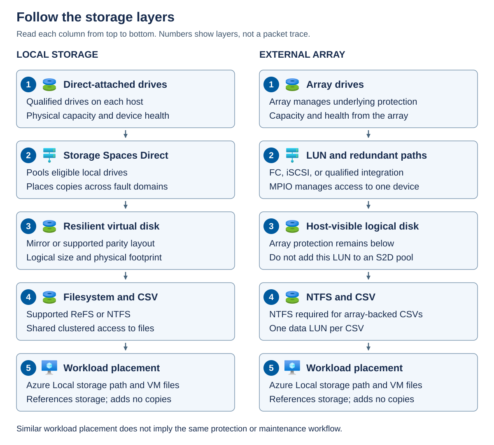
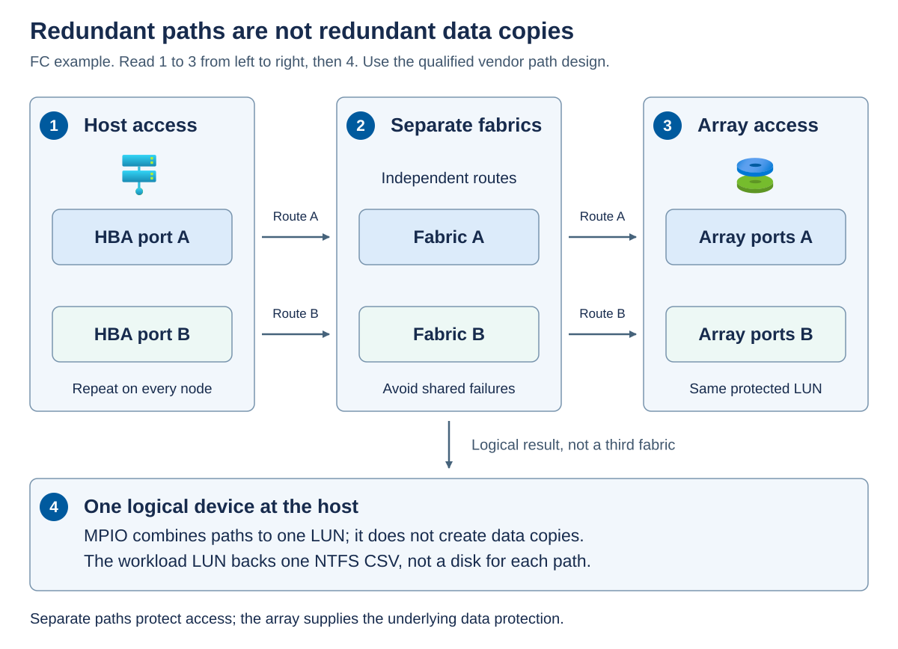

Before choosing a resiliency layout, identify which component owns the storage protection. Azure Local can use **Storage Spaces Direct (S2D)** on local drives, qualified external storage, or a supported combination. These models expose similar objects to an application, but their failure and maintenance boundaries differ.

## Storage Spaces Direct

Storage Spaces Direct pools eligible directly attached drives across the participating machines. In a hyperconverged deployment, the same machines provide compute and local storage. The pool makes physical capacity available to software-defined storage, but it isn't itself a filesystem.

A *virtual disk* allocates capacity from the pool and applies a resiliency layout, such as a mirror. A virtual disk is a storage object, not the same thing as a VM's VHDX file. A VHDX file can reside on a filesystem that's backed by that virtual disk.

A *volume* provides a formatted filesystem, such as Resilient File System (ReFS) or NT file system (NTFS). The filesystem organizes files and tracks its own free space. A healthy filesystem can't reconstruct data that the underlying storage layout can no longer supply.

A *Cluster Shared Volume* (CSV) allows cluster nodes to access a clustered volume through a common namespace, commonly beneath `C:\ClusterStorage`. A CSV has an owner or coordinator node, but ownership doesn't mean that only that node can perform workload I/O. CSV access and redirection behavior must be interpreted with the underlying storage and network state.

An *Azure Local storage path* is an Azure resource that identifies an eligible on-premises placement location for resources such as VM disks. It belongs to the management model. Creating a storage path neither uploads the volume's data to Azure Storage nor creates new physical capacity or additional copies.

The following diagram compares the layers. Read each column from top to bottom. The numbers identify layers rather than packet flow. In the left column, local drives feed a Storage Spaces Direct pool and resilient virtual disks. A supported filesystem and CSV expose the storage for workload placement. In the right column, an external array protects its own capacity and presents a logical unit through redundant paths. An NTFS CSV exposes that unit to the same general placement layer. The similar top-level placement experience doesn't make the protection mechanisms interchangeable.

## NTFS versus ReFS for Azure Local volumes

NTFS and ReFS organize files on a volume, but their capabilities don't make them interchangeable in every Azure Local deployment. Choose the supported storage architecture first, then select the filesystem that meets its requirements and the workload's needs. Neither filesystem creates the underlying mirror copies, supplies cluster quorum, or replaces backup.

Distinguish the host filesystem from the guest filesystem. A host CSV can contain a VM's VHDX file, while the guest operating system formats the virtual disk exposed by that file. For example, an eligible ReFS CSV can hold a VHDX containing an NTFS guest volume. The requirement to use NTFS for an array-backed CSV applies to the host storage, not automatically to every guest filesystem.

CSV provides clustered access over the underlying filesystem. In local volume-creation commands, `CSVFS_NTFS` and `CSVFS_ReFS` identify that clustered access with NTFS or ReFS respectively. They aren't resiliency layouts, and selecting either doesn't change the pool's failure-domain requirements.

For the Azure Local 2610 baseline, use these distinctions:

| Selection consideration | NTFS | ReFS |
| --- | --- | --- |
| Supported local Storage Spaces Direct volumes | An option where the workload and feature requirements permit it | Recommended for supported local volumes |
| External-array CSVs | Required for the supported array-backed configurations in this module | Not supported for these SAN-backed CSVs |
| Mirror-accelerated parity | Doesn't provide the required filesystem support | Required for this layout |
| ReFS deduplication | Not applicable because the feature requires ReFS | Available only on eligible volumes and supported configurations |

> [!NOTE]
> NTFS volumes can use Windows Data Deduplication in supported configurations. This separate feature also supports some ReFS configurations and must not be confused with Azure Local ReFS deduplication. Confirm support and suitability for the specific deployment, storage layout, and workload. The requirement to use NTFS for an array-backed CSV doesn't itself establish support for host-side deduplication; any array-side deduplication is a separate capability.

ReFS supports *block cloning*, which allows files within the same ReFS volume to share existing data blocks without copying their contents. When a file modifies a shared block, ReFS allocates new storage for the write, leaving other files' contents unchanged. ReFS deduplication identifies duplicate blocks and uses block cloning and metadata updates to reduce their physical storage footprint. Shared blocks aren't additional independent data copies, so deduplication doesn't replace the volume's resiliency layout. The underlying storage layout continues to apply its configured mirror or parity protection to the shared data.

ReFS deduplication requires an eligible ReFS CSV on a deployed and registered Azure Local instance. Confirm support for the exact resiliency layout and workload before enabling it. An NTFS array-backed CSV isn't eligible. ReFS deduplication is separate from Windows Data Deduplication, and the two must never be enabled on the same CSV. Run settings-changing commands in an elevated PowerShell session on the CSV's current owner node.

Deduplication runs as background optimization, either manually or on a schedule, and processes new or changed data incrementally. Savings depend on data similarity and become available after processing, not automatically when the feature is enabled. Similar VM images can produce different savings from already compressed or encrypted application data. Compare actual savings and application performance with the baseline, and don't count estimated deduplication savings as guaranteed repair reserve.

ReFS uses *checksums*, values calculated from stored information, to detect unintended changes. It always checksums filesystem metadata, but checksums for file contents require the optional *integrity streams* feature. A ReFS-formatted volume doesn't automatically provide file-data checksum coverage for every file. This distinction matters because a drive can remain online while returning corrupted data.

For files with integrity streams enabled, ReFS validates data before returning it to the application. On resilient Storage Spaces storage, ReFS can attempt to repair detected corruption using valid redundant data. If valid data isn't available, it returns an error. ReFS records corruption and repair outcomes in the System event log. Its background integrity scrubber also examines infrequently accessed data, but it can validate file contents only where integrity streams are enabled.

Integrity streams add processing and allocation overhead. Confirm workload support and performance requirements before enabling them, especially for VM disk files and databases. Use `Get-FileIntegrity` to inspect a file's setting rather than assuming protection from the volume's filesystem type. Don't enable integrity streams across every CSV as a general maintenance action or apply these ReFS capabilities to an NTFS array-backed volume.

Checksums establish whether stored information has changed unexpectedly, not whether an application update was desirable. An accidental deletion or incorrect database update can have valid checksums and reach every replica. These cases still require application-level validation and an appropriate independent recovery point.

Use the following decision sequence:

1. Identify whether the volume uses local Storage Spaces Direct or a qualified external array, including any rack-aware restrictions.
1. Apply mandatory filesystem requirements, such as NTFS for array-backed CSVs or ReFS for mirror-accelerated parity on an eligible local configuration.
1. Confirm application, backup, recovery, and management-tool compatibility. A feature available in Windows Server isn't automatically supported for every Azure Local workload.
1. Record the chosen filesystem, required features, capacity assumptions, and supported maintenance procedure before provisioning the volume.

If requirements later change, don't assume an existing NTFS volume can be converted to ReFS in place. Provision a destination volume with a filesystem and resiliency layout supported by its storage architecture, then migrate workloads through their supported lifecycle procedures. Reformatting a live volume destroys its contents and isn't a migration procedure.

## External block storage

An external array presents block storage to the hosts. A *logical unit number* (LUN) identifies a logical unit exposed through the storage protocol. Administrators commonly use "LUN" to mean the presented block device. The host can partition and format that device, while the array manages the underlying drives, protection, and any array-side snapshots or replication.

A *storage area network* (SAN) connects hosts to block storage. General Azure Local external-storage support includes qualified Fibre Channel (FC) and Internet Small Computer Systems Interface (iSCSI) solutions. FC uses a dedicated storage fabric and host bus adapters (HBAs). iSCSI carries block-storage commands over an IP network. A solution must be qualified as a complete combination, not merely use a recognized protocol.

The array supplies its underlying redundancy. Don't add its LUNs to the Storage Spaces Direct pool intended for directly attached drives. Layering a locally assumed copy policy over an unsupported array presentation isn't a supported shortcut to resilience.

In a hyperconverged deployment with external storage, local Storage Spaces Direct and external array storage coexist. The local infrastructure requirements still apply. In a disaggregated deployment, external storage separates storage scale from compute scale. Additional compute hosts don't automatically add array capacity or storage bandwidth.

The word *hybrid* with respect to storage can describe two different things: coexistence of local and SAN storage, or a media configuration that combines flash and hard disk drives (HDDs).

## Supported storage architecture

Use the architecture-specific requirements for the selected release. Don't combine the largest node limit, most permissive latency, and preferred filesystem from different rows.

| Architecture | Machine boundary | Storage and filesystem boundary | Key availability boundary |
| --- | --- | --- | --- |
| Ordinary hyperconverged | 1-16 machines | Qualified local drives with supported ReFS or NTFS volumes | A single machine can protect against some drive failures, but not its own host failure. |
| Hyperconverged with external storage | Hyperconverged cluster limits | Local storage plus qualified external block volumes. Array-backed CSVs use NTFS. | External arrays aren't supported on the hyperconverged rack-aware topology. |
| Ordinary disaggregated | 1-64 machines, subject to solution-specific limits | Qualified external storage with NTFS array-backed CSVs | Array, fabric, and host qualification determine the supported design. |
| Hyperconverged rack-aware | 1+1, 2+2, 3+3, or 4+4 machines | All-flash local data drives and prescribed rack-level mirroring | Two equally populated zones with inter-rack round-trip time no greater than 1 millisecond. |
| Disaggregated rack-aware, preview | Equal zones from 1+1 through 8+8 machines | Qualified synchronously replicated arrays, FC, and NTFS | Two zones with inter-rack round-trip time no greater than 5 milliseconds. |

The notation `2+2` means two machines in one local availability zone and two in the other. These are local failure domains, not Azure public-cloud availability zones.

Ordinary deployments have their own physical network and latency requirements. Neither rack-aware latency value is a blanket allowance for other topologies. Local-drive requirements also vary. Single-node configurations require the approved uniform flash design. Eligible ordinary multi-node solutions can use qualified hybrid media. Hyperconverged rack-aware data drives must be all-flash.

Some external solutions have narrower integration limits than the generic matrix. For example, the documented Dell PowerFlex integration uses its software initiator and has a 3-16 Azure Local host range. It isn't evidence that every software-presented remote disk is supported, and it's excluded from the rack-aware SAN preview.

## Redundant storage access

*Zoning* controls which FC initiators and targets can communicate. *LUN masking* controls which hosts can access particular logical units. Host registration, zoning, and masking must present the correct storage to every required cluster node without exposing it to unintended consumers.

*Multipath I/O* (MPIO) combines multiple paths to the same logical device and manages path selection and failover with the qualified device-specific implementation. Two visible paths that share one failed switch, HBA, or controller aren't two independent failure paths. Read the numbered groups from left to right, then the result below them. The host has separate HBA connections through Fabric A and Fabric B to supported array ports. Both routes reach the same LUN. MPIO exposes one logical disk to the host, not one disk per cable and not an additional data replica. Repeat the required presentation and path configuration on every participating node.

For array-backed data volumes, each LUN backs one CSV and isn't shared across clusters. Configure MPIO consistently before using the volumes. NTFS is required for these CSVs. ReFS support on local Storage Spaces Direct doesn't establish ReFS support on an array-backed CSV. A dedicated witness LUN, where required by the SAN preview, is a separate clustered witness disk rather than a workload CSV.

Connectivity is a separate deployment decision. In connected mode, the control plane runs in Azure. Disconnected operations use a local control-plane appliance and provide a subset of Azure capabilities. Hyperconverged and disaggregated architectures can use either mode, but the selected workload and storage integration must be supported in that mode. Disconnected operation doesn't turn an array-backed LUN into local Storage Spaces Direct storage.
