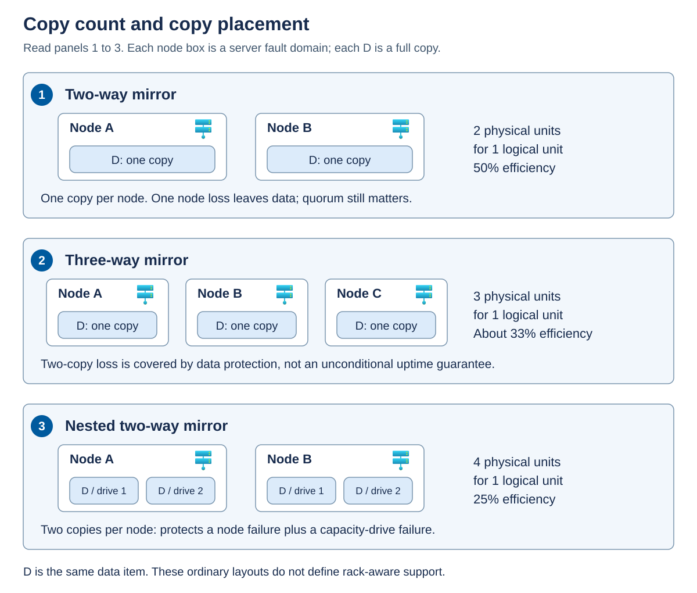
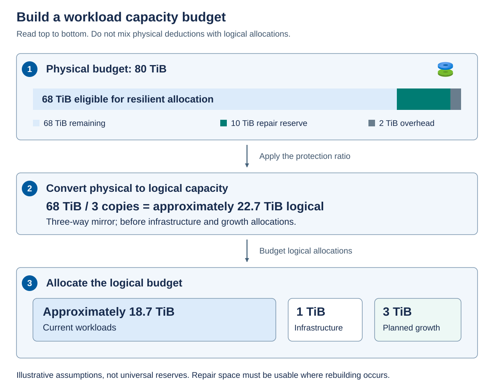

Resiliency consumes capacity and changes I/O behavior. The most space-efficient layout isn't necessarily the best fit for a latency-sensitive application, and a copy count isn't an end-to-end availability guarantee.

## Compare mirrors and parity

*Mirroring* stores complete copies of data in separate eligible locations. A two-way mirror uses approximately two units of physical capacity for each unit of logical data. A three-way mirror uses approximately three. Reads can be served from an available copy. Writes must maintain the required protection.

*Parity* stores data together with calculated reconstruction information. If enough fragments remain, the system can reconstruct missing data. Dual parity provides protection against two covered faults, but it isn't two extra full copies of every block. Updating and reconstructing parity has different processing and I/O costs from updating mirrors.

The diagram shows a simplified data item, labeled D, in three ordinary local-storage layouts. It illustrates copy placement, not the complete distribution of a volume.

Panel 1 places one copy on each of two nodes. Panel 2 places one copy on each of three nodes. Panel 3 places two copies on separate drives within each of two nodes. In the nested example, losing one node still leaves two copies on the survivor. Losing one of those capacity drives then leaves one copy. These are ordinary layouts, not instructions for configuring rack-aware volumes.

| Layout | Typical applicable topology | Ideal capacity efficiency | Protection and tradeoff |
| --- | --- | --- | --- |
| Two-way mirror | Ordinary two-node design or local protection on an eligible single node | 50 percent | One-copy loss is covered. Copies within one server can't survive loss of that server. |
| Three-way mirror | Ordinary clusters with at least three server fault domains | About 33 percent | Two-fault data protection, subject to placement, metadata, and quorum availability. |
| Nested two-way mirror | Ordinary two-node design with the required drive layout | 25 percent | Two copies per node protect against a node failure plus a capacity-drive failure. |
| Dual parity | Eligible ordinary clusters with at least four nodes | Layout-dependent, with 50 percent in the documented four-node example | Two-fault data protection, with different write and reconstruction costs from mirrors. |
| Mirror-accelerated parity | Eligible ordinary clusters with at least four nodes | Depends on mirror and parity proportions | Combines a mirror tier with a more capacity-efficient parity tier. |
| Rack-level mirror | Prescribed hyperconverged rack-aware topology | 50 percent for 1+1 and 25 percent for larger supported pairs | Uses the topology's two-way or four-way layout. Three-way mirror is unsupported. |

Efficiency is logical data capacity divided by the physical capacity used for its protection, before other overhead and reserve. For example, four copies of 1 TiB consume approximately 4 TiB and provide 25-percent efficiency. A *tebibyte* (TiB) is 2^40 bytes, whereas a manufacturer's decimal terabyte (TB) is 10^12 bytes. Convert to one unit before comparing a hardware quote with an operating-system report.

> [!NOTE]
> Don't calculate dual-parity efficiency universally as "number of nodes minus two, divided by number of nodes." Actual placement and coding layouts change in steps. Use the supported layout's documented efficiency or sizing tools.

## Mirror-accelerated parity and nested resiliency

*Mirror-accelerated parity* uses mirror capacity for write activity and moves colder data into parity capacity. This is storage tiering within the volume, not another name for the physical cache devices that can accelerate Storage Spaces Direct. A sustained write workload still needs enough mirror-tier capacity and sufficient performance to move data to parity. The parity tier isn't a cost-free write destination.

ReFS is required for mirror-accelerated parity and is recommended for supported local volumes. NTFS remains a local-volume choice where the workload and feature matrix permit it. Confirm backup and application compatibility before selecting a filesystem.

Ordinary two-node *nested mirror-accelerated parity* combines cross-node mirroring with local mirror/parity protection. Its efficiency depends on drive count and tier proportions. It's distinct from ordinary four-or-more-node mirror-accelerated parity and from the prescribed rack-level mirror configuration.

Nested resiliency requires a validated drive layout, not merely a cluster that has two nodes. A cache device can serve multiple capacity drives, so a failed cache device can affect more than one apparent capacity-drive location. Don't interpret the capacity-drive protection guarantee as unconditional cache-failure protection. The documented optional cache-handling behavior after a node failure includes a delay and destaging requirements. It isn't immediate protection against every subsequent cache fault.

> [!WARNING]
> Changing between ordinary two-way mirroring and ordinary nested resiliency isn't an in-place conversion. Plan supported replacement volumes and data migration if a different layout is needed. A new copy policy is a lifecycle decision, not just a capacity-setting change.

## Data integrity and silent corruption

Hardware availability and data integrity are different requirements. A drive can remain online while returning damaged data. *Silent corruption* is an unintended change that isn't immediately exposed as a device or application error. Multiple available copies don't, by themselves, identify which copy is correct.

A *checksum* is a value calculated from data that can be compared with a stored value to detect changes. ReFS always uses checksums for filesystem metadata. Checksums for file contents require the optional *integrity streams* feature. Formatting a CSV with ReFS doesn't prove that every file on it has file-data checksums enabled.

For files with integrity streams enabled, ReFS checks the data before returning it to the application. When ReFS detects corruption on resilient Storage Spaces storage, it can attempt repair using valid redundant data. If it can't obtain valid data, it returns an error rather than treating the damaged contents as healthy. Corruption events and their repair outcomes are recorded in the System event log.

ReFS also uses a background integrity scrubber to inspect infrequently accessed data. The scrubber can validate file contents only where integrity streams are enabled. It doesn't make an unchecked file checksummed, and it can't recover a valid version if the required redundant data is unavailable.

Integrity streams introduce processing and allocation overhead. Confirm the workload's support and performance requirements before enabling them, especially for VM disk files and database workloads. `Get-FileIntegrity` provides read-only evidence of a file's setting. Don't enable integrity streams across every CSV as a general maintenance step or assume that ReFS behavior applies to an NTFS array-backed volume.

Storage-level integrity also differs from application correctness. An accidental deletion or an incorrect database update can be written successfully with valid checksums and replicated to every copy. Checksums detect damaged bits, not an authorized write with an unwanted business outcome. Application validation and independent recovery points address those cases.

## Calculate capacity at the correct layer

A workload budget begins with physical capacity, but applications consume logical capacity. 

- *Physical footprint* is the backing allocation consumed by a virtual disk, including its resiliency layout. 
- *Logical capacity* is the size presented by that virtual disk. 
- *Filesystem free space* is unused space inside the formatted volume. 

A guest filesystem introduces another layer inside the VM.

Consider this illustrative ordinary three-way-mirror design:

| Budget item | Layer | Amount |
| --- | --- | --- |
| Eligible physical capacity | Physical | 80 TiB |
| Assumed physical metadata and other overhead | Physical | 2 TiB |
| Approved repair reserve | Physical | 10 TiB |
| Infrastructure allocation not already included above | Logical | 1 TiB |
| Planned workload growth allowance | Logical | 3 TiB |

First, subtract the physical deductions: `80 - 2 - 10 = 68 TiB`. Then apply the three-copy layout: `68 / 3 = approximately 22.7 TiB` logical. Finally, subtract the logical infrastructure and growth allowances: `22.7 - 1 - 3 = approximately 18.7 TiB` for current workloads.

The diagram keeps physical and logical amounts in separate numbered panels. Panel 1 reserves physical overhead and repair space. Panel 2 converts the remaining physical budget into logical capacity. Panel 3 assigns that logical capacity to infrastructure, growth, and current workloads. The rounded result isn't extra capacity: use unrounded values in the actual sizing calculation.

The repair reserve and overhead in this example are assumptions, not product-wide recommendations. Determine them from the supported design, drive sizes, required rebuild scenarios, platform allocations, and operational policy. Avoid counting an infrastructure allocation once as physical overhead and again as a logical deduction.

*Repair reserve* is physical storage capacity deliberately left unallocated so that the storage system can rebuild missing data copies or parity fragments after a drive or node failure. It's recovery headroom, not capacity budgeted for normal workload growth, and it must remain available on eligible drives in surviving failure domains. Free space inside a VM or filesystem isn't a substitute for this physical reserve.

## Keep repair reserve usable

A *repair* reconstructs missing copies or fragments to restore the desired protection. An application can remain online while repair is incomplete, but it's then running with reduced tolerance for the next fault.

Repair needs eligible destinations. Ten TiB of free space in the rack that just failed isn't useful to the surviving rack. Free capacity also can't replace a missing fault domain: if the layout needs copies on distinct servers and too few eligible servers remain, physical free space alone can't restore the original protection.

Consider both capacity and time. Repair traffic competes with workload I/O and network traffic. A long repair window extends exposure to a second failure. Size and monitor the degraded state, not just the healthy cluster's aggregate throughput.

For an external array, identify what the vendor's capacity number already includes. If it's usable capacity after array protection, don't divide it again by a Storage Spaces Direct mirror factor. Account separately for array reserves, snapshots, replication, platform allocations, and growth without double-counting them.

## Thin-provisioning risk

*Thin provisioning* presents logical capacity before all backing physical blocks have been allocated. This can improve utilization, but it creates a commitment: future writes need physical capacity that might not yet be reserved.

For example, a guest can report 6 TiB free while its backing pool has only 1 TiB unallocated. The guest sees its logical filesystem. The pool must supply newly allocated blocks. Writes can fail at the backing layer before the guest reaches its own advertised limit.

Fixed or thick allocation reserves space at the relevant layer, but doesn't automatically reserve application growth at every other layer. Track the physical pool or array, virtual-disk footprint, host filesystem, VM disk, and guest filesystem as separate observations.

Deduplication and compression estimates aren't guaranteed capacity. Data similarity can change, and savings occur only when supported optimization processes have actually reclaimed backing allocation. Don't spend required repair reserve on an assumed reduction ratio.

**Apply the calculation:** An 80-TiB two-way-mirror proposal advertises 40 TiB for applications. That's the ideal protection ratio, not the workload budget. Ask where physical overhead, infrastructure, repair reserve, and growth are accounted for, and whether the reserve remains usable after the promised failure.

Use the following requirements to turn the capacity estimate into a supported ordinary local Storage Spaces Direct volume. These are server-level resiliency rules, not configuration instructions for rack-aware clusters or external-array volumes.

**Choose protection before optimizing capacity.** For most performance-sensitive workloads, mirroring is the recommended starting point. Ordinary two-way mirroring provides 50-percent efficiency and protects against one covered failure. With three or more servers, prefer three-way mirroring when performance and two-fault data protection are required. Its ideal efficiency is about 33 percent. Single parity requires at least three server fault domains but protects against only one failure, so it's discouraged compared with three-way mirroring at that scale. Adding more drives to one server doesn't create additional server fault domains, and data-copy protection doesn't override cluster or pool quorum requirements.

**Calculate parity efficiency from the actual layout.** Ordinary dual parity requires at least four server fault domains and provides two-fault data protection. Its efficiency changes in steps because different server counts and media configurations use different coding groups. The documented pure dual-parity efficiencies are:

| Ordinary server fault domains | All-flash configuration | Flash and HDD configuration |
| --- | --- | --- |
| 4-6 | 50 percent | 50 percent |
| 7-8 | 66.7 percent | 66.7 percent |
| 9-11 | 75 percent | 66.7 percent |
| 12-15 | 75 percent | 72.7 percent |
| 16 | 80 percent | 72.7 percent |

These percentages describe protection efficiency, not the final workload budget. Physical overhead, repair reserve, infrastructure, and growth still need separate allowances. They also don't describe an entire mirror-accelerated-parity volume: calculate the mirror and parity portions separately. For example, on an eligible four-server configuration, a 10-TiB logical volume with 2 TiB of three-way mirror and 8 TiB of dual parity has an ideal footprint of `(2 x 3) + (8 / 0.5) = 22 TiB`, before other deductions. An all-three-way-mirror volume of the same logical size would occupy 30 TiB. The smaller footprint comes with different write and background data-movement behavior.

**Use nested resiliency only for an eligible ordinary two-node design.** Nested two-way mirror keeps two copies on separate drives in each server: four copies in total, with 25-percent efficiency. Nested mirror-accelerated parity also mirrors data between the servers, but combines local mirroring for recent writes with local parity for colder data. Its efficiency depends on the capacity-drive count and the mirror/parity split. For example, with six capacity drives per server, 10 GiB of nested mirror and 90 GiB of nested parity occupy approximately 256 GiB across both servers, giving about 39.1-percent efficiency. The drive layout must be supported for the actual Azure Local solution. This example isn't a universal minimum-drive requirement.

Nested capacity-drive protection doesn't automatically cover a cache-drive failure while the other server is down. Where the documented optional cache-handling setting applies and is enabled, it waits until the server has been down for 30 minutes, disables write caching, and writes the cached contents to capacity drives. The additional cache-failure protection applies only after that transfer completes and can reduce performance. Don't treat the initial 30-minute interval as protected against this failure combination. Changing an existing ordinary two-way-mirror volume to nested resiliency requires a new volume and data migration, not an in-place conversion.

**Create the volume with explicit placement and filesystem choices.** For supported local storage, `New-Volume` creates the virtual disk, partitions and formats it, creates the volume, and adds it to CSVs. Specify a suitable `FriendlyName`, the intended `StoragePoolFriendlyName`, the logical `Size`, and the `FileSystem`. Use `CSVFS_ReFS` for a supported ReFS CSV or `CSVFS_NTFS` where NTFS is appropriate. Mirror-accelerated parity requires ReFS. Avoid the deployment-managed `UserStorage_<number>` naming pattern. PowerShell size suffixes use binary units, so `1TB` represents 1 TiB rather than a manufacturer's decimal terabyte.

In the ordinary untiered creation examples, one or two servers default to two-way mirroring and three servers default to three-way mirroring. On a single server, those copies protect drives, not the host. With four or more servers, `ResiliencySettingName` selects `Mirror` or `Parity` for the supported ordinary layout. Tiered and nested volumes instead require the appropriate tier templates and sizes: inspect the available templates with `Get-StorageTier`, then use `StorageTierFriendlyNames` and matching `StorageTierSizes` when creating the volume. A nested mirror/parity volume specifies its mirror tier first and parity tier second. Don't assume that a generic two-node `New-Volume` call selects nested resiliency.

Windows Admin Center also provides **Volumes** > **Inventory** > **Create** for supported ordinary mirror and mirror-accelerated-parity volumes. Single-node volume creation uses PowerShell. Whichever interface you use, confirm the resulting resiliency, filesystem, CSV path, and physical footprint before assigning workloads, and leave the approved repair reserve unallocated.
