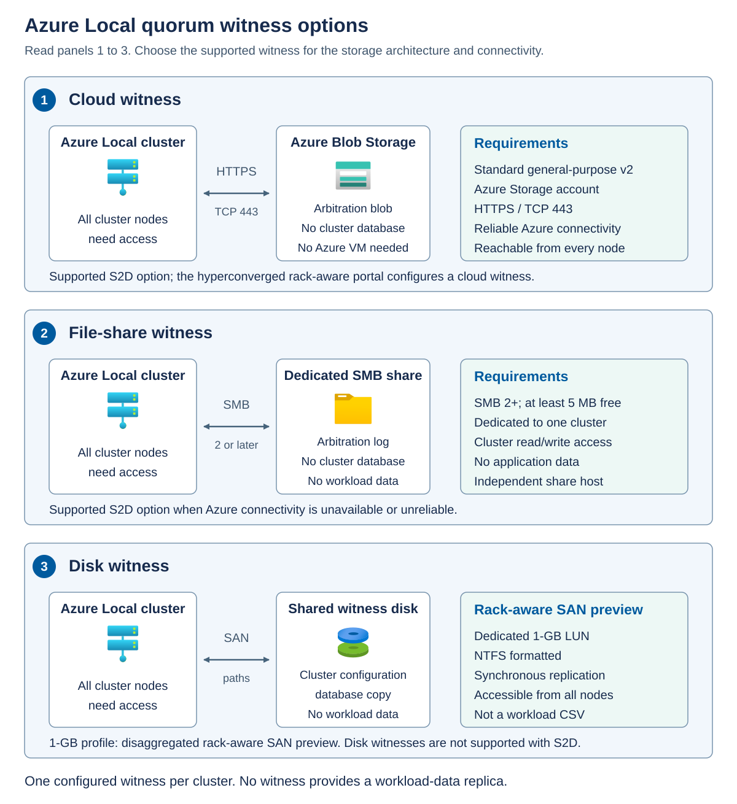
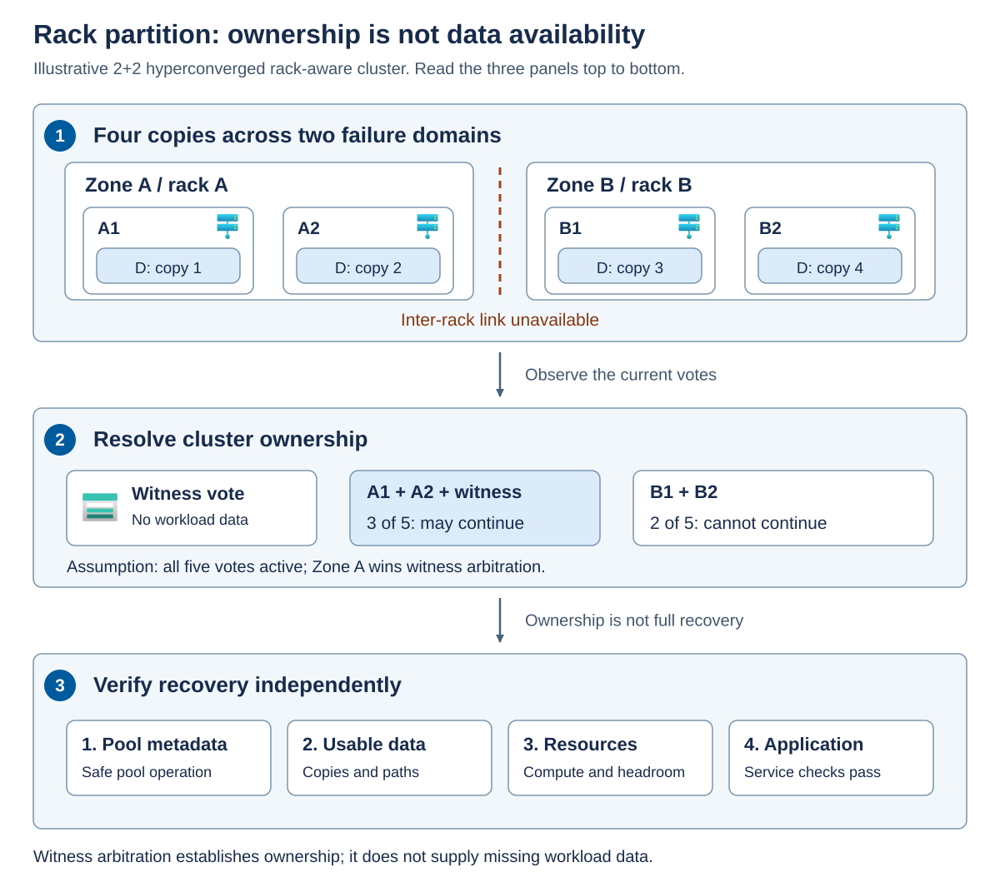

A failure-domain design maps physical dependencies to the placement and recovery behavior of the platform. Start with the failures that must be covered, then verify both data protection and the ability to keep one authoritative cluster membership operating.

## Map racks to local availability zones

Hyperconverged rack-aware clusters contain exactly two equally populated local availability zones, with at most four machines per zone. The zone mapping must correspond to the real physical layout. Labeling two groups as separate zones doesn't make their power feeds or switches independent.

Trace shared dependencies such as power distribution, top-of-rack switches, inter-rack links, and management connectivity. A failure of a shared dependency can remove both nominal zones. Review witness connectivity and application dependencies as part of the same exercise.

The hyperconverged design requires all-flash data drives, a dedicated storage network, and inter-rack round-trip time no greater than 1 millisecond. Round-trip time is the time for a request and response, not a one-way delay.

Bandwidth matters as well as latency. The published example with two 25-gigabit storage ports per machine specifies aggregate inter-rack bandwidth of 50, 100, 150, or 200 gigabits per second for one, two, three, or four machines per zone respectively. These are configuration-dependent examples, not a universal 50-gigabit requirement. Use the table for the chosen port configuration and account for degraded-state and repair traffic.

## Rack-level resiliency

For a 1+1 hyperconverged rack-aware design, the prescribed two-way mirror provides protection against one drive, node, or rack failure. For 2+2, 3+3, and 4+4, the prescribed four-way mirror places protection across both racks. After a rack failure, the documented layout supports one additional drive or node failure in the surviving rack, subject to the design's operating conditions.

These are supported storage-protection statements. They don't promise sufficient memory to restart every VM or immediate application recovery. Three-way mirror isn't an alternative in this topology, even though it's valid in eligible ordinary clusters.

Hyperconverged rack-aware expansion is supported from 2+2 to 3+3 and then 4+4 by adding a pair of machines. Expansion from 1+1 isn't supported in this release.

## Cluster quorum versus pool quorum

*Cluster quorum* determines which cluster membership is allowed to operate. Nodes can have votes, and a configured witness can contribute a vote. A membership that has the required majority can continue, but a competing membership can't independently claim the same cluster.

*Dynamic quorum* can adjust node voting as membership changes successfully. *Dynamic witness* adjusts whether the witness has a vote. Consequently, the current voting state and the timing of failures matter. A cluster surviving several sequential departures doesn't prove it can survive the same number of simultaneous failures.

For an ordinary two-node cluster with two node votes and one witness vote, an unexpected node failure leaves the surviving node and witness with two of three votes. Without a functioning witness, either-node survival isn't deterministic in the same way. A witness is required for an ordinary two-node Azure Local cluster and strongly recommended for ordinary three- or four-node configurations.

*Pool quorum* separately protects Storage Spaces Direct pool metadata from inconsistent operation. Metadata describes the storage configuration and allocation mappings. Readable data blocks alone aren't enough if the system can't safely interpret and maintain those mappings. Pool quorum uses metadata-bearing drives and the quorate cluster database as a tie-breaker. It isn't a vote weighted by free capacity, and it doesn't dynamically remove drive votes in the same way that cluster dynamic quorum adjusts node votes.

For example, a three-way mirror can preserve a data copy after two server failures, but that doesn't mean an ordinary three-node deployment can keep its pool operational after losing two nodes. The ordinary pool-quorum limits still apply. Use the specialized rack-aware requirements for rack-aware behavior rather than extending a generic quorum example.

## Quorum witness configuration

Azure Local uses a *quorum witness* as an arbitration resource that can contribute an additional vote to cluster quorum. It helps determine which cluster membership may continue operating after failures or a network partition. The supported witness depends on the storage architecture and deployment procedure. Cloud, file-share, and disk witnesses aren't interchangeable in every Azure Local configuration.

| Witness option | How it works | Azure Local applicability and requirements |
| --- | --- | --- |
| Cloud witness | Uses a small blob in Azure Storage for voting arbitration. It doesn't require an Azure VM or store the cluster database. | An option for supported Storage Spaces Direct deployments with reliable Azure connectivity. The hyperconverged rack-aware portal workflow configures a cloud witness. Use an Azure Standard general-purpose v2 storage account and allow every cluster node to reach its storage endpoint over HTTPS on TCP port 443. |
| File-share witness | Uses a dedicated Server Message Block (SMB) share to maintain arbitration information. It doesn't store the cluster database. | An option for supported Storage Spaces Direct deployments, including designs where a cloud witness is unsuitable because Azure connectivity is unavailable or unreliable. The host must support SMB 2 or later, provide at least 5 MB of free space, and grant the cluster the required read/write access. Dedicate the share to one cluster and don't store application data in it. |
| Disk witness | Uses a shared clustered disk accessible to all cluster nodes and stores a copy of the cluster configuration database. | Applicable only where the SAN-backed deployment supports it. It isn't supported with Storage Spaces Direct. The disaggregated rack-aware SAN preview specifies a dedicated 1-GB, NTFS-formatted witness LUN, synchronously replicated with the other required cluster LUNs. It remains a witness disk, not a workload CSV. |

For an on-premises cloud-witness deployment, the documented storage-account choice is locally redundant storage (LRS). The cluster creates its arbitration blob in the `msft-cloud-witness` container. Multiple clusters can use the same storage account, but each has its own cluster-specific blob. The small amount of witness data doesn't contain VM disks, application data, or backup copies. Include storage-account access, DNS resolution, firewalls, and outbound network connectivity in the availability design.

Place a file-share witness outside the failure domains that it helps protect. For example, a witness hosted by a VM on the same Azure Local cluster can disappear when that cluster needs it. Use independent hosting, power, and network paths, and ensure the surviving rack can still reach the share. Don't use Distributed File System (DFS) or independently replicated copies of a file-share witness: inconsistent witness state can undermine arbitration. This file-share restriction is separate from the qualified synchronous SAN replication required for the disk witness in the array-backed preview.

A cluster has one configured quorum witness, not simultaneous cloud, file-share, and disk witnesses that provide three additional votes. Dynamic witness determines whether that witness currently has a vote. Losing access to the witness doesn't automatically stop a cluster that still has the required majority, but it can reduce the cluster's ability to survive another failure. Don't remove a required witness simply because the cluster is currently healthy.

Select the witness specified by the deployment's support rules, then assess its reachability during the failures the design promises to withstand. A witness never supplies a missing workload-data copy: even a disk witness's cluster database is configuration information, not VM data. Witness availability therefore can't replace pool quorum, storage resiliency, or application recovery.

## Rack partition example

Assume a healthy 2+2 hyperconverged rack-aware cluster. Zone A contains A1 and A2. Zone B contains B1 and B2. The volume uses the prescribed four-copy layout. For this example, all four node votes and one witness vote are active immediately before a simultaneous inter-rack partition.

- The first panel places two illustrative copies in each rack. The partition separates the racks without implying that their drives are destroyed. 
- The second panel, the supplied arbitration evidence says that Zone A retains the witness vote. A1, A2, and the witness account for three of the five votes. Zone B has two. Only Zone A is permitted to continue in this example.
- The final panel shows what must still be established: the storage pool can operate safely, usable data remains accessible, enough resources survive, and the application recovers. Winning the witness vote answers the ownership question, not all of those questions.

The result is conditional on the supplied voting and arbitration evidence. Don't assume that Zone A is always preferred, that mere network reachability grants a witness vote to both sides, or that five votes remain active in every later state.

Never force quorum merely because a witness is healthy or one rack has intact disks. Forced recovery requires an authoritative ownership decision, protection against a second active membership, and the supported recovery procedure.

## Keep the array-backed preview separate

The disaggregated rack-aware preview uses two synchronously replicated arrays, redundant FC fabrics, and equal zones from 1+1 through 8+8 machines. Its inter-rack round-trip limit is 5 milliseconds. It requires Windows Server 2025-certified FC HBAs with supported drivers and a qualified transparent-failover or metro replication solution.

Every required cluster LUN, including infrastructure, performance history, witness, and workload LUNs, must have the prescribed replication and presentation. Replicated-LUN identity, size, sector characteristics, and access must remain consistent through failover so that hosts don't discover an unexpected replacement device.

The documented procedure uses NTFS, a dedicated 1-GB disk witness, and separate infrastructure and performance-history LUNs. General iSCSI support isn't permission to use iSCSI in this FC-based preview. PowerFlex is excluded. Its deployment workflow also differs from the hyperconverged rack-aware workflow. Follow the preview procedure rather than selecting similarly named options by analogy.

Don't import the hyperconverged four-copy capacity ratio, extra-fault guarantee, or expansion sequence into the array design. Obtain the actual protection, capacity accounting, arbitration, and recovery behavior from the qualified array solution and preview requirements.

## Recovery location

*Strict VM placement* keeps a VM within its assigned local zone and prevents cross-zone failover. *Non-strict placement* permits recovery in the other zone when an eligible destination has sufficient resources. Strict placement can be appropriate when the application already has independently placed replicas, but it isn't a way to make one VM survive loss of its only allowed zone.

As a simple compute-capacity example, four hosts with 128 GiB of memory each provide 512 GiB before platform reservations. Losing one rack in a 2+2 layout leaves 256 GiB. If the surviving hosts require 32 GiB in total for platform overhead, 224 GiB remains for workloads. A 200-GiB workload set might fit under those assumptions, but losing one more host leaves only 112 GiB after a 16-GiB reservation. Storage can retain data while not all VMs can restart.

Memory is only one dimension of VM placement. Check CPU demand, storage performance, network connectivity, VM placement, startup dependencies, and application licensing or placement restrictions. Establish workload priorities before an incident.

## Failure and recovery scenario matrix

Use the following matrix to connect a named failure to its expected behavior and recovery evidence. Each row assumes an initially healthy, supported configuration and failures within that design's protection limits. The matrix doesn't grant a generic fault-tolerance guarantee to every topology.

| Failure scenario | Expected behavior and remaining risk | Evidence required before normal operation resumes |
| --- | --- | --- |
| One local capacity drive fails | A supported resilient layout can serve data from surviving copies or fragments. Protection is reduced until the missing protection is reconstructed. | Confirm the failed drive's identity, qualified replacement or eligible repair destinations, completed repair, healthy volumes, and usable reserve. A cache-drive failure needs separate assessment because it can affect several capacity drives. |
| One node becomes unavailable | Eligible workloads can recover elsewhere only if quorum, data access, placement, and capacity permit. Local data copies on the offline node can miss writes. | Confirm the node's return, correct cluster and Azure Local placement state, completed resynchronization, storage health, and application operation before further planned maintenance. |
| One SAN fabric or access path fails | Access can continue through qualified independent paths. Remaining connectivity might now be vulnerable to a second failure even though the LUN stays online. | Confirm stable LUN identity, expected healthy paths on every required node, correct array/controller state, and workload I/O. |
| Witness access is lost | A cluster that still has the required majority can continue. Another node or connectivity failure can then remove quorum. | Inspect current votes and membership, restore supported witness access, and confirm the witness resource state. Witness recovery doesn't restore missing workload data. |
| One hyperconverged rack-aware zone fails | The prescribed rack-level layout provides its documented storage protection. Workload recovery still depends on quorum, non-strict placement where needed, and surviving resources. | Confirm authoritative ownership, pool and volume availability, application recovery, and completed storage recovery when the failed zone returns. Don't treat one rack's free capacity as a substitute for restoring the required topology. |
| One zone or array fails in the rack-aware SAN preview | Continued access depends on the qualified synchronous replication and transparent-failover design, consistent LUN presentation, paths, and quorum. | Use vendor evidence to confirm the authoritative array, replication state, LUN identities, and restored independent paths. Follow the qualified recovery procedure before changing preferred-array or failback behavior. |

*Failback* means returning workloads or storage service to a preferred location after recovery. Treat it as a planned change rather than an automatic consequence of hardware becoming reachable. Confirm current data, healthy replication or resynchronization, eligible placement, and adequate resources before moving workloads back.
