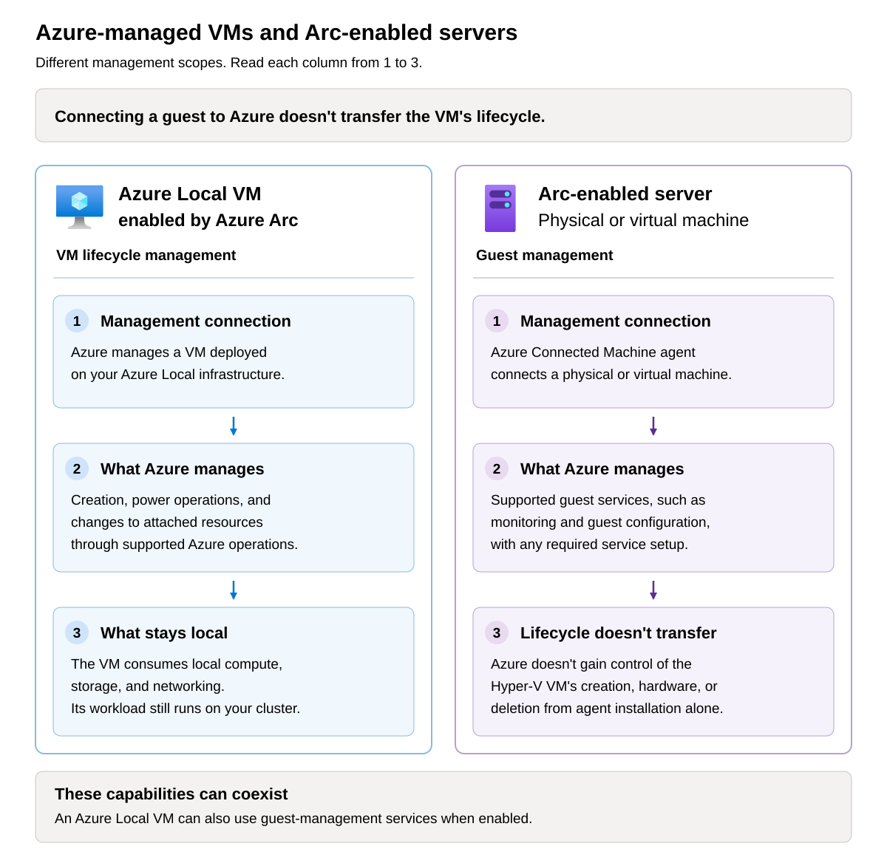
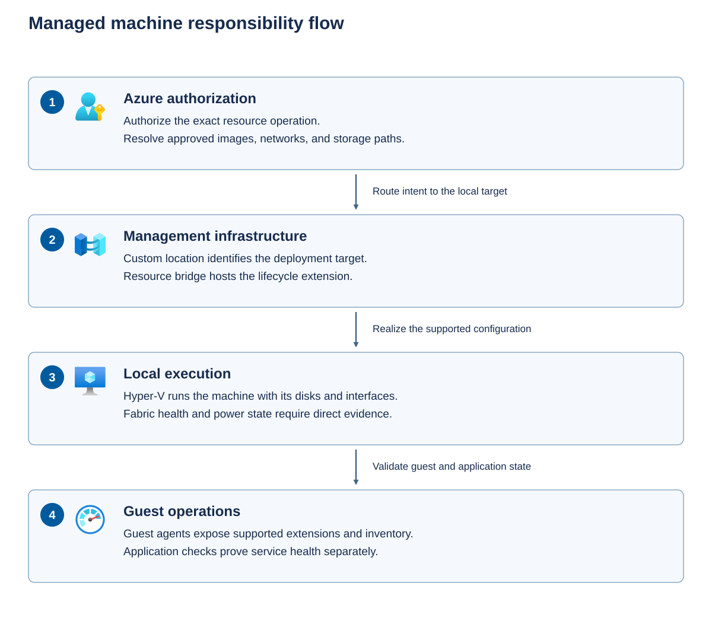

Before implementing a change to VM, establish the scope of the alteration you'll be performing. Installing an agent in a guest VM and provisioning a new VM through Azure the Azure portal are operations that have different scopes and owners.

- An *Azure Local VM enabled by Azure Arc* has an Azure-managed VM lifecycle. Azure can orchestrate supported actions such as creation, power operations, and changes to attached resources. The VM still consumes local compute, storage, and networking.
- An *Arc-enabled server* is a physical or virtual machine connected to Azure through the Azure Connected Machine agent. That connection enables supported guest services. By itself, it doesn't give Azure ownership of the underlying Hyper-V VM's creation, hardware, or deletion.

Use the following distinctions to select an operating procedure.

| Management model | What Azure manages | Operational consequence |
| --- | --- | --- |
| Azure Local VM enabled by Azure Arc | The VM lifecycle and supported associated resources, plus guest services when enabled | Use the Azure Local operation matrix to choose the interface for each change. |
| Locally managed VM with an Arc-enabled guest | Guest inventory and supported guest-management services | Arc registration alone doesn't transfer the Hyper-V lifecycle to Azure. |
| Locally managed VM without an Arc-enabled guest | No equivalent Azure guest or VM lifecycle representation | Local tools govern it within the host and workload support boundaries. |
| Existing VM onboarded through a supported workflow | The capabilities established by that workflow | Check eligibility, resulting resource identities, and post-onboarding restrictions. |

Don't treat an onboarding command as a general conversion utility. The `create-from-local` command reference identifies an invitation-only private-preview workflow. Its presence in command help isn't permission to use it. Azure Migrate is a separate migration service with its own prerequisites and cutover process, not cross-cluster live migration.

## Azure Local virtual machine control plane

The *control plane* is the management path that accepts requests and coordinates changes. The *local fabric* is the infrastructure that actually runs the workload, including Hyper-V hosts, cluster services, storage, and networks.

Azure Resource Manager receives a request against an Azure resource. Azure RBAC determines whether the caller can perform that action at the required scope. The request refers to an Azure location and a custom location, which have different purposes:

- The **Azure location** identifies the Azure region associated with the management resources.
- The **custom location** identifies the Azure Local deployment target. It isn't a second public Azure region and doesn't move execution into Azure.

The Azure Arc resource bridge is a management appliance running locally. It hosts an Arc-enabled Kubernetes management cluster. A Kubernetes cluster extension for Azure Local VMs implements the lifecycle logic and coordinates operations on the local fabric. This cluster extension isn't the same thing as an extension installed inside a guest.

The following diagram shows the responsibility flow. 

- First, Azure authorizes the operation and identifies the resources it references. 
- Second, the custom location and resource bridge direct the request to the local management extension. 
- Third, that extension coordinates the VM, disks, and interfaces on the local fabric. 
- Finally, guest-management and application checks establish whether the guest and workload are ready. 

The infrastructure logical network supports management components such as the bridge. Workload logical networks provide connectivity for your VMs.

## Choose the right VM management tool

Azure Local VM management spans Azure resources, the local virtualization fabric, and the guest operating system. Choose a tool according to the VM's management model and the operation you need to perform. A tool that can display or change a Hyper-V setting isn't automatically a supported way to change that setting on an Azure Local VM enabled by Azure Arc.

The following overview groups the principal tools by purpose. For Azure Local VMs enabled by Azure Arc, select the management path according to the operation, not simply whether a tool exposes the setting:

- **Azure management**: Use the Azure portal, Azure CLI, or another documented Azure Automation workflow described below for VM provisioning and supported lifecycle changes. Power actions, deletion, vCPU and startup-memory changes, NIC and data-disk attachment changes, extensions, and guest-management enablement belong to this path, not equivalent local Hyper-V edits.
- **Azure CLI-specific operations**: Use the documented CLI workflows to change the guest computer name, attach or detach a GPU, or expand a data disk. Changing the guest computer name automatically restarts the VM and isn't the same as changing its display name in a local tool.
- **Permitted local operations**: Local tools support selected tasks such as operating-system disk expansion, processor compatibility settings, affinity rules, automatic balancing, and eligible live or quick migration within the same cluster. Eligible VM checkpoints are supported locally from Azure Local 2504 onward, but checkpoint permissions must remain restricted to Hyper-V administrators.
- **Network ATC operations**: Use Network ATC PowerShell cmdlets for the documented SR-IOV settings, migration-concurrency settings, and host-network selection for live migration. These host settings don't authorize otherwise unsupported VM migrations.
- **Unsupported operations**: Don't clone or copy a managed VM, perform cross-cluster live migration or storage live migration, convert its disk type or format, or change its managed NIC's VLAN locally. Changing dynamic-memory minimum and maximum values after creation also isn't supported. An available command or editable field doesn't remove these restrictions.

Most permitted local configuration changes aren't reflected in the Azure portal, so don't assume that Azure discovers and synchronizes every local edit. Release, security-type, and attached-device requirements can further restrict an otherwise supported operation. For example, support for within-cluster migration doesn't mean that a VM with any GPU or security configuration can live-migrate. Apply the operation's prerequisites as well as the tool-selection boundaries.

### Azure lifecycle management and deployment automation

Use the Azure management path for Azure-managed VM provisioning and supported resource lifecycle changes. These tools require an authenticated Azure identity with appropriate RBAC access to the VM and its dependencies. Operations that change the local VM also depend on a working resource bridge and local management infrastructure.

The following tools provide interactive management or automation through Azure, rather than editing the Hyper-V VM directly.

| Tool | Purpose | Prerequisites and support boundary |
| --- | --- | --- |
| Azure portal | Interactive creation, inspection, power operations, supported configuration changes, and guest-management enablement through the Azure Local VM experience. | Select the correct Azure Local instance and VM resource. Not every CLI operation has an equivalent portal action, and a preview feature isn't an unconditional replacement for the documented procedure. |
| Azure CLI with `stack-hci-vm` | Scriptable VM and associated-resource management, including the lifecycle examples in this module. | Install approved CLI and extension versions, authenticate, and select the intended subscription. Use `az stack-hci-vm`, not the public-cloud `az vm` commands. Running Azure CLI from PowerShell doesn't make it a local Hyper-V operation. |
| Azure PowerShell with `Az.StackHCIVM` | Azure resource automation using cmdlets such as `Get-AzStackHCIVMVirtualMachine` and the module's documented creation, update, and power operations. | Use the matching module reference and supported parameters. Don't assume complete parity with Azure CLI or substitute a cmdlet for an operation documented as CLI-only without confirming support. This module is distinct from local Hyper-V cmdlets and the public-cloud VM cmdlets in `Az.Compute`. |
| Azure Resource Manager templates and Bicep | Repeatable, declarative provisioning of Azure Local VMs and their associated resources. Bicep compiles to an ARM template. | Use the documented Azure Local resource definitions, API versions, and custom location. A public-cloud VM template doesn't become an Azure Local template merely by changing its region. Provisioning support doesn't imply that every property can be changed after creation. |
| Terraform | Declarative provisioning through the documented Azure Local provider and module workflow. | Use compatible provider and module versions, review the plan before applying it, and protect state and credentials. Check whether a change updates a resource or replaces it. Terraform doesn't bypass Azure Local support restrictions. |
| Azure Resource Manager REST APIs and SDKs | Programmatic access to documented resource operations for custom automation. | Use the correct resource IDs, authentication, API versions, and operation contracts. Handle asynchronous completion and failures explicitly. An API field's existence isn't evidence that a particular configuration or lifecycle change is supported. |

These deployment methods use the Azure Local instance's custom location, an available VM image, and compatible storage and networking resources. The operator needs access to the target subscription and resource group, with permissions covering the VM and its dependencies. The deployment also defines the guest administrator identity, authentication method, processor and memory configuration, and supported security settings. When referencing an image, disk, NIC, or storage path in a different resource group, supply its full Azure resource ID rather than relying on its name.

The provisioning workflow differs by interface:

- **Azure portal**: Open the Azure Local instance's VM creation experience and select the custom location, image, security type, processor count, and memory configuration. Configure storage and networking, and enable guest management only when the image and VM type support it. Guest management requires at least one NIC with a valid IP configuration and access to the required Azure endpoints.
- **Azure CLI**: Authenticate, select the intended subscription, and use `az stack-hci-vm create` with the custom location and the required image, NIC, and storage references. The CLI workflow uses a previously created NIC. Prepare all required static-IP NICs before creating the VM rather than assuming that they can be added afterward.
- **ARM templates, Bicep, and Terraform**: Express the VM and its resource relationships in a deployment definition. The deployment can create associated resources, such as a NIC or data disk, when those resources and their dependencies are included. Use Azure Local resource definitions and supported API or provider versions. Supply environment-specific inputs, including the custom location and image or network IDs, rather than copying values from another instance.

Azure PowerShell exposes a separate command set in `Az.StackHCIVM`. For example, `New-AzStackHCIVMVirtualMachine` creates a VM, `Get-AzStackHCIVMVirtualMachine` retrieves it, and `Update-AzStackHCIVMVirtualMachine` applies supported updates. `Start-AzStackHCIVMVirtualMachine`, `Stop-AzStackHCIVMVirtualMachine`, and `Restart-AzStackHCIVMVirtualMachine` perform the corresponding power actions. The module also manages images, logical networks, NICs, storage paths, and virtual disks. Creating a disk with `New-AzStackHCIVMVirtualHardDisk` and attaching it with `Add-AzStackHCIVMVirtualMachineDataDisk` are separate operations.

Some properties can be set only during resource creation. An update cmdlet or deployment definition doesn't make every property editable or remove a required shutdown. Keep deployment definitions and operational changes coordinated so that a later template or Terraform deployment doesn't unintentionally revert a change or replace a resource. Review the intended changes before applying them, then verify resource configuration, guest-management connectivity, and application readiness separately.

### Local fabric tools

Local tools communicate with the cluster or Hyper-V hosts and require the appropriate local or domain permissions, management connectivity, and installed components. Azure RBAC doesn't automatically provide that access.

For Azure-managed VMs, use these tools only for diagnostics and operations explicitly permitted through local interfaces. Examples include eligible within-cluster migration, affinity rules, and specific host or VM settings. Don't use a local creation, deletion, resize, or attachment command as a shortcut around the Azure management path.

The following local tools expose different views of the same infrastructure, but their capabilities don't remove the managed-VM restrictions.

| Tool | Purpose | Prerequisites and support boundary |
| --- | --- | --- |
| Hyper-V Manager | Inspect a host's VMs, open supported console connections, and perform permitted local VM configuration tasks. | Requires host access and the Hyper-V management tools. Its menus also expose operations that aren't supported local edits for Azure-managed VMs. |
| Failover Cluster Manager | Inspect clustered VM roles and owner nodes, and perform supported within-cluster migration or cluster-level administration. | Requires cluster access and the Failover Clustering tools. Cluster controls don't authorize cross-cluster live migration or unrestricted changes to Azure-owned VM resources. |
| Native PowerShell modules | Use Hyper-V, FailoverClusters, and storage cmdlets for local inspection, performance history, and explicitly supported local changes. | Confirm which module owns each command and where it must run. For example, `Get-VM` and `Get-ClusterPerformanceHistory` aren't Azure resource queries. A PowerShell session can host both local cmdlets and Azure tools, so the shell alone doesn't identify the management path. |
| Windows Admin Center | Browser-based access to supported local management functions, such as the documented cluster-balancing workflow, and eligible guest-management experiences. | Verify the connection type, extension, release, and specific operation. Don't treat Windows Admin Center as a general replacement for Azure Local infrastructure management. The managed-VM operation matrix describes its Azure-enabled VM access as read-only, separately from explicitly permitted local operations. |
| System Center Virtual Machine Manager (VMM) | Centralized management of supported local virtualization environments and locally managed VM estates. | Requires a supported VMM version, fabric integration, and appropriate licensing and permissions. Its broader provisioning and lifecycle features aren't blanket authorization to manage Azure-owned VMs. Limit interactions with those VMs to documented supported operations. |
| Network ATC PowerShell cmdlets | Manage the host-network settings assigned to Network ATC, including documented migration-network and concurrency settings. | Follow the Network ATC workflow rather than making an equivalent ad hoc adapter change. Changing host settings doesn't make an unsupported VM operation supported. |

Creating a VM with a local tool doesn't by itself create an Azure Local VM enabled by Azure Arc. Installing the Azure Connected Machine agent afterward enables guest management, not Azure ownership of the underlying VM lifecycle. Don't create competing Azure and local management records as a troubleshooting workaround.

### Guest access, monitoring, and protection

Guest administration changes the operating system or application inside the VM. Monitoring collects evidence, while backup and migration tools address their own specialized workflows. None of these automatically replaces the supported VM lifecycle interface.

The following tools and services complement the Azure and local management paths.

| Tool or service | Purpose | Prerequisites and support boundary |
| --- | --- | --- |
| SSH, Remote Desktop, PowerShell remoting, and guest shells | Sign in to the guest, inspect logs, administer services, and perform approved operating-system or application changes. | Require guest authentication and an approved network path. Don't expose administrative ports directly to the internet. Guest access doesn't grant host or Azure lifecycle permissions. |
| VMConnect console access | Access an eligible VM's console through Hyper-V management tools. | Requires appropriate host permissions and support for the VM's security configuration. Protected-image workflows can restrict console access. A console session isn't a substitute for guest authentication or a supported recovery method. |
| Azure Monitor Metrics, Insights, Logs, Workbooks, and Alerts | Inspect utilization, health, trends, and operational evidence. | Collection extensions, agents, data collection rules, and permissions depend on the feature. Use the capacity-assessment section for prerequisites. A healthy monitoring view doesn't prove that every VM management action is available. |
| Azure Update Manager, Azure Policy machine configuration, Microsoft Defender for Cloud, and VM extensions | Provide supported guest patching, configuration assessment or enforcement, and security services. | Check guest OS support, agent and extension requirements, permissions, service setup, and licensing. These services don't take ownership of Hyper-V hardware changes. |
| Supported backup and recovery products | Protect and restore workload data and required VM state. | Confirm support for the Azure Local release, VM security type, protected keys, and application-consistent recovery. A local checkpoint or copied virtual disk isn't an equivalent recovery plan. |
| Azure Migrate | Migrate eligible source workloads to Azure Local through a documented migration and cutover workflow. | Verify supported sources, destination requirements, and migration prerequisites. It isn't the cluster's load balancer or cross-cluster live migration. |

Before acting, identify whether the task changes an Azure resource, the local fabric, or the guest. Then confirm the supported interface and the permissions at that layer. For example, use the documented Azure workflow to change vCPU count, an approved cluster tool for eligible within-cluster live migration, and a guest session to inspect an application service. If the Azure management path fails, investigate that failure rather than assuming a local edit is a safe fallback.

## Record identities and names

A display name is convenient for operators but doesn't always provide a sufficient correlation key to identify an actual resource. Store resource identities and investigation details in two linked operational records:

- **VM inventory or configuration management database (CMDB)**: Record the subscription ID, resource group, full Azure resource IDs, custom location, and local VM identifier in the VM's inventory entry. Include its relationships to the Azure Local cluster and resource bridge.
- **Change or incident ticket**: Record the relevant operation or correlation IDs, the timestamp and time zone of the failure or change, and supporting logs. Link the ticket to the VM's inventory entry.

These are your organization's operational records, not a dedicated Azure Local field. If you don't have a CMDB, use a maintained, access-controlled VM inventory.

Modern Azure Local VM representations include a `Microsoft.HybridCompute/machines` resource and an associated `Microsoft.AzureStackHCI/virtualMachineInstances` resource. Guest connection information and VM instance configuration therefore belong to related but distinct resource surfaces. Use the supported portal and CLI views to correlate them.

Some supported local changes don't appear in Azure. For example, a local display-name change isn't necessarily synchronized with the Azure name. *Reconciliation* means that controllers try to realize supported desired state. It doesn't mean that every local edit is discovered and safely synchronized in both directions.

> [!WARNING]
> Don't delete the resource bridge to repair an individual VM or extension. It's shared management infrastructure for VM resources and other workloads, including AKS enabled by Azure Arc. Removing it can remove the Azure control plane for those workloads. Use the documented troubleshooting or decommissioning workflow instead.

Azure Local deployment creates the resource bridge, infrastructure logical network, and custom location automatically. The bridge appears in Azure as `<instance-name>-arcbridge`, while its local VM uses the name `<GUID>-control-plane-<GUID>`. These names identify different representations of the same management appliance, not separate workload VMs. Each Azure Local instance has one custom location, which maps to a namespace in the bridge's Kubernetes management cluster. Record these relationships so that an investigation follows the correct deployment target and management components even when their display names differ.
