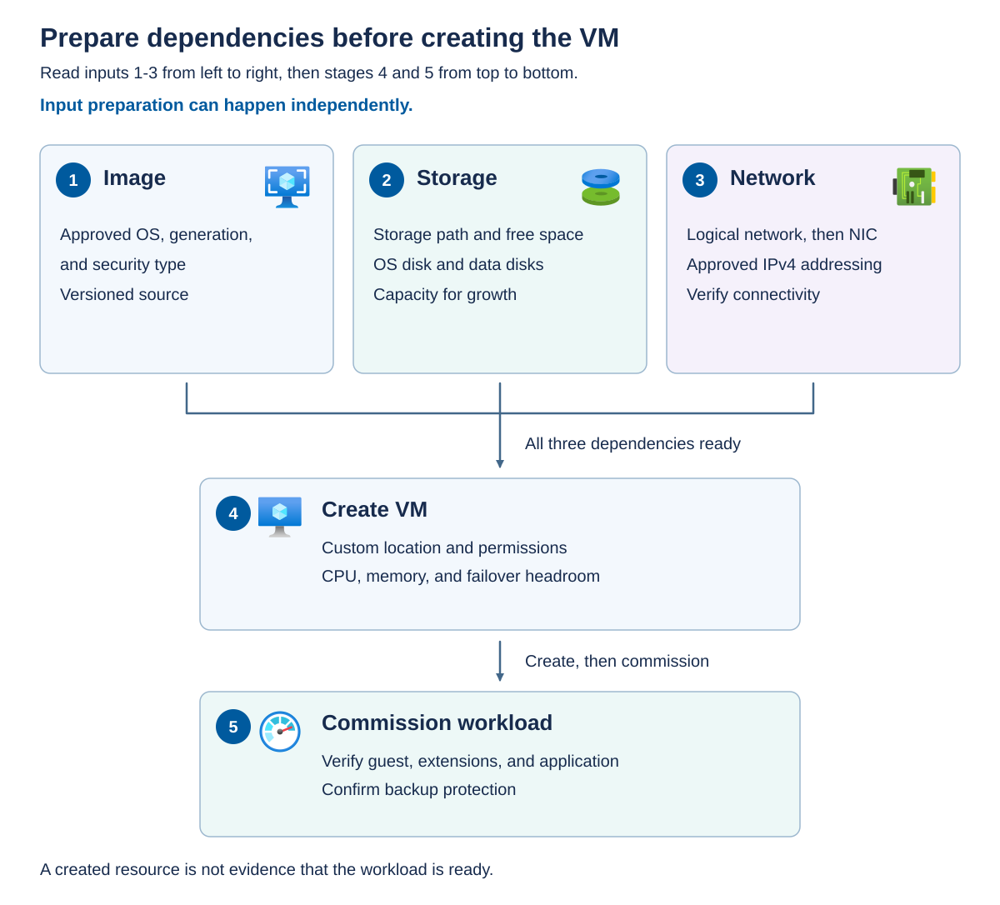

Before you create a VM, make sure its required image, storage path, and network interface are ready and suitable for the intended workload. An image, a storage path, and a network interface can each exist as Azure resources while still being unsuitable for the intended VM.

## Choose and maintain the image

A *VM image* is a prepared source used to create an operating-system disk. It isn't a running VM, a backup of an application, or a mechanism for updating already deployed guests.

Azure Local can create image resources from supported Azure Marketplace images, an Azure Storage account, or an approved local source. Marketplace images provide known publisher, offer, SKU, and version combinations. A custom image gives you more control over installed software and configuration, but also makes your team responsible for preparation and maintenance.

Image approval should answer five questions:

1. Is the operating system supported for the intended VM and guest-management model?
1. Does the disk format and Hyper-V generation match the documented import workflow?
1. Is the image eligible for the selected security type?
1. Has the guest been prepared and generalized by the operating system's supported process?
1. Can a newly created VM boot, obtain its intended configuration, and complete guest-management setup?

*Generalization* removes machine-specific identity and configuration so that new VMs can establish their own identities. For a Windows image, follow the applicable Sysprep workflow. Linux preparation differs by distribution and image source. Don't use Windows preparation commands on Linux or assume that copying a running VM's disk produces a valid image.

Hyper-V generation describes the VM's virtual hardware and boot model. Generation 2 uses UEFI firmware and can support Secure Boot. Selecting Generation 2 doesn't make an image automatically eligible for Trusted Launch or confidential computing.

Maintain an image record containing the source, publisher or build owner, exact version, preparation procedure, patch level, licensing requirements, validation results, and retirement date. Avoid relying on an unspecified "latest" version when reproducibility matters.

An image and its deployed guests have separate update cycles. Publishing a patched image improves future deployments. Existing VMs still need their own guest patching process. Conversely, patching `app01` doesn't update the source image. Keep an older image only when an approved rollback or recreation requirement justifies retaining it.

For Windows Marketplace images, register the subscription with the `Microsoft.EdgeMarketplace` resource provider and have an authorized administrator assign the **Azure Connected Machine Resource Manager** role to the `Microsoft.AzureStackHCI` resource provider app on the image's resource group. In the Azure Local resource, open **Resources > VM images > Add VM Image** and choose the Marketplace source. The image picker filters for compatible images. With Azure CLI, use `az stack-hci-vm image create` with the selected publisher, offer, SKU, explicit version, and target custom location. Linux Marketplace images require their distribution-specific preparation rather than the Windows workflow.

For a local-share import, place the prepared VHDX on a cluster shared volume accessible to every machine in the instance. For a Windows source, complete activation and run `sysprep /generalize /shutdown /oobe` before importing the image. Use the appropriate distribution preparation for Linux instead. Create the image resource with `az stack-hci-vm image create`, supplying `--image-path`, `--os-type`, the custom location, and `--storage-path-id` for deliberate placement. For either source, wait for the image deployment to complete and the portal status to become **Available** before using it to create a VM. An image resource whose download is still running isn't ready for provisioning.

## Understand storage paths and disks

A *storage path* is an Azure resource that maps provisioning to an approved local storage location. It tells the management system where to place supported VM files. It doesn't add physical capacity or guarantee that every operation will fit.

The operating-system disk contains the bootable guest installation. Data disks hold additional application or user data. Both consume backing storage. Image files, growth, backup activity, temporary files, and any supported checkpoints also affect capacity.

Check the selected path, not just the cluster-wide free-space total. A deployment can fail because its selected path is full even when another volume has free capacity. Explicit placement is useful when your operating procedure needs predictable capacity allocation.

Also distinguish logical disk size from physical consumption. A dynamically expanding disk might initially consume less physical space than its advertised capacity. That doesn't remove the need to accommodate future writes. Storage resiliency and infrastructure reservations further affect usable capacity.

## Understand logical networks and interfaces

A *logical network* describes the approved network configuration used by Azure Local VMs, including its relationship to a virtual switch and, where applicable, a VLAN and address configuration. A *network interface* (NIC) connects a particular VM to a logical network.

Creating these Azure resources doesn't automatically configure every upstream switch, route, firewall, or DNS server. The physical and virtual network must already provide the connectivity that the workload requires.

Choose the supported static or dynamic address-allocation model. Confirm address availability, subnet, gateway, DNS resolution, and any necessary outbound endpoints. An IP address alone doesn't prove connectivity.

Azure Local managed VMs support IPv4 rather than IPv6. Guest management requires an appropriate NIC configuration and access to required Azure endpoints. This doesn't mean that you should expose SSH or Remote Desktop directly to the internet.

## Size for failure, not just initial placement

*Startup memory* is the memory required when a VM starts. *Static memory* remains allocated at its configured amount. *Dynamic memory* can adjust memory within a configured range when the guest and VM configuration support it.

Virtual processors are scheduled against host CPU resources. They aren't a reservation of dedicated physical cores merely because a count appears in the VM configuration. Base sizing on workload measurements, contention, licensing, and supported host limits.

Capacity planning must include maintenance and failure. If a VM can run only while every host is available, spare capacity on the current owner isn't enough. Model the loss of an eligible host and determine whether the remaining hosts can run the displaced workloads alongside management infrastructure.

The dependency diagram separates the inputs from VM creation and workload commissioning. Cards 1 through 3 identify image, storage, and network preparation. These activities can happen independently. Card 4 combines those inputs with a custom location, permissions, CPU and memory settings, and failover headroom to create the VM. Card 5 commissions the workload by validating the guest, extensions, application, and backup arrangements. Creating the VM isn't the end of provisioning.



## Assess capacity and performance before deployment

Before adding a VM to an existing Azure Local instance, establish whether eligible nodes can start and run the new workload without compromising existing services. Assess both normal operation and the maintenance or failure conditions that the design must tolerate. A healthy cluster, a low average CPU reading, or sufficient aggregate free memory doesn't prove that the proposed VM can run with acceptable performance.

### Define the workload and measurement window

Record the proposed VM's configuration, expected peak demand, application performance requirements, and growth assumptions. Include startup and runtime memory, CPU demand, storage capacity and I/O patterns, network traffic, and any GPU or placement requirements. For a migrating workload, use measurements from its current environment as a starting point, while accounting for differences in hardware and storage. For a new workload, use representative testing in an approved environment rather than treating an untested estimate as measured demand.

Choose a historical window that includes the workload's important operating cycles, such as business peaks, backups, batch processing, and month-end activity. Compare sustained demand and peaks, not just averages or the latest sample. Include recently approved deployments that haven't yet reached their expected load.

Confirm that the data covers every eligible node and the intended storage and network resources. Record timestamps, time zones, collection gaps, and aggregation intervals. Missing or stale telemetry isn't evidence of spare capacity, and long averaging intervals can hide short periods of contention.

### Collect evidence with Azure Monitor

Azure Local provides several complementary ways to inspect utilization and performance. The following tools differ in their collection prerequisites and the evidence they provide.

| Tool | Evidence and access path | Prerequisites and boundaries |
| --- | --- | --- |
| Azure Monitor Metrics | In the Azure Local resource, open **Monitoring > Metrics** to chart node CPU and memory, storage, and network measurements. | Requires a deployed, registered, Azure-connected instance and the `AzureEdgeTelemetryAndDiagnostics` extension. Platform metrics don't require the separate Insights setup. |
| Single Cluster Performance Metrics workbook | Open **Monitoring > Workbooks > Single Cluster Performance Metrics**. Review the **Compute**, **Storage Performance**, and **Network Performance** tabs, then drill down to individual nodes, volumes, and adapters. | Uses the platform metrics collected by the telemetry extension. Select the intended instance, resources, and time range before drawing conclusions. |
| Azure Local Insights | Open **Capabilities > Insights** to configure or access combined health and utilization views for nodes, VMs, and storage. | Requires Azure Monitor Agent, an Insights-enabled data collection rule, and a Log Analytics workspace. Review permissions, collection settings, and applicable ingestion and retention costs before enabling it. |

In Metrics, split or filter measurements by the relevant dimensions, such as **Node**, instead of relying only on a cluster-wide chart. For available memory, examine the minimum over the assessment window. For CPU utilization, review sustained demand and peaks. Select a supported aggregation for each metric, and don't add percentages from different nodes as though they were a single utilization value.

Correlate storage latency with IOPS and throughput during the same periods. A low-latency result from an idle volume doesn't demonstrate performance under the proposed load. Use guest and application measurements to assess service response times, because infrastructure averages alone don't establish application performance.

Review current health faults alongside these measurements. A failed node, degraded storage pool, storage repair, or network fault can reduce usable capacity and distort the baseline. Resolve the issue or explicitly assess operation in that degraded state before approving another workload.

### Inspect local performance history

For supported Storage Spaces Direct deployments, `Get-ClusterPerformanceHistory` provides local access to collected performance history. Its alias is `Get-ClusterPerf`. You can query the whole cluster or scope the query to a node or volume. These are native PowerShell diagnostics, not Azure CLI commands, and Azure RBAC permissions alone don't grant the required local access.

The following read-only example retrieves CPU usage and available memory for one node, followed by write latency for the volume backing a proposed storage path. Run it from an approved Windows PowerShell session on a node in the target cluster, with the Failover Clustering and storage cmdlets available and sufficient permissions. Replace the placeholders and confirm that the volume label identifies the intended backing volume.

```powershell
$ErrorActionPreference = 'Stop'
$nodeName = '<node-name>'
$volumeLabel = '<volume-label>'

Get-ClusterNode -Name $nodeName |
    Get-ClusterPerformanceHistory -ClusterNodeSeriesName 'ClusterNode.Cpu.Usage' -TimeFrame LastWeek

Get-ClusterNode -Name $nodeName |
    Get-ClusterPerformanceHistory -ClusterNodeSeriesName 'ClusterNode.Memory.Available' -TimeFrame LastWeek

Get-Volume -FileSystemLabel $volumeLabel |
    Get-ClusterPerformanceHistory -VolumeSeriesName 'Volume.Latency.Write' -TimeFrame LastWeek
```

Repeat the node assessment for every eligible node and inspect each relevant backing volume. `LastWeek` is illustrative, not a sufficient window for every workload. Choose a supported timeframe that captures the required operating cycle. Historical samples become less granular over longer timeframes, so a recorded peak can still conceal a shorter spike.

Check the returned series, timestamps, and units before comparing results. These CPU values are percentages, available memory is reported in bytes, and volume latency is reported in seconds. Convert units consistently when comparing them with VM settings or application requirements. If a query returns no samples, investigate collection status, the selected object, and the available history instead of interpreting the result as zero utilization.

### Compare demand with usable capacity

Evaluate the proposed workload against the resources it can actually use. The following assessment separates resource capacity from the performance and placement conditions that can limit deployment.

| Area | Evidence to examine | Predeployment decision |
| --- | --- | --- |
| CPU | Per-node host and guest CPU usage, sustained busy periods, peaks, and the proposed application's measured CPU demand. | Determine whether eligible nodes can sustain the combined workloads. Don't equate configured vCPUs with dedicated physical cores or use an arbitrary vCPU-to-core ratio as proof of capacity. |
| Memory | Per-node available memory, host and management consumption, existing VM commitments, startup requirements, and expected runtime growth. | Ensure the VM fits on an eligible node and that restart scenarios can satisfy startup memory. For dynamic memory, include expected simultaneous growth rather than relying only on current assigned memory. |
| Storage capacity | Free space on the selected backing volume, storage-pool health, usable capacity after resiliency overhead, and existing commitments. | Allow for the new disks, data growth, image files, supported checkpoints, and operational or repair reserves. A dynamically expanding disk's current file size doesn't represent its full future demand. |
| Storage performance | Read/write IOPS, throughput, latency, workload I/O patterns, and contention during backups or repair. | Determine whether storage can meet the combined workload's response-time and throughput requirements, not merely hold its data. |
| Network | Per-adapter utilization, link capacity and health, workload traffic, storage or RDMA traffic, and migration or replication demand. | Preserve bandwidth for normal traffic and required maintenance or recovery activity. Available IP addresses alone don't establish network capacity. |
| Placement and devices | Eligible nodes, processor and security compatibility, GPU availability, and supported affinity or anti-affinity rules. | Confirm that sufficient resources exist on nodes where the VM is allowed and technically able to run. Capacity on an ineligible node doesn't help the deployment. |

For example, suppose two eligible nodes each have 40 GiB of memory available after accounting for host needs and existing commitments. A VM requiring 64 GiB of startup memory can't start on either node, even though their combined available memory is 80 GiB. VM memory isn't pooled across nodes to satisfy one VM's startup requirement.

### Test failure headroom and record the decision

Recalculate placement and resource demand for the required failure scenario. For a design that must tolerate one node becoming unavailable, model the loss of each relevant node, including the node with the largest capacity or unique devices. Determine whether the surviving eligible nodes can run the existing and proposed workloads together. Include the startup memory of VMs that must restart, management infrastructure, and additional storage or network demand from recovery.

Aggregate spare capacity is a useful first check, but it doesn't prove that individual VMs fit on the surviving nodes. Placement rules, devices, and uneven node sizes can prevent recovery even when the totals appear sufficient. If the design requires a stronger failure tolerance than a single-node outage, assess that requirement explicitly.

Use planning and approved tests to establish this evidence. Don't shut down production nodes or run stress workloads merely to obtain a capacity measurement. Where demand is uncertain, use an approved pilot or representative performance test before committing to production service levels. Automatic load balancing and its utilization thresholds aren't substitutes for this assessment.

Record the assessment in the deployment or change record, linked to the VM and cluster inventory. Include the measurement window, data sources, proposed resource demand, eligible nodes, selected storage path, growth and reserve assumptions, failure scenarios, performance acceptance criteria, identified gaps, and approval decision. If the evidence doesn't support the deployment, resolve the capacity or design gap rather than relying on a successful create operation to prove suitability.

After deployment, compare observed infrastructure and application performance with the baseline and acceptance criteria. Set appropriate monitoring alerts and review the assessment as demand grows or infrastructure changes. A deployment approval is based on stated conditions, not a permanent guarantee of spare capacity.

## Apply least-privilege permissions

Azure RBAC grants a principal a role at a scope such as a resource, resource group, or subscription. Effective access must cover the VM and the dependencies required by the operation.

The built-in role names retain the Azure Stack HCI branding. The following table summarizes their intended separation of duties.

| Role | Typical responsibility | Important boundary |
| --- | --- | --- |
| Azure Stack HCI Administrator | Manage the Azure Local instance and shared VM infrastructure | Shared images, logical networks, and storage paths require infrastructure-level responsibility. |
| Azure Stack HCI VM Contributor | Create and manage VMs and supported attached resources | Doesn't create shared logical networks, image resources, or storage paths. |
| Azure Stack HCI VM Reader | Inspect VMs and VM resources | Doesn't authorize configuration changes or power operations. |

An Azure role doesn't automatically grant guest sign-in rights, local host administrator access, or permission to retrieve application secrets. Those are separate access decisions. Similarly, permission to create a VM in one resource group doesn't imply permission to use every shared image or network.

Prefer the same subscription for infrastructure and workloads because cross-subscription CLI scenarios have documented limitations. Use full resource IDs when a dependency belongs to a different resource group. Keep the related Azure management resources in the supported region arrangement.

To delegate access, an operator with **Owner** or **User Access Administrator** permissions at the intended scope opens **Access control (IAM) > Add > Add role assignment** in the Azure portal. Select the appropriate Azure Stack HCI role, choose the user, group, service principal, or managed identity, and review the assignment before saving it. Verify the resulting access through **Access control (IAM) > Check access**. Use **View my access** when checking your own permissions. The VM Contributor role doesn't authorize system registration or role assignment, so an application operator who needs VM lifecycle access doesn't also need authority to grant access to others.

## Prepare the management workstation

The *management workstation* is the administrator's secured client computer for running management tools and scripts. In this module, it runs PowerShell, Azure CLI, and the `stack-hci-vm` extension. You use it to authenticate to Azure, inspect resources, and submit approved VM lifecycle operations to Azure Resource Manager. The resource bridge and local management components coordinate those operations on the Azure Local cluster. The workstation doesn't host the workload VMs or replace the resource bridge.

Treat the workstation as a privileged access device. A compromised workstation could expose signed-in sessions or credentials and let an attacker act with the operator's permissions. Apply your organization's privileged-access standard and consider the following controls:

- **Device protection and isolation**: Use an approved, centrally managed administration device, separate from everyday email and web browsing. Keep its operating system and security software supported and patched. Enable disk encryption, Secure Boot where supported, endpoint protection, and a host firewall.
- **Identity and permissions**: Use a separate administrative identity with only the Azure roles and resource scopes required for the task. Require multifactor authentication, preferably phishing-resistant methods, and apply your organization's Conditional Access policies for device compliance and sign-in conditions. Use time-limited privileged role activation where available.
- **Trusted tools**: Install Azure CLI and extensions from approved sources, and review scripts before running them with administrative access. Control tooling versions so that an unreviewed update doesn't change behavior during a production operation.
- **Network access**: Allow the outbound connections required for Azure authentication and management. Use approved private access paths for any direct host or guest administration. Don't expose the workstation, host management interfaces, SSH, or Remote Desktop directly to the internet.
- **Credentials and sessions**: Protect the workstation's user profile and cached Azure CLI sign-in data. Keep passwords, tokens, and private keys in approved credential stores, not in scripts, command histories, or change records. End privileged sessions when the work is complete.
- **Auditability**: Collect workstation security events and administrative sign-in logs centrally. Correlate Azure management actions with the Azure Activity Log and the change or incident record. Restrict access to these records and exclude credentials from captured output.

Before using the examples, install a supported Azure CLI and the approved `stack-hci-vm` extension version, sign in, and select the intended subscription. Record the versions in your change record. Don't update tooling in the middle of a production change without reviewing compatibility.

The following read-only commands show the tool versions, extension version, and active account context.

```powershell
$ErrorActionPreference = 'Stop'

az version
if ($LASTEXITCODE -ne 0) { throw 'Unable to read Azure CLI versions.' }

az extension show --name 'stack-hci-vm' --output table
if ($LASTEXITCODE -ne 0) { throw 'The required extension is unavailable.' }

az account show --output table
if ($LASTEXITCODE -ne 0) { throw 'Unable to read the Azure account context.' }
```

These are native CLI commands hosted by PowerShell. `$ErrorActionPreference` doesn't reliably turn every native nonzero exit code into a terminating error, so the examples inspect `$LASTEXITCODE` immediately. A script must stop when an earlier operation fails rather than continuing to a dependent change.

## Understand how Azure Local selects a node to host a VM

When you create an Azure Local VM enabled by Azure Arc through the Azure portal or Azure CLI, you select the Azure Local instance rather than an individual physical node. In the CLI, `--custom-location` identifies that deployment target. Azure Local selects an eligible node within the cluster to run the VM. The standard creation workflow doesn't include a host-node selection parameter.

The selected node must have sufficient resources and meet the VM's requirements, including processor compatibility, available memory, access to storage and networks, and any required GPU resources. Free capacity elsewhere in the cluster doesn't make an unsuitable node eligible. Selecting `--storage-path-id` determines where the VM's files are stored, not which node runs the VM.

The node currently running the VM is its *owner node*. The owner can change during supported migration, maintenance, or failover within the same cluster. Don't treat the initial placement as a permanent assignment or assume that every VM can move to every node. VM security settings and attached devices can restrict movement.

## Control VM balancing and placement

Initial VM placement and ongoing load balancing are separate operations. Creating or deleting a VM changes resource utilization, but doesn't guarantee that existing VMs immediately move to other nodes or that every node ends up with the same number of VMs.

### Understand when rebalancing occurs

Azure Local VM load balancing identifies heavily loaded nodes and uses live migration to move eligible VMs to less-loaded nodes within the same cluster. It evaluates current memory pressure and CPU utilization averaged over a five-minute window, rather than simply counting VMs.

Depending on its configuration, balancing runs when a physical node joins the cluster, or when a node joins and every 30 minutes. Deploying a new VM isn't the same event as adding a physical node. With periodic balancing enabled, changes in load can lead to later redistribution if the configured thresholds are met and suitable destinations are available.

Balancing respects placement constraints and requires the VM to support live migration. It doesn't make a VM with incompatible devices or security restrictions eligible to move. Assess workload performance in a test environment before enabling automatic balancing in production, because migration can temporarily affect performance.

### Configure automatic balancing

Administrators can configure balancing through Windows Admin Center under **Tools > Settings > Virtual machine load balancing**, or through the cluster PowerShell properties `AutoBalancerMode` and `AutoBalancerLevel`. These are cluster-level settings, not options on an individual VM creation request.

The following settings control when balancing runs and how aggressively it responds to load.

| Cluster property | Value | Behavior |
| --- | --- | --- |
| `AutoBalancerMode` | `0` | Disable automatic VM load balancing. |
| `AutoBalancerMode` | `1` | Balance when a physical node joins the cluster. |
| `AutoBalancerMode` | `2` | Balance when a physical node joins and every 30 minutes. |
| `AutoBalancerLevel` | `1` | Low aggressiveness: move VMs when a node is more than 80% loaded. |
| `AutoBalancerLevel` | `2` | Medium aggressiveness: move VMs when a node is more than 70% loaded. |
| `AutoBalancerLevel` | `3` | High aggressiveness: move VMs when a node is more than 5% above the cluster's average load. |

`AutoBalancerMode = 0` disables automatic balancing. In Windows Admin Center, **Never**, **Server joins**, and **Always** correspond to modes `0`, `1`, and `2`. **Always** evaluates load when a physical node joins and every 30 minutes. `AutoBalancerLevel = 1` selects low aggressiveness, but an aggressiveness setting doesn't enable balancing by itself.

Published guidance is inconsistent about the Azure Local default: its configuration table and Windows Admin Center procedure identify disabled/Never, while its recurring-balancing description says periodic balancing is enabled by default. Don't assume either behavior for an existing cluster. Inspect its actual mode and level, record the values before an approved change, and confirm the resulting configuration afterward.

From an approved management computer with the Failover Clustering PowerShell module installed and authorized access to the target cluster, replace `<cluster-name>` and run this read-only command:

```powershell
Get-Cluster -Name '<cluster-name>' -ErrorAction Stop |
    Select-Object AutoBalancerMode, AutoBalancerLevel
```

### Distinguish affinity, preference, and pinning

Placement controls have different meanings and availability consequences:

- **Affinity and anti-affinity rules**: Keep specified VMs together or apart. Use supported rules when workloads need to share a node or run on separate nodes. These rules don't necessarily select a particular named node and are separate from choosing the deployment target during creation.
- **Preferred owners**: Express an order of preference for ownership of a clustered role. A preferred owner isn't a hard restriction that prevents the VM from running elsewhere.
- **Possible owners**: At the Failover Clustering resource level, restrict which nodes can own a resource. Restricting the VM's eligible owners to one node effectively pins it there, but prevents it from failing over to another node if that node becomes unavailable.

In Failover Clustering, `Set-ClusterOwnerNode` changes different settings depending on its target. With `-Group`, the `-Owners` list sets the order of preferred nodes for a clustered role. With `-Resource`, the list specifies the nodes permitted to own that cluster resource. A cluster group is a local clustered role, not an Azure resource group. These settings influence how the cluster responds to resource or role failures. Naming one preferred owner doesn't restrict the VM to that node, whereas limiting its possible owners can prevent recovery elsewhere.

For Azure Local VMs enabled by Azure Arc, supported local operations include applying affinity or anti-affinity rules, changing automatic VM balancing, and performing eligible live or quick migration within the same cluster. Local configuration changes generally aren't reflected in the Azure portal. Manual preferred-owner and possible-owner changes aren't explicitly listed among the supported managed-VM operations, so the existence of `Set-ClusterOwnerNode` doesn't establish that those changes are supported for an Azure-managed VM. Obtain support confirmation for the installed release and VM type before using these ownership controls, and don't treat a generic Failover Clustering example as an approved pinning procedure.

Review placement constraints against maintenance and host-failure scenarios. Keeping VMs together, separating them, or restricting eligible nodes can reduce the capacity available for migration and recovery.

## Create a VM from existing dependencies

The following example illustrates creation of a standard Linux VM using the documented `Default` size. It doesn't assume a fixed processor count or memory allocation for that size. Inspect the resolved hardware before commissioning the workload.

This isn't a complete environment deployment. The approved image, unused NIC, and storage path must already exist, be compatible, and target the intended custom location.

Replace every angle-bracketed placeholder, including the brackets, with an approved value. The key file must contain an approved RSA SSH public key accepted by `stack-hci-vm` 1.16.0, not its private key. Keep the private key in your approved credential store.

This example runs interactively from the approved management workstation. In extension 1.16.0, supplying an administrator username without `--admin-password` prompts for an administrator password, even with `--authentication-type ssh`. Enter an approved guest administrator password at that prompt. The extension sends this value in the VM OS profile, so it isn't a local-only validation secret. A noninteractive run must use an approved credential-injection or deployment workflow instead of relying on the prompt.

The example supplies the SSH destination path required by this extension version. This is a path inside the Linux guest, not on the Windows management workstation. Don't treat the `ssh` option alone as proof that password-based sign-in is disabled inside the guest.

```powershell
$ErrorActionPreference = 'Stop'
$subscriptionId = '<subscription-id>'
$resourceGroup = '<workload-resource-group>'
$customLocationId = '<custom-location-resource-id>'
$storagePathId = '<storage-path-resource-id>'
$imageId = '<approved-linux-image-resource-id>'
$nicId = '<unused-network-interface-resource-id>'
$publicKey = (Get-Content '.\approved-admin-key.pub' -Raw).Trim()

az stack-hci-vm create --subscription $subscriptionId `
    --resource-group $resourceGroup --name 'app01' `
    --custom-location $customLocationId `
    --image $imageId --nics $nicId --storage-path-id $storagePathId `
    --size 'Default' `
    --admin-username 'workloadadmin' --authentication-type ssh `
    --ssh-dest-key-path '/home/workloadadmin/.ssh/authorized_keys' `
    --ssh-key-values $publicKey --enable-agent true
if ($LASTEXITCODE -ne 0) { throw 'VM creation did not report success.' }
```

Creation allocates local resources and can start the guest. Approval must cover capacity, network exposure, guest and application licensing, associated service charges, and backup ownership.

After the create operation completes, confirm the resolved VM configuration and dependencies. Verify guest-management connectivity, administrator access through the approved network, application readiness, and protection. If creation fails, inspect the operation error and any partially created resources before retrying. Don't delete shared dependencies as a generic cleanup step.

For custom sizing at creation, use the syntax exposed by your approved extension's `az stack-hci-vm create --help` and the matching creation guide. Creation-time hardware-profile syntax differs between current documentation surfaces. The later CPU and memory example demonstrates the separately documented update operation on an approved stopped VM.

For an eligible standard VM, the following creation options let you configure guest identity, existing attachments, and management connectivity. They supplement the image, NIC, storage path, and custom location in the example.

| Creation option | Purpose and operating boundary |
| --- | --- |
| `--computer-name` | Sets the guest computer name, which is distinct from the Azure resource name supplied through `--name`. |
| `--attach-data-disks` | Attaches existing data disk resources by name or resource ID. It doesn't create new empty disks. |
| `--authentication-type` | Accepts `password`, `ssh`, or `all`. For this module's interactive example, extension 1.16.0 still requests an administrator password when a username is supplied, and `ssh` requires an explicit SSH destination path. Confirm the effective guest sign-in configuration after provisioning. Don't hard-code passwords or assume that a noninteractive run can use the interactive prompt. |
| `--enable-agent` and `--enable-vm-config-agent` | Control Connected Machine agent onboarding and VM configuration-agent provisioning respectively. Both default to true in the current CLI. Don't rely on those defaults for an image that prohibits guest management. |
| `--gateway-id` | Selects an Azure Arc gateway for supported agent and extension traffic. It doesn't route every application connection or remove all outbound endpoint requirements. |
| `--proxy-configuration` | Supplies proxy settings for agent onboarding and guest environment variables. Applications that use other proxy settings, including Windows networking settings, need separate configuration. |

Guest management requires at least one NIC with a valid IP configuration and access to the required Azure endpoints. For Ubuntu Server images, the creation workflow supports setting the guest proxy during provisioning. Confirm image-specific support before applying the same proxy configuration to another Linux distribution.
