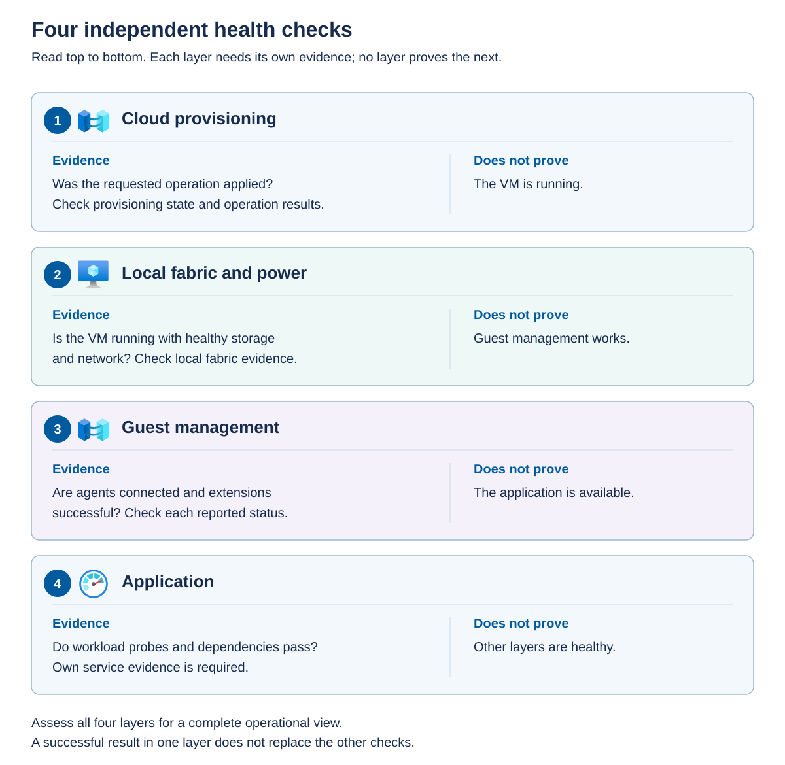

A single "healthy" indicator can't describe every part of a VM. An operator needs separate evidence for the cloud operation, local execution, guest-management connection, and application.

## Ask four different health questions

Evaluate the following indicators separately, because success at one layer doesn't prove that the others are healthy:

- *Provisioning state* describes the progress or result of realizing a management request. 
- *Power state* describes VM execution, such as running or stopped. 
- Guest connection and extension statuses describe management software inside the operating system. 
- Application probes describe the service delivered to users.

The following infographic keeps these checks separate. Read the four checks from top to bottom. Cloud provisioning answers whether the requested operation was applied. Local fabric and power checks establish whether the VM is executing with usable infrastructure. Guest checks establish whether agents and extensions work. Application checks test services and dependencies. None of the first three is a substitute for the next check.



For example, a provisioning state of `Succeeded` can coexist with a stopped VM. That might be the correct result of a successful stop request. A running VM can also have a disconnected agent or a failed database service.

## Gather evidence without altering state

The following example retrieves the management representation of an existing VM. Replace the placeholders and use a role with read access to the target.

```powershell
$ErrorActionPreference = 'Stop'
$subscriptionId = '<subscription-id>'
$resourceGroup = '<workload-resource-group>'

az stack-hci-vm show --subscription $subscriptionId `
    --resource-group $resourceGroup --name 'app01' --output json
if ($LASTEXITCODE -ne 0) { throw 'VM inspection failed.' }
```

Inspect the returned resource identities, VM instance configuration, provisioning information, runtime status, and guest-agent status. The output can contain a nested `virtualmachineinstance` object. Use the schema returned by your approved extension version rather than assuming that a public-Azure VM query has the same fields.

The current documented output places the following fields beneath `virtualmachineinstance.properties`. Confirm this shape against your installed extension before automating a query.

| Field under the VM instance properties | Meaning |
| --- | --- |
| `provisioningState` | State of the requested management operation |
| `status.powerState` | Reported VM execution state |
| `hardwareProfile.processors` and `hardwareProfile.memoryMb` | Configured processor count and startup memory |
| `instanceView.vmAgent.statuses` | VM guest-agent connection evidence and timestamps |

In the documented guest-agent view, `instanceView.vmAgent.statuses` describes the VM guest agent. A `Connected` display status there isn't automatically proof that the Azure Connected Machine agent or every guest extension is healthy. Check the timestamps as well as the status text. Treat a missing field as missing evidence, not as a successful health check.

Use Azure Activity Log and deployment-operation details to identify the failed action, caller, time, and correlation information. Compare that evidence with supported local VM and cluster views. Treat full JSON output and diagnostic logs as potentially sensitive operational data, and store them only in an approved location.

## Interpret combinations of states

Use the following examples to narrow an investigation. They suggest a starting point, not a guaranteed diagnosis.

| Observation | What it suggests | What to inspect next |
| --- | --- | --- |
| Cloud creation fails before a local VM exists | A dependency or management operation failed before execution | Image readiness, permissions, NIC, storage path, bridge, and operation error. |
| Several VMs keep running, but Azure lifecycle actions time out | A shared management-path issue is more likely than simultaneous guest failures | Resource bridge, cluster extension, required connectivity, and correlated operations. |
| VM provisioning succeeds, but guest-management onboarding fails | Fabric provisioning can work while guest integration fails | Guest OS eligibility, guest agent, managed identity, and outbound connectivity. |
| Connected Machine agent is connected, but one extension fails | The agent's basic connection works, but the extension has another dependency or error | Extension status, supported version, configuration, downloads, and logs. |
| Guest management is connected, but the application is unavailable | The problem can be inside or beyond the workload | Service state, DNS, certificates, storage, dependencies, and application logs. |

A successful local restart doesn't prove that the bridge has recovered. Conversely, a bridge outage doesn't necessarily stop VMs that are already running. Don't translate either observation into a promise that all workloads or all operations will remain available.

If cloud and local views disagree, preserve the evidence before making further changes. Repeated updates can obscure the original failure and create overlapping operations. Establish which change was supported, whether it completed, and which component owns the remaining work.

## Turn health signals into an operational response

A dashboard helps an operator investigate, but it doesn't ensure that someone responds when a workload fails. Define alerts, accountable owners, and response procedures before commissioning a production VM. Cover the local infrastructure, guest-management path, and application rather than assuming that a single CPU or VM-power alert represents service health.

Azure Local health alerts report supported Health Service faults. Metric alerts evaluate numeric measurements, and log alerts can evaluate collected events or query results. Application availability checks require suitable application monitoring. These sources have different collection prerequisites and permissions. Verify that each source is populated and current before relying on its alerts.

Use the following sequence to make an alert actionable:

1. Select the resource, signal, and dimensions. For example, scope available-memory measurements to each node instead of only a cluster-wide average. Distinguish an unexpectedly stopped production VM from an intentionally stopped test VM.
1. Set a threshold, evaluation frequency, and duration using the workload baseline and available recovery time. Brief spikes might need a different response from sustained pressure. Recommended alert thresholds are starting points, not proof that the workload's service requirements are protected.
1. Assign a severity and an owner. Configure an action group or the monitoring system's equivalent to route notifications to the responsible team, with an escalation path if nobody acknowledges the incident. Specify who can approve a disruptive recovery action.
1. Account for planned maintenance. Use narrowly scoped, time-limited notification suppression where appropriate, while retaining telemetry and incident evidence. Don't disable all monitoring or suppress unrelated critical faults.
1. Test notification delivery and the response procedure through an approved test. Confirm that the recipient receives enough resource identity and diagnostic context to act. A successfully created alert rule doesn't prove that its notifications reach the on-call team.

The following examples connect useful signals to a first response. Select supported metrics or collected logs for the particular environment rather than assuming that every signal is a built-in platform metric.

| Signal | Initial response | Important boundary |
| --- | --- | --- |
| Sustained node memory pressure or storage capacity below the planned reserve | Review per-node commitments, storage growth, current placement, and pending deployments with the infrastructure team. | Don't automatically restart VMs or delete files to clear the alert. |
| An application probe fails while the VM remains running | Check the service, dependency health, and recent application or guest changes with the workload owner. | VM power state doesn't establish application availability. |
| Agent heartbeat or required telemetry is stale | Check collection status and the affected connectivity path, then use an independent health source. | Missing data isn't a healthy result or a measurement of zero demand. |
| A backup job fails or the latest usable recovery point becomes too old | Investigate protection health and compare the recovery-point age with the agreed recovery objective. | A previously successful backup doesn't establish current protection. |

For example, an application team might define an alert when a synthetic transaction fails three consecutive one-minute checks. The action group routes it to the application on-call team, and the linked runbook checks dependencies before considering a restart. Those timings are illustrative. The application owner must approve values that reflect the service's tolerance for interruption and false alarms.

Azure Local provides recommended metric-based alert rules for CPU utilization, available memory, volume read and write latency, and inbound and outbound network traffic. These rules require a deployed and registered Azure Local instance with the `AzureEdgeTelemetryAndDiagnostics` extension installed to collect the underlying telemetry. They provide initial infrastructure monitoring, not a complete set of application or backup alerts.

To configure recommended alerts in the Azure portal:

1. Open the intended Azure Local resource and select **Monitoring > Alerts**. Where recommendations are available, select **View + set up** or **Set up recommendations**.
1. Select the required rules and expand each rule to inspect its condition and threshold. Confirm the metric's units and choose thresholds appropriate to the workload baseline and capacity reserves. The recommended rules initially use **Informational** severity, which you can change to reflect the required response.
1. Under **Notify me by**, enable **Email** and provide the approved notification address. If your team already has an appropriate action group, select **Use an existing action group** and choose it.
1. Enable the selected rules and select **Save**.
1. Return to **Monitoring > Alerts > Alert rules** and open each created rule to confirm its scope, condition, severity, enabled state, and notification configuration. To change a rule, select **Edit**, make the approved changes, and select **Review + save**.

After configuration, confirm that telemetry remains current and test notification delivery through an approved method. Review noisy alerts and missed incidents regularly, and adjust thresholds and routing as workload requirements change rather than leaving the initial configuration unchanged indefinitely.

## Troubleshoot common VM failures

Start with the exact VM identity, the last known working time, recent changes, and the scope of the impact. Determine whether one VM, one node, or several workloads are affected. Compare Azure operation evidence with supported local observations and guest or application logs before changing configuration.

The following short runbooks help select a responsible team and a safe next action.

| Symptom | Evidence and safe first actions | Escalation or recovery boundary |
| --- | --- | --- |
| The VM won't start | Check the start-operation error, reported power state, cluster role, and current owner. Inspect eligible-node startup memory, backing-storage health and access, required devices, and any protected-state or key errors. | Escalate fabric or protected-state failures with the operation ID and relevant logs. Don't repeatedly force starts, recreate the Azure resource, or disable boot protection to bypass an unexplained error. |
| The VM starts but the guest doesn't boot | Use a supported console or diagnostic path for the VM's security type. Inspect boot errors, disk availability, and the last guest update or configuration change. | Use the approved OS recovery or restore procedure. Don't change VM generation, replace its operating-system disk, or remove encryption requirements as an improvised repair. |
| The guest runs but SSH or Remote Desktop fails | Verify the intended guest IP and DNS record, approved route, service listener, guest firewall, authentication method, and account state. Distinguish a connection timeout from an authentication rejection. | Route network failures to the network team and identity failures to the authorized identity owner. Use a documented credential-recovery path, not public exposure of administrative ports or a broad firewall disablement. |
| An application loses network connectivity | Compare guest addressing and routes with the managed NIC and logical-network configuration. Check DNS, upstream routing and firewall changes, and whether peers are affected. | Preserve the supported network configuration. Don't change the managed VLAN or guest static address merely to make a test succeed. |
| An application reports a full or unavailable disk | Map the guest volume to the correct managed disk and backing storage. Distinguish guest filesystem exhaustion, backing-volume exhaustion, storage faults, and a missing mount or offline disk. | Use the applicable disk or application procedure after ownership is confirmed. Never format an existing disk or delete checkpoint files directly as a generic repair. |

If a supported first check doesn't identify a safe remedy, stop the change and escalate. Include resource IDs, affected nodes, timestamps and time zones, errors, relevant recent changes, and the checks already performed. Keep secrets and protected extension settings out of shared diagnostics. After repair, verify application acceptance checks as well as refreshed VM and agent status.

## Operate during an Azure management outage

Loss of Azure management isn't the same as loss of local VM execution. Existing workloads might continue, but that doesn't guarantee that provisioning, configuration changes, extensions, monitoring, authentication dependencies, or protected-VM startup will remain available. Treat loss of Azure connectivity, a resource-bridge failure, and a guest-only agent failure as different incidents.

Use a bounded response rather than repeatedly submitting changes:

1. Establish impact through independent evidence. Check application availability and permitted local VM or cluster views. Identify whether the workstation, Azure service access, cluster management path, or individual guest connection is failing.
1. Record in-flight operations and their correlation IDs. A client timeout doesn't prove that a request wasn't accepted. Pause nonessential changes until you can determine whether earlier operations completed or remain in progress.
1. Investigate the affected path using the approved connectivity and component-health procedures. Correlate DNS, proxy, firewall, certificate, time-synchronization, and service-health evidence without rebuilding shared management components.
1. Use only actions supported for the VM type and available management path. Existing guest access or permitted local diagnostics might remain usable. An outage doesn't authorize local resizing, disk attachment, deletion, or other edits normally owned by Azure.
1. If an urgent recovery action isn't covered by an approved runbook, escalate to the infrastructure owner and Microsoft support as appropriate. Record the decision and avoid overlapping cloud and local changes.
1. After service returns, inspect the result of each uncertain operation before retrying it. Compare Azure configuration, local execution, fresh agent status, and application health. Reconcile monitoring and protection gaps, then resume normal changes.

Don't delete the resource bridge or custom location to repair a connectivity incident. Maintain an accessible copy of approved incident procedures and required contact information so that responders aren't dependent on the same failed management service. A temporary outage in a connected deployment isn't equivalent to a deployment designed and licensed for disconnected operations.
