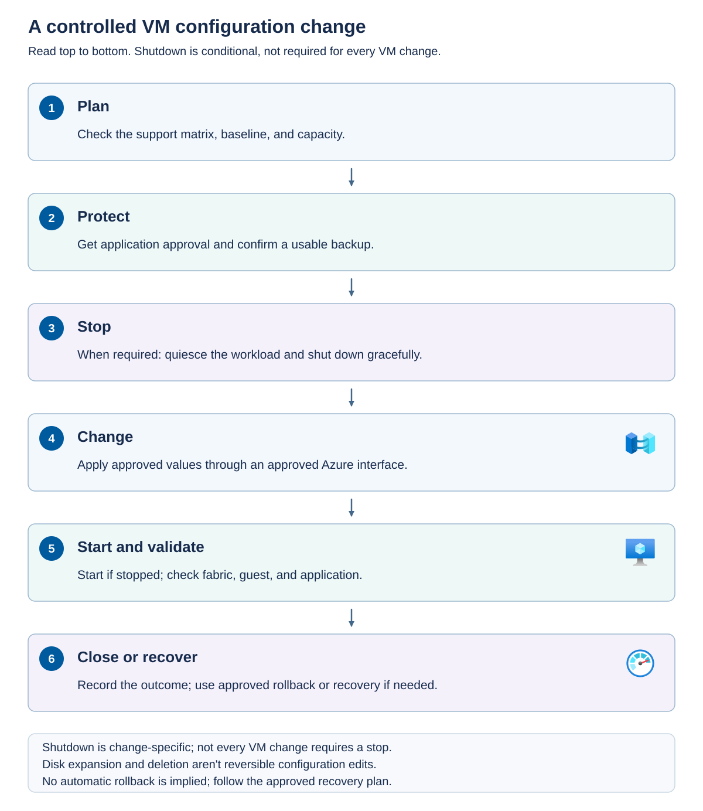

Routine changes become safer when you use a repeatable change process. The process should distinguish reversible configuration changes from operations that require restore or recreation to recover.

## Plan a controlled change

Before changing `app01`, confirm its management model, security type, installed release, current configuration, and application requirements. Check the current operation matrix and record the interface it assigns to the requested action.

Then establish the pre-change baseline: CPU and memory settings, disk and NIC associations, guest-management status, application probes, and relevant performance measurements. Identify a maintenance window, a usable recovery point, success criteria, and the person who can authorize recovery.

*Application quiescence* means preparing the application for interruption, for example by draining requests, completing transactions, or stopping a service through its supported procedure. A graceful operating-system shutdown isn't always a substitute for application-specific preparation.

The following diagram illustrates a change that requires a stopped VM.



The sequence starts with support and capacity planning, then protection and application approval. After quiescence and graceful shutdown, apply the approved change through its supported interface. Start the VM and validate fabric, guest, and application evidence. Finally, record the outcome or use the approved recovery procedure. Disk expansion and deletion aren't ordinary reversible configuration edits.

## Prepare VM workloads for host maintenance

Host maintenance can move or interrupt VMs even when their guest configuration isn't changing. Coordinate with the infrastructure team before an Azure Local solution update or other approved node-maintenance activity. The VM operator's responsibility is to identify workload impact, establish an acceptable availability plan, and verify service afterward.

Azure Local solution updates use the platform's update orchestrator, installed during deployment, to apply a validated combination of host operating-system, agent, and service updates. This includes the Azure Connected Machine agent on the hosts and the Azure Arc resource bridge and its dependencies. Where the hardware vendor integrates a Solution Builder Extension, the update workflow can also include its drivers and firmware. The orchestrator performs health checks before and during updates and coordinates required host restarts.

The infrastructure team applies these updates through the Azure Local solution-update experience in Azure Update Manager in the Azure portal, or through the Azure Local update PowerShell workflow. Both use the same orchestration backend. This is different from selecting an individual host in the generic Arc machine update experience. Some updates require node restarts, so plan for eligible VM migration or approved workload interruption rather than assuming that a platform update is transparent to every VM.

Cumulative and security updates typically arrive monthly, feature updates typically arrive twice a year, and hotfixes and hardware-vendor updates arrive as needed. Review the selected update's supported upgrade path and restart requirements. A security update applied to an older release can also bring in prerequisite Azure Local updates, so its impact might be broader than a guest-style security patch.

Keep the instance within the published support window. The current lifecycle guidance requires staying within six months of the most recent feature release. Resource-bridge solution updates must also be applied within one year to keep its certificates valid and VM management functioning. That certificate limit isn't a recommended annual servicing schedule and doesn't replace the shorter platform support requirement.

Solution updates don't patch customer guest operating systems or applications. Those workloads, including the Connected Machine agents installed inside eligible guests, need their own supported servicing process. Conversely, a guest update schedule doesn't update the Azure Local hosts, resource bridge, firmware, or other platform components.

> [!IMPORTANT]
> Don't substitute manual Cluster-Aware Updating, Windows Admin Center updates, SConfig, or the host's generic Arc machine update experience for the supported Azure Local solution-update workflow. Don't apply individual host-component updates outside that workflow unless Microsoft documents an applicable supported procedure.

Before maintenance begins, complete the following workload preparation:

1. Inventory affected VMs, their owners, application dependencies, security types, attached devices, and permitted destinations. Include VMs on nodes that might receive migrated workloads, not just those on the first maintenance node.
1. Confirm that current cluster health and destination capacity support the maintenance plan. Recheck startup memory, storage access, GPU availability, and placement rules. Resolve blocked migration or inadequate headroom before proceeding.
1. Classify each workload's availability path. An eligible VM might live-migrate. A VM that can't migrate needs an approved interruption or application-level redundancy. A single-node deployment has no alternate node for within-cluster migration.
1. Coordinate application quiescence, guest restarts, backup windows, and service dependencies. Don't schedule simultaneous host maintenance and guest patching without an explicit combined plan. Preserve enough healthy application instances and any required application-cluster quorum.
1. Agree on the maintenance window, current recovery evidence, success criteria, stop conditions, and escalation owner. Confirm that scoped alert suppression expires and doesn't hide unexpected failures.

The infrastructure team should use the supported maintenance or update orchestration to evacuate and service nodes as applicable. Don't independently move or power-cycle VMs while an orchestrated operation owns those actions. If a VM can't move or the workload loses its required redundancy, follow the documented pause, remediation, or escalation procedure rather than forcing evacuation.

After maintenance, confirm the platform operation's result, node health, current VM placement, guest-management connectivity, application probes, and backup coverage. The VM might legitimately remain on a different node, so don't automatically move it back merely to restore the previous layout. Close the change only after both infrastructure and application owners accept the outcome.

## VM stop, pause, and save aren't equivalent

A graceful stop lets the guest operating system shut down before the VM powers off. An immediate power-off doesn't. It can interrupt writes and require application recovery.

Pausing suspends VM execution but retains its allocated memory. Saving preserves execution state to storage for later resumption. Neither action makes the application available to users, creates an independent backup, or guarantees that a stopped-state configuration change is now permitted.

Use each power action only where the VM type and operation matrix support it. In particular, don't assume that saved-state or checkpoint capabilities for standard VMs apply to protected VMs or GPU-attached VMs.

For Azure Local 2604 and later, the documented `az stack-hci-vm stop` behavior is graceful shutdown by default. Earlier cluster versions can turn off the VM without a graceful guest shutdown. The `--skip-shutdown` option requests immediate power-off and isn't a safe default for routine maintenance.

The following example requests a graceful stop on the module's supported baseline. It requires the relevant VM action permission and approved downtime.

```powershell
$ErrorActionPreference = 'Stop'
$subscriptionId = '<subscription-id>'
$resourceGroup = '<workload-resource-group>'
$name = 'app01'

az stack-hci-vm stop --subscription $subscriptionId `
    --resource-group $resourceGroup --name $name
if ($LASTEXITCODE -ne 0) { throw 'Stop operation failed.' }

az stack-hci-vm show --subscription $subscriptionId `
    --resource-group $resourceGroup --name $name --output json
if ($LASTEXITCODE -ne 0) { throw 'Post-stop inspection failed.' }
```

Confirm that the reported runtime state is stopped before continuing. If shutdown fails, investigate guest integration and application activity. Don't automatically retry with immediate power-off.

## Change CPU and startup memory

Changing the vCPU count requires a stopped VM. Memory-only updates can leave the VM running, although a restart might be required if the guest operating system doesn't support live memory updates. The following example changes both settings. It assumes that you've confirmed a supported standard VM is stopped, recorded its original settings, and approved an increase to four virtual processors and 8,192 MB of startup memory.

Recheck capacity at the intended size, including a host-failure scenario. Doubling a VM's configured memory can reduce the cluster's ability to restart other workloads even when the update itself succeeds.

```powershell
$ErrorActionPreference = 'Stop'
$subscriptionId = '<subscription-id>'
$resourceGroup = '<workload-resource-group>'
$name = 'app01'

az stack-hci-vm update --subscription $subscriptionId `
    --resource-group $resourceGroup --name $name `
    --v-cpus-available 4 --memory-mb 8192
if ($LASTEXITCODE -ne 0) { throw 'VM configuration update failed.' }

az stack-hci-vm start --subscription $subscriptionId `
    --resource-group $resourceGroup --name $name
if ($LASTEXITCODE -ne 0) { throw 'Start operation failed.' }

az stack-hci-vm show --subscription $subscriptionId `
    --resource-group $resourceGroup --name $name --output json
if ($LASTEXITCODE -ne 0) { throw 'Post-change inspection failed.' }
```

Verify the resolved configuration, local power state, guest-visible CPU and memory, agent connectivity, and application probes. Compare workload performance with the pre-change baseline rather than assuming that more resources solved the original problem.

The example doesn't make the change transactional. If the update succeeds but startup fails, the new configuration might remain applied. Investigate the failure before choosing an approved rollback. Restoring the original CPU or memory settings can require another shutdown.

Dynamic-memory settings need their own support check. The managed-VM operation matrix doesn't support changing the dynamic-memory minimum and maximum after creation. The existence of a Hyper-V control or CLI parameter doesn't override that restriction.

## Treat disk operations as separate workflows

Disk attachment, expansion, and deletion are different operations with different consequences. The management path depends on the exact action.

The following table summarizes the standard managed-VM disk boundaries. Apply security-type restrictions as well.

| Operation | Supported management path | Follow-through |
| --- | --- | --- |
| Add or remove a data disk | Azure portal or Azure CLI | Confirm the correct disk, attachment state, guest visibility, application ownership, and retention. |
| Expand a data disk | Azure CLI | Check backing capacity, then extend the guest partition or filesystem as required. |
| Expand the operating-system disk | The documented local-tool workflow | Follow its power-state and disk requirements, then check bootability and guest capacity. |

When adding a disk, the guest might see a new device that isn't yet initialized, partitioned, formatted, mounted, or assigned to an application. Identify the disk reliably before performing any guest operation. Formatting the wrong device can destroy data.

When expanding a disk, increasing virtual capacity doesn't necessarily expand the guest's partition or filesystem. Check the guest layout and supported filesystem tools. A recovery partition or other layout constraint might require a different procedure.

Data-disk expansion is documented for Azure Local 2504 and later. The documented workflow supports online expansion for VHDX data disks, while VHD expansion requires the VM to be offline. Other VM and application restrictions still apply. For example, an approved expansion of an existing data disk named `app01-data` from 64 GB to 128 GB uses the following command, not the operating-system-disk workflow.

```powershell
$ErrorActionPreference = 'Stop'
$subscriptionId = '<subscription-id>'
$diskResourceGroup = '<data-disk-resource-group>'

az stack-hci-vm disk update --subscription $subscriptionId `
    --resource-group $diskResourceGroup --name 'app01-data' --size-gb 128
if ($LASTEXITCODE -ne 0) { throw 'Data-disk expansion failed.' }
```

Confirm the disk resource's new size with `az stack-hci-vm disk show`, targeting the disk's own resource group, which can differ from the VM's resource group. Map the Azure disk resource to the correct guest device before extending its partition or filesystem. For a SCSI data disk in a Windows guest, compare the disk resource's **Unique ID** with the `UniqueId` returned by `Get-Disk`. This mapping doesn't apply to an IDE-attached disk. Expansion must fit the backing storage and the format limits of 2 TB for VHD or 64 TB for VHDX.

If the workload needs a separate data disk instead of a larger existing disk, create that resource with `az stack-hci-vm disk create`, specifying its capacity, custom location, provisioning type, and storage path. Then attach it with `az stack-hci-vm disk attach` before initializing and mounting the correct device inside the guest. Creating a disk resource and attaching it are separate operations.

For `az stack-hci-vm disk attach`, set `--resource-group` to the VM's resource group, not the disk's resource group. If the disk is in a different resource group, supply its full Azure resource ID through `--disks`. Creating or inspecting the disk uses the disk's own resource group, so don't blindly reuse that group for the attach command. The disk and VM must still target compatible Azure Local infrastructure and satisfy the operation's permissions and support requirements.

When removing a data disk, stop application use and follow the operating system's safe unmount or offline procedure where required. Detaching a disk isn't the same as deleting the disk resource or erasing its backing data.

Expansion isn't generally reversible by shrinking the disk back to its old size. Capture a usable recovery point and plan recovery before expanding. Don't use local tools to attach managed data disks merely because those tools expose an attachment command.

## Retire a VM deliberately

Deletion is the end of an ownership workflow, not just a power operation. Before deleting a VM, confirm application-owner approval, retention requirements, recovery evidence, and which resources are exclusive to the VM.

Use this retirement sequence:

1. Identify the exact VM by subscription, resource group, Azure resource ID, and local identity.
1. Quiesce or retire the application and verify that required data is recoverable.
1. Inventory its disks, NICs, addresses, extensions, and application dependencies.
1. Use the supported Azure portal delete operation or `az stack-hci-vm delete`.
1. Confirm the intended Azure and local VM resources are removed, then inspect remaining associated resources.
1. Remove only approved unused resources, and update inventory, monitoring, backup, DNS, and ownership records.

The documented VM-delete workflow doesn't automatically delete associated data disks or NICs. Inspect and retire those resources separately when their data and connectivity are no longer required. Don't extend that statement to assume that every operating-system disk is retained. Review the selected workflow and verify the result.

Shared images, logical networks, and storage paths can serve other VMs and aren't generic cleanup targets. Retaining a data disk after VM deletion also doesn't turn that disk into an independent backup.

Deletion has no general undo. Recovery requires a supported restore or recreation process, not manually rebuilding Azure records around files that happen to remain on disk.

When checking deletion results in the Azure resource group, enable **Show hidden types** if associated disks or NICs aren't visible. Their absence from the default list doesn't prove that they were deleted. Inspect their identities and ownership before approving any separate cleanup.

For standard managed VMs, distinguish Azure resource management from local fabric operations and guest administration. The Azure portal, Azure CLI `stack-hci-vm` extension, and Azure PowerShell `Az.StackHCIVM` module act through Azure management and require appropriate RBAC access to the VM and its dependencies. ARM templates, Bicep, and Terraform provide repeatable Azure Local provisioning, but don't make every property editable after creation or remove an operation's shutdown requirement.

Local tools, including Hyper-V Manager, Failover Cluster Manager, Windows Admin Center, VMM, and native PowerShell modules, require separate host or cluster permissions. Use them only for the operations explicitly supported through local interfaces, not as substitutes for Azure-owned lifecycle changes. Their configuration changes generally aren't reflected in the Azure portal. SSH, Remote Desktop, and guest shells administer software inside the VM and don't grant authority to change its underlying Azure-managed hardware.

The following table summarizes the portal, CLI, and local-tool paths used in this module. Other Azure Automation must follow its operation-specific API or module requirements rather than assuming that every tool supports the same actions. Apply the installed release's restrictions for the VM security type and attached devices as well as the interface boundaries.

| Operation group | Required management interface and boundary |
| --- | --- |
| VM creation | Use a documented Azure Local provisioning workflow, such as the portal or CLI example in this module. ARM templates, Bicep, Terraform, and the Azure PowerShell module provide additional documented provisioning options. Local Hyper-V creation isn't equivalent. |
| VM deletion, power actions, vCPU or startup-memory changes, NIC and data-disk attachment changes, extensions, and guest-management enablement | Use the Azure portal or Azure CLI for the procedures in this module, not an equivalent local Hyper-V edit. Other Azure Automation must follow its operation-specific documentation and support requirements. |
| Guest computer-name changes, GPU attachment or detachment, and data-disk expansion | Use Azure CLI. Changing the guest computer name automatically restarts the VM and isn't the same as renaming its local display name. |
| OS-disk expansion, processor compatibility and NUMA configuration, boot order, and integration services | Use supported local tools. These configuration changes aren't reflected in the Azure portal. |
| Within-cluster live or quick migration and eligible VM checkpoints | Use supported local tools. Check compatibility first and restrict checkpoint operations to Hyper-V administrators. |
| Network-interface SR-IOV settings, cluster migration concurrency, and host-network selection for live migration | Use Network ATC PowerShell cmdlets. Changing a host migration setting doesn't authorize an otherwise unsupported VM migration. |
