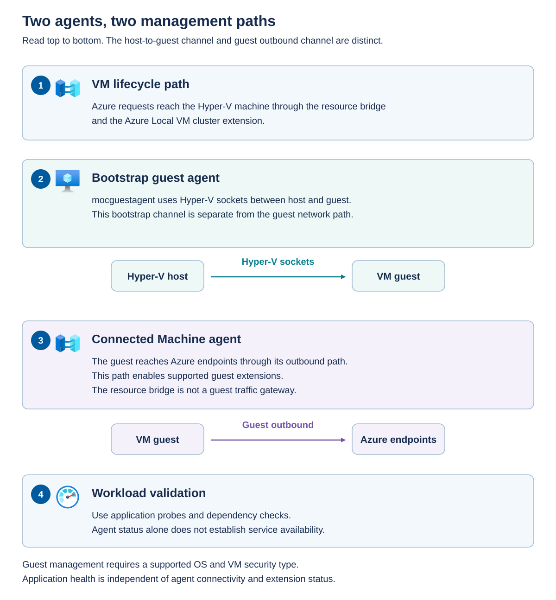

Guest management adds an operating-system management path to the VM lifecycle. That path has its own agents, identities, connectivity, and support requirements.

## Understand the two agents

The VM guest agent, also called `mocguestagent`, supports guest configuration and the bootstrap process. It communicates through Hyper-V sockets between host and guest. Hyper-V sockets provide an integration channel that's distinct from ordinary guest IP networking.

When guest management is enabled, this guest agent installs the Azure Connected Machine agent. The Connected Machine agent connects the guest to Azure and supports guest extensions. An extension is a management component installed in the guest for a particular purpose, such as monitoring or configuration.

These are different paths. The resource bridge coordinates VM lifecycle operations. The Connected Machine agent uses the guest's supported outbound connectivity to reach Azure services. A working bridge doesn't prove the guest can reach those endpoints.

The lifecycle path reaches the local VM through the bridge and cluster extension. The bootstrap agent uses host-to-guest Hyper-V sockets. The Connected Machine agent uses the guest's outbound path for Azure connectivity and supported extensions. Workload validation then checks the application independently. Guest management requires an eligible operating system and VM security type.

> [!NOTE]
> Windows Server 2012 and Windows Server 2012 R2 lack the Hyper-V sockets support needed for this guest-management workflow. A guest operating system appearing on the general Arc-enabled servers list doesn't automatically establish eligibility for Azure Local guest management. Confidential VMs have additional restrictions described in the next unit.

## Maintain guest operating systems, agents, and extensions

Guest servicing is an ongoing workload responsibility. A current source image doesn't keep existing VMs patched, and a successful Azure Local solution update doesn't update the software inside customer VMs. Assign an owner and an approved servicing method to each component rather than assuming that one update tool maintains every layer.

The following separation helps prevent updates intended for one layer from being applied to another.

| Component | Servicing responsibility and method | Boundary to preserve |
| --- | --- | --- |
| Guest operating system and applications | The workload owner uses supported OS and application servicing, including Azure Update Manager where the guest is eligible. | Check application compatibility and restart requirements. A guest update doesn't service the host, source image, or resource bridge. |
| Azure Connected Machine agent inside the guest | Maintain a supported agent version through the documented agent-upgrade method for that guest OS and environment. | Check the actual installed version and upgrade result. Guest-agent servicing instructions aren't permission to update Azure Local host agents outside solution orchestration. |
| Guest VM extensions | Follow the extension publisher's supported upgrade path and the applicable Arc extension-management workflow. | Extension updates have their own settings and rollout behavior. Updating the Connected Machine agent doesn't prove that every extension is current or healthy. |
| VM guest agent, or `mocguestagent` | Follow the Azure Local release's documented servicing or repair workflow. | Don't replace it with an arbitrary package or use Connected Machine agent commands as though the two agents were interchangeable. |
| Azure Local hosts, resource bridge, and platform components | The infrastructure team follows the supported Azure Local solution-update workflow. | These aren't members of an ordinary guest-patching deployment ring. |

### Plan and apply guest updates

For eligible Arc-connected Windows and Linux guests, Azure Update Manager can assess update compliance and deploy approved updates immediately or through a maintenance configuration. It uses the guest's configured update source, such as Windows Update, an approved WSUS service, or Linux package repositories. It doesn't supply a replacement repository, and agent connectivity alone doesn't prove that update downloads will succeed.

Use the following workflow for an approved guest-patching cycle:

1. Confirm guest OS, image, security-type, agent, and service eligibility. Check repository access, required extension health, permissions, free guest disk space, and existing pending restarts. Don't enable guest management on an image whose supported workflow prohibits it.
1. Assess missing updates and review application compatibility. Define the update classifications or packages to include, any time-limited exceptions, and the evidence required before widening the deployment.
1. Establish deployment rings, such as a representative pilot followed by production groups. Coordinate redundant application instances explicitly rather than assuming that Azure Update Manager understands the application's availability requirements or Azure Local node placement.
1. Define the maintenance configuration's guest scope, target machines, schedule and time zone, update selection, window, and restart behavior. Verify dynamic-scope membership if used. Exclude the Azure Local host machine resources from guest schedules.
1. Confirm current recovery evidence, application quiescence requirements, and approval to interrupt service. Avoid overlap with host maintenance or other changes that would remove the application's remaining redundancy.
1. Apply the pilot updates, inspect individual update results and pending restarts, and run application acceptance checks. Proceed to later rings only after the agreed criteria are met.
1. Reassess compliance after installation and any required restart. Record successful, failed, excluded, and deferred updates, together with the responsible owner and next action.

Azure Update Manager stores recurring guest-patching schedules as maintenance configurations. Use the maintenance scope **Guest (Azure VM, Azure Arc-enabled VMs/servers)** for eligible Azure Local guests connected through Arc. The **Customer Managed Schedules** patch-orchestration prerequisite for public-cloud Azure VMs doesn't apply to Arc-enabled machines.

To create and assign a guest-patching schedule in the Azure portal:

1. Open **Azure Update Manager** and select **Schedule updates** from **Overview** or **Machines**. Select the intended subscription and eligible guest machines, not the Azure Local host machine resources.
1. Create a maintenance configuration with the intended subscription, resource group, name, and guest maintenance scope.
1. Select **Add a schedule** and define the start time, time zone, maintenance-window duration, recurrence, and any end date. The portal supports daily, weekly, and monthly recurrence. The documented maximum guest-patching window is 3 hours 55 minutes, so plan separate windows when the approved work won't fit.
1. Review the target machines and choose the update classifications and any specific KB IDs or Linux packages to include or exclude. Confirm the restart behavior and ensure that the target group preserves the application's required availability.
1. Add any required tags, review the complete configuration under **Review + create**, and select **Create**.
1. Open the selected guest's **Scheduled updates** view and confirm that the maintenance configuration is attached. To reuse an existing schedule for another eligible guest, use **Attach maintenance configuration** rather than creating an overlapping schedule.

A maintenance configuration can apply to multiple machines. If you use policy-based assignment or dynamic scope, review the resulting membership so that newly matching machines don't enter a production patching group unintentionally. Don't assume that public-cloud availability-set scheduling rules coordinate Azure Local application instances or node placement.

Creating a schedule doesn't guarantee that every selected update will finish within its window. Also check guest OS restart policies: Windows Update policy and registry settings can cause a restart even when the schedule specifies **Never Reboot**. Align those settings with the approved maintenance plan rather than treating the schedule's restart selection as an absolute guarantee.

An update assessment isn't installation, and an installation result isn't proof of application health. If an update fails, preserve its error and inspect repository connectivity, disk space, package-manager or Windows Update state, and pending restarts before retrying. Don't repeatedly reboot the VM or assume that a failed deployment automatically reversed earlier successful updates. Use the approved OS, application, or restore procedure if recovery is required.

Use a separate supported workflow for driver changes, major OS upgrades, or application updates not covered by the configured repositories. For an integrity-protected confidential image, follow the approved image-rebuild and attestation workflow rather than applying a generic mutable-guest patching procedure.

### Track agent and extension servicing independently

Keep the Azure Connected Machine agent inside an eligible guest on an approved, supported version. Microsoft recommends the latest release and supports agent versions released within the preceding year. Record the installed version before an upgrade and review the target release for compatibility. Installing or upgrading this agent doesn't require a guest restart, but verify its connection and dependent services afterward.

Choose an update method that matches the guest operating system and your servicing controls:

- **Windows**: Upgrade with the official agent MSI installer, Microsoft Update, or Azure Update Manager. Running a newer MSI upgrades an existing installation. To receive the agent through Microsoft Update, enable updates for other Microsoft products. If WSUS or Configuration Manager supplies updates, synchronize and approve the **Azure Connected Machine Agent** product and its **Critical Updates** and **Updates** classifications.
- **Linux**: Use the distribution's supported package manager, such as `apt`, `yum`, or `zypper`, with Microsoft's package repository configured. Refresh the package metadata and update the `azcmagent` package using an account with the required root or `sudo` privileges. Azure Update Manager can also deploy applicable agent updates from the guest's configured repositories.
- **Automatic Agent Upgrade**: For eligible machines in Azure public cloud, Microsoft can roll out agent upgrades in batches during off-peak hours. This requires agent version 1.67 or later. Windows requires the documented `RemoteSigned` PowerShell execution policy, and Linux requires the `cron` service to be installed and running. Confirm that these requirements comply with your security policy before enabling the feature. An older agent must first be upgraded through another supported method.

For an existing eligible machine, automatic agent upgrade can be enabled from its Azure Arc resource under **Properties > Agent status > Agent auto upgrade**. Confirm that the setting is enabled and subsequently check the installed version, because enabling automatic upgrades doesn't mean that an upgrade has already completed. Automatic agent upgrades and automatic extension upgrades are separate features.

Don't disconnect and re-onboard the guest for an ordinary agent upgrade. If an approved compatibility exception requires an older supported version, the documented version-replacement process uninstalls the current agent and installs the selected version without first disconnecting the machine from Arc. Treat that as a separate planned change, not the normal upgrade procedure. Preserve installer or package-manager logs, confirm the final version, and check fresh agent connectivity and required extension functions before closing the change.

These methods apply to the agent inside the guest, not to the VM guest agent (`mocguestagent`) or agents installed on Azure Local hosts. Host agents remain part of the supported platform solution-update workflow.

For each extension, record its publisher, type, installed version, configuration owner, and automatic-upgrade setting. Newly installed Arc-enabled server extensions are opted into automatic upgrades by default, but updates occur only when the publisher supports the feature. An enabled setting on an unsupported extension has no effect until support becomes available. Supported examples include Azure Monitor Agent, Azure Update Manager, and the Azure Key Vault extension, subject to the guest and extension's own eligibility requirements.

The Azure Connected Machine agent installs the newer extension version while preserving its settings. Each extension is upgraded independently, so failure of one upgrade doesn't prevent another extension on the same machine from being upgraded. Automatic extension upgrade doesn't update the guest operating system or the Connected Machine agent itself.

To inspect or change the setting in the Azure portal, open the guest's Azure Arc machine resource and select **Settings > Extensions**. The **Automatic upgrade** column identifies extensions whose upgrades are enabled, disabled, or unsupported. Select the relevant supported extension and choose **Enable automatic upgrade** or **Disable automatic upgrade** according to the approved servicing policy. This is a per-extension decision, not a single switch for every component in the VM.

Automatic rollout is batched across regions and subscriptions and can take up to eight weeks to reach all eligible machines. Versions designated for critical security fixes use an accelerated rollout of up to three weeks. Don't assume that an enabled setting means the latest version is already installed. If the required remediation deadline is earlier, use the supported manual extension-upgrade workflow. These rollouts are separate from guest OS patch schedules, and best-effort batching doesn't guarantee the availability of your application instances or alignment with an Azure Local maintenance window.

If an automatic upgrade fails, the agent attempts to reinstall the last known good extension version. A successful recovery can report **Succeeded** even though the new version wasn't installed, and another upgrade attempt can occur as soon as the next hour. If recovery also fails, the extension reports **Failed** and requires component-specific repair, which can include approved removal and reinstallation. Coordinate any temporary suspension of automatic upgrades with the service owner while investigating persistent failures.

Use the Azure Activity Log to correlate attempts with their outcomes. Filter for **Upgrade Extensions on Azure Arc machines**. To distinguish automatic attempts from manually initiated upgrades, also filter **Event initiated by** to **Azure Regional Service Manager**.

After an extension update, check the installed version and its intended function, such as fresh monitoring data, not just a successful status label. If automatic recovery reinstates an older extension version, confirm which version is running before treating the update as complete. Coordinate approved changes to automatic-upgrade settings with the service owner, and investigate persistent failures through the component-specific procedure.

## Diagnose before repairing

When a VM runs but an extension fails, begin with a bounded investigation:

1. Confirm the VM's resource identity, management model, guest OS, and security type.
1. Verify fabric operation and establish whether the failure affects one VM or many.
1. Inspect VM guest-agent status, guest-management enablement, Connected Machine connection state, and the failing extension's status.
1. Check DNS resolution, time synchronization, proxy configuration, required outbound endpoints, and the Hyper-V sockets integration path.
1. Inspect the relevant identity and agent or extension logs, and correlate them with operation timestamps.
1. Apply the documented repair for the failing component, then verify fresh agent and extension results.
1. Have the application owner validate service health separately.

Time synchronization matters because authentication and certificate validation can fail when clocks are wrong. DNS matters because an agent usually reaches named service endpoints. Proxy settings matter because an agent and an application might use different networking libraries or proxy configurations.

An Azure Arc gateway can simplify supported agent connectivity, but it doesn't make every endpoint or application dependency disappear. Check the current endpoint requirements for the guest, its extensions, and the selected connectivity architecture.

The following evidence helps distinguish repair paths.

| Evidence | Likely investigation | What not to assume |
| --- | --- | --- |
| VM guest agent reports `Connecting` | Check the documented guest-agent installation and Hyper-V sockets path | Reinstalling the Connected Machine agent won't necessarily repair bootstrap. |
| VM guest-agent status is empty | Check the documented VM configuration-agent provisioning workflow | An empty status isn't proof that the application is stopped. |
| Guest agent is connected, but guest management is disabled | Check eligibility and the supported enablement procedure | Local VM execution doesn't require every guest-management feature. |
| Guest-management enablement reports an invalid managed identity | Inspect the parent machine resource's system-assigned identity | The identity belongs on the correct resource, not an arbitrary child resource. |
| Connected Machine agent is connected, but an extension reports failure | Check extension configuration, dependencies, connectivity, and logs | Agent connectivity isn't extension success. |

A *system-assigned managed identity* is an Azure-managed identity associated with a resource. It lets the supported management workflow authenticate without embedding a reusable user password. It doesn't replace the human operator's RBAC permissions or the guest administrator account.

When the VM guest agent is already working and the VM is eligible, the documented enablement path uses `az stack-hci-vm update --enable-agent true`. When the bootstrap agent is absent or not connected, the procedure differs. Follow the branch that matches the actual status rather than running every repair command.

Don't delete the bridge, remove the VM's Azure resource, or reinstall every extension as an initial diagnostic step. Preserve error codes and relevant logs, and redact tokens, passwords, private keys, and protected extension settings before sharing diagnostics.

For an eligible VM, select the repair branch from the guest-agent status rather than repeating the entire onboarding process:

- **Connected**: From the authenticated management workstation, run `az stack-hci-vm update --name <vm-name> --resource-group <vm-resource-group> --enable-agent true` if guest management is disabled. This enables Connected Machine agent onboarding through the working bootstrap agent.
- **Connecting**: Sign in to the guest with administrative privileges and locate the provisioning media labeled `mocguestagentprov`. In Windows, run its `install.ps1` script. In Linux, mount the labeled media and run its `install.sh` script, then unmount and eject the media after successful installation. Recheck the guest-agent connection before enabling guest management.
- **Empty status array**: From the management workstation, run `az stack-hci-vm update --name <vm-name> --resource-group <vm-resource-group> --enable-vm-config-agent true` to mount the missing provisioning ISO. Wait a few minutes, run `az stack-hci-vm show` again, and follow the branch for the resulting status.

If enablement reports **Invalid managed identity**, inspect the JSON representation of the parent `Microsoft.HybridCompute/machines` resource. When its identity type is `None`, an authorized operator can use the approved `connectedmachine` CLI extension to run `az connectedmachine update --ids <parent-machine-resource-id> --set identity.type=SystemAssigned`. Don't target the `Microsoft.AzureStackHCI/virtualMachineInstances` child resource. Confirm that the parent identity is assigned before retrying guest-management enablement.

After repair, open the VM's **Overview > Properties > Configuration** in the Azure portal and confirm that **Guest management** reads **Enabled (Connected)**. Check fresh agent timestamps and the previously failing extension separately. These repair branches don't override an operating-system or confidential-image restriction that requires guest management to remain disabled.

## Keep activation and entitlement separate

Check operating-system activation, software licensing, Azure verification, and guest-management connectivity separately. Success in one area doesn't establish the status of the others.

- Activation establishes the guest's activation state through its supported mechanism. 
- Licensing establishes whether the organization has the required rights. 
- Azure verification establishes eligibility for applicable Azure-exclusive benefits on the platform. 
- Guest-management connectivity establishes whether the agent can communicate with Azure.

A connected Arc resource doesn't prove that Windows is activated, that the application is licensed, or that Azure verification has succeeded. Check the guest edition, entitlement, supported activation route, and any benefit-specific requirements separately.
