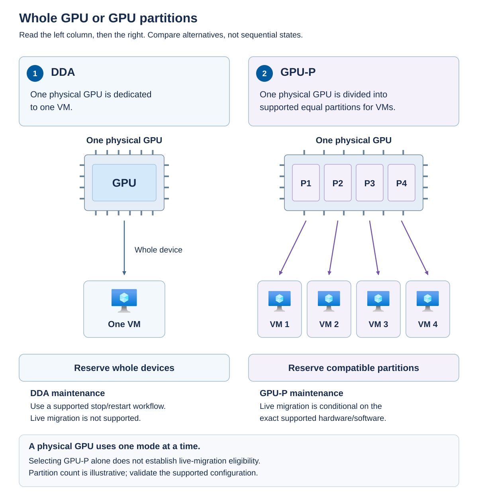
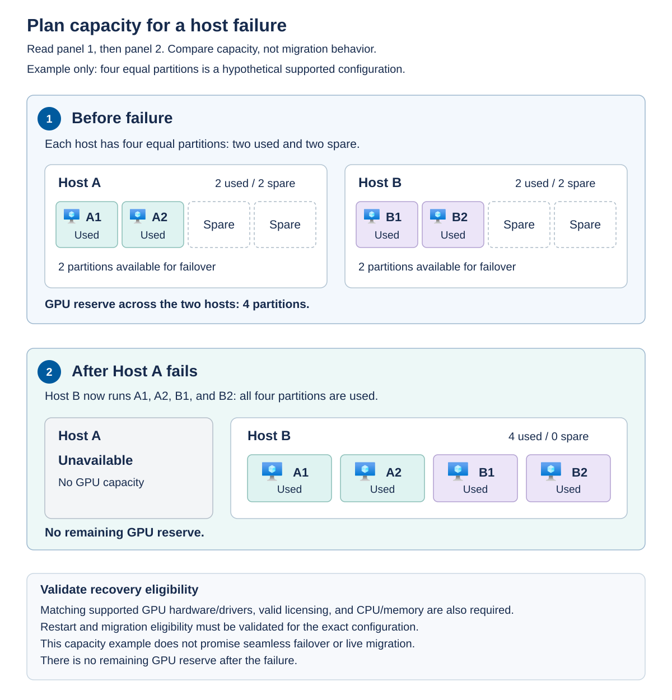

A graphics processing unit (GPU) can accelerate workloads such as visualization, video processing, and supported AI processing. The choice of allocation model affects VM density, software requirements, placement, maintenance, and recovery.

## Compare whole-device assignment and partitioning

*Discrete Device Assignment* (DDA) assigns an entire physical GPU to a VM. The assigned device isn't available for another VM to share at the same time. This model can suit workloads that need a whole supported device and its capabilities.

*GPU partitioning* (GPU-P) divides a supported physical GPU into hardware-isolated partitions that can be allocated to multiple VMs. A partition is a defined allocation of GPU resources, not simply an arbitrary percentage typed into a configuration field. Supported partition counts and vendor profiles determine the available choices.

The managed Azure Local GPU-P workflow assigns one partition per VM, with partition selection handled automatically. Don't import broader Hyper-V partition-assignment capabilities into the managed-VM procedure.

The following diagram contrasts the two allocation models.

Read the DDA panel first and the GPU-P panel second. DDA connects one complete physical device to one VM. GPU-P divides one device into supported equal partitions and allocates those partitions to multiple VMs. Recovery therefore requires either available whole devices or compatible partition capacity. A physical GPU can't simultaneously operate in both modes.

Use the following comparison to evaluate the complete operating model.

| Consideration | DDA | GPU-P |
| --- | --- | --- |
| Allocation | One entire supported physical device | Supported partitions of a physical device |
| Density | Device availability limits the number of GPU-equipped VMs | Multiple VMs can share the GPU through separate partitions |
| Software | Supported host preparation and guest vendor driver | Compatible host and guest virtual-GPU drivers and required licensing |
| Placement | An eligible host with an available whole device | An eligible host with a compatible available partition |
| Recovery reserve | Spare compatible devices | Spare compatible partition capacity |
| Maintenance | DDA live migration isn't supported | Live migration requires an explicitly supported hardware and software combination |

The GPU's presence in a server isn't sufficient. Validate the Azure Local hardware catalog, OEM support, firmware settings, platform version, driver versions, guest OS, and workload software. A GPU supported for an unmanaged Hyper-V VM might not be supported for an Azure-managed VM. For example, the Azure Local matrix lists NVIDIA A10 and A40 for GPU-P and unmanaged-VM DDA, but not managed-VM DDA.

Azure Local GPU management requires Generation 2 VMs and a supported 64-bit guest OS. DDA host preparation includes the applicable mitigation driver, which protects host interactions with the assigned device. This is distinct from the native vendor driver inside the guest.

For GPU-P, enable the required virtualization and single-root I/O virtualization (SR-IOV) capabilities. SR-IOV is a hardware mechanism used to provide isolated device functions for virtualization. Maintain the required homogeneous GPU model and supported partition configuration across eligible hosts.

Install compatible virtual-GPU drivers on every participating host and guest, and confirm the vendor licensing entitlement. A driver that allows a device to appear in the guest doesn't necessarily establish a licensed or supported configuration.

## Plan placement and spare capacity

GPU capacity is an additional placement constraint. A host can have free CPU and memory but still be unable to run a VM because no compatible GPU device or partition is available.

Consider a hypothetical two-host cluster. Each host has a compatible GPU configured with four supported equal partitions. Each normally runs two VMs that consume one partition each. The remaining two partitions on each host are reserved for the other host's workloads.

Panel 1 shows Host A running A1 and A2 and Host B running B1 and B2, with two spare partitions on each host. Panel 2 shows the capacity requirement after Host A fails: Host B needs all four partitions for A1, A2, B1, and B2. No GPU reserve remains. Four partitions is an illustrative configuration, not a recommendation for every GPU model.

This arithmetic proves only that the partition count can fit. It doesn't prove that failover, restart, or live migration is supported. The surviving host also needs compatible drivers and licenses, sufficient CPU and startup memory, accessible storage, and a supported recovery path.

If both hosts normally consumed all four partitions, neither would have spare partition capacity for the other's workloads. High utilization isn't the same as a resilient design.

## Evaluate maintenance availability explicitly

DDA live migration isn't supported. A supported clustered GPU-pool design can provide restart or failover placement when compatible whole devices are available, but this isn't uninterrupted movement of a running VM.

GPU-P live migration is conditional. The Azure Local guidance requires the applicable 26100-series or later OS build and NVIDIA vGPU software version 18 or later on hosts and guests, in addition to supported GPUs and destination capacity. Check the complete current matrix rather than treating a minimum driver version as sufficient by itself.

Processor support for IOMMU DMA bit tracking is one relevant requirement. An *input-output memory management unit* (IOMMU) controls device access to memory. DMA bit tracking helps identify memory changed through direct memory access so that the migration process can handle device-related state correctly.

GPU-P live migration uses TCP/IP with compression rather than assuming the same transfer behavior as a non-GPU migration. This can increase processor utilization and migration time. Plan CPU and network capacity and test representative workloads instead of assuming that an existing migration-time estimate still applies.

Where live migration isn't supported, use a planned interruption or application-level redundancy. A service with redundant application instances can have a different availability strategy from a single stateful VM with an attached GPU.

## Operate GPU attachments through the supported interface

Separate host preparation from VM assignment. Preparing the fabric establishes supported devices, drivers, partition configuration, and capacity. Assigning a GPU makes a specific device or partition available to a VM.

For managed VMs, use the documented Azure CLI attachment and detachment workflow. Plan an outage for the documented shutdown, assignment change, and restart sequence. GPU attachment isn't a promise of hot-add or hot-remove. Don't attach devices with an unrelated local Hyper-V procedure and assume the Azure resource will be reconciled.

After assignment, verify the resource configuration, guest driver, visible GPU resources, and a representative application workload. Record the device model, allocation mode, driver versions, and placement constraints in the VM inventory.

The cloud GPU fabric-management and portal assignment experience is documented separately as preview. The standard operation matrix still identifies CLI attachment and detachment, so don't describe the preview portal workflow as an unconditional replacement. Partition-count changes can interrupt workloads and aren't a harmless way to create spare capacity. AKS GPU support also has its own matrix and isn't implied by VM GPU-P support.

Before assignment, inspect GPU recognition on each eligible host with `Get-PnpDevice -Class Display`. For GPU-P, inspect `Get-VMHostPartitionableGpu` and record each device's `Name`, `ValidPartitionCounts`, and `PartitionCount`. Select only a supported partition count and maintain compatible settings across the participating hosts. These commands show installed devices and partition configuration, not how many unallocated managed-VM assignments remain. Compare the inventory with existing VM allocations before promising capacity.

Confirm that the target VM is stopped and has no existing GPU assignment before using this one-GPU attachment example. Attachment adds to existing assignments rather than replacing them, and a VM can have only one GPU partition in the managed GPU-P workflow. If an assignment already exists, stop and review the current configuration instead of repeating the attach command. Use `az stack-hci-vm gpu attach` with the VM's `--resource-group` and `--vm-name`, plus `--subscription` when selecting an explicit subscription. In extension 1.16.0, use `--gpu-p-count 1` for one GPU-P assignment or `--gpu-dda-count 1` for one DDA assignment. Use only one GPU-selection form, and don't add `--custom-location` to either GPU subcommand.

To remove the GPU-P assignment, use `az stack-hci-vm gpu detach` with the same VM identifiers and singular `--gpu GpuP`. For a matching DDA assignment, use `--gpu GpuDDA,0`. These selectors identify an assignment type and, where supplied, its partition-size specification, not a physical GPU identifier. Follow the approved extension's help and command reference if its syntax differs. A detach operation removes only the first matching assignment. If the VM has more than one assignment, the others remain.

Inspect `hardwareProfile.virtualMachineGPUs` for the expected assignment type and count. After detaching the sole assignment in this example, the array should be empty. If multiple assignments are present, verify that only the approved matching assignment was removed. Don't assume that a CLI attachment change has restarted the guest. Use `az stack-hci-vm start` after a successful change, then check the guest driver and application. If a hardware operation fails, inspect the current assignment and power state before retrying instead of combining repeated attachment commands with automatic restarts.
