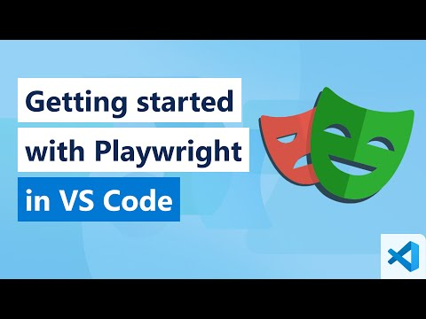
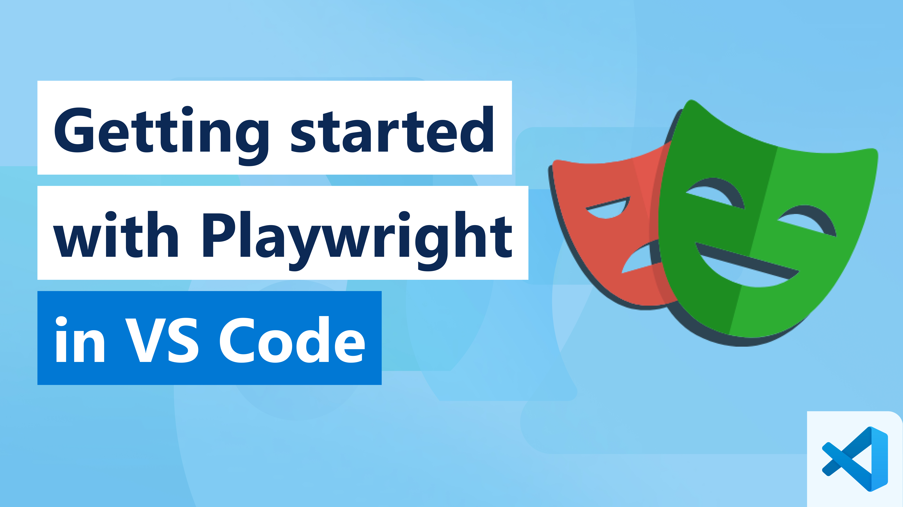
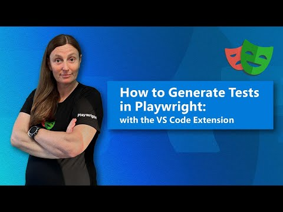

In the previous section, we walked through core concepts related to the Playwright Test Configuration and Playwright Test Specification, but we used the Playwright Commandline (CLI) for executing our tests and viewing reports.

What if we could do it *within our Visual Studio Code environment* and have a more **visual** interaction process for authoring, running, and debugging, our tests?

With the [Playwright Test for Visual Studio Code Extension](https://marketplace.visualstudio.com/items?itemName=ms-playwright.playwright), you get a superior developer experience *and some unique tooling features* that could make it your preferred way to interact with the Playwright Test runner. Let's jump in and take a tour.

## Getting started

The [Playwright documentation](https://playwright.dev/docs/getting-started-vscode) has a comprehensive tutorial with the video walkthrough that we recommend you watch in your own time. In this lesson, we try to walk through a subset of these exercises to get you familiar with usage.

## Install Playwright extension

[Install the extension](https://marketplace.visualstudio.com/items?itemName=ms-playwright.playwright) from the Visual Studio Code Marketplace. Once installed, you should spot a beaker icon in the left-hand side of your Visual Studio Code window as shown in the screenshot. Note how the extension *automatically* detects and gathers the test specifications in your project.

:::image type="content" source="../media/vs-code-find-specs.png" alt-text="Screenshot of the Visual Studio Code Test Explorer listing Playwright test files and test cases.":::

In the Playwright sidebar, review the projects selected for execution. Select only `chromium` for this walkthrough. To repeat a test across the other configured browsers, select those projects as well and run the test again.

> [!NOTE]
> A fresh extension selection enables the first configured project, while later sessions can retain your choices. VS Code runs the enabled projects. This can differ from `npx playwright test`, which runs all configured projects unless you filter the run.

## Run test (headless)

Leave **Show browser** unchecked to run with the example configuration's headless default. Leave **Show trace viewer** unchecked for this first run so you can focus on the test results. Traces can also be collected while the test browser runs headlessly.

Select the green **play** button next to the `has title` test in the *example.spec.ts* file to run the first test. You can also select the gray **play** buttons in the Test Explorer sidebar to run all tests in the file or to run a specific test.

:::image type="content" source="../media/vs-code-run-headless.png" alt-text="Screenshot of a headless Playwright test run in Visual Studio Code.":::

Once you run your tests, the **Test Results** tab opens a window where you can see the entire history of test executions. You can also drill down into a test and select **Run test** to rerun that specific test.

:::image type="content" source="../media/vs-code-re-run-test-run.png" alt-text="Screenshot of Playwright test execution history in Visual Studio Code.":::

## Show browser (headed)

If you want to run in *headed* mode, which means running your tests with a browser window open, you can check the **Show browser** box before running the tests.

:::image type="content" source="../media/vs-code-see-browser.png" alt-text="Screenshot of a visible browser running a Playwright test from Visual Studio Code.":::

Playwright is a very fast user, which can make it difficult to keep track of what's happening in the test when using **Show browser**. For debugging, we recommend using the **Show trace viewer** option.

## Inspect a run in Trace Viewer

Select **Show trace viewer**, then run the `get started link` test. The extension opens Trace Viewer to inspect recorded actions and page snapshots. This isn't the live test browser. In the current extension, enabling **Show trace viewer** turns off **Show browser**, and enabling **Show browser** turns off **Show trace viewer**.

At the top, you'll see a timeline of the test that you can hover over to see the state of the browser. To select a specific time range to focus on, select and drag the timeline.

:::image type="content" source="../media/vs-code-trace-viewer-timeline.png" alt-text="Screenshot of the Playwright Trace Viewer timeline with browser-state snapshots.":::

In the left sidebar, you can see the actions that were performed during the test execution. If you select the **locator.click** action, you'll see a red dot on the **Get Started** button in the DOM snapshot.

:::image type="content" source="../media/vs-code-trace-viewer-select-action.png" alt-text="Screenshot of a selected click action and its target in a Playwright trace DOM snapshot.":::

Next, select the **expect.toBeVisible** assertion, and you'll see our DOM snapshot changed to show the Installation page with a highlight on the heading we're asserting. Above the DOM snapshot, you can select the **Before** and **After** buttons to see the state of the DOM before and after the action was performed.

:::image type="content" source="../media/vs-code-trace-viewer-select-assertion.png" alt-text="Screenshot of a visibility assertion highlighting the Installation heading in Playwright Trace Viewer.":::

You can pop out the DOM snapshot to a separate window by selecting the **pop out** icon in the top right corner. It can be useful if you want to inspect the DOM while debugging your test.

:::image type="content" source="../media/vs-code-trace-viewer-dom-snapshot.png" alt-text="Screenshot of a Playwright trace DOM snapshot opened in a separate window for inspection.":::

Speaking of debugging, you can also pick a locator from the DOM snapshot by selecting the **Pick Locator** button in the bottom panel. Then, hover over elements on the DOM snapshot to see the locator for that element. Selecting an element it adds it to the *Locator* box at the bottom of the trace viewer, where you can edit it before copying it to your clipboard.

:::image type="content" source="../media/vs-code-trace-viewer-pick-locator.png" alt-text="Screenshot of the Pick Locator tool selecting an element in a Playwright trace DOM snapshot.":::

Feel free to explore on your own the rest of the features of the trace viewer such as the **Call**, **Console**, **Network**, and **Source** tabs.

## Debug tests

For debugging, we recommend running your tests with the *Show trace viewer* option and using your test's trace to better understand what's happening.

However, with the Visual Studio Code extension, you can also debug your tests right in Visual Studio Code, see error messages, create breakpoints, and live debug your tests. [Learn more from the documentation](https://playwright.dev/docs/getting-started-vscode) or watch the following video to get a sense of the debugging support.

## Generate tests

[CodeGen](https://playwright.dev/docs/codegen-intro) generates your tests for you as you perform actions in the browser,  making it the simplest way to get started for authoring tests for complex workflows.

To generate a test, select the **Record new** button in the testing sidebar in Visual Studio Code. This opens up a browser window where you can perform actions that'll be recorded and turned into a test. You'll also notice that a new file in the `tests` folder is created with the generated test.

:::image type="content" source="../media/vs-code-record-test.png" alt-text="Screenshot of Record new creating a Playwright test file in Visual Studio Code.":::

Type in a URL in the browser window and start performing actions like a user would. You'll see the actions being recorded in the test file in VS Code.

Let's recreate the simple test we ran earlier by going to the Playwright website and selecting the **Get Started** button. We can then select the **Assert Visibility** icon from the Codegen toolbar and select the **Installation** heading to assert that it's visible.

:::image type="content" source="../media/vs-code-record-test-assertion.png" alt-text="Screenshot of Playwright Codegen recording a visibility assertion for the Installation heading.":::

Finish the recording and run your new test:

1. Close the recording browser window to finish the recording session. Return to the generated test file in Visual Studio Code.
1. Give the generated test a descriptive title, such as `recorded get started link`. Confirm that it navigates to `https://playwright.dev/`, selects **Get started**, and includes an awaited visibility assertion for the **Installation** heading. Save the file.
1. Keep only the `chromium` project selected in the Playwright sidebar. Run the new test by selecting its play button, rather than running the entire file collection.
1. Confirm that the new test has one passing execution. If it fails, inspect the failure message or trace and refine the generated locator or assertion before continuing.

> [!NOTE]
> Keep `example.spec.ts` unchanged when recording a new test. If you add exactly one recorded test, your project now has three test cases. Running all tests with only Chromium selected gives three executions. An unfiltered CLI run with all four configured projects gives twelve executions. Running just the new test in Chromium still gives one execution.

Learn more on generating tests in the following video.

## Next steps

You learned how to find and run tests in Visual Studio Code, inspect recorded actions in Trace Viewer, and generate a test with **Record new**. Next, complete the module assessment and review the summary.
