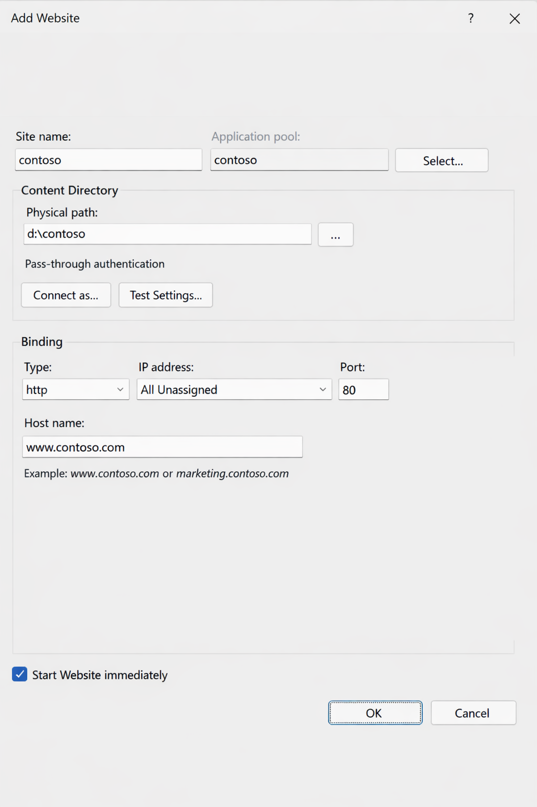
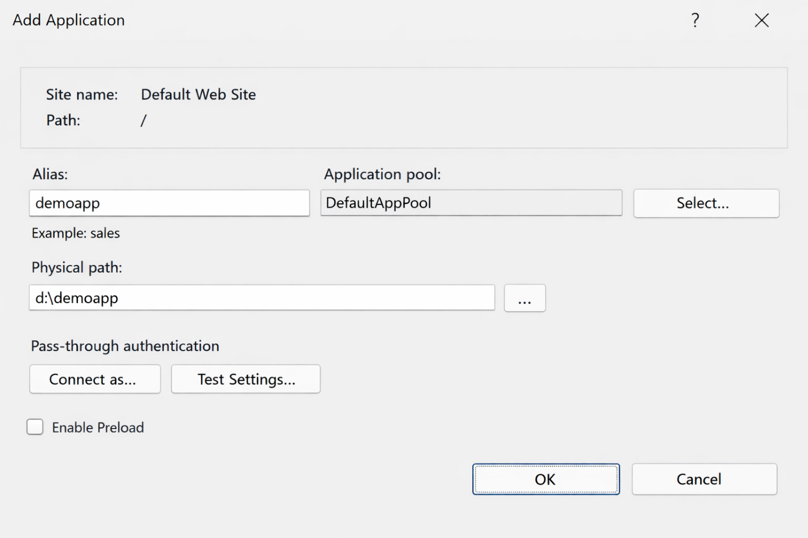

IIS organizes web content through a hierarchy of sites, applications, and virtual directories. In this unit, you learn to understand and create new websites, configure web applications within those sites, and set up virtual directories using both the IIS Manager graphical interface and PowerShell.

## The IIS content hierarchy

IIS structures web content in a three-tier hierarchy:

- **Website (Site):** The top-level container. Each site has at least one binding (IP address, port, and optional host name) that identifies incoming requests. A site maps to a physical root directory on disk.
- **Web Application:** A child container within a site. Applications have their own application pool assignment and can have separate configuration settings from the parent site. Use applications when you need isolated configuration, a different .NET runtime, or a dedicated worker process identity for a portion of a site.
- **Virtual Directory:** A pointer from a URL path to a physical directory on disk (which may be on a different volume or UNC path). Virtual directories don't have their own application pool and inherit the parent application's settings.

> [!NOTE]
> This hierarchy is stored in the central IIS configuration file, ApplicationHost.config, located at %windir%\system32\inetsrv\config\.

The following table lists the differences between IIS Web Applications and IIS Virtual Directories.

| **Feature** | **Web application** | **Virtual directory** |
|---|---|---|
| **Has own application pool** | Yes | No (inherits parent app's pool) |
| **Isolated configuration** | Yes | No |
| **Separate .NET runtime** | Yes | No |
| **Physical path** | Local or UNC | Local or UNC |
| **Typical use** | Separate component with own identity/runtime | Alias for supplementary content directory |

## Creating a new website

Use either IIS Manager or PowerShell for each creation task in this unit, not both for the same resource. The examples create new lab resources. If you're using an existing application pool, check its runtime and identity before selecting it. Skip the corresponding `New-WebAppPool` command rather than recreating or deleting that pool.

For the IIS Manager procedure, first create `C:\inetpub\contoso`. The PowerShell alternative creates this directory for you. You can substitute another existing, appropriately secured volume. Deploy suitable test content; an empty directory doesn't demonstrate a working website.

To add a new site in IIS Manager:

1. Open IIS Manager.
1. In the Connections pane on the left, expand the server node, then right-click Sites.
1. Select Add Website.
1. In the Add Website dialog, fill in the following fields:
   - Site name: Enter a descriptive name, for example Contoso.
   - Application pool: IIS creates a new pool with the same name as the site by default. Accept this or select Select to assign an existing pool.
   - Physical path: Enter `C:\inetpub\contoso` or browse to the directory.
   - Binding type: Select http.
   - IP address: Select All Unassigned unless restricting the site to a specific IP address.
   - Port: Enter 80 (or another port if 80 is already in use and you're hosting multiple sites on the same IP address but differentiating based on port).
   - Host name: Enter the FQDN for this site, for example www.contoso.com. Use distinct host-name bindings to distinguish HTTP sites that share the same IP address and port. IIS uses the HTTP Host header to select the site. Sites using different IP addresses can use the same port without relying on host names for that distinction.

   For HTTPS, certificate selection happens during TLS negotiation, before the HTTP Host header arrives. Server Name Indication (SNI) lets a supporting client send the requested server name during TLS negotiation so the server can select a certificate by host name. Traditional non-SNI bindings use the certificate associated with the IP address and port, and can coexist with SNI bindings. Use SNI when you need hostname-based certificate selection on a shared IP address and port. SNI isn't mandatory for every shared-certificate configuration, but the certificate presented must be valid for the requested host name.

   

1. Leave Start Website immediately checked unless you want to configure the site before it begins serving requests.
1. Select OK.

Alternatively, use `New-Website` to create the site. Unlike the Add Website dialog, this cmdlet assigns an existing pool; it doesn't create one. The following example prepares `C:\inetpub\contoso`, creates the `Contoso` pool, and creates the `Contoso` website on port 80 with the host name www.contoso.com:

```powershell
Import-Module WebAdministration -ErrorAction Stop
$sitePath = 'C:\inetpub\contoso'
New-Item -ItemType Directory -Path $sitePath -Force -ErrorAction Stop | Out-Null
New-WebAppPool -Name 'Contoso' -ErrorAction Stop

New-Website -Name "Contoso" `
            -PhysicalPath $sitePath `
            -Port 80 `
            -HostHeader "www.contoso.com" `
            -ApplicationPool "Contoso" `
            -ErrorAction Stop
```

After creating the site through either interface, verify its configuration with `Get-Website`:

```powershell
Import-Module WebAdministration -ErrorAction Stop
Get-Website -Name "Contoso" -ErrorAction Stop
```

## NTFS permissions for web content

Configure NTFS permissions for the website's actual content directory. Permissions can be explicit or inherited from parent folders; review both before changing access. Using a separate, existing volume can help separate website content from operating system files and simplify backups.

The worker process runs under the pool's configured identity. With the default `ApplicationPoolIdentity` identity type, a pool named `Contoso` runs locally as `IIS AppPool\Contoso`. Application pool identities are:

- Local virtual accounts. On a domain-joined server, they access network resources using the server's machine account.
- Noninteractive
- Automatically managed
- Not usable for interactive logon

> [!NOTE]
> A remote file share or SQL Server can authorize the domain-joined IIS server's machine account, such as `CONTOSO\WEB01$`. ApplicationPoolIdentity and NetworkService can use that account for network authentication. Configure the required remote permissions; network access isn't granted automatically. Pools using the same machine account aren't separate identities to the remote resource. For UNC content, check both share and NTFS permissions.

The following local-directory example grants `Read and Execute` access to the pool identity. It assumes that the existing `Contoso` website uses the `Contoso` pool with `ApplicationPoolIdentity`. If the site uses a different pool or identity type, substitute its actual identity in the permission rule. Resolve the website's configured physical path rather than assuming that it uses the example path:

```powershell
Import-Module WebAdministration -ErrorAction Stop
$site = @(Get-Website -Name 'Contoso' -ErrorAction Stop)
if ($site.Count -ne 1) {
    throw 'Expected exactly one existing website named Contoso.'
}
$contentPath = [Environment]::ExpandEnvironmentVariables($site[0].PhysicalPath)
if (-not (Test-Path -LiteralPath $contentPath -PathType Container)) {
    throw "The website content directory is unavailable: $contentPath"
}
$acl = Get-Acl -LiteralPath $contentPath -ErrorAction Stop
$permission = "IIS AppPool\Contoso", "ReadAndExecute",
              "ContainerInherit,ObjectInherit", "None", "Allow"
$accessRule = New-Object System.Security.AccessControl.FileSystemAccessRule $permission
$acl.AddAccessRule($accessRule)
Set-Acl -LiteralPath $contentPath -AclObject $acl -ErrorAction Stop
```

Granting read and execute access to `IIS AppPool\Contoso` authorizes that pool identity. It doesn't remove other explicit or inherited permissions. Review the complete ACL and effective access before concluding that other application pools can't read the content. Applications assigned to the same pool also share its process identity.

> [!NOTE]
> Preserve required access for administrators, SYSTEM, deployment tools, and other authorized services. Remove overly broad grants only after reviewing the directory's existing permissions and operational requirements. Don't blindly disable inheritance or replace the entire ACL.
>
> Anonymous authentication uses `IUSR` by default. For a site intended to use only its pool identity for anonymous content access, select the site, open **Authentication**, select **Anonymous Authentication**, select **Edit**, and choose **Application pool identity**. Otherwise, account for the configured anonymous identity when granting access. Apply this choice deliberately; don't enable anonymous access on a site that requires authenticated users.

Inspect the explicit and inherited access rules using the `$contentPath` resolved in the preceding example:

```powershell
(Get-Acl -LiteralPath $contentPath -ErrorAction Stop).Access |
    Format-Table IdentityReference, FileSystemRights, AccessControlType, IsInherited
```

Listing access rules isn't a complete effective-access test. Use the directory's advanced security settings to inspect effective access for the relevant identities. Then request the website's test content and verify the expected response and any isolation requirements.

For content that only needs to be read, grant `Read and Execute` rather than `Write`. If an application needs to write files, grant write access only to the required data directories, not to executable content or configuration. Keeping content read-only for the runtime identity helps limit:

- Web shell uploads
- Defacement attacks
- Runtime modification of binaries or config files

## Creating web applications

Use the existing `Contoso` website from the preceding example. For IIS Manager, first create `C:\inetpub\contoso-api` and deploy the application's files there. The PowerShell alternative creates the directory, but you still need to deploy suitable test content and configure its permissions for the application's content-access identity.

To use a new dedicated pool in IIS Manager, select **Application Pools**, select **Add Application Pool**, and create `Contoso-API` first. Then return to the site to add the application.

To add a web application within the site:

1. In the Connections pane, expand Sites, then select the Contoso site.
1. Right-click the site and select Add Application.
1. In the Add Application dialog, configure:
   - Alias: The URL path segment, for example api (accessible at www.contoso.com/api).
   - Application pool: Use **Select** to choose the `Contoso-API` pool.
   - Physical path: Enter `C:\inetpub\contoso-api`.
1. Select OK.



Alternatively, prepare the directory and create the pool before assigning it with `New-WebApplication`:

```powershell
Import-Module WebAdministration -ErrorAction Stop
$applicationPath = 'C:\inetpub\contoso-api'
New-Item -ItemType Directory -Path $applicationPath -Force -ErrorAction Stop | Out-Null
New-WebAppPool -Name 'Contoso-API' -ErrorAction Stop

New-WebApplication -Name "api" `
                   -Site "Contoso" `
                   -PhysicalPath $applicationPath `
                   -ApplicationPool "Contoso-API" `
                   -ErrorAction Stop
```

Review the application's content permissions as described earlier, using its physical path and the `Contoso-API` pool identity. Account for its configured anonymous identity if anonymous access is enabled. Test a known application endpoint under `www.contoso.com/api`; creating an empty directory doesn't demonstrate a working application.

## Adding a virtual directory within a site

For IIS Manager, first create `C:\inetpub\contoso-downloads` and add suitable test files. The PowerShell alternative prepares this directory for you. A virtual directory uses its parent application's pool, so review permissions for that application's content-access identity, including the anonymous identity if applicable.

To add a virtual directory within a site using IIS Manager, perform the following steps:

1. In the Connections pane, right-click the Contoso site (or an application within it) and select Add Virtual Directory.
1. In the Add Virtual Directory dialog, configure:
   - Alias: The URL segment, for example downloads.
   - Physical path: Enter `C:\inetpub\contoso-downloads`.
1. Select OK.

Alternatively, use `New-WebVirtualDirectory` to add `downloads` to the root application of the existing `Contoso` site:

```powershell
Import-Module WebAdministration -ErrorAction Stop
$downloadsPath = 'C:\inetpub\contoso-downloads'
New-Item -ItemType Directory -Path $downloadsPath -Force -ErrorAction Stop | Out-Null

New-WebVirtualDirectory -Site "Contoso" `
                        -Name "downloads" `
                        -PhysicalPath $downloadsPath `
                        -ErrorAction Stop
```

After adding test files and configuring their permissions, request a known file under `www.contoso.com/downloads` and verify its contents.
