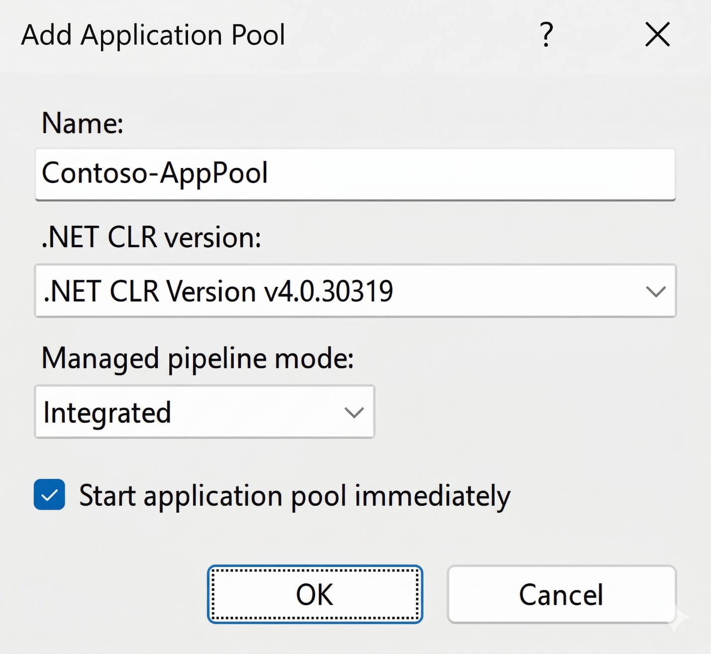
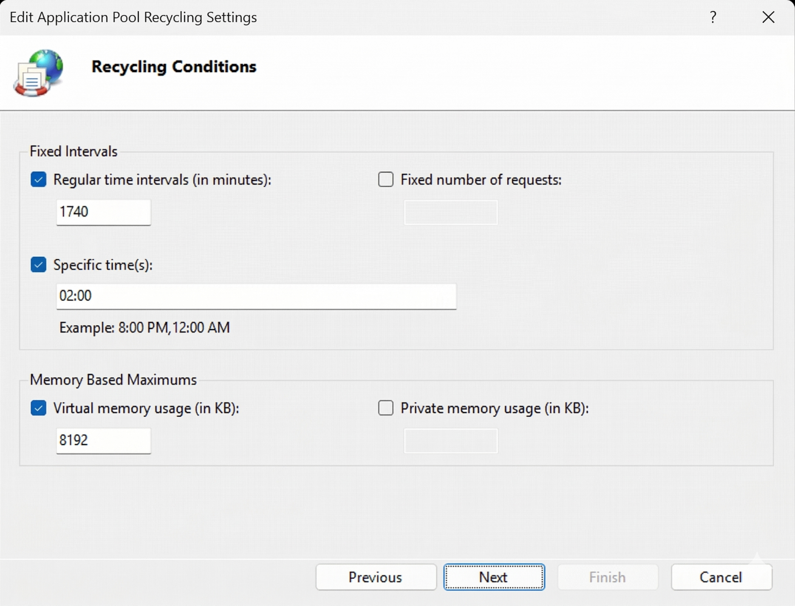

Application pools are one of the most important isolation and stability mechanisms in IIS. Each application pool runs one or more worker processes (w3wp.exe) that serve requests for the applications assigned to that pool. When one pool fails or is recycled, other pools continue unaffected. 

When IIS receives a request, it routes it to the worker process belonging to the application pool assigned to the target application. Because each pool runs in its own process space:

- A crash or memory leak in one pool doesn't affect other pools.
- Each pool can run under a different Windows identity, enabling least-privilege service accounts.
- Each pool can target a different .NET CLR version or pipeline mode.

> [!TIP]
> Assign a dedicated application pool to each website or application in production. Never share application pools between sites with different security or stability requirements.

## Creating an application pool

To create an application pool using IIS Manager, perform the following steps:

1. In the Connections pane, select Application Pools.
1. In the Actions pane on the right, select Add Application Pool.
1. In the Add Application Pool dialog, configure:
   - Name: Enter a descriptive name, for example Contoso-AppPool.
   - .NET CLR version: Select the CLR generation required by the application: `v4.0` for .NET Framework 4.x applications, or `v2.0` for supported CLR 2.0-generation applications, such as .NET Framework 3.5 applications, when the required Windows and ASP.NET components are installed. Select **No Managed Code** if IIS shouldn't preload the .NET Framework CLR.
   - Managed pipeline mode: Select Integrated.
1. Select OK.



To edit an existing pool, double-click it or select it and select Basic Settings in the Actions pane.

You can create a new application pool using the `New-WebAppPool` PowerShell cmdlet. For example, to create a new application pool named Contoso-AppPool for a .NET Framework 4.x application, run the following commands:

```powershell
# Create a new application pool
New-WebAppPool -Name "Contoso-AppPool"
# Set .NET Framework CLR version (use "" for No Managed Code)
Set-ItemProperty "IIS:\AppPools\Contoso-AppPool" managedRuntimeVersion "v4.0"
# Set pipeline mode (0 = Integrated, 1 = Classic)
Set-ItemProperty "IIS:\AppPools\Contoso-AppPool" managedPipelineMode 0
```

## Configuring application pool recycling

Recycling replaces the worker process at defined intervals or thresholds, helping to recover memory and resources that may accumulate over time. IIS starts a new worker process before shutting down the old one (overlapping recycling), so recycling is typically transparent to users.

To configure application pool recycling in IIS Manager, perform the following steps:

1. Select the application pool in the Application Pools list.
1. In the Actions pane, select Recycling.
1. In the Edit Application Pool Recycling Settings wizard, configure:
   - Regular time intervals: Set the interval in minutes. The default is 1,740 minutes (29 hours). Consider aligning this with off-peak hours, or disable time-based recycling and rely on memory-based recycling instead.
   - Specific times: Recycle at a fixed time each day (for example, 02:00) to ensure recycling occurs during low-traffic periods.
   - Memory-based recycling: Set virtual memory and private memory limits (in KB) to trigger recycling if the worker process exceeds those thresholds.
1. Select Next to configure recycling event log settings, then select Finish.



You use the `Set-ItemProperty` cmdlet to configure application pool recycling using PowerShell. For example, to configure a regular interval, run the following command:

```powershell
$poolName = "Contoso-AppPool"
# Set regular time interval recycling (TimeSpan; 00:00:00 = disabled)
Set-ItemProperty "IIS:\AppPools\$poolName" `
    recycling.periodicRestart.time "29:00:00"
# Add a specific-time recycle trigger (e.g., 2:00 AM daily)
$recycleTime = New-Object System.TimeSpan 2,0,0
Add-WebConfiguration -Filter "system.applicationHost/applicationPools/add[@name='$poolName']/recycling/periodicRestart/schedule" -Value @{value = $recycleTime}
# Set private memory limit in KB (0 = unlimited)
Set-ItemProperty "IIS:\AppPools\$poolName" `
    recycling.periodicRestart.privateMemory 512000
```

## Configuring the idle timeout

The idle timeout setting stops the worker process after it's been idle (no requests) for the specified period. This frees server resources but means the first request after the timeout incurs a cold-start delay.

```powershell
# Set idle timeout to 20 minutes (the default value)
Set-ItemProperty "IIS:\AppPools\Contoso-AppPool" `
    processModel.idleTimeout "00:20:00"
# Disable idle timeout for always-on applications
Set-ItemProperty "IIS:\AppPools\Contoso-AppPool" `
    processModel.idleTimeout "00:00:00"
```

> [!NOTE]
> In IIS Manager, find the idle timeout in the application pool's Advanced Settings (select the pool, select Advanced Settings in the Actions pane), under the Process Model section.

## Application initialization and always-on start mode

Application Initialization can start application initialization before the first external request. Configure `preloadEnabled` on the application and `AlwaysRunning` on the pool assigned to it. This starts initialization earlier; it doesn't eliminate initialization work or guarantee immediate readiness after a restart.

To achieve this, configure the following:

- **Application pool start mode:** Set `startMode` to `AlwaysRunning` on the application's assigned pool so IIS can start the worker process without waiting for an incoming request.
- **Application Initialization:** Install the Application Initialization feature in Windows Server if it isn't already installed, and set the application's `preloadEnabled` attribute to `true`.

You can install the Application Initialization feature by running the following PowerShell command:

```powershell
Install-WindowsFeature -Name Web-AppInit -ErrorAction Stop
```

Review the installation result, including any restart requirement, before continuing. Verify that the feature's **Install State** is **Installed**:

```powershell
Get-WindowsFeature -Name Web-AppInit
```

Use the pool already assigned to the existing `Contoso` root application. The website example uses the `Contoso` pool; the `Contoso-AppPool` created earlier is a separate demonstration pool.

To configure preload in IIS Manager:

1. In the **Connections** pane, select the `Contoso` website, then select **Advanced Settings** in the **Actions** pane. Note the root application's **Application Pool**, then select **OK**.
1. Select **Application Pools**, select that pool, and select **Advanced Settings**. Set **Start Mode** to **AlwaysRunning**, then select **OK**.
1. Return to the `Contoso` website's **Advanced Settings**. Set **Preload Enabled** to **True**, then select **OK**.

Alternatively, use PowerShell to configure the existing `Contoso` root application and its assigned pool:

```powershell
Import-Module WebAdministration -ErrorAction Stop
$applicationFilter = "system.applicationHost/sites/site[@name='Contoso']/application[@path='/']"
$application = Get-WebConfiguration -PSPath 'MACHINE/WEBROOT/APPHOST' `
    -Filter $applicationFilter -ErrorAction Stop
if ($null -eq $application) {
    throw 'Create the Contoso website and its root application first.'
}
$poolName = [string]$application.applicationPool
if ([string]::IsNullOrWhiteSpace($poolName)) {
    throw 'Identify and explicitly configure the application pool before enabling preload.'
}
Set-ItemProperty -LiteralPath "IIS:\AppPools\$poolName" `
    -Name startMode -Value 'AlwaysRunning' -ErrorAction Stop
Set-WebConfigurationProperty -PSPath 'MACHINE/WEBROOT/APPHOST' `
    -Filter $applicationFilter -Name preloadEnabled -Value $true -ErrorAction Stop
```

For a child application, replace `/` in the filter with its actual application path, such as `/api`. Ensure that the intended site and pool are started. Don't change the pool assignment without reviewing its runtime requirements and content permissions.

> [!NOTE]
> `preloadEnabled` controls initialization when the application pool starts. `doAppInitAfterRestart` is a separate setting for application restarts. Configure an appropriate initialization URL if the default request doesn't warm the application sufficiently. Review the unit's idle-timeout settings when continuous residency is required.

After either procedure, verify that the application's **Preload Enabled** is **True** and its assigned pool's **Start Mode** is **AlwaysRunning**. During a planned restart or recycle, use application-level telemetry or a suitable readiness check to establish when initialization finishes. The simulated preload request isn't recorded as an ordinary request in the IIS access log.

## Application pool identity

The identity under which a worker process runs determines what Windows resources (files, network shares, databases) it can access. IIS supports four built-in identity types plus custom service accounts:

| **Identity Type** | **Description** | **Recommended Use** |
|---|---|---|
| **ApplicationPoolIdentity** | Least-privilege local virtual account per pool (`IIS AppPool\PoolName`). On a domain-joined server, uses the server's machine account for network authentication. | Default for most sites |
| **NetworkService** | Built-in account that uses the server's machine account for network authentication on a domain-joined server. | Legacy scenarios only |
| **LocalSystem** | Full local administrator. Highest privilege. | Never recommended |
| **LocalService** | Limited local account that presents anonymous credentials on the network. | Use only when its local and remote permissions meet the application's requirements. |
| **Custom account** | Domain or local service account. | Use when resources must authorize a particular service account rather than the server's machine account. |

> [!NOTE]
> A remote file share or SQL Server can authorize the domain-joined IIS server's machine account, such as `CONTOSO\WEB01$`. ApplicationPoolIdentity and NetworkService can use that account for network authentication. Configure the required remote permissions; network access isn't granted automatically. Pools using the same machine account aren't separate identities to the remote resource. For UNC content, check both share and NTFS permissions.

To configure a custom identity in IIS Manager, perform the following steps:

1. Select the application pool, then select Advanced Settings in the Actions pane.
1. Under Process Model, select the Identity field, then select the ellipsis (...) button.
1. In the Application Pool Identity dialog, select Custom account and select Set.
1. Enter the domain account credentials (for example, `CONTOSO\svc-webapp`), then select OK.

You can use the `Set-ItemProperty` cmdlet to configure a custom identity with PowerShell. The pool and service account must already exist. Plan a production identity change for an appropriate maintenance window, and verify the application's permissions and behavior afterward. For example, to set the identity of `Contoso-AppPool` to `CONTOSO\svc-webapp`, run the following commands:

```powershell
Import-Module WebAdministration -ErrorAction Stop
$poolName = 'Contoso-AppPool'
$username = 'CONTOSO\svc-webapp'
$password = Read-Host -Prompt 'Enter service account password' -AsSecureString
$bstr = [IntPtr]::Zero
$plain = $null

try {
    $bstr = [Runtime.InteropServices.Marshal]::SecureStringToBSTR($password)
    $plain = [Runtime.InteropServices.Marshal]::PtrToStringBSTR($bstr)
    Set-ItemProperty -LiteralPath "IIS:\AppPools\$poolName" `
        -Name processModel.userName -Value $username -ErrorAction Stop
    Set-ItemProperty -LiteralPath "IIS:\AppPools\$poolName" `
        -Name processModel.password -Value $plain -ErrorAction Stop
    Set-ItemProperty -LiteralPath "IIS:\AppPools\$poolName" `
        -Name processModel.identityType -Value 3 -ErrorAction Stop
}
finally {
    if ($bstr -ne [IntPtr]::Zero) {
        [Runtime.InteropServices.Marshal]::ZeroFreeBSTR($bstr)
    }
    $plain = $null
    if ($null -ne $password) {
        $password.Dispose()
    }
}
```

> [!NOTE]
> This clears and frees the unmanaged BSTR. The managed plaintext string used by the configuration API is a separate allocation; assigning `$null` doesn't guarantee immediate erasure. Don't print or persist the password.
>
> When using custom service accounts, follow the principle of least privilege. Grant the account only the NTFS permissions required (typically read and execute on the web content directory) and avoid making the account a member of local Administrators. Consider using managed service accounts, which don't require as much administrative effort.

## Managing application pool state

You can use the WebAppPool PowerShell cmdlets to manage application pool states.

```powershell
Stop-WebAppPool    -Name "Contoso-AppPool"   # Stop
Start-WebAppPool   -Name "Contoso-AppPool"   # Start
Restart-WebAppPool -Name "Contoso-AppPool"   # Recycle worker process
Get-WebAppPoolState -Name "Contoso-AppPool"  # Check current state
```

> [!NOTE]
> In IIS Manager, select the pool and use the Start, Stop, or Recycle links in the Actions pane.

## Application pool .NET CLR version and pipeline mode

When configuring an application pool, you need to set the .NET CLR version and pipeline mode. The .NET CLR version setting controls which .NET Framework CLR IIS preloads for the worker process. Your options are:

- **No Managed Code:** IIS doesn't preload the .NET Framework CLR for the pool. Use this for static sites or applications built on non-.NET frameworks. This setting doesn't prevent the ASP.NET Core Module from loading CoreCLR for an in-process ASP.NET Core application. ASP.NET Core runtime and hosting-bundle requirements are separate from the IIS-managed .NET Framework CLR setting.
- **v4.0:** Loads the .NET Framework 4.x runtime. Use this for ASP.NET Web Forms, ASP.NET MVC, and Web API applications targeting .NET Framework 4.x.
- **v2.0:** Loads the CLR 2.0-generation runtime for supported applications, such as .NET Framework 3.5 applications, when the required Windows and ASP.NET components are installed.

Changing this setting doesn't install a runtime, upgrade an application, or make an unsupported framework supported.

> [!NOTE]
> ASP.NET Core applications don't use the IIS-managed .NET CLR. For out-of-process hosting, set the pool to No Managed Code. The ASP.NET Core Module forwards requests to the application's own Kestrel process.

The pipeline mode determines how IIS processes incoming HTTP requests. Specifically it determines how ASP.NET code integrates with the IIS request-handling pipeline. The options are:

- Integrated (recommended): The ASP.NET request pipeline is fully integrated with the IIS pipeline, enabling features like authentication and output caching to apply to all content types.
- Classic: Legacy mode for older ASP.NET applications incompatible with Integrated mode. Avoid unless required for application compatibility.

## Supporting 32-bit applications in application pools

By default, IIS application pools on 64-bit versions of Windows Server run in 64-bit mode. However, some legacy web applications may depend on 32-bit components or libraries that are incompatible with 64-bit execution. In such cases, you can enable 32-bit support for the application pool.

To enable 32-bit applications in IIS Manager:

1. Open IIS Manager and select **Application Pools** in the Connections pane.
2. Select the target application pool and select **Advanced Settings** in the Actions pane.
3. Set **Enable 32-Bit Applications** to **True**.
4. Select **OK** to apply the change.

To enable 32-bit support using PowerShell, use the `Set-ItemProperty` cmdlet. For example, to set 32-bit support on `Contoso-AppPool`, run the following command:

```powershell
Set-ItemProperty "IIS:\AppPools\Contoso-AppPool" -Name enable32BitAppOnWin64 -Value $true
```
