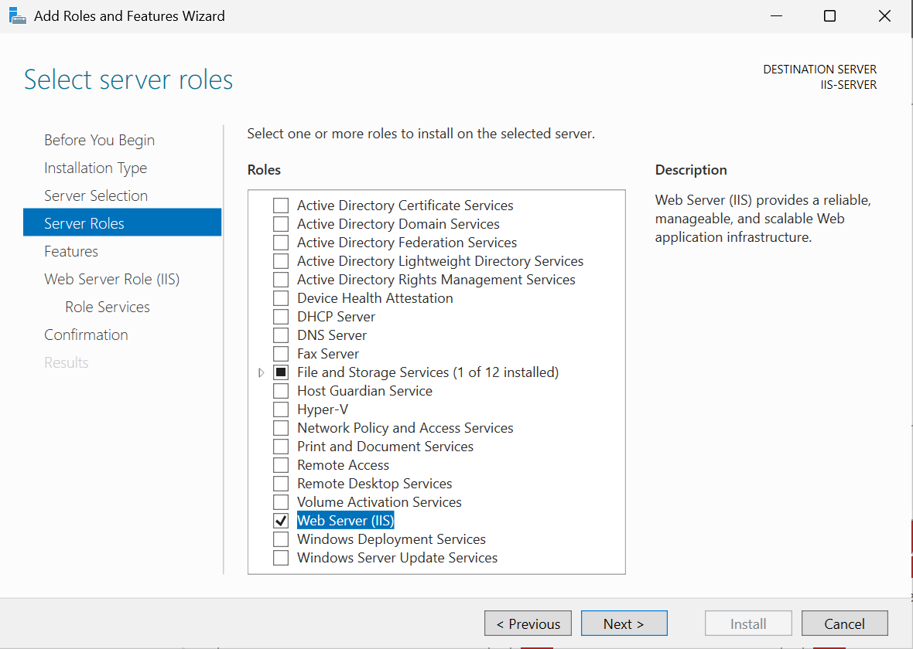
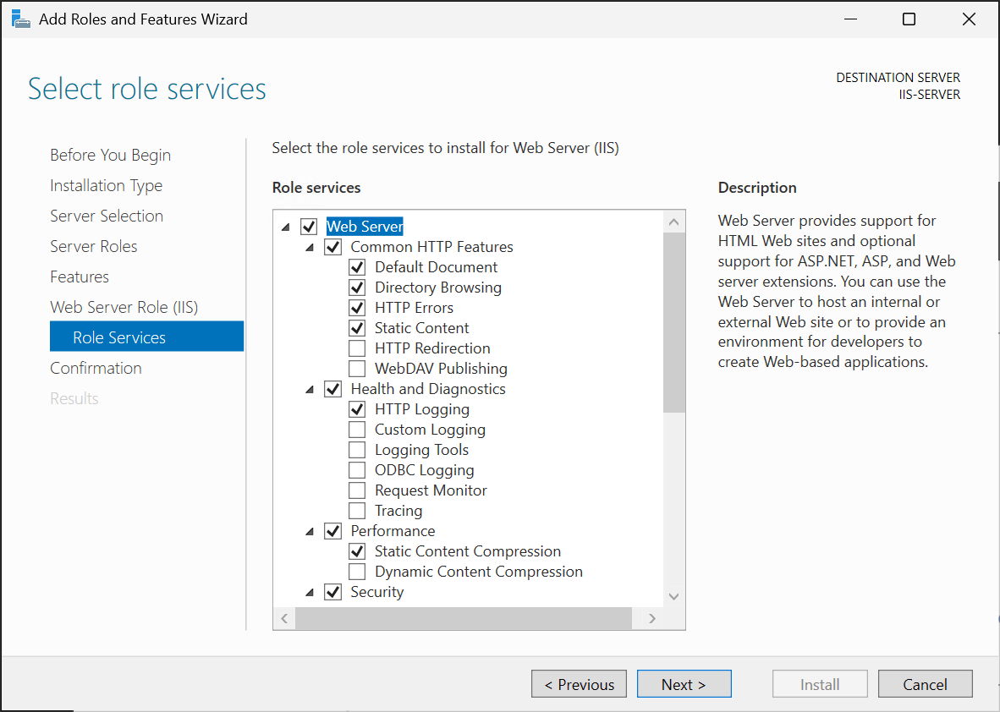

On a computer configured as Windows Server 2025 with Desktop Experience, you can install IIS using the Add Roles and Features Wizard:

1. In Server Manager's dashboard, select "Add Roles and Features." This opens the Add Roles and Features Wizard.
1. In the wizard's Before you begin page, select Next. Choose "Role-based or feature-based installation," then select your server. Continue to the Server Roles step.
1. In the list of roles, find and check "Web Server (IIS)". If this is the first time installing IIS, a pop-up appears to add associated features. Select "Add Features" when prompted to include IIS Management Console and other required components. After that, the "Web Server (IIS)" role should be checked.
[](../media/server-manager-install.png#lightbox)
1. Select Next to go through features until you reach the Role Services page. This list displays subcomponents like Common HTTP Features, Security, and Performance. By default, essential services are preselected. You can optionally select additional services or add them later as required. [](../media/server-manager-roles.png#lightbox)
1. Complete the wizard and then select Install on the confirmation page. The installation proceeds and when it completes, you'll see an "Installation succeeded" message.

> [!NOTE]
> By default, installing IIS through the wizard enables the Default Web Site on port 80. If you want to quickly verify that IIS works, you can open a web browser on the server and navigate to http://localhost. You should be greeted by the IIS welcome page, indicating the web server is running.

## PowerShell installation

To install IIS via PowerShell in Windows Server, use the Install-WindowsFeature cmdlet from an elevated command prompt:

```powershell
Install-WindowsFeature Web-Server -IncludeManagementTools
```

You can install specific IIS subcomponents by name using PowerShell. For example, to install IIS with some common features, you might specify component names like Web-WebSockets or Web-Dyn-Compression. You can see the available web server features by running the command:

```powershell
Get-WindowsFeature -Name Web*
```

You can determine which IIS features are installed by running the command: 

```powershell
Get-WindowsFeature -Name Web* | Where Installed
```

## IIS on Server Core

Server Core is the minimal, GUI-less installation option for Windows Server. The Server Core installation option is appropriate for workloads like IIS as the minimal number of components reduces the server's attack surface. You can deploy IIS on Server Core, but you can't use the local IIS Manager application. You can install IIS on Server Core using PowerShell using Install-WindowsFeature or remotely using Server Manager.

Server Manager and PowerShell remoting have their own remote-management prerequisites; they don't require the Web Management Service (WMSVC). For [remote role installation through Server Manager](/windows-server/administration/server-manager/add-remove-roles-features#prerequisites), add the destination server to Server Manager and use an account with administrator rights on that server. Use a management host that supports Windows Server 2025, such as another Windows Server 2025 server. To configure the remote-management method you've chosen, follow [Manage Server Core](/windows-server/administration/server-core/server-core-manage).

### Configure remote IIS Manager access

To manage IIS remotely through IIS Manager, install the **Management Service** role service, which provides WMSVC. Run the following installation and configuration commands in an elevated Windows PowerShell session on the destination server, either locally or through an already configured, approved remote session:

```powershell
Install-WindowsFeature -Name Web-Mgmt-Service
```

Change [WMSVC remote-management settings](/iis/manage/remote-administration/remote-administration-for-iis-manager#enable-remote-connections) while the service is stopped. A newly installed Management Service isn't started automatically. Check its state:

```powershell
Get-Service -Name WMSVC
```

If it's already running, schedule the interruption and stop it with `Stop-Service -Name WMSVC` from a local console or another approved management session. Stopping WMSVC interrupts IIS Manager connections. Run `Get-Service -Name WMSVC` again and confirm that the status is **Stopped** before continuing.

Enable remote connections by configuring the registry:

```powershell
Set-ItemProperty -Path HKLM:\SOFTWARE\Microsoft\WebManagement\Server  -Name EnableRemoteManagement -Value 1
```

### Restrict WMSVC access

WMSVC uses HTTPS on TCP port 8172 by default. Installing Management Service can create an enabled firewall exception for this port. To restrict access to a management subnet, inspect the effective firewall policy and narrow the applicable existing allowances. Adding another restricted allow rule doesn't cancel a broader one. Replace the example subnet, `192.168.15.0/24`, with your approved management subnet. If your WMSVC listener uses a different port, use that port throughout the firewall review and connection tests.

> [!IMPORTANT]
> Keep a local console or another approved recovery path available while changing management access, and record the rules' original settings so you can restore access if needed. Don't disable the firewall, replace unrelated shared rules, or add a broad block rule as a shortcut. A block rule can override the allowance you're trying to keep.

First, identify the active network profiles and inspect their effective firewall settings. Confirm that Windows Firewall is enabled for the relevant profiles and that the default inbound policy blocks traffic without an applicable allowance. If these settings don't meet that requirement, work with the firewall policy owner to resolve them before continuing.

```powershell
Get-NetConnectionProfile
Get-NetFirewallProfile -PolicyStore ActiveStore |
    Select-Object Name, Enabled, DefaultInboundAction
```

Next, inspect enabled inbound allow rules in the effective policy, including their owning policy source. Don't identify rules by display name alone. The following read-only commands show each rule's profile and its associated port, service, application, and address filters:

```powershell
$inboundAllowRules = Get-NetFirewallRule -PolicyStore ActiveStore `
    -TracePolicyStore -Enabled True -Direction Inbound -Action Allow

foreach ($rule in $inboundAllowRules) {
    $rule | Format-List Name, DisplayName, Profile,
        PolicyStoreSourceType, PolicyStoreSource
    $rule | Get-NetFirewallPortFilter |
        Format-List Protocol, LocalPort, RemotePort
    $rule | Get-NetFirewallServiceFilter | Format-List Service
    $rule | Get-NetFirewallApplicationFilter | Format-List Program, Package
    $rule | Get-NetFirewallAddressFilter | Format-List LocalAddress, RemoteAddress
}
```

Look for rules whose conditions could match the WMSVC listener. Check for TCP or `Any` protocol and for the configured local port, a range containing that port, or `Any` port. Review the service, application, local and remote addresses, and profile conditions together; a rule permits traffic only when all its conditions match.

Narrow every applicable WMSVC-specific allowance at its owning policy source. For Group Policy or other centrally managed policy, have its owner change that policy; a local rule might not be effective. If a broader shared rule also permits WMSVC traffic, coordinate a change with its owner instead of blindly changing an unrelated rule.

For a rule you've confirmed is locally managed, dedicated to WMSVC, and appropriate for the active profiles, use [`Set-NetFirewallRule`](/powershell/module/netsecurity/set-netfirewallrule?view=windowsserver2025-ps&preserve-view=true) to narrow its remote-address scope. Replace `<confirmed-local-WMSVC-rule-name>` with the actual unique `Name` found during inspection, not its display name:

```powershell
Set-NetFirewallRule -PolicyStore PersistentStore `
    -Name '<confirmed-local-WMSVC-rule-name>' -RemoteAddress '192.168.15.0/24'
```

This command preserves the rule's other conditions; the placeholder isn't a universal installed rule name. Apply the restriction to every relevant WMSVC allowance. If IPv6 is enabled, account for both address families and allow only the approved management sources. If no appropriate allowance exists, create a specifically scoped inbound TCP rule through your approved firewall policy, using the configured listener port, approved source addresses, and appropriate profiles.

After the changes take effect, repeat the effective-policy and rule-filter inspections. Don't consider access subnet-restricted while another effective allowance still permits unwanted access. Resolve any remaining broader allowances with their policy owners before starting WMSVC.

### Start WMSVC and test remote access

Only after all registry and firewall configuration is complete, configure automatic startup, start WMSVC, and check its state:

```powershell
Set-Service -Name WMSVC -StartupType Automatic
Start-Service -Name WMSVC -ErrorAction Stop
Get-Service -Name WMSVC
```

The service's status should be **Running** before you attempt an IIS Manager connection. Setting the startup type to **Automatic** controls future starts; it doesn't start a stopped service. If startup fails, resolve the reported service error before continuing.

After WMSVC starts, test from two remote clients that can route to the server: one inside the allowed management subnet and one outside it. On each client, replace `<iis-server>` with the server's reachable name or address:

```powershell
Test-NetConnection -ComputerName '<iis-server>' -Port 8172
```

`TcpTestSucceeded` should be `True` from the allowed client and `False` from the disallowed client. Test both address families if they're in use, and use the configured listener port if it differs from 8172. If the results differ, investigate the effective firewall policy and network path before considering access restricted. An open TCP port doesn't verify authentication or authorization, so complete the IIS Manager connection described next from the allowed client.

Once WMSVC is running and listening, you can open IIS Manager on a different Windows machine and use the "Connect to a Server" option and enter the hostname (or IP) of your Server Core machine. You'll typically authenticate with an account that has local administrator privileges on the server hosting IIS.
