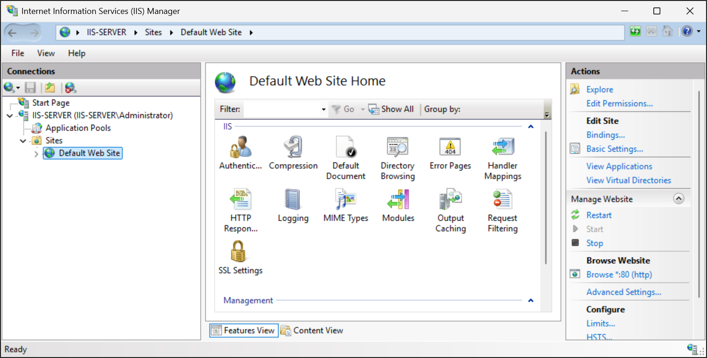
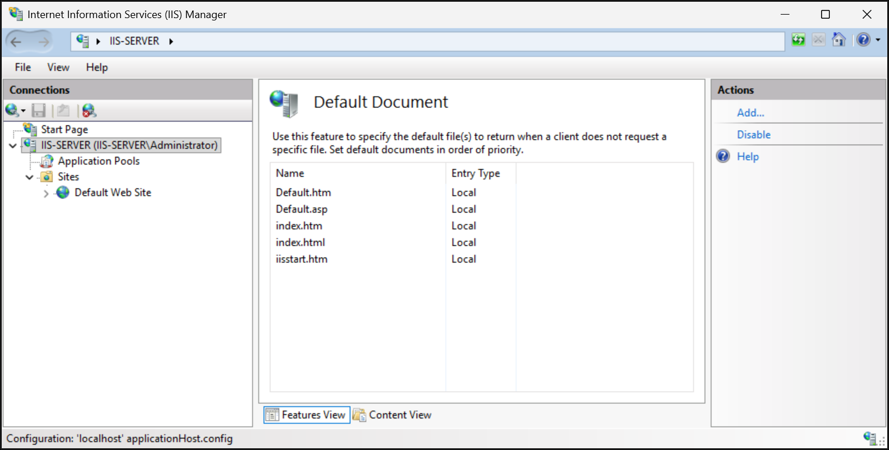
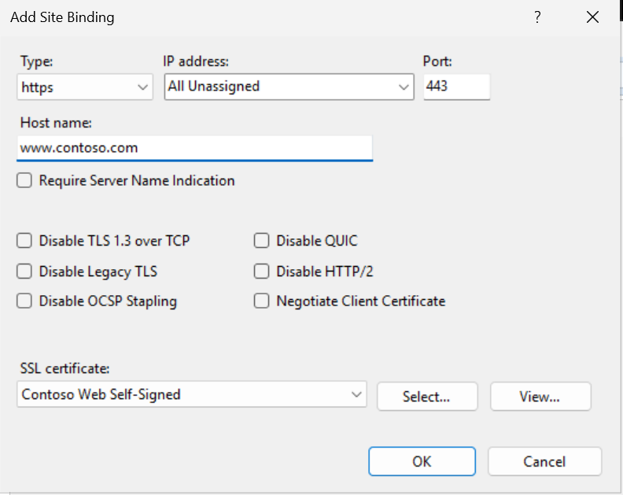
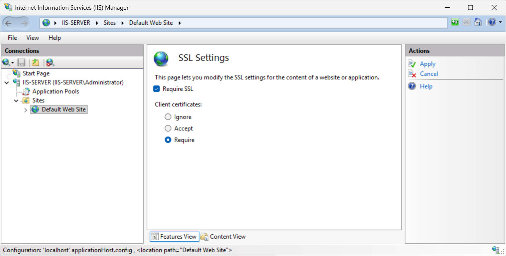

The deployment of the web server role creates a web site named Default Web Site. This site uses the path C:\inetpub\wwwroot as its content root and listens on port 80 (http) on all IP addresses configured for the server. The Default Web Site also has an empty host name binding, which means it responds to any host name on that server's IP. This continues to occur unless you configure an additional site, specifying a host name, for the same port.

You can verify that the default web site is present by navigating to `http://localhost/` in a local browser on a server with Desktop Experience, or by navigating to the server's IP address or DNS name using a web browser on a remote host.

You can also test the website from Windows PowerShell running on the IIS server, either at its console or through an established PowerShell remoting session:

```powershell
Invoke-WebRequest -Uri "http://localhost/" -UseBasicParsing
```

Before changing the default bindings or requiring HTTPS, this local check should return **StatusCode 200** for the IIS welcome page. `localhost` refers to the computer running the command. A local check doesn't verify remote network access; test from a remote host using the server's reachable IP address or DNS name to check that path.

`-UseBasicParsing` avoids Windows PowerShell 5.1's Internet Explorer-based HTML parsing requirement, including on Server Core. PowerShell 7 uses basic parsing without relying on Internet Explorer. For more information, see [Invoke-WebRequest in Windows PowerShell 5.1](/powershell/module/microsoft.powershell.utility/invoke-webrequest?view=powershell-5.1&preserve-view=true).

## Exploring the IIS Manager Interface

IIS Manager (inetmgr.exe) is the graphical tool for managing IIS. On launch, you see a window with a tree on the left. Select the server node to expand it. Under it, you see subnodes for Application Pools and Sites. If you expand Sites, you see Default Web Site listed.

[](../media/iis-manager.png#lightbox)

When you select the server itself or a site, the middle pane populates with features. These allow you to configure settings such as authentication at the server level, or settings at the level of an individual site level. Settings configured at the site level take precedence over those configured at the server level.

You can determine which IIS features are installed by looking at the Features View for the server. For instance, if "URL Rewrite" is installed, you'd see an icon for it under the IIS section. If Dynamic Content Compression was installed, you'll see a "Compression" icon that includes both static and dynamic compression settings. If you're looking for a setting and it's not present, you might need to install the appropriate web server role service using Server Manager or PowerShell.

## Basic configurations

There are a few basic settings and checks that you should be familiar with before using IIS in a production environment. These include:

- Default documents
- SSL Settings
- HTTP Compression

### Default documents

The default document is the file that IIS serves if a user requests a URL that corresponds to a folder. For example, if a user goes to http://yoursite/ (with no page specified), IIS looks for a default document in that folder. Typical defaults include Default.htm, Default.asp, index.htm, index.html, and iisstart.htm. In IIS Manager, you can configure this at the server or site level by double-selecting Default Document. You see the list of default files. You can add (for example, if your application uses home.aspx as the main page, you could add that), remove, or reorder these entries. The server-level list serves as the default for all sites, but you can override per site.

[](../media/default-document.png#lightbox)

### SSL settings

Configure and verify an HTTPS binding before applying optional SSL restrictions. For a Server Core target, use the remote IIS Manager connection from the previous unit.

1. Choose a DNS host name for the site and confirm that the test client resolves it to the intended IIS server.
1. On the IIS server, install or import a suitable server-authentication certificate and its associated private key into the Local Computer **Personal** certificate store. The certificate must cover the site's DNS name, be within its validity period, and have a chain trusted by the intended clients. Importing a PFX into this store is one supported option.
1. In IIS Manager, select the site in **Connections**, then select **Bindings** in **Actions**. Add an **https** binding, or edit the intended existing binding.
1. Select the intended **IP address** and **Port**, normally **443**. Enter the site's DNS name in **Host name**. For host-named HTTPS sites sharing the same IP address and port, select **Require Server Name Indication** and ensure that clients support Server Name Indication (SNI).
1. Select the matching **SSL certificate**, save the binding, and close the dialog. Before testing, inspect the effective firewall policy and ensure that the required inbound HTTPS traffic is allowed on the applicable profiles. Use least-privilege scoping rather than opening unrelated ports.
1. From the test client, browse to the exact configured HTTPS host name. Confirm that the expected site content loads and the browser accepts the certificate without name, validity, or trust warnings. For a host-named SNI binding, test the DNS name rather than substituting the server's IP address or `localhost`.

For a PowerShell check of the module's default static website, run the following command on the test client. Replace `<site-host-name>` with the configured DNS host name, without the angle brackets:

```powershell
(Invoke-WebRequest -Uri 'https://<site-host-name>/' -UseBasicParsing).StatusCode
```

The expected status is `200`. Resolve any certificate errors rather than bypassing certificate validation. For more information about certificates and binding validation, see [How to set up SSL on IIS](/iis/manage/configuring-security/how-to-set-up-ssl-on-iis).

> [!NOTE]
> The screenshot's self-signed certificate is a lab example. For production, use a certificate valid for the site's DNS name and issued through a certificate authority trusted by the intended clients, such as your enterprise CA or a public CA. A self-signed certificate isn't automatically trusted by other computers.

[](../media/contoso-certificate.png#lightbox)

Only continue to optional SSL restrictions after the HTTPS check succeeds.

After applying the binding, you can use the SSL Settings feature to require SSL for the site or specific content. You can optionally configure an HTTP-to-HTTPS redirect so users will be automatically sent to the secure version of the site.

[](../media/certificate-settings.png#lightbox)

**Require SSL** doesn't automatically redirect HTTP to HTTPS. After configuring SSL restrictions, request the site's HTTP URL to verify the intended outcome. Without a separate redirect, an unencrypted request that reaches SSL-required content is rejected with HTTP status 403 and IIS substatus 4 (403.4). If you configure automatic redirection, test it separately: inspect the redirect response and its HTTPS destination, then confirm that the final HTTPS page loads successfully. For more information, see [IIS SSL settings](/iis/configuration/system.webserver/security/access).

### HTTP compression

IIS can compress eligible responses to clients, reducing bandwidth and speeding up web content delivery. There are two types: static compression for files such as HTML, CSS, and JavaScript, and dynamic compression for content generated by applications, such as ASP.NET or PHP pages. Compression applies only to eligible MIME types and responses. JPEG and PNG files are already compressed and typically don't benefit. Static Content Compression might already be installed if you accepted recommended defaults, but Dynamic Content Compression might not be.

To configure and test compression:

1. Confirm which compression role services are installed on the IIS server. In Server Manager, use **Add Roles and Features** for the target server and locate **Web Server (IIS)** > **Web Server** > **Performance**. Install **Static Content Compression** if it's missing and you need static compression. Install **Dynamic Content Compression** only if the application needs it, then complete the wizard. For a Server Core target, use the supported remote Server Manager workflow from the previous unit.
1. In IIS Manager, select the intended site, open **Compression** in **Features View**, select the required static or dynamic compression options, and select **Apply**. A setting might already be enabled; installing a role service and configuring a site's setting are separate checks.
1. To test static compression, select an existing static text resource with an enabled MIME type whose size exceeds the server's configured `minFileSizeForComp`. Use a successful GET request that advertises `Accept-Encoding: gzip`. Repeat requests in quick succession if needed because static compression can depend on the configured hit-frequency threshold.
1. Inspect the response headers. For a gzip-compressed response, expect `Content-Encoding: gzip`. If it isn't present, check feature installation, the site's compression setting, MIME eligibility, size and hit-frequency thresholds, and CPU-based compression limits before concluding that compression is broken.

You can optionally check role-service installation from an elevated Windows PowerShell session on the IIS server:

```powershell
Get-WindowsFeature -Name Web-Stat-Compression, Web-Dyn-Compression
```

An **Installed** state confirms that the role service is installed, not that every response is compressed.

On a Windows test client, use the `curl.exe` executable, not Windows PowerShell's `curl` alias, to send a GET request. Replace the example URL with the actual URL of the eligible static text resource:

```powershell
curl.exe --silent --show-error --dump-header - --output NUL `
    --header "Accept-Encoding: gzip" `
    "https://<site-host-name>/<test-file>.txt"
```

This command requests the body, prints response headers, and discards the body. Don't use a HEAD-only request as the compression test. Resolve HTTPS certificate problems instead of bypassing certificate validation. If HTTPS hasn't been configured, use the existing HTTP test binding instead.

A static-file response tests static compression, not dynamic compression. To verify dynamic compression, use an actual application endpoint that returns an eligible dynamic response and inspect its response headers. Don't enable every MIME type or lower server-wide thresholds just to force a test to pass.

For configuration details, see [URL compression](/iis/configuration/system.webserver/urlcompression) and [HTTP compression eligibility and thresholds](/iis/configuration/system.webserver/httpcompression/).

> [!NOTE]
> On Windows Server, adding the Web Server role typically enables the basic firewall rules for World Wide Web Services (HTTP and HTTPS) on Domain networks (if the server is domain-joined). If your server is standalone or in a workgroup, you may need to manually enable the rules for Public/Private profiles or create new rules for port 80 and 443.
