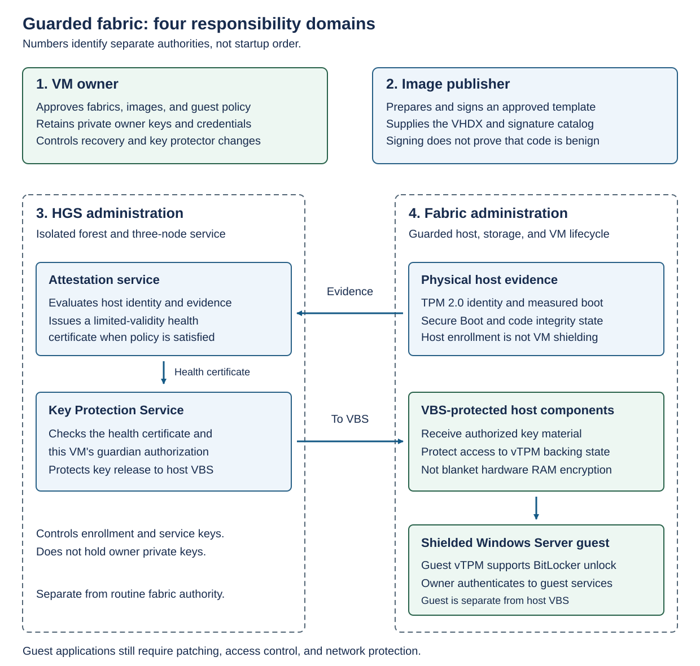
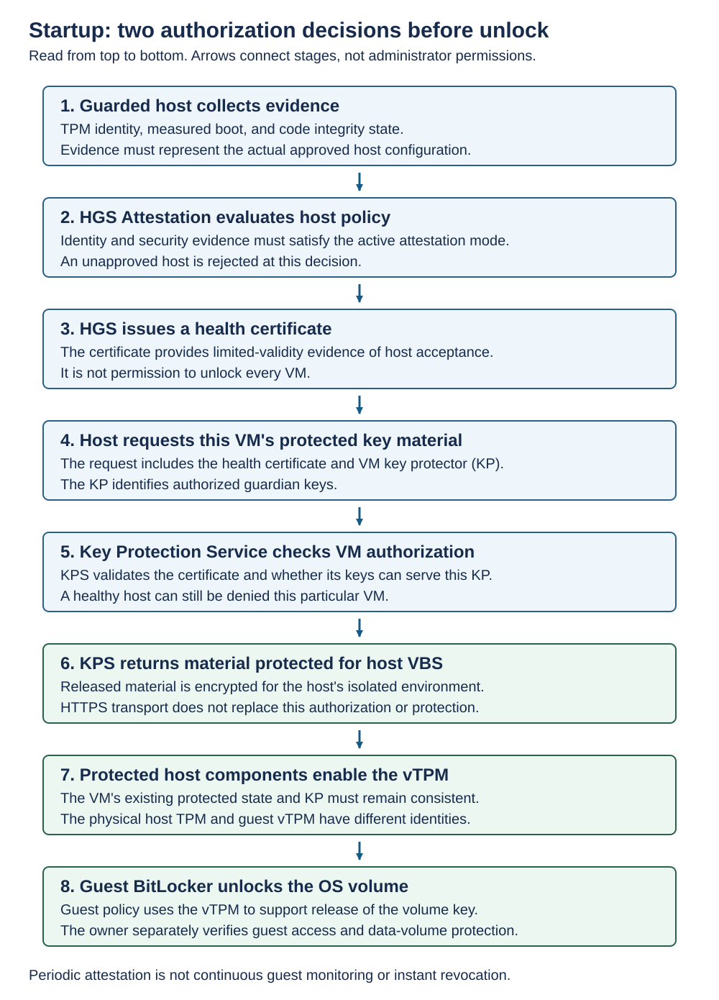

Guarded fabrics combine Hyper-V and Host Guardian Service to help protect virtual machine secrets from fabric administrators. This module explains how Hyper-V host attestation, key protection, guest encryption, and separate administrative roles support the deployment, operation, and recovery of shielded VMs.

## Separate administrative authority

Guarded fabrics provide technical solutions to the security and integrity of workloads. To maintain security and integrity, it's necessary to assign separate distinct responsibilities to fabric administrators, HGS administrators, VM owners, and image publishers.

- The **fabric administrator** manages Hyper-V hosts, storage, virtual networks, and VM lifecycle. Shielding is intended to prevent that administrator from turning infrastructure access into access to a protected guest's secrets. The administrator can still deny service, delete files, disconnect networks, or disrupt storage.
- The **HGS administrator** decides which Hyper-V hosts qualify and controls the fabric's key-protection service. Compromising this authority can undermine the Hyper-V host trust decision. HGS administration must therefore be separate from routine fabric administration, with protected credentials, management workstations, audit trails, and recovery access.
- The **VM owner**, also called the tenant, authorizes fabrics, approves images, and controls guest credentials and owner keys. Owner authority mustn't be placed on the Hyper-V hosts from which it's meant to protect the VM.
- The **image publisher** prepares and signs templates. Trusting that publisher remains a supply-chain decision.

The diagram illustrates the four responsibility domains:

- The VM owner retains private recovery authority.
- The image publisher supplies an approved image identity.
- HGS administration evaluates Hyper-V host evidence and protects VM keys.
- Fabric administration runs the guarded Hyper-V host, whose VBS-protected components receive released key material.

> [!NOTE]
> **Virtualization Based Security (VBS)** isolates sensitive Hyper-V host components from the ordinary Hyper-V host operating system. In this design, it helps protect the material needed to operate the shielded VM's vTPM. It isn't a claim that all physical RAM is hardware-encrypted, nor that a compromised guest can't read its own unlocked data.

## Understand the protection mechanisms

Guarded fabrics use two different types of Trusted Platform Module (TPM):

- A Hyper-V host's physical **TPM** supplies a hardware-rooted identity and evidence about measured boot.
- A VM's **virtual TPM (vTPM)** is a separate, per-VM device whose protected state travels with that VM's protected configuration.

Registering a Hyper-V host's TPM doesn't create or register each VM's vTPM.

Guarded fabrics use the following encryption technologies to protect workloads:

- **Guest BitLocker** encrypts Windows volumes.
- **VM state encryption** protects sensitive VM state
- **Live-migration encryption** protects that state in transit during supported migration.

These protections have different scopes. Guest data disks and ordinary application network traffic don't become protected merely because the OS disk or migration traffic is encrypted.

## Shielded VM startup

The HGS **Attestation service** checks whether a Hyper-V host meets the active trust policy. During shielded VM startup, the **Key Protection Service (KPS)** checks whether the requesting Hyper-V host has acceptable attestation evidence and whether that shielded VM authorizes the fabric's keys. These are separate decisions.

If the Hyper-V host lacks a usable health certificate when a shielded VM starts, it presents attestation evidence to HGS. If the evidence satisfies policy, HGS issues a health certificate. The Hyper-V host presents its valid health certificate and the shielded VM's key protector to KPS. A **key protector (KP)** protects the VM's secret and identifies the guardians authorized to help unlock it.

KPS validates the health certificate and the KP's authorization. It releases the necessary material encrypted for the Hyper-V host's VBS-protected environment. That environment can then make the vTPM available to the shielded VM. Inside the shielded VM's guest operating system, the vTPM supports BitLocker's normal release of the OS-volume key.

Passing attestation doesn't authorize a Hyper-V host to start every shielded VM. A VM whose KP doesn't authorize the available KPS keys must remain inaccessible even on an otherwise healthy Hyper-V host.

A Hyper-V host attests to HGS when it starts and approximately every eight hours. The Hyper-V host can also perform attestation on demand if it lacks a valid health certificate. Each certificate is valid for a limited time. Attestation checks the Hyper-V host, not the shielded VM's guest operating system. Changing the HGS trust policy doesn't necessarily revoke a Hyper-V host's existing access to VM keys immediately.

## Make two independent security decisions

When configuring a guarded fabric, select an attestation mode for the Hyper-V hosts and a protection policy for each VM.

- **Attestation mode selects eligible Hyper-V hosts.** TPM-trusted attestation checks hardware identity and measured security state. Host-key attestation checks possession of a registered key. It doesn't provide the same measured-health assurance. Choose the mode according to the threat actor, not according to the name of the VM.
- **VM policy selects enforced workload protections.** A shielded policy imposes stronger restrictions against fabric-administrator inspection and tampering. Encryption-supported policy provides encryption-related capabilities while retaining more administrator access for compatibility and troubleshooting. It isn't equivalent protection from a malicious fabric administrator.

An **ordinary VM** has no shielded-policy guarantee. Its administrator can generally use the normal console and debugging paths and change its configuration. Individually enabled encryption features don't establish the owner's guarded-fabric authorization boundary.

An **encryption-supported VM** can use a vTPM, guest encryption, and encrypted state/migration while retaining administrator access that a shielded policy restricts. This can meet a disk-theft requirement without meeting a malicious-fabric-administrator requirement.

A **shielded VM** enforces the required protection settings, restricts both inspection/debugging from the Hyper-V host and security-weakening configuration changes, and limits protected portability to compatible, authorized destinations. Guest-authenticated management is a different access path.

An ordinary VM, an encryption-supported VM, and a shielded VM can coexist on one guarded Hyper-V host. Enrolling the Hyper-V host doesn't upgrade the policies of its VMs. Similarly, enabling a vTPM, turning on BitLocker, or creating a local KP doesn't establish an HGS-backed guarded fabric.

> [!NOTE]
> Shielding doesn't cure malicious code in an approved image, stolen guest credentials, vulnerable applications, or an owner who discloses data. Continue guest patching, application authorization, endpoint protection, and network encryption. Protect backup integrity and retention against deletion by the same administrator who operates the fabric.

## Shielded VMs and guarded fabrics vs. Trusted Launch VMs

Shielded VMs in a Windows Server guarded fabric protect guest secrets from fabric administrators. With TPM-trusted attestation, HGS validates host identity and measured security state before releasing keys authorized by the VM's key protector. Shielding enforces VM security settings and encrypts the Windows OS volume, sensitive VM state, and live-migration traffic.

Trusted Launch hardens supported generation 2 VMs in Azure and Azure Arc-enabled VMs on hyperconverged Azure Local deployments with Secure Boot and a vTPM. Optional guest attestation checks the VM's boot chain, rather than authorizing Hyper-V hosts through HGS. Trusted Launch on Azure Local doesn't provide shielded-VM isolation from fabric administrators. Azure managed disks are encrypted at rest independently of Trusted Launch. On Azure Local, encrypt live-migration traffic separately, for example with IPsec.
