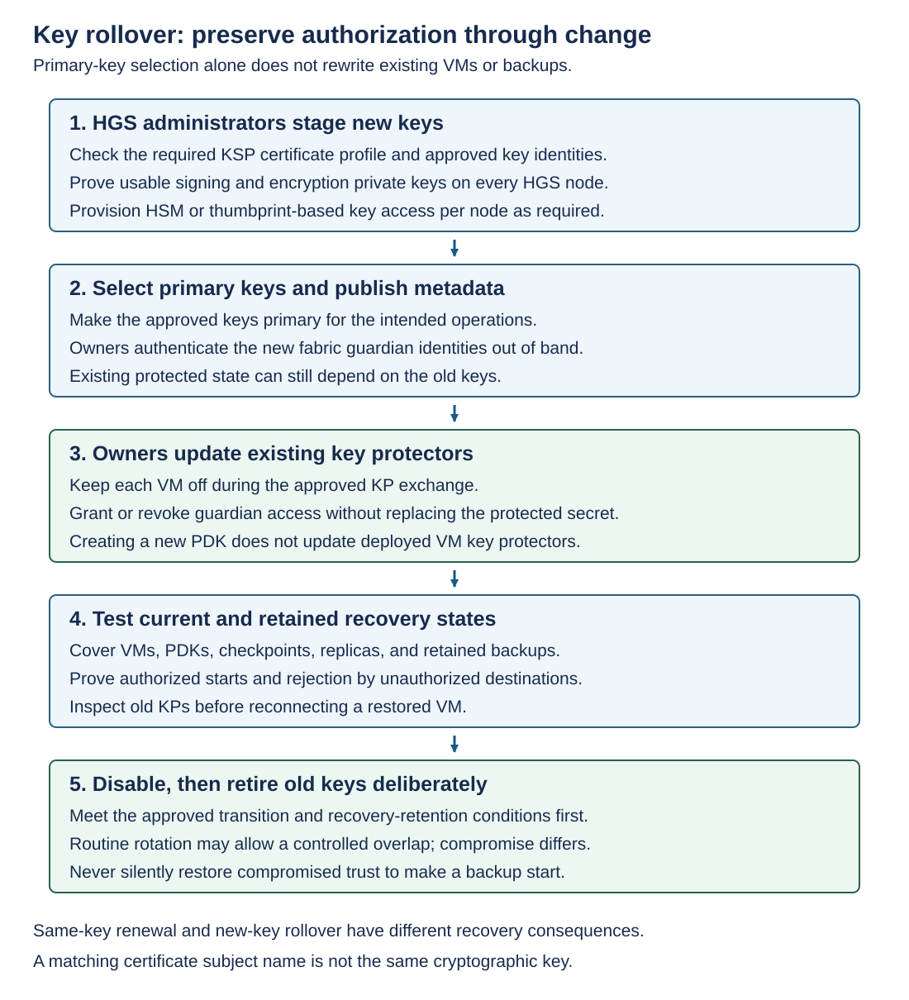

Before servicing a Hyper-V host, verify approved destinations, capacity, backup health, and the workload's KP authorization. Drain the Hyper-V host, service one Hyper-V host at a time, reattest it, test a protected workload, and only then return it to placement.

Firmware, Secure Boot revocation data, drivers, CI policy, and operating-system updates can change measured evidence. A TPM replacement also changes identity. Explain the change before admitting the new measurements.

During an approved rolling change, old and new approved baselines or CI artifacts may need to coexist. Define the population, maintenance window, and removal condition. After the rollout, retire obsolete artifacts so they don't remain a permanent path for older or weaker configurations.

An emergency outage isn't approval to enroll unknown boot measurements, allow all code, skip endorsement validation, or downgrade to version 1. Those actions change the trust model rather than repairing it.

## Apply updates in a controlled order

For routine cumulative updates within the same Windows Server release, update all guarded Hyper-V hosts before updating HGS. This lets hosts provide any new attestation evidence the service requires. Drain and update one host at a time, verify attestation and shielded VM startup, then return it to service. After all hosts are updated, update HGS one node at a time, preserving quorum and sufficient capacity for attestation and key release. Verify each HGS node before proceeding to the next.

Activate new or changed HGS attestation policies only after the required updates are installed on all Hyper-V hosts and HGS nodes. If activation requires HGS state export/import, protect the export and treat activation as a separate, tested change. Confirm that approved hosts still attest and start shielded VMs afterward.

For Windows Server version upgrades, first confirm support for the exact source, target, and intermediate HGS/host combinations and attestation versions. Where the target HGS version supports both the existing and upgraded hosts, upgrade HGS first, verify attestation and key release for the existing hosts, then upgrade the hosts. Don't apply the cumulative-update sequence automatically to an operating-system version upgrade.

## Monitor the security path

Monitor Attestation and KeyProtection events, HGS client diagnostics, Hyper-V VMMS and worker events, and CodeIntegrity events. Include DNS and HTTPS reachability, service and cluster health, private-key permissions, HSM availability, capacity, and time synchronization.

Forward security-relevant events to a system outside routine fabric-administrator control. Record enrollment, policy edits, key additions, primary-key changes, KP updates, and recovery actions. Logs on a compromised Hyper-V host alone aren't a durable audit trail.

Monitor recovery readiness as an operational condition: backup age, owner-key retrieval tests, HGS export usability, and whether the recovery fabric still authorizes the intended Hyper-V hosts and VMs.

## Rollover keys without stranding protected state

New HGS primary keys affect new protection operations and published metadata. Existing VMs, PDKs, checkpoints, replicas, and retained backups may still depend on old keys.



Stage the new keys and prove private-key access on every HGS node. Select the intended primary keys and publish authenticated metadata. Owners then authorize the new guardian identities in existing KPs. Test current and retained recovery states before disabling or retiring old keys.

For example: An HGS administrator stages an approved new encryption certificate on HGS. The PowerShell code imports a protected PFX. An HSM or thumbprint-based design needs its own per-node private-key provisioning.

```powershell
$newKeyPassword = Read-Host -AsSecureString -Prompt 'New encryption PFX password'

Add-HgsKeyProtectionCertificate -CertificateType Encryption `
    -CertificatePath 'C:\Certificates\HgsEncryption-Next.pfx' `
    -CertificatePassword $newKeyPassword

Get-HgsKeyProtectionCertificate
```

Apply the corresponding `-CertificateType Signing` operation when rotating the signing key. Verify each new key's identity and usability before changing its primary status.

```powershell
$newEncryptionThumbprint = Read-Host -Prompt 'Approved new encryption thumbprint'

Set-HgsKeyProtectionCertificate -CertificateType Encryption `
    -Thumbprint $newEncryptionThumbprint -IsPrimary
```

Owners authenticate the updated metadata and use the existing-KP grant/revoke workflow. Merely generating a new PDK doesn't update deployed VMs. Inventory the retained backup population before deciding that the old key is unused.

After the approved transition tests, an HGS administrator can disable an old key. The following command is a separate retirement-stage action, not the next automatic step after making a new key primary.

```powershell
$oldEncryptionThumbprint = Read-Host -Prompt 'Approved retiring encryption thumbprint'

Set-HgsKeyProtectionCertificate -CertificateType Encryption `
    -Thumbprint $oldEncryptionThumbprint -IsEnabled $false
```

Use `Remove-HgsKeyProtectionCertificate -CertificateType Encryption -Thumbprint $oldEncryptionThumbprint` only after the retirement decision and recovery-retention requirements are satisfied. Apply the same dependency analysis to signing keys.

For routine rotation, a controlled overlap can preserve availability. If a key is compromised, retaining or re-enabling it has different security consequences. Choose a clean recovery path rather than treating old-key restoration as harmless rollback.

## Retire infrastructure without losing recovery authority

Maintain separately controlled break-glass credentials and recovery authority, with approval, auditing, and post-use review. Emergency access mustn't become a permanently shared HGS administrator account or a copy of owner private keys on every Hyper-V host.

Before retiring a guarded Hyper-V host, drain workloads, preserve required evidence, withdraw its TPM or host-key authorization from every applicable HGS service, and dispose of local sensitive material through the approved process. A retired hostname isn't proof that its key can no longer authenticate.

Before retiring an HGS node, prove remaining-node key access and capacity, then follow the supported HGS, cluster, and domain decommissioning procedure. Don't destroy the last recoverable key needed by retained backups. Keep the retirement record with the key and workload dependency inventory.
