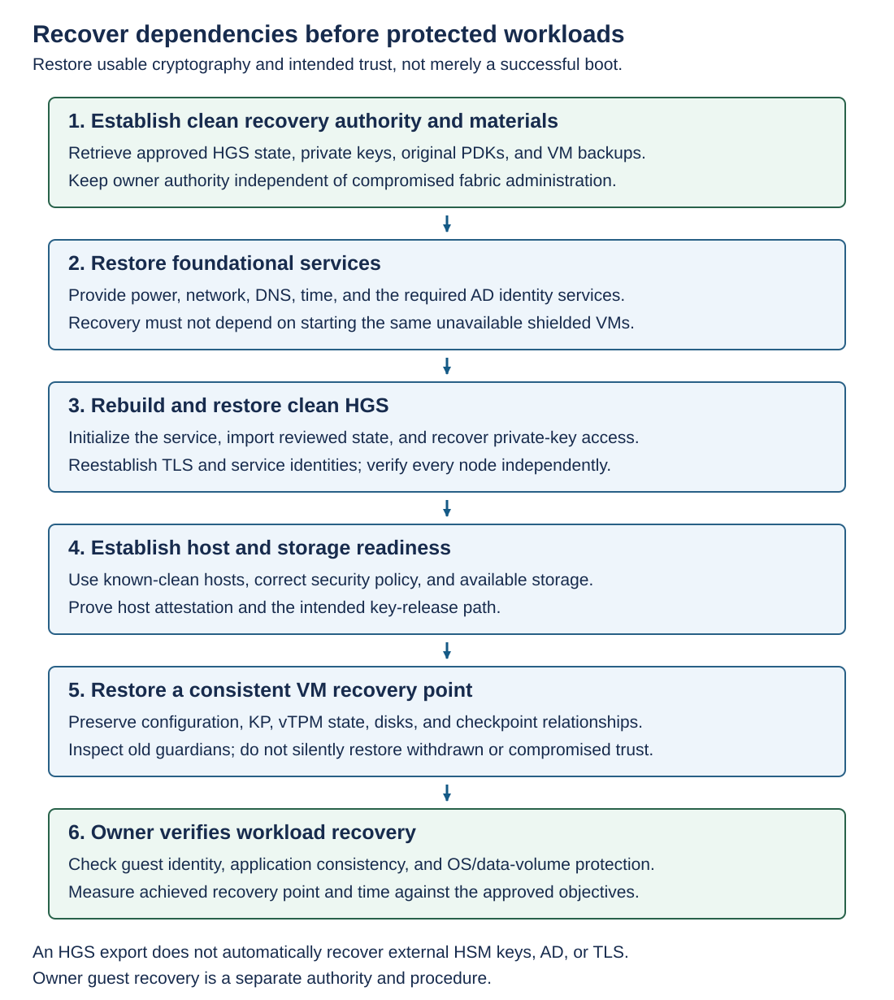

A recovery HGS deployment can protect against primary-site unavailability. Its enrollment, policies, keys, and administrative identities are independently managed. Configuring fallback URLs doesn't synchronize any of them.

Both services must be able to authorize the intended Hyper-V hosts, and each must possess keys authorized by the VM's KP. Keep rotations and withdrawals coordinated without erasing the administrative isolation that the design requires.

Fallback handles an unreachable or unresponsive primary service. It isn't a legitimate bypass for a primary service that rejects the Hyper-V host's security state. Don't design a weaker fallback policy that admits precisely the Hyper-V hosts the primary intends to reject.

## Evaluate offline key-material caching

Offline caching is disabled by default. When enabled, eligible key material can support a shielded VM start on a Hyper-V host that previously obtained the appropriate cacheable material. This trades availability during service outages against prompt enforcement of later trust withdrawal.

The cache is bound to the particular Hyper-V host and shielded VM, and to the Hyper-V host's security state, including the VBS identity. Changes can invalidate eligibility. It isn't a portable emergency key for a different Hyper-V host.

For example: An HGS administrator inspects the setting and changes it only after the owner and security teams approve the availability-versus-revocation tradeoff. This is a service policy change.

```powershell
Get-HgsKeyProtectionConfiguration
Set-HgsKeyProtectionConfiguration -AllowKeyMaterialCaching:$true
Get-HgsKeyProtectionConfiguration
```

After enabling caching, the shielded VM needs a **full shutdown and start** while HGS is available to obtain cacheable material. Restarting only the shielded VM's guest operating system isn't the same operation. Establish eligibility through an actual controlled outage test. Don't infer it from the configuration flag.

If caching isn't approved, retain the disabled setting and design sufficient online HGS availability. Disabling future caching isn't a promise that previously released material has been erased from a compromised machine. See fallback and offline operation.

## Outage behavior by operation

The following scenarios describe how HGS outages and infrastructure failures affect running shielded VMs, cold starts, migration, host restarts, and recovery.

- **Running shielded VM:** An HGS outage doesn't automatically stop an already running shielded VM. Its availability can still depend on the Hyper-V host, storage, and network, and its running state isn't evidence that a shielded VM cold start will work.
- **Shielded VM cold start:** The Hyper-V host needs an available authorized key-release path or an eligible offline cache. Without either, the shielded VM start must remain blocked. Don't repair this by introducing an unrelated local KP.
- **Migration:** Check the destination Hyper-V host's trust, key authorization, and operational dependencies. A running VM or cache on the source Hyper-V host doesn't establish the destination Hyper-V host's eligibility.
- **Hyper-V host restart:** Reattestation and key availability can become necessary. A previous cache can be invalidated by changed Hyper-V host security state. Test the exact reboot and servicing scenarios rather than promising all restart cases will work offline.
- **Full-site loss:** A cache on a lost Hyper-V host doesn't help a different Hyper-V host at the recovery site. Recovery needs independent identities, HGS keys and policy, VM artifacts, network and storage access, and owner authority.

## Back up the security dependencies

A recoverable fabric needs more than VM disks. Preserve HGS state, required HGS private keys or HSM recovery capability, owner private keys, original PDKs, VM configuration and KP, vTPM/protected state, disks and checkpoint chains, and guest recovery information.

Protect those backups against alteration and deletion by the same compromised authority that could disrupt production. Separate key custody from backup storage where required, and test that authorized recovery operators can actually combine the dependencies.

Distinguish a Hyper-V host-level encrypted whole-VM backup from a guest/workload backup. Whole-VM restore must preserve protected state consistently. Application-consistent or item-level recovery can require guest-aware credentials and vendor-supported handling. Obtain explicit support evidence for the backup product and version.

## Export HGS state and understand its limits

An HGS administrator can export state from a healthy HGS deployment to protected recovery storage. The Export-HgsServerState command prompts for a password that protects the export. Store that password through the approved separate recovery process.

```powershell
Export-HgsServerState -Path 'C:\HgsBackup\PrimaryHgsState.xml'
```

The export includes attestation configuration and key material that HGS received through PFX import. It doesn't supply every dependency. Thumbprint-referenced or HSM private keys need their own recovery method. AD configuration, service-identity reconstruction, cluster naming, TLS configuration, and TLS certificates also require separate recovery planning.

> [!NOTE]
> A copied export that has never been imported successfully is unproven recovery evidence. Record when policy or key changes make a new export necessary.

## Recover in dependency order



Begin with clean recovery authority and accessible protected materials. Restore power, networks, DNS, time, and the required AD identity services. Rebuild and initialize clean HGS, recover its approved state and private-key access, then establish Hyper-V host and storage readiness. Restore a consistent VM set, review its KP, and have the owner verify the recovered workload.

> [!WARNING]
> Avoid circular recovery: the only DNS, identity, backup, or HGS service needed for recovery mustn't itself require an unavailable shielded workload to start.

After rebuilding and initializing the clean HGS destination, an HGS administrator imports an approved state export. Obtain and verify the export before exposing the recovered service to clients.

```powershell
Import-HgsServerState -Path 'C:\HgsBackup\PrimaryHgsState.xml'
Get-HgsServer
Get-HgsKeyProtectionCertificate
Get-HgsAttestationPolicy
```

Restore nonexported private keys and every node's access separately. Reestablish TLS and service-name correctness, review trust and policy, and test attestation and VM key release. Prefer a deliberate HGS rebuild and state restore over assuming a whole-server image will reconstruct the distributed service correctly.

A **recovery point objective (RPO)** limits acceptable data loss. A **recovery time objective (RTO)** limits acceptable recovery duration. Set both for the application and its security dependencies. For example, a recent VM backup is insufficient if the only recoverable owner authorization predates the current KP change.

## Restore VM state without restoring withdrawn trust

Restore a consistent set of VM configuration, KP, vTPM/protected state, disks, and checkpoint relationships. Mixing a current disk with unrelated older protected state can make guest encryption unrecoverable or produce an invalid recovery point.

Inspect a pre-rotation backup's KP before connecting it to production. If it authorizes only an old, uncompromised key retained for approved recovery, use the controlled recovery path and then update authorization. If it authorizes a compromised guardian, recover under clean owner authority instead of silently re-enabling that guardian.

Record application-level validation after the VM starts. Successful import, attestation, or guest boot alone doesn't establish application consistency or acceptable RPO.

## Recover eligible Windows guest BitLocker material

HGS recovery restores service capability. Guest BitLocker recovery restores access to a particular encrypted guest volume. They're separate procedures with separate authorities.

The documented shielded-VM recovery mechanism applies to Windows shielded VMs created with PDKs generated on Windows Server version 1709 or later. It requires the matching **original PDK** and the owner guardian's private keys. A newly generated PDK with the same friendly name isn't an equivalent artifact.

> [!NOTE]
> These cmdlets recover BitLocker material for the Windows guest's **operating-system volume**. In this example, `App01.vhdx` must be the VM's OS disk. The decrypted `.bek` file is for that OS volume, not a general-purpose recovery key for additional encrypted data volumes; maintain and test those volumes' recovery protectors separately.

In an isolated, owner-controlled recovery environment, use a consistent offline copy of the eligible VM disk and the shielding-data recovery tools. Preserve the original backup. The first operation extracts encrypted recovery information.

```powershell
Save-ShieldedVMRecoveryKey `
    -VHDPath 'C:\Recovery\App01.vhdx' `
    -Path 'C:\Recovery\App01.ebek'
```

With the matching original PDK and owner private keys available, decrypt that material into a tightly controlled recovery-key file.

```powershell
Unprotect-ShieldedVMRecoveryKey `
    -ShieldingDataFilePath 'C:\Recovery\App01-original.pdk' `
    -EncryptedBitLockerKeyPath 'C:\Recovery\App01.ebek' `
    -DecryptedBitLockerKeyPath 'C:\Recovery\App01.bek'
```

The result is a decrypted **`.bek` key file**, not necessarily a shown recovery-password string. Handle it as plaintext recovery authority. Restrict access, avoid transcripts and shared diagnostic locations, and use the supported BitLocker recovery procedure in the isolated environment.

After repair, restore the intended protected state and verify owner access and encryption again. Remove temporary decrypted material according to approved handling and retention policy. Missing usable owner keys and other valid recovery protectors can mean permanent data loss. There's no legitimate administrative bypass to promise.
