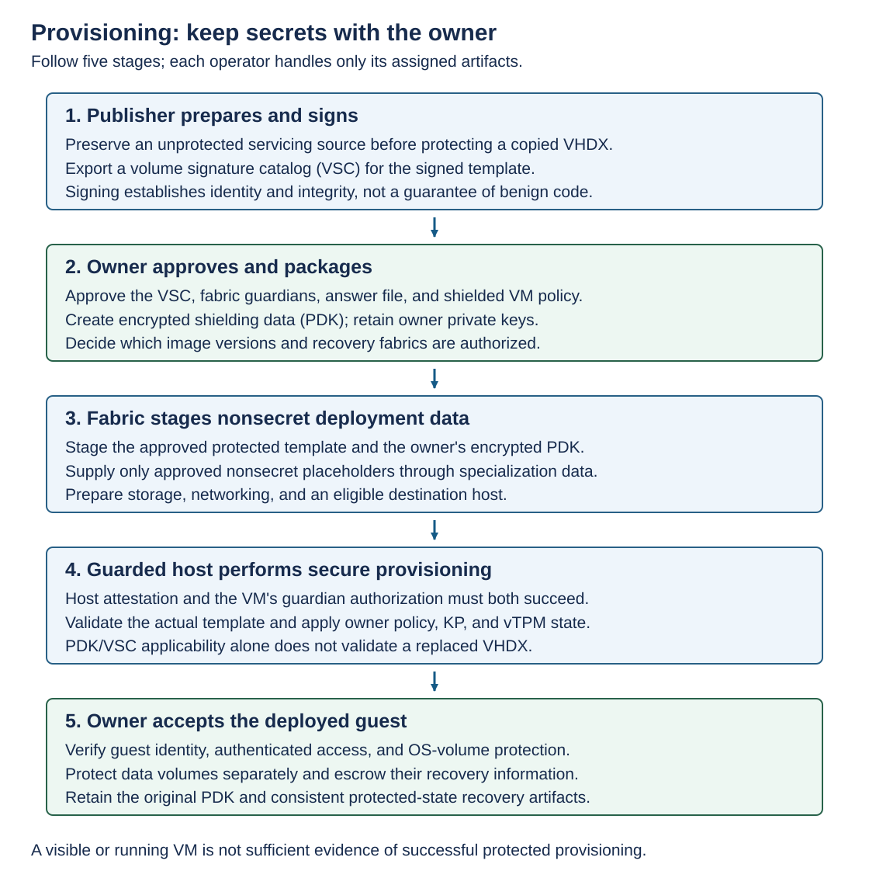

Start with a supported Windows Server 2025 source. Patch and configure it, prepare remote guest management, and generalize it for deployment. Preserve an unprotected servicing copy before protecting the template. Verify the generation 2, GPT, basic-disk, boot-partition, and Windows-volume prerequisites.

Template signing identifies the publisher and the image integrity state. It doesn't establish that the image is benign. The owner still needs an approval process for installed software, configuration, provenance, and vulnerability posture.



The publisher distributes a protected VHDX and its VSC. 

- **VHDX:** The virtual hard disk file containing the prepared operating system and template configuration.
- **VSC:** The volume signature catalog used to verify the template disk's identity and integrity during provisioning.

The owner approves the catalog and the primary and recovery guardians, then creates the encrypted PDK. The fabric supplies nonsecret specialization data and provisions on a qualifying Hyper-V host. The VM owner verifies identity, access, and encryption inside the shielded VM after provisioning.

## Protect a copied template and export its catalog

The image publisher uses a trusted preparation server with the template tooling and an approved template-signing certificate whose private key is available. The VHDX below is a copy, not the only serviceable source. `Protect-TemplateDisk` modifies it in place.

```powershell
$templateSigningThumbprint = Read-Host -Prompt 'Template-signing certificate thumbprint'
$certificate = Get-Item "Cert:\LocalMachine\My\$templateSigningThumbprint"

Protect-TemplateDisk -Certificate $certificate `
    -Path 'C:\Templates\WS2025-Shielded.vhdx' `
    -TemplateName 'Windows Server 2025' `
    -Version 1.0.0.0

Save-VolumeSignatureCatalog `
    -TemplateDiskPath 'C:\Templates\WS2025-Shielded.vhdx' `
    -VolumeSignatureCatalogPath 'C:\Templates\WS2025.vsc'
```

Confirm the intended template identity and version before distribution. Don't boot the protected template as an ordinary VM or patch it in place and assume its old catalog remains valid. Service the retained source, regenerate the protected template and signature, and obtain the owner's approval for the new version.

If protection fails, retain evidence and return to the known-good servicing source. Don't recover by distributing a partially transformed disk with the old VSC. See Windows template preparation.

## Create the provisioning package

The VM owner works on a trusted Windows Server system with `RSAT-Shielded-VM-Tools`. Install the tools there if needed, not by moving owner secrets onto the Hyper-V host.

```powershell
Install-WindowsFeature -Name RSAT-Shielded-VM-Tools
```

The owner prepares a secured answer file containing the required unattended setup choices. Define guest identity, remote-management configuration, and credential provisioning deliberately. Keep passwords, product keys, domain-join secrets, and private certificates out of public examples and fabric-controlled specialization fields.

A PDK can contain the answer file, additional deployment material, guardians, a VM policy, and trusted-image qualifiers. Its encrypted contents allow the fabric to provision without reading owner secrets.

On the same owner-controlled system, retrieve the approved guardians and bind the PDK to the approved catalog. The answer file must already exist and be protected.

```powershell
$owner = Get-HgsGuardian -Name 'Owner-AppWorkloads'
$primary = Get-HgsGuardian -Name 'PrimaryFabric'
$recovery = Get-HgsGuardian -Name 'RecoveryFabric'

$qualifier = New-VolumeIDQualifier `
    -VolumeSignatureCatalogFilePath 'C:\Shielding\WS2025.vsc' `
    -VersionRule Equals

New-ShieldingDataFile `
    -ShieldingDataFilePath 'C:\Shielding\App01.pdk' `
    -Owner $owner `
    -Guardian @($primary, $recovery) `
    -VolumeIDQualifier $qualifier `
    -AnswerFile 'C:\Shielding\App01-unattend.xml' `
    -Policy Shielded
```

`Equals` pins the approved version. `GreaterThan` and `GreaterThanOrEquals` delegate acceptance of later versions within the approved template identity. They aren't permission to substitute an arbitrary newer image. Broader version acceptance is a trust decision about the publisher's future releases.

`-Policy Shielded` is independent of the Hyper-V host's attestation mode. Choose `EncryptionSupported` only when the lower workload-policy assurance meets the requirement. Existing-VM PDK creation uses a different parameter set without the new-template qualifier and answer-file pair.

A reusable PDK mustn't create identical guest credentials or unintended duplicate identities across the estate. Choose an owner-controlled credential and identity lifecycle. Archive the original PDK securely before removing plaintext staging material according to policy. See shielding-data creation and New-ShieldingDataFile.

## Fabric specialization files

A **fabric specialization file** (`.fsk`, or FSK) supplies approved substitutions into the owner's answer file. It isn't a substitute for the PDK's security policy. The fabric can choose allowed deployment details, but it shouldn't gain control over owner credentials or security-sensitive settings.

On the provisioning system, the fabric administrator supplies values for placeholders that the owner actually included and approved. This example contains no secrets.

```powershell
New-ShieldedVMSpecializationDataFile `
    -ShieldedVMSpecializationDataFilePath 'C:\Provisioning\App01.fsk' `
    -SpecializationDataPairs @{
        '@ComputerName@' = 'App01'
        '@TimeZone@'     = 'GMT Standard Time'
    }
```

Every required placeholder must resolve correctly. Arrange the virtual switch, addressing, DNS, guest firewall, and intended management endpoint before deployment. A successfully encrypted guest with unreachable management isn't operationally ready.
